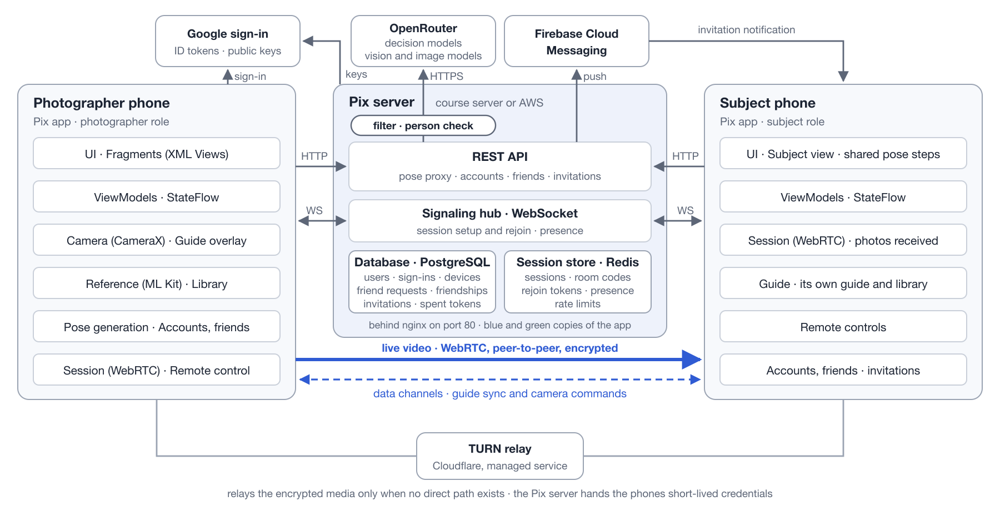

<p align="center">
  <picture>
    <source media="(prefers-color-scheme: dark)" srcset="branding/png/pix-horizontal-on-dark.png">
    
  </picture>
</p>

<p align="center"><strong>Get the portrait you have in mind, together.</strong></p>

<p align="center">
  <a href="https://github.com/snuhcs-course/swpp-2026-project-team-10/wiki/Requirements-and-Specifications">Requirements and Specifications</a> ·
  <a href="https://github.com/snuhcs-course/swpp-2026-project-team-10/wiki/Design-Documentation">Design Documentation</a> ·
  <a href="https://github.com/snuhcs-course/swpp-2026-project-team-10/wiki/Testing-Documentation">Testing Documentation</a> ·
  <a href="https://github.com/snuhcs-course/swpp-2026-project-team-10/wiki">Wiki</a>
</p>

---

Pix is an Android camera app. It helps two people get the portrait that one of them has in mind. When friends take photos of each other, the person in the photo often knows the pose and the framing they want. But only the photographer sees the screen. Pix gives both people the same view. The photographer puts a pose guide on the camera. The subject's phone shows the live camera with the same guide, and the subject can adjust the shot. The photographer takes the photo. Pix saves it at full quality, without the guide.

This branch is the **Iteration 3 build**. Two phones now connect over Wi-Fi or cellular data, with an invitation or a room code. Both phones follow the guide and pose steps together, and both phones keep the photo. AI poses fit the scene's ratio and come with a tip on how to take them. Pix also has selfie mode, a guide library, settings, a tutorial, and Korean.

## Contents

- [Demo videos](#demo-videos)
- [Features implemented](#features-implemented): [Major progress in Iteration 3](#major-progress-in-iteration-3)
- [Known limitations and to-dos](#known-limitations-and-to-dos)
- [How it works](#how-it-works)
- [Technology stack](#technology-stack)
- [Development environment](#development-environment)
- [Run the demo](#run-the-demo): [1. Get the code](#1-get-the-code) · [2. Choose a server](#2-choose-a-server) · [3. Install the app](#3-install-the-app-on-both-phones) · [4. Try the flows](#4-try-the-flows)
- [Tests and checks](#tests-and-checks)
- [Repository](#repository)
- [Documents](#documents)
- [Team](#team)

## Demo videos

Both videos show the photographer's phone (Galaxy S23 Ultra) and the subject's phone (Galaxy S25 Ultra) side by side. The phones run a debug build of Iteration 3 with the AWS server.

**1. Pose guide from a photo**

https://github.com/user-attachments/assets/9a5d3121-1a4c-4954-a7a1-98f3a6575be8

**2. AI pose generation**

https://github.com/user-attachments/assets/bb74c7e2-876a-432c-9f6a-e400385f095b

## Features implemented

This table lists everything the Iteration 3 build can do. The subsection below lists what is new in Iteration 3.

| Feature | What you can do |
|---|---|
| **Camera** | Pix opens on the rear camera. Choose the ratio 3:4, 9:16, or 1:1. Tap to focus, then drag the bar beside the focus box to change the brightness. Pinch to zoom, or tap the zoom readout to step through the zoom levels. Use the flash, the grid, and the level. The camera switch beside the shutter turns on selfie mode. Pix saves each photo at full resolution to the "Pix" album, without the guide. |
| **Guide from a photo** | Pick a photo of a person. A screenshot of a post from Instagram or another app also works: Pix cuts the screenshot to its photo. ML Kit finds the person on the phone, and Pix draws a white outline, never the photo's pixels. The guide starts where the person stands in the photo. A thumbnail of the photo stays in a corner of the preview. The Pix server never receives the photo. |
| **Guide controls and library** | Drag the guide, pinch to resize it, fade it, hide it, replace it, or remove it. The guide-edit toggle sets what a pinch does: it moves the guide or zooms the camera. *Save guide* keeps the guide in *My library*. The library holds up to 100 guides, from photos and from AI poses. |
| **AI pose generation** | Tap *Guide* › *Generate poses here* and take a photo of the scene. Pix checks that the photo shows a person. Describe a pose, or let Pix suggest four poses. The Pix server checks the description with a filter model. Then an image model makes four candidates of the same person in the same place, in the scene's ratio. Swipe through the candidates and pick one. It becomes the guide, and a tip on Camera tells the photographer how to hold the phone. ♥ saves a candidate to *My library*. Descriptions used before show under the text field. |
| **Pix ID and friends** | Sign up with a Pix ID and a password, or continue with Google. Find friends by their exact Pix ID. Send and answer friend requests. A friend request arrives as a push notification. Everything else in Pix works without an account. |
| **Shoot together** | Tap *Shoot together* and choose who takes the photo. The photographer invites a Pix friend or shows a 6-digit code. The friend gets a push notification and accepts the invitation. Without an account, the subject enters the code. The phones connect over Wi-Fi or cellular data. When the phones have no direct path, a TURN relay forwards the encrypted video. After a drop of less than 10 s, the session comes back by itself. |
| **Both phones in a session** | The subject's phone shows the live camera in the photographer's ratio, with the same guide and thumbnail. Either phone can add a guide from a photo. Both phones show the pose description as either person types it. Both phones show the candidates as they arrive. The first phone to pick a candidate decides. The subject can zoom, change the brightness and the flash, and move the guide. Only the photographer takes the photo. Both phones save it. |
| **Settings and help** | The gear on Camera opens *Settings*. It has the base brightness, the guide's color and thickness, and the live-view delay. It also has the language (English or Korean), notifications, the AI agreement, and the Pix account. At first use, a tutorial shows tips over each screen. *Settings* can show the tutorial again. |

The plan for every iteration is in [Requirements and Specifications §4.1](https://github.com/snuhcs-course/swpp-2026-project-team-10/wiki/Requirements-and-Specifications#41-scope-by-iteration).

### Major progress in Iteration 3

These features are new since the Iteration 2 build:

- **Any network.** Sessions work over Wi-Fi and cellular data through a TURN relay ([#134], [#139]). After a short drop, a session comes back by itself ([#149]).
- **Invitations.** A Pix friend gets invitations and friend requests as push notifications. A link works when no notification arrives ([#153], [#154]). Before the phones connect, each person chooses who takes the photo ([#189]).
- **Both phones work together.** Either phone can add a guide, and both phones follow the pose steps ([#145], [#151]). Both phones save each photo ([#159]). The subject's phone shows the reference thumbnail ([#143]).
- **Better AI poses.** The candidates fit the scene's ratio ([#155]), and *Pick a pose* shows them one at a time ([#133]). A tip in English or Korean tells the photographer how to take the pose ([#135], [#157]). A filter refuses harmful descriptions, and a person check refuses scenes without a person ([#166], [#169]). *Generate poses* shows the descriptions used before ([#164]).
- **More ways to get a guide.** Pix adds selfie mode ([#152]), the guide library ([#172]), and ♥ to save an AI pose ([#175]). A screenshot of a post becomes a guide from its photo ([#176], [#178]).
- **Polish.** Pix adds settings ([#163]), a tutorial over each screen ([#167], [#173]), Korean ([#138]), and animations between states and screens ([#184], [#186], [#187]). Camera's controls fit every phone ([#137]), and they follow the heuristic evaluation ([#185]).
- **Servers and tests.** GitHub Actions deploys the AWS server, which answers from every network ([#150]). The AI module test checks the AI features with an LLM judge, which we checked against our own labels ([#190]).

## Known limitations and to-dos

Moved from Iteration 3 to Iteration 4 ([Design Documentation 2.9](https://github.com/snuhcs-course/swpp-2026-project-team-10/wiki/Design-Documentation#29-module-ownership-and-build-order)):

- **Offline connection with a QR code** ([#122]): not built. Both phones must reach the Pix server.
- **Four prompt templates** ([#125]): a description still goes to the image model as itself and three variations.
- **The remote-control switch and remote focus** (FR-7.5, FR-7.7): not built. The photographer cannot block the subject's controls, and the subject cannot focus.
- **Camera quality and the shutter freeze** ([#183]): the camera's quality and speed are not yet close to the phone's own camera. The preview also freezes for a moment when the photographer takes a photo.

Known limitations of the Iteration 3 build ([Testing Documentation 3.2](https://github.com/snuhcs-course/swpp-2026-project-team-10/wiki/Testing-Documentation#32-results)):

- The person check on the phone misses people who are far away or in low light. Pix then refuses the scene photo, so these users get no poses.
- Suggested poses are often too alike for close-up scenes and selfies.
- Some error messages do not say why a request failed. For example, a request over the daily AI limit shows the general error message.
- The course servers answer only on the campus network. So debug builds use a temporary AWS server.

### Next: Iteration 4

- Fixes from the user test and the heuristic evaluation, such as a separate error message for each failure and new app colors
- The user acceptance test (UAT) on 11/16 and 11/18, and its fixes
- Search, situations, and memos in the library (FR-3.11)
- The items above: the QR connection, the prompt templates, the remote-control switch, remote focus, and camera quality

## How it works



- **Pix server** (FastAPI behind nginx on port 80): connects the two phones (signaling) and keeps accounts, friends, and invitations. It sends push notifications through Firebase Cloud Messaging (FCM). It checks each description and scene photo with a decision model. Then it sends the pose requests to the image and vision models through OpenRouter. The API key stays on the server. The server never sees the video.
- **Servers**: Server A on the course servers runs `main` for release builds. Server B runs `dev` for staging. A temporary AWS server runs `dev` for debug builds and answers from any network. Each server deploys a new commit blue-green. The course servers pull it with a timer, and GitHub Actions deploys the AWS server.
- **Phone to phone** (WebRTC): the live video and the photos go directly between the two phones. So do the guide, the shared steps, the candidates, and the subject's controls. Without a direct path, Cloudflare's TURN relay forwards the encrypted packets. Each phone draws the guide itself, so the guide never appears in the video or in saved photos.
- **On the phone**: CameraX runs the camera, and ML Kit makes the outline and the person check. The guide library, the settings, and the sign-in tokens stay on the phone.

The full design is in the [Design Documentation](https://github.com/snuhcs-course/swpp-2026-project-team-10/wiki/Design-Documentation).

## Technology stack

| Part | Stack |
|---|---|
| Android app | Kotlin 2.2, XML Views with ViewBinding, Navigation, ViewModel, and coroutines · CameraX 1.6 · ML Kit Subject Segmentation, Pose Detection, and Face Detection · WebRTC (`io.github.webrtc-sdk:android` 137) · OkHttp 4.12 and Retrofit 2.11 with kotlinx.serialization · Jetpack DataStore · Credential Manager with Google ID · Firebase Cloud Messaging |
| Server | Python 3.11 · FastAPI and Uvicorn (WebSocket signaling and REST API) · SQLAlchemy 2 with asyncpg and Alembic on PostgreSQL 18 · Redis (session store) · PyJWT and argon2 · google-auth (Google sign-in and FCM) · pydantic-settings · httpx2 · Pillow · Docker and nginx with blue-green deploys |
| Services | Cloudflare Realtime (TURN relay) · Firebase Cloud Messaging · OpenRouter · AWS EC2 (the temporary server) |
| AI | Through OpenRouter: GPT Image 2.5 Flare at low quality for the candidates · Gemini 3.1 Flash Lite for the suggestions and the tips · Jev 1.14 (`typesafe/jev-1.14`) for the description filter and the person check. The AI module test uses Claude Opus 5.5 as its judge. |
| Tests and CI | JUnit 4, Robolectric 4.17, and FragmentScenario with JaCoCo · pytest with pytest-cov, fakeredis, and SQLite · Spotless with ktlint · Ruff · GitHub Actions (lint, tests, the server image, the AWS deploy, the wiki) |

## Development environment

| Part | Requirements |
|---|---|
| Android app | Android Studio with its bundled JDK (the unit tests need JDK 21 or later), Kotlin 2.2, and Gradle 9.5 through the wrapper. minSdk 29 (Android 10), target and compile SDK 36. |
| Server | Only for a local server: Python 3.11 or later and [uv](https://docs.astral.sh/uv/getting-started/installation/). Pose generation needs an [OpenRouter](https://openrouter.ai/) API key with credits. Redis and PostgreSQL are optional locally. Without them, the server keeps rooms in the process and accounts in a SQLite file. |
| Tested on | Galaxy S21, S22, S23 Ultra, S25 Ultra, and Note20 |
| Network | Wi-Fi or cellular data on each phone. The AWS server answers from any network. The course servers answer only on the campus network. |

## Run the demo

### 1. Get the code

```sh
git clone https://github.com/snuhcs-course/swpp-2026-project-team-10.git
cd swpp-2026-project-team-10
git checkout iteration-3-demo
```

### 2. Choose a server

**The AWS server (no setup).** A debug build uses the temporary AWS server, `http://3.105.185.251/`, by default. It runs `dev` and answers from any network, cellular data included. To check it, open `http://3.105.185.251/health` in a phone's browser. It answers `{"status":"ok"}`.

**Server A (campus network only).** A release build uses Server A, `http://swpp26t10.147-46-242-169.sslip.io/`. It runs `main`. To use it in a debug build, create `android/local.properties` with this line:

```properties
pix.serverUrl=http://swpp26t10.147-46-242-169.sslip.io/
```

**A server on the laptop.** Run these commands from the repository root:

```sh
cd server
uv sync --locked
cp .env.example .env
```

Put the keys you need in `server/.env`. The server runs without them, but some features stop:

| Key | Without it |
|---|---|
| `OPENROUTER_API_KEY` | No pose generation |
| `PIX_TURN_KEY_ID`, `PIX_TURN_API_TOKEN` | No TURN relay, so sessions across networks often fail |
| `PIX_FCM_CREDENTIALS_FILE` | No push notifications. The invite link still works. |
| `PIX_GOOGLE_CLIENT_ID` | No Google sign-in. Sign-up with a Pix ID and a password still works. |

Then start one worker:

```sh
uv run uvicorn pix_server.main:app --host 0.0.0.0 --port 8000 --workers 1 --ws-max-size 65536
```

The server keeps rooms in the process and accounts in `server/pix.db`. Find the laptop's Wi-Fi address (on macOS, `ipconfig getifaddr en0`). Check `http://<laptop-IP>:8000/health` from a phone. Then put `pix.serverUrl=http://<laptop-IP>:8000/` in `android/local.properties`. For an emulator, use `pix.serverUrl=http://10.0.2.2:8000/`. The [server README](server/README.md) has more detail.

### 3. Install the app on both phones

Connect a phone with USB debugging on. Then run this command from `android/`:

```sh
./gradlew :app:installDebug
```

Do the same for the second phone. Google sign-in on a debug build needs the phone's debug key in the team's Google Cloud project. Run `./gradlew :app:signingReport`, and a project owner adds the `SHA1` of `Variant: debug` as an Android OAuth client. Sign-up with a Pix ID and a password needs no setup.

### 4. Try the flows

Pix follows the phone's language, English or Korean. The steps below use the English labels.

1. **Camera.** Pix opens on the camera. At first use, the tutorial shows tips over the screen. Tap *Got it*. Tap the ratio button and choose 3:4, 9:16, or 1:1. Tap the preview to focus, then drag the bar beside the focus box. Pinch to zoom, or tap the zoom readout. Tap the camera switch beside the shutter for selfie mode. Take a photo. "Saved without the guide" appears.
2. **Guide from a photo.** Tap *Guide* › *Add photo* and pick a photo of a person, or a screenshot of a post. Tap *Use this guide*. The outline starts where the person stands in the photo. With the guide-edit toggle on, drag and pinch the guide. The bar under the preview fades, hides, saves, or removes the guide. A saved guide shows in *My library*. At first use, Google Play services downloads the segmentation model. This can take a minute.
3. **AI poses.** Tap *Guide* › *Generate poses here*. Accept the notice. Take a photo of the scene with a person in it, and tap *Use this photo*. Type a pose and tap *Generate 4 poses from this*. Or leave the field empty and tap *Suggest 4 poses*. The candidates appear as they are ready, usually within 30 s. Swipe through them, tap *Use this pose*, and then *Use this guide*. A tip on how to take the pose shows on Camera. The bulb button shows it again. Each set costs up to four images on OpenRouter.
4. **Pix ID and friends** (two phones). Tap *Shoot together* › *I'll take the photo* › *Sign in to add friends*. Sign up with a Pix ID and a password (*New to Pix? Sign up*), or continue with Google. Do the same on the other phone. Tap *Add a friend* and search for the other Pix ID. The other phone gets a push notification and accepts the request.
5. **Shoot together with an invitation.** On the photographer's phone, tap *Shoot together* › *I'll take the photo*, then *Invite* next to the friend. The subject's phone gets a notification. Tap it, then tap *Accept*. The invitation also waits for a minute under *Shoot together* › *I'll be in the photo* › *Received invitations*. The subject's phone shows the live camera with the same guide. Try it with one phone on cellular data.
6. **Shoot together with a code** (no sign-in). On the photographer's phone, tap *Shoot together* › *I'll take the photo* › *Show a code*. On the subject's phone, tap *Shoot together* › *I'll be in the photo*. Enter the code and tap *Connect*.
7. **In a session.** On the subject's phone, pinch to zoom, change the brightness and the flash, and move the guide with the guide-edit toggle on. The photographer's phone follows. Add a guide or generate poses: the other phone shows each step. The photographer takes the photo, and both phones save it. Turn off Wi-Fi on one phone for a few seconds. The session comes back by itself. *Leave* or *End session* ends the session.

With one phone, `server/tools/fake_photographer.py` or `server/tools/fake_subject.py` can be the other phone against a local server. See the [server README](server/README.md#testing-the-photographers-phone-without-a-second-phone).

## Tests and checks

GitHub Actions runs these checks on every pull request. Run them locally before you push.

| Part | From | Command |
|---|---|---|
| Android | `android/` | `./gradlew spotlessCheck :app:lintDebug :app:testDebugUnitTest :app:assembleDebug` |
| Android, with coverage | `android/` | `./gradlew :app:jacocoTestReport` → `app/build/reports/jacoco/jacocoTestReport/html/index.html` |
| Server | `server/` | `uv run ruff check . && uv run ruff format --check . && uv run pytest` |
| Server, with coverage | `server/` | `uv run pytest --cov=pix_server --cov-branch --cov-report=html` → `htmlcov/index.html` |

At the close of Iteration 3, all 1,711 app tests and 791 server tests pass. App line coverage is 86.9 % (managers 94.4 %, ViewModels 97.7 %, Views 93.7 %, platform adapters 50.4 %). Server line coverage is 98.3 %. The AI module test measures the candidates, the suggestions, the tips, the description filter, and the person check against fixed thresholds. The targets, the integration scripts, and all results are in the [Testing Documentation](https://github.com/snuhcs-course/swpp-2026-project-team-10/wiki/Testing-Documentation). The [Android README](android/README.md) and the [server README](server/README.md) have more detail.

## Repository

| Folder | Contents |
|---|---|
| `android/` | The Android app (open this folder in Android Studio) |
| `server/` | The Pix server, its tests, the AI module test, the deploy files, and tools for tests with one phone |
| `wiki/` | The source of the GitHub wiki. A push to `dev` publishes it. `wiki/design/` holds the sources of the figures and the wireframes. |
| `branding/` | The logo: SVG masters, PNG exports, and the usage guide |
| `.github/` | CI workflows and the pull request template |

Branches: `main` holds the stable version, and `dev` is the integration branch. Each task gets a branch from `dev`. The branch returns to `dev` through a reviewed, squash-merged pull request. `iteration-N-demo` holds the code of that iteration's demo. At the end of each iteration, the team merges `dev` into `main`.

## Documents

- [Requirements and Specifications](https://github.com/snuhcs-course/swpp-2026-project-team-10/wiki/Requirements-and-Specifications)
- [Design Documentation](https://github.com/snuhcs-course/swpp-2026-project-team-10/wiki/Design-Documentation)
- [Testing Documentation](https://github.com/snuhcs-course/swpp-2026-project-team-10/wiki/Testing-Documentation)
- [AI Collaboration Report – Iteration 3](https://github.com/snuhcs-course/swpp-2026-project-team-10/wiki/AI-Collaboration-Report-%E2%80%93-Iteration-3)
- [Team Meetings](https://github.com/snuhcs-course/swpp-2026-project-team-10/wiki/Team-Meetings) and [Daily Standup Meeting Log](https://github.com/snuhcs-course/swpp-2026-project-team-10/wiki/Daily-Standup-Meeting-Log)

## Team

SWPP 2026 Team 10:

- 박동제: PM in Iteration 1. Camera, reference guide, guide controls, pose tips, selfie mode, and the prompt history.
- 박재완: PM in Iteration 3. Server, deployment, accounts and friends, pose generation, the AI checks and the AI module test, and the documents.
- 조성민: PM in Iterations 4 and 5. Real-time session, sessions across networks, reconnection, invitations, remote controls, settings, the guide library, and the animations.
- 한준형: PM in Iteration 2. Guide transfer, shared steps, photos on both phones, the tutorial, and Camera's controls after the heuristic evaluation.

[#122]: https://github.com/snuhcs-course/swpp-2026-project-team-10/issues/122
[#125]: https://github.com/snuhcs-course/swpp-2026-project-team-10/issues/125
[#133]: https://github.com/snuhcs-course/swpp-2026-project-team-10/pull/133
[#134]: https://github.com/snuhcs-course/swpp-2026-project-team-10/pull/134
[#135]: https://github.com/snuhcs-course/swpp-2026-project-team-10/pull/135
[#137]: https://github.com/snuhcs-course/swpp-2026-project-team-10/pull/137
[#138]: https://github.com/snuhcs-course/swpp-2026-project-team-10/pull/138
[#139]: https://github.com/snuhcs-course/swpp-2026-project-team-10/pull/139
[#143]: https://github.com/snuhcs-course/swpp-2026-project-team-10/pull/143
[#145]: https://github.com/snuhcs-course/swpp-2026-project-team-10/pull/145
[#149]: https://github.com/snuhcs-course/swpp-2026-project-team-10/pull/149
[#150]: https://github.com/snuhcs-course/swpp-2026-project-team-10/pull/150
[#151]: https://github.com/snuhcs-course/swpp-2026-project-team-10/pull/151
[#152]: https://github.com/snuhcs-course/swpp-2026-project-team-10/pull/152
[#153]: https://github.com/snuhcs-course/swpp-2026-project-team-10/pull/153
[#154]: https://github.com/snuhcs-course/swpp-2026-project-team-10/pull/154
[#155]: https://github.com/snuhcs-course/swpp-2026-project-team-10/pull/155
[#157]: https://github.com/snuhcs-course/swpp-2026-project-team-10/pull/157
[#159]: https://github.com/snuhcs-course/swpp-2026-project-team-10/pull/159
[#163]: https://github.com/snuhcs-course/swpp-2026-project-team-10/pull/163
[#164]: https://github.com/snuhcs-course/swpp-2026-project-team-10/pull/164
[#166]: https://github.com/snuhcs-course/swpp-2026-project-team-10/pull/166
[#167]: https://github.com/snuhcs-course/swpp-2026-project-team-10/pull/167
[#169]: https://github.com/snuhcs-course/swpp-2026-project-team-10/pull/169
[#172]: https://github.com/snuhcs-course/swpp-2026-project-team-10/pull/172
[#173]: https://github.com/snuhcs-course/swpp-2026-project-team-10/pull/173
[#175]: https://github.com/snuhcs-course/swpp-2026-project-team-10/pull/175
[#176]: https://github.com/snuhcs-course/swpp-2026-project-team-10/pull/176
[#178]: https://github.com/snuhcs-course/swpp-2026-project-team-10/pull/178
[#183]: https://github.com/snuhcs-course/swpp-2026-project-team-10/issues/183
[#184]: https://github.com/snuhcs-course/swpp-2026-project-team-10/pull/184
[#185]: https://github.com/snuhcs-course/swpp-2026-project-team-10/pull/185
[#186]: https://github.com/snuhcs-course/swpp-2026-project-team-10/pull/186
[#187]: https://github.com/snuhcs-course/swpp-2026-project-team-10/pull/187
[#189]: https://github.com/snuhcs-course/swpp-2026-project-team-10/pull/189
[#190]: https://github.com/snuhcs-course/swpp-2026-project-team-10/pull/190
