<details>
<summary><b>Document Revision History</b></summary>

| Version | Date | Key changes |
|---|---|---|
| 0.1 | 2026-09-30 | Initial draft of every section, with the Iteration 1 build order and the shared contracts in `android/`. |
| 0.2 | 2026-09-30 | Iteration 1 design: JSON examples for every message and endpoint, the same-Wi-Fi setup, remote zoom, and the module split; the plan for Iterations 2–5 (1.4, 2.5, 2.9, Figures 1, 3). |
| 0.3 | 2026-10-04 | Pose generation as built: OpenRouter's Image API, scene validation, a 1 MiB request limit, a 30 s timeout, and a per-address rate limit (2.5.3, 2.6.3, 2.8). |
| 0.4 | 2026-10-05 | Remote zoom as built: the subject pinches the live view, and every applied zoom is echoed in `camera.state` (2.5.1, 2.6.5). |
| 0.5 | 2026-10-06 | Zoom sliders on Camera and Subject view replace pinch zoom; the remote zoom protocol is unchanged (2.6.2, 2.6.5). |
| 0.6 | 2026-10-06 | The scene photo is taken with Camera's shutter and confirmed before it is sent; one 30 s limit covers a generation run (2.6.3). |
| 0.7 | 2026-10-07 | Measurement as built: the `ping.received` and `rtt` lines give the clock offset for latencies across phones (2.5.1, 2.8). |
| 0.8 | 2026-10-09 | Final Iteration 1 version, synced with the build: the WebRTC library, the subject leaving, the zoom notice, grid, horizon bar, ultrawide zoom, and owners (1.2, 2.4, 2.6.2, 2.6.5, 2.9). |
| 1.0 | 2026-10-13 | First Iteration 2 version, from the 10/09 kickoff: public host, push invitations, TURN, camera controls, outline-only and saved guides, accounts, friends, and reconnection (AD-6, AD-10–AD-17, 2.1–2.7, 2.9; Iter2-P3, [#45]). |
| 1.1 | 2026-10-13 | Hosting decided: the course servers over HTTP and WS, Cloudflare's managed TURN, a Redis session store, and blue-green deploys (AD-11, AD-14, AD-18, 2.8, Figure 4; Iter2-P4, [#46]). |
| 1.2 | 2026-10-14 | Smooth outlines as built: the mask is blurred, cleaned, and traced as a 3 dp white line; limb lines and ML Kit Pose Detection dropped (1.2, 2.6.1; Iter2-P7, [#49]). |
| 1.3 | 2026-10-14 | Session store built: rooms, codes, and the rate limit in Redis, two workers per copy, fakeredis in tests, and `503 UNAVAILABLE` (2.5.3, 2.7, 2.8; Iter2-A2, [#73]). |
| 1.4 | 2026-10-14 | Guide-edit mode and pinch zoom as built: when the mode turns on and off, and that it takes every touch on the image (2.6.2; Iter2-P6, [#48]). |
| 1.5 | 2026-10-15 | Accounts and friends server built: Pix ID sign-up next to Google, account and friend endpoints, PostgreSQL, access and refresh tokens, and privacy limits (AD-12, 2.5.3, 2.7, 2.8; Iter2-P8, [#50]). |
| 1.6 | 2026-10-15 | Camera controls as built: flash, ratio, brightness, and tap to focus; each ratio is a center crop, and Subject view follows ratio changes (AD-10, 2.5.1, 2.6.2, 2.6.4; Iter2-P10, [#51]). |
| 1.7 | 2026-10-16 | Guide controls as built: outline only, *Hide* / *Show*, replacing through *Guide*, a start from the reference's `anchor`, and the movable thumbnail (2.3, 2.6.1, 2.6.2, 2.9; Iter2-P11, [#52]). |
| 1.8 | 2026-10-16 | Remote brightness, flash, and guide moves as built: the subject's requests, `guide.state` with `by`, the notices, and protocol version 2 (2.5.1, 2.6.5; Iter2-P17, [#57]). |
| 1.9 | 2026-10-18 | Subject view's video fitted to the frame, so the guide covers the same part of the scene on both phones (2.6.4; Iter2-A4, [#86]). |
| 1.10 | 2026-10-21 | Pose descriptions and suggested poses: one prompt per candidate, `POST /pose-suggestions`, *Generate poses*, `prompts.toml`, and a 60 s limit (2.5.3, 2.6.3, 2.8; Iter2-P12, [#53]). |
| 1.11 | 2026-10-21 | Sign-in, Pix ID, and Friends screens as built: *Shoot together* opens *Friends*, the *Account* sheet, stored tokens, presence, and a 10 s refresh (2.1, 2.3, 2.5.2, 2.5.3, 2.8; Iter2-P13, [#54]). |
| 1.12 | 2026-10-22 | *Check* and *Sent requests*: `POST /auth/check-pix-id`, the sent-requests list, and the room code sheet over *Camera* (2.1, 2.3, 2.5.3; Iter2-P13, [#54]). |
| 1.13 | 2026-10-22 | Zoom without stutter as built: the newest zoom once per frame, the lens held during a pinch, and the last frame kept during a rebind (2.6.2, 2.6.5, 2.8; Iter2-P5, [#47]). |
| 1.14 | 2026-10-23 | Saved guides as built: the store's files and its size limit (2.8; Iter2-P18, [#58]). |
| 1.15 | 2026-10-23 | Synced with `dev` after [#96]: every section describes the build, Figure 4 redrawn, and invitations and Could items moved to Iteration 3 (1.1–2.10). |
| 1.16 | 2026-10-23 | Iteration 2 integration: when Subject view shows "Connecting…" and when "camera paused" (2.8; Iter2-P22, [#60], [#99]). |
| 1.17 | 2026-10-23 | The *Decided* paragraphs at the top removed; each decision is in its own section. |
| 2.0 | 2026-10-26 | Iteration 3 plan from the kickoff; current design only (1.4.2, 2.9). |
| 2.1 | 2026-10-26 | *Pick a pose* shows one candidate at a time, as built (2.6.3; Iter3-P10, [#114], [#108]). |
| 2.2 | 2026-10-26 | TURN credentials from the server: each phone gets its own from Cloudflare, with Cloudflare's STUN server as the fallback, and the TURN settings (2.2, 2.5.2, 2.6.7, 2.8; Iter3-P13, [#117]). |
| 2.3 | 2026-10-26 | Pose tips as built: `POST /pose-tips` and the tip on Camera (1.1.2, 2.1, 2.5.3, 2.6.3, 2.7; Iter3-P11, [#115], [#110]). |
| 2.4 | 2026-10-26 | Camera and Subject view layout: the preview below the top bar, a fixed shutter, zoom over the image, a live dot, and 48 dp targets (2.3, 2.5.1, 2.6.2, NFR-16; Iter3-A2, [#136]). |
| 2.5 | 2026-10-26 | Sessions across networks in the app: the mobile-data notice, a relay-only debug option, the wrong-code message, and the AWS server for debug builds (1.4.2, 2.1, 2.3, 2.5.2, 2.6.7, 2.8; Iter3-P13, [#117]). |
| 2.6 | 2026-10-27 | The Korean translation as built: strings picked by the phone's language, the per-app language on Android 13+, and Pretendard (2.8; Iter3-P7, [#111]). |
| 2.7 | 2026-10-27 | The reference thumbnail on Subject view: a copy of the reference photo, at most 512 px, goes once per guide to the subject (AD-6, AD-15, 2.1, 2.3, 2.5.1, 2.6.2; Iter3-A1, [#132]). |
| 2.8 | 2026-10-28 | One account on several phones: each phone reads its account with `GET /me` every 10 s, so changes from another phone show (2.1, 2.5.3, 2.8). |
| 2.9 | 2026-10-28 | The mask-only guide transfer in either direction, protocol version 3, and a guide made on the subject's phone adopted by the photographer (AD-6, AD-7, 2.1, 2.3, 2.5.1, 2.6.1, 2.6.2, 2.6.5, 2.8; Iter3-P9, [#113]). |
| 2.10 | 2026-10-28 | Reconnection after a short drop: the reconnecting state, rejoin tokens, `peer.rejoined`, an ICE restart, drop detection, and timeouts, with fixes from the first two-phone run (2.1, 2.3, 2.4, 2.5.2, 2.6.7, 2.7, 2.8, Figures 3c, 9; Iter3-P14, [#118]). |
| 2.11 | 2026-10-29 | The AWS server deployed from GitHub through AWS Systems Manager (2.8, 2.10). |
| 2.12 | 2026-10-29 | Invitations and push on the server: an invitation opens its session when sent, both phones join with `session.join`, FCM pushes, and the invite link (1.1.2, 1.1.3, 1.2, 2.5.2, 2.5.3, 2.6.6, 2.7, 2.8, Figure 3b; Iter3-P15, [#119]). |
| 2.13 | 2026-10-29 | *Pick a pose* on both phones, where the first *Use this pose* to reach the photographer decides, and *Save guide* on Subject view (AD-7, 2.1, 2.3, 2.5.1, 2.6.5; Iter3-P16, [#120]). |
| 2.14 | 2026-10-29 | *Reference confirm* on both phones: the subject sees *Your reference*, and the first *Use this guide* to reach the photographer decides (AD-7, 2.1, 2.5.1, 2.6.5, 2.6.7; Iter3-P16, [#120]). |
| 2.15 | 2026-10-29 | *Generate poses* on both phones: the subject gets a copy of the scene photo, one phone types at a time, and either phone starts the set (AD-7, 2.1, 2.5.1, 2.6.5, 2.6.7; Iter3-P16, [#120]). |
| 2.16 | 2026-10-29 | Fixes after Codex's review of PR #151: copies too large for the subject are made again smaller or left out, and stale step ends are ignored (2.5.1, 2.6.5). |
| 2.17 | 2026-10-30 | Fixes after Codex's second review of PR #151: no *Pick a pose* without copies, and shared steps wait until *Add a pose guide* closes (2.6.5). |
| 2.18 | 2026-10-30 | Selfie mode as built: the front camera, mirrored in photos and streamed video, selfie prompts, and no pose tip for a selfie (1.4.2, 2.1, 2.5.3, 2.6.3, 2.6.4; Iter3-P12, [#116]). |
| 2.19 | 2026-10-30 | Invitations in the app: push tokens, invitation states and end reasons, a 60 s lifetime, push notifications, and fixes after the reviews (1.1.2, 2.1, 2.3, 2.4, 2.5.2, 2.5.3, 2.6.6, 2.6.7, 2.8, Figures 3b, 5, 8b; Iter3-P15, [#119]). |
| 2.20 | 2026-10-30 | Candidates in the scene photo's ratio: the server asks for 3:4, 9:16, or 1:1, and the screens show each photo whole (2.5.3, 2.6.3; Iter3-P8, [#112]). |
| 2.21 | 2026-10-30 | Pose tips in Korean: the app sends its screens' language, and the server writes a Korean tip with a check for numbers and units (2.5.3, 2.6.3, 2.8; Iter3-A4, [#156]). |
| 2.22 | 2026-10-30 | A light for the scene photo: the light stays on while the scene is framed, and a shot waits until the light is as chosen (2.1, 2.6.3; Iter3-A5, [#158]). |
| 2.23 | 2026-10-31 | Session photos on both phones: photos go in chunks behind other reliable messages, paced by `photo.ack`, and resume after a short drop (2.1, 2.5.1, 2.6.5, 2.6.7, 2.8; Iter3-P17, [#121]). |
| 2.24 | 2026-10-31 | Fixes after Codex's review of PR #159: session photo notices wait until shown, one at a time, and keep an ended session's name (2.6.5). |
| 2.25 | 2026-11-02 | Fixes after Codex's second review of PR #159: a photo belongs to the session at its shutter, and the subject handles photo messages in their own coroutine (2.6.5). |
| 2.26 | 2026-11-02 | The settings screen: the gear on Camera, stored settings and language, the guide's color and thickness, the latency indicator, and withdrawing the AI agreement (1.4.2, 2.1, 2.6.8, 2.8, 2.9; Iter3-P23, [#123]). |
| 2.27 | 2026-11-02 | Fixes after Codex's review of PR #163: the AI agreement row, the screens' language on Android 10–12, and a light backing behind a black outline (2.6.8, 2.8). |
| 2.28 | 2026-11-03 | The description filter: a moderation model judges every description and pose, refuses with `422 REJECTED`, and every prompt says user text is never an instruction (1.1.1–1.1.3, 2.5.3, 2.6.3, 2.8, Figure 1; Iter3-A7, [#165]). |
| 2.29 | 2026-11-03 | The first-use tutorial: slides drawn in `wiki/design/tutorial/` in both languages, opened by Camera and from Settings (2.1, 2.6.8; Iter3-P23, [#123]). |
| 2.30 | 2026-11-03 | Prompt history on *Generate poses*: past descriptions kept on the phone, recorded on both phones with the invitation's friend; the idea chips removed (2.1, 2.2, 2.5.1, 2.6.3, 2.6.5; Iter3-P24, [#124]). |
| 2.31 | 2026-11-03 | Fixes after Codex's review of PR #164: an empty start text for suggested poses, history reads retried, no history in backups, and long names cut (2.5.1, 2.6.3). |
| 2.32 | 2026-11-03 | Fix after Codex's second review of PR #164: the reconnecting state keeps the invitation's friend for the prompt history (2.1, 2.6.3). |
| 2.33 | 2026-11-03 | Fewer words on the screens: hints the tutorial covers removed, Camera's hint chip narrowed, and one "… sees this too" on shared screens (2.6.5, 2.6.8; Iter3-P23, [#123]). |
| 2.34 | 2026-11-03 | The person check: ML Kit on the phone before *Use this photo*, and the server before the image model, with `422 NO_PERSON` (1.1.1–1.1.3, 1.2, 2.1, 2.3, 2.5.3, 2.6.3, 2.8, Figures 1, 8; Iter3-A7, [#165]). |
| 2.35 | 2026-11-03 | The tutorial on each screen: tips around the live screen's own controls on first open, the slides removed, and a reset (2.1, 2.6.8; Iter3-P23, [#123]). |
| 2.36 | 2026-11-04 | Fixes after Codex's review of PR #173: due tips wait under other screens, guide tips need a visible guide, and Subject view's tips wait for pose steps (2.6.8). |
| 2.37 | 2026-11-04 | The guide library: *My library* on *Add a pose guide*, a library screen with filters, 100 saved guides, and its tutorial tips (AD-16, 1.4.2, 2.1, 2.3, 2.6.2, 2.6.8, 2.8, 2.9; Iter3-A8, [#170]). |
| 2.38 | 2026-11-04 | A generated pose saved with ♥ on both phones' *Pick a pose*, and *Use this pose* goes on with the saved guide (1.4.2, 2.6.3, 2.9, Figure 6; Iter3-A9, [#171]). |
| 2.39 | 2026-11-04 | Fix after Codex's review of PR #175: a save reports whether it deleted the oldest guide, decided under the store's lock (2.1, 2.3, 2.6.2, 2.6.3, 2.8). |
| 2.40 | 2026-11-04 | A screenshot cut to its photo: finding the photo, tuned on 20 screenshots, and the cut on *Reference confirm* (2.1, 2.3, 2.6.1; Iter3-A10, [#174]). |
| 2.41 | 2026-11-04 | Screenshots from other apps: scrollbars, one-color margins, the photo's size and shape, and shared post cards, checked on 48 screenshots (2.6.1; Iter3-A11, [#177]). |
| 2.42 | 2026-11-05 | Changes on screen: the held frame moves and fades on a ratio change, shutter effects, `photo.shutter`, and a ratio row under the top bar (2.2, 2.5.1, 2.6.2, 2.6.4, 2.6.7; Iter3-A12, [#179]). |
| 2.43 | 2026-11-05 | Transitions between screens: a fade to and from Camera and Subject view, a shared-axis slide elsewhere, and fading tutorial tips (2.1, 2.6.8; Iter3-A14, [#181]). |
| 2.44 | 2026-11-05 | The guide and pose flow: one *Generate poses* button, *Generating poses* on the subject's phone too, and fades for guides, outlines, and candidates (2.2, 2.5.1, 2.6.1–2.6.3, 2.6.5; Iter3-A13, [#180]). |
| 2.45 | 2026-11-05 | Who takes the photo, before connecting: *Shoot together* asks first, received invitations are listed, and sign-in returns to the screen that opened it (2.1, 2.5.3, 2.6.6, 2.6.8, 2.8, Figure 8b; Iter3-A17, [#188]). |
| 2.46 | 2026-11-05 | Camera's controls after the heuristic evaluation: control labels, a drag brightness bar, the horizon bar, thinner lines, and *Save guide* as a toggle (2.5.1, 2.6.1–2.6.3, 2.6.5, 2.6.8, 2.8; Iter3-A15, [#182]). |
| 2.47 | 2026-11-06 | Rewritten in concise, simple technical English and checked against the code. QR, the prompt templates, FR-7.5, FR-7.7, and camera quality with the shutter freeze (#183) moved to Iteration 4; the zoom stutter settled and Korean poses dropped (*Still open*). Figure 1 redrawn; pushes only to signed-in phones. Section 1.4 removed: the task status is in 2.9, the later scope in R&S 4.1, and the QR plan in *Still open*. The AWS server stays on beside the course servers, for other networks (all sections). |
| 3.0 | 2026-11-07 | Iteration 4 plan from the kickoff of 11/7: the task table with owners and due dates (2.9); the open decisions (*Still open*: the light mode's colors, Back on the pose screens, the situation prompts, whether four templates are needed); the Iteration 3 table closed. The remote-control switch and remote focus move to Iteration 5 (2.5.1, 2.6.5, 2.9). |
| 3.1 | 2026-11-09 | Color tokens and a DayNight theme (Iter4-P5, [#202]): the tokens in two sets, page and on the image, and `Theme.Pix` on DayNight but dark until light mode (2.8). |
| 3.2 | 2026-11-10 | A refused description is kept on neither phone: the description's own request decides, a refusal deletes the entry, `pose.candidate.failed` says `descriptionRejected`, and the subject reads `PoseSyncer.verdicts`; the owner of this task and of Iter4-P6 (2.2, 2.5.1, 2.6.3, 2.9; Iter4-P3, [#200]). |
| 3.3 | 2026-11-10 | Back on the pose screens (Iter4-P2, [#199]): each screen's Back goes one step back, *Regenerate* on *Pick a pose*, the step's action at the top right, Back on *Generating poses* and *Pick a pose* asking first, as it loses the images, and *Reference confirm* without *Choose another photo*; the decision leaves *Still open* (2.4, 2.5.1, 2.5.3, 2.6.3, 2.6.5). |
| 3.4 | 2026-11-11 | Why poses failed (Iter4-P6, [#203]): `422 DECLINED` and `429 DAILY_LIMITED` on the server, `GenerationError` and `GenerationFailedException`, the case each failed set names and when it offers *Try again*, and `pose.step`'s `failure` for the subject's phone (2.1, 2.2, 2.5.1, 2.5.3, 2.6.3, 2.6.5, 2.8). |
| 3.5 | 2026-11-11 | The subject's video as a mirror with the rear camera too: `camera.state` names the camera in use, and the subject flips the video, the grid, the guide, and the reference photo (2.3, 2.5.1, 2.6.4; Iter4-P4, [#201]). |
| 3.6 | 2026-11-12 | Settings in a session: the gear on Camera and Subject view, and Settings going back to Subject view when the session ends; a tutorial tip for the guide's ✕, and *Got it* placed before the captions (2.6.8; Iter4-P7, [#204]). |
| 3.7 | 2026-11-13 | The tutorial closes with a tap anywhere, with its line at the bottom's middle; *Got it* is gone, and *Guide*'s ring is around its icon (2.6.8; [#204]). |

</details>

Audience: the development team. This page describes Pix's design as built through Iteration 3, and the plan for later iterations (2.9; R&S 4.1). The PR that builds a feature updates its design here. **TBD** and **TODO** mark open decisions. *Still open* below lists each with an owner, who updates this page in the PR that settles it. Requirement IDs (FR-, NFR-, US-) refer to the [Requirements and Specifications](Requirements-and-Specifications). Testing is described in the [Testing Documentation](Testing-Documentation).

**Still open**

| Decision | Current proposal | Owner | Decide by |
|----|----|----|----|
| Four prompt templates (FR-4.8) | With a description, four templates around one `{pose}` replace the three variations. The default template reads `{pose}` as the user's request, keeps the face and the clothes, and makes one pose per photo (2.6.3). Open: the templates, and requests such as "two photos saluting and two with hands up" (Iter3-P25, [#125]; now [#211]). Open also, from the kickoff of 11/7: whether four templates are needed at all, the belongings kept, and the framing. | 박재완 | Iteration 4 |
| Offline QR connection (F9) | The photographer's phone opens a local-only hotspot and runs the signaling, so no server or shared Wi-Fi is needed. The QR code carries the hotspot's details. One connection per code; the session starts once both tap *Resume*. Another entry point (AD-8). Open: the QR payload, the local signaling, and the hotspot API's limits (Iter3-P22, [#122]; now [#214]). | 조성민 | Iteration 4 |
| The light mode's colors (FR-10.1) | Light mode follows the phone's setting, with dark kept, on color tokens sorted into *page* and *on the image* ([#202]). Open: the palette, the current black and yellow or a lighter one; the comparison boards are on the team's design canvas ([#212]). | 박동제 | Iteration 4 |
| Situation prompts (FR-4.8) | A prompt per situation (background, person, landmark, ID photo, default, selfie) behind a `situation` field, compared with the current prompt on the evaluation scenes before the choice is built ([#209], [#210]). Open: which situations keep their own prompt. | 박재완 | Iteration 4 |

**Contents**

- [1. System Design](#1-system-design)
  - [1.1 System Architecture](#11-system-architecture)
  - [1.2 External libraries and services](#12-external-libraries-and-services)
  - [1.3 Architectural decisions](#13-architectural-decisions)
- [2. Design Details](#2-design-details)
  - [2.1 Android app structure](#21-android-app-structure)
  - [2.2 Class diagrams](#22-class-diagrams)
  - [2.3 Data models](#23-data-models)
  - [2.4 State machines](#24-state-machines)
  - [2.5 Protocols and APIs](#25-protocols-and-apis)
  - [2.6 Algorithms and AI components](#26-algorithms-and-ai-components)
  - [2.7 Database](#27-database)
  - [2.8 Implementation decisions](#28-implementation-decisions)
  - [2.9 Module ownership and build order](#29-module-ownership-and-build-order)
  - [2.10 Repository and branches](#210-repository-and-branches)
- [3. Design Patterns (Iteration 5)](#3-design-patterns-iteration-5)

## 1. System Design

### 1.1 System Architecture

#### 1.1.1 High-level architecture

Pix is one Android app in two roles, **photographer** and **subject**, plus a small **Pix server**. A control plane and a media plane are kept apart:

- **Control plane (client-server).** The server connects the phones (signaling), keeps accounts, friends, and invitations, and sends push notifications. It forwards pose requests to external models once a decision model has checked the text and the scene photo (2.6.3). It runs behind nginx on the course servers, over HTTP and WS on port 80, and on an AWS server (AD-11, 2.8).
- **Media plane (peer-to-peer).** The live video and all messages between the phones go directly over WebRTC. Without a direct path, as often on cellular data, a managed TURN relay forwards the still-encrypted packets (AD-14).

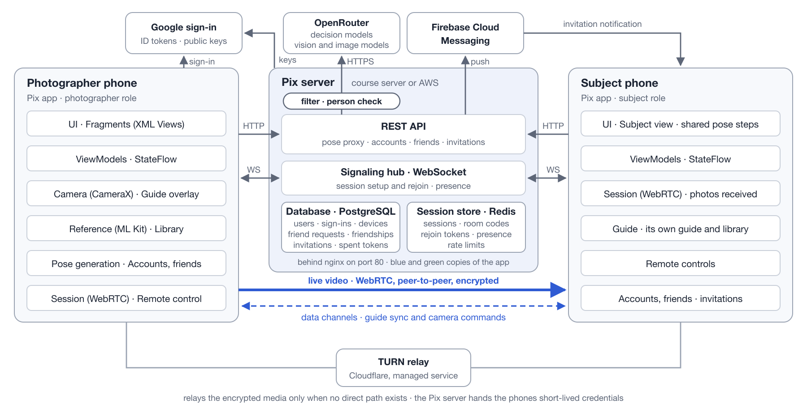

*Figure 1. High-level architecture. The phones talk to each other over WebRTC and to the Pix server over HTTP and WS on port 80. Through OpenRouter, a decision model checks each text and scene photo before the vision and image models see it. Saved guides stay on the phone. Push notifications and the relay, drawn dashed, are built (Iter3-P13, Iter3-P15). The relay is Cloudflare's service, not a process on the Pix server (AD-11, AD-14, AD-18).*

#### 1.1.2 Components and interfaces

| Component | Responsibility | Interfaces |
|----|----|----|
| **Pix app, photographer role** (Android) | Owns the camera. Makes and saves guides, takes photos, requests poses, and streams video. Applies the subject's requests. Signs in, keeps friends, and invites them. | CameraX; ML Kit; WebRTC; REST; signaling; MediaStore; app files; DataStore; Credential Manager; FCM |
| **Pix app, subject role** (Android) | Shows the live video under its own copy of the guide. Requests camera changes, guide moves, guides, and pose steps (AD-7). Saves the session's photos and guides. Gets invitations by push, link, or *See their camera*. | WebRTC; REST; signaling; ML Kit; MediaStore; app files; FCM |
| **Signaling hub** (Pix server) | Creates room-code sessions; relays SDP and ICE, never media; gives each phone its `iceServers` and a rejoin token. A socket with an access token marks its user online (FR-5.9). Counts wrong room codes per address. | WebSocket, JSON (2.5.2); session store |
| **Pose proxy** (Pix server) | Holds the API key and validates the scene photo. Refuses harmful or manipulative text and scenes without a person. Gets four poses or three variations, a candidate per pose, and a tip for the chosen one. Applies timeouts (60 s per image) and rate limits, and cancels the upstream call when the phone drops. | REST `POST /api/v1/pose-suggestions`, `/poses`, `/pose-tips`; `GET /api/v1/pose-templates` for apps before Iteration 2 (2.5.3) |
| **Account and friends API** (Pix server) | Sign-up and sign-in with a Pix ID and a password or with Google; tokens; exact-match lookup; friend requests, friendships, presence; push device tokens. | REST `/auth`, `/me`, `/users`, `/friend-requests`, `/friends`, `/devices` (2.5.3) |
| **Invitation service** (Pix server) | Creates, lists, answers, cancels, and expires invitations (60 s); sends the push; mints the invite link; opens the session in the signaling hub (AD-8). | REST `/invitations`; page `/i/{id}` (2.6.6); FCM |
| **TURN relay** (Cloudflare) | Forwards encrypted media when no direct path exists, with short-lived credentials that the Pix server gets for each phone. | Cloudflare Realtime TURN; `iceServers` (2.5.2) |
| **Database** (server host) | PostgreSQL: users, sign-in sessions, spent refresh tokens, devices, friend requests, friendships, invitations (2.7). | SQL, through the server only |
| **Session store** (server host) | Redis: sessions, room codes, presence, rate-limit windows, wrong-code counts; pub/sub between server processes (AD-18, 2.7). | Redis, through the server only |
| **Firebase Cloud Messaging** (external) | Invitation and friend-request notifications, even with Pix closed. | FCM HTTP v1 API; Firebase SDK |
| **Google sign-in** (external) | Identifies a Google user; the server verifies the ID token and never stores it. | Credential Manager; token check on the server |
| **OpenRouter models** (external) | A vision model suggests four poses or three variations of a description, and writes the tip. A decision model runs the description filter on every description and pose, and the person check on every `POST /poses` scene. An image-editing model makes the same person in the same scene in another pose (2.6.3). | Chat completions, `POST https://openrouter.ai/api/v1/chat/completions` (`PIX_SUGGESTION_MODEL`, `PIX_TIP_MODEL`; default `google/gemini-3.1-flash-lite`); Decisions API, `POST https://openrouter.ai/api/alpha/decisions` (`PIX_FILTER_MODEL`, `PIX_PERSON_MODEL`; default `typesafe/jev-1.14`); Image API, `POST https://openrouter.ai/api/v1/images` (`PIX_POSE_MODEL`; default `openai/gpt-image-2.5-flare@low`) |

#### 1.1.3 Key data flows

| Flow | Path | Transport | Latency budget |
|----|----|----|----|
| **Reference photo → guide** | Photo → downscale → screenshot cut (FR-2.10) → ML Kit segmentation → mask smoothing → person box and outline → guide store | On device | ≤ 2 s (NFR-3) |
| **Pose generation** | Scene photo → person check on the phone → *Use* → resized JPEG, no EXIF → `POST /pose-suggestions` (filter) → four parallel `POST /poses` (filter, person check) → image model → candidates → reference flow → `POST /pose-tips`. A description's own `POST /poses` starts at once. | HTTP to the server, HTTPS to OpenRouter | First ≤ 20 s, all ≤ 30 s (NFR-4) |
| **Session setup** | Room code or invitation → signaling → SDP and ICE → peer connection | WebSocket, then WebRTC | ≤ 10 s after Join (US-13) |
| **Live view** | CameraX frames → NV21 (`NV21Buffer`), cropped to the frame → H.264 or VP8 → subject's renderer | SRTP, peer-to-peer | ≤ 0.5 s on Wi-Fi, ≤ 0.8 s on cellular or relay (NFR-5) |
| **Guide sync** | Guide store → `guide.image.*` (the mask, once per guide), `guide.reference.*` (thumbnail photo), `guide.state` → the other phone's mirror → overlay. The photographer adopts a guide made on the subject's phone. | Data channel | ≤ 0.3 s (NFR-7) |
| **Remote control** | Subject → `camera.zoom.set`, `camera.exposure.set`, `camera.flash.set`, or `guide.move` → clamp and apply → echo in `camera.state` or `guide.state` | Data channel | ≤ 0.5 s (NFR-7) |
| **Shared pose steps** | `pose.description.*` from both phones → generation on the photographer's phone → `pose.planned`, `pose.candidate.*`, `pose.step` → first `pose.pick` decides → `guide.confirm.*` → first `guide.confirm.use` decides (2.6.5) | Data channel | — |
| **Session photo** | Shutter → `photo.shutter` → saved in Pictures/Pix → `photo.begin`, `.chunk`, `.end`, paced by `photo.ack` → subject's Pictures/Pix → `photo.saved` | Data channel | — |
| **Sign-in** | Pix ID and password → `POST /auth/login` or `/auth/signup`, or Google ID token → `POST /auth/google` → tokens in DataStore. A signed-in phone in front holds a signaling socket for presence. | HTTP, WebSocket | — |
| **Invitation** | `POST /invitations` → session with the photographer's place → push, link, or *See their camera* → `POST /invitations/{id}/accept` → the friend's place → both phones `session.join` → session setup | HTTP, FCM, WebSocket, WebRTC | Push ≤ 5 s; live view ≤ 10 s after *Accept* (NFR-9) |
| **Reconnection** | ICE disconnected → `Reconnecting` on both phones → each `session.join` over a new socket → the photographer's ICE restart on the same connection → connected, or *Connection lost* after 10 s | WebSocket, WebRTC | ≤ 10 s (NFR-11) |
| **Saved guide** | Guide store ↔ app private storage; the library reads thumbnails on demand (2.8) | On device | — |

#### 1.1.4 Main sequences

**Session setup with a room code**

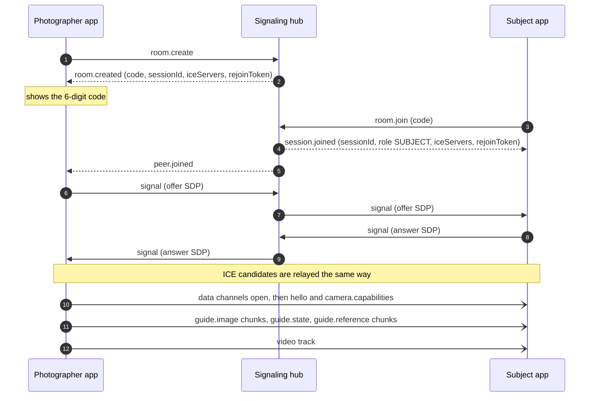

*Figure 2. Connecting two phones with a room code. The photographer always creates the offer.*

**Remote zoom**

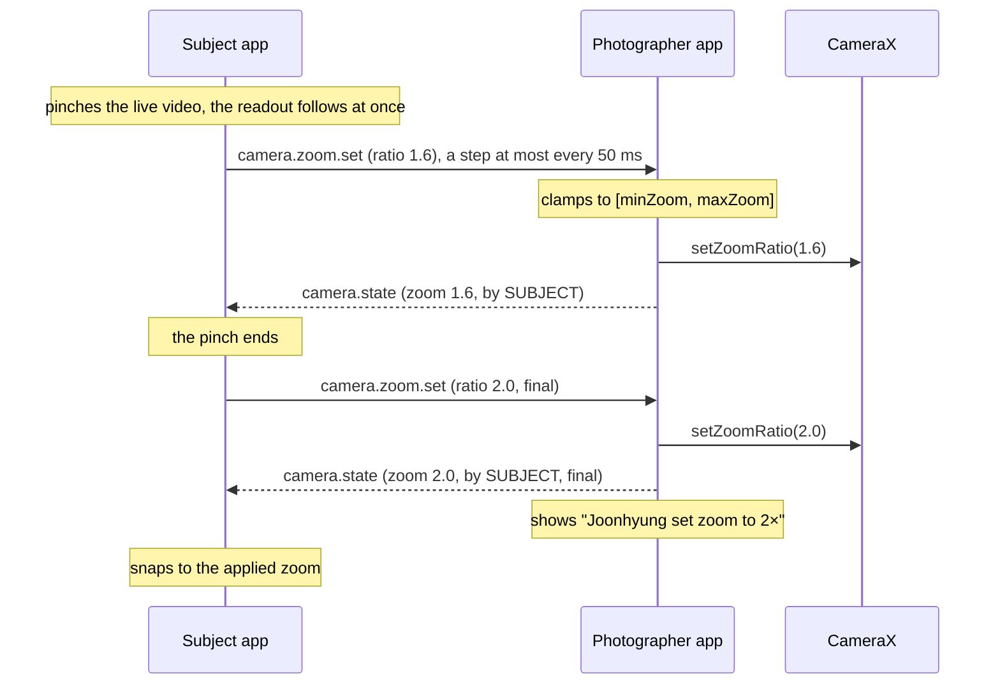

*Figure 3. The photographer's phone applies each request and echoes the applied value, so both phones end on the same zoom. Only the photographer takes photos.*

**Invitation (Iteration 3)**

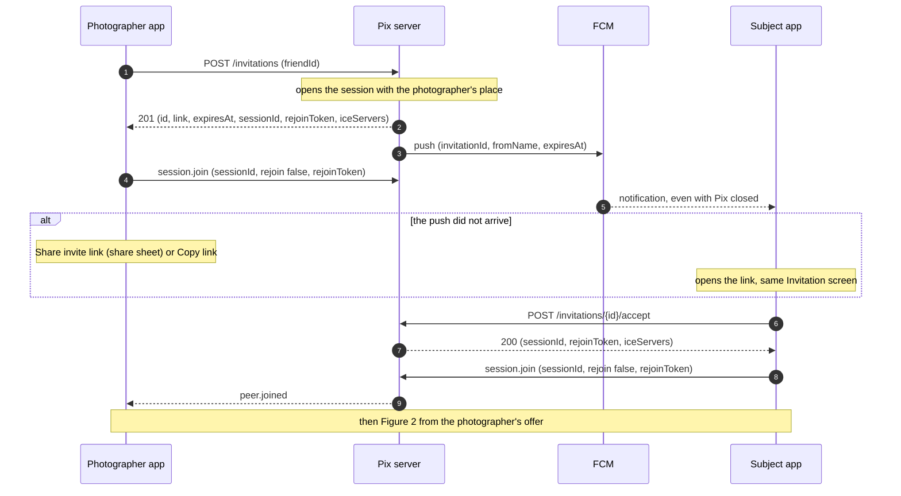

*Figure 3b. Sending an invitation opens its session, and each phone takes its place with the token it got over REST (AD-8). A friend who comes first is announced when the photographer comes. A decline (`DECLINED`) or no answer in 60 s (`EXPIRED`) ends the session with an error to the photographer.*

**Reconnection (Iteration 3)**

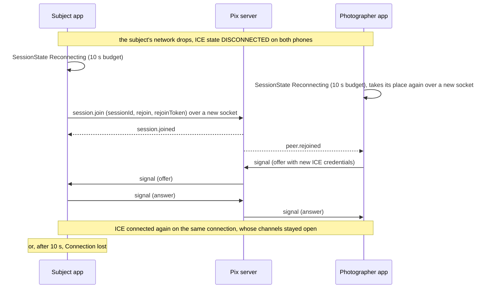

*Figure 3c. A short drop recovers without a new invitation (FR-6.12, NFR-11). The photographer creates every offer, so it also starts the ICE restart.*

#### 1.1.5 Architectural patterns

- **System: client-server plus peer-to-peer.** The server handles discovery and AI calls. Real-time media never passes through our server code.
- **App: MVVM with unidirectional data flow.** Fragments with XML layouts (ViewBinding) render immutable state from a ViewModel's `StateFlow` and send user events back. ViewModels call repositories and managers that wrap CameraX, ML Kit, WebRTC, and the network, so each part is tested and replaced alone.
- **Single source of truth per session.** The photographer's phone owns the camera and guide state. The subject's phone keeps a mirror that only messages update, and its actions are requests (AD-7).

### 1.2 External libraries and services

App versions are from `android/gradle/libs.versions.toml`; server versions are the minimums in `server/pyproject.toml`. The external services are in 1.1.2.

| Library | Used for | Where |
|----|----|----|
| Kotlin 2.2, Coroutines 1.10, Flow, kotlinx.serialization 1.9 | Language; background work and streams; JSON for messages and REST | App |
| AppCompat 1.7, Material Components 1.12, Fragment 1.8, Activity KTX 1.10, ConstraintLayout 2.2, Navigation 2.9, Lifecycle 2.9, ViewBinding | XML screens, navigation, ViewModels; `ProcessLifecycleOwner` for presence and the 60 s background limit | App |
| CameraX 1.6.2 (`core`, `camera2`, `lifecycle`, `view`) | Preview, capture, frames for streaming, zoom, focus, exposure, flash, torch | App |
| ML Kit Subject Segmentation 16.0.0-beta1 (Google Play services) | The person's confidence mask for the guide (2.6.1) | App |
| ML Kit Pose Detection 18.0.0-beta5 and Face Detection 16.1.7, bundled | The person check on the phone, before anything is sent (2.6.3) | App |
| WebRTC for Android 137.7151.01 (`io.github.webrtc-sdk:android`, a maintained prebuilt) | Peer connection, H.264 or VP8 video, two data channels, ICE | App |
| OkHttp 4.12, Retrofit 2.11 | WebSocket signaling; REST | App |
| Jetpack DataStore 1.1 | The sign-in, the aspect ratio, the AI agreement, the descriptions used before (FR-4.11), and most settings (2.6.8) | App |
| Credential Manager 1.5, Google ID 1.1 | Google sign-in. The ID token goes to the server once, and again only after `NOT_REGISTERED` (FR-5.13). | App |
| Firebase Messaging (Firebase BoM 34.0) | Pushes, also with Pix closed; the device token | App |
| Manrope, Pretendard, DM Mono (bundled fonts) | UI text, Korean text, the room code (2.8) | App |
| FastAPI 0.142, Uvicorn 0.54 with `websockets`, pydantic-settings, python-multipart, Pillow 12 (Python 3.11) | Signaling and REST in one process, in one or more workers (AD-18); settings; uploads; checking scene photos and converting candidates to JPEG | Server |
| `httpx2` 2.13 | Calls to OpenRouter, Cloudflare, FCM, and Google's published keys | Server |
| `google-auth` 2.62 | Checks Google ID tokens; signs the FCM service-account request, so `firebase-admin` is not needed | Server |
| `argon2-cffi` 25.1, `PyJWT` 2.15 | argon2id password hashes; access tokens (JWT, HS256) (2.5.3, 2.8) | Server |
| SQLAlchemy 2.1 (asyncio), Alembic 1.20, asyncpg, aiosqlite | Schema, migrations, and queries on PostgreSQL or a SQLite file (2.7) | Server |
| Redis 8, `redis-py` 8.1 | The session store and pub/sub between server processes (AD-18, 2.7) | Host, Server |
| fakeredis 2.39 with `lupa` | An in-process Redis that runs the store's Lua, for tests and a laptop; development only (2.7) | Server |
| Docker Compose, nginx 1.30, PostgreSQL 18 | Hosting on the course servers; nginx on port 80 switches between the two app copies during a deploy (2.8) | Host |

### 1.3 Architectural decisions

| ID | Decision | Why | Rejected alternative |
|----|----|----|----|
| AD-1 | **Generate poses with an external image-editing API, called through our server** | No on-device model fits Android; the server hides the key and is one place to switch vendors or rate-limit. Paid calls run only on request. | On-device model (DreamLite); calling the API from the app |
| AD-2 | **Segment the reference on the device (ML Kit)** | Fast (≤ 2 s), free, and offline, and the photo stays on the phone (FR-2.6). | Segmentation on the server or in the image API |
| AD-3 | **Peer-to-peer media with WebRTC; the server only does signaling** | Lowest latency, no media-server cost, end-to-end encryption, and adaptive quality (NFR-6). | Media server (SFU); JPEG frames over WebSocket |
| AD-4 | **CameraX is the only camera owner and feeds frames to WebRTC** | Only one client can open the camera, and one viewport keeps preview, capture, and stream on the same framing. | WebRTC's camera capturer |
| AD-5 | **Two data channels: *realtime* (unordered, no retransmission) and *reliable* (ordered)** | Continuous values need only the newest value; images, commands, and results must arrive exactly once. | One reliable channel; relaying through the server |
| AD-6 | **Each phone draws the guide itself; only the smoothed mask (once) and small state updates are sent** | The guide stays sharp, out of the video and the photo, and free of reference pixels. A reference copy of at most 512 px goes once per guide, only for the subject's thumbnail. It is never drawn as the guide, saved, or sent through the server (FR-3.9, [#132]). | Burning the overlay into the video; mirroring the screen |
| AD-7 | **The photographer's phone is the single source of truth for camera and guide state** | The subject only requests, and the photographer applies requests in arrival order and echoes them, so the later change wins (FR-7.6). The first request decides a shared pose step (2.6.5). | Shared editing on both phones |
| AD-8 | **One session abstraction with pluggable entry points (room code, invitation)** | Streaming and sync work without accounts, and each entry point only yields a `sessionId`. | Building accounts and invitations first |
| AD-9 | **One app for both roles** | Friends swap roles between shots: one codebase, one install, the role chosen per session. | A separate viewer app |
| AD-10 | **One frame in the chosen aspect ratio (3:4, 9:16, or 1:1), shown whole (fit) on both phones** | One CameraX `ViewPort` makes what you see what is captured, with the same guide coordinates on both phones; 9:16 fits Instagram stories. The crops: 2.6.2. | Fixed 3:4; full-screen 9:16 with cropping |
| AD-11 | **The server runs on the course-provided servers with Docker and nginx, over HTTP and WS, and an AWS server serves other networks** | The course servers open only HTTP on port 80, without TLS (NFR-14), and only to the campus network. They stay the main hosting, as Servers A and B. An AWS server with the same setup serves other networks, cellular data included (2.8, Hosting). | AWS as the only hosting (cost); a TLS front such as a Cloudflare Tunnel (domain and approval; revisit if `ws://` fails on cellular); GitHub hosting; a laptop with port forwarding |
| AD-12 | **Sign-in with a Pix ID and a password or with Google; the server issues its own tokens** | No Google account is needed, and Google is one tap. The Pix ID is the login name, with no email; either account can add the other (FR-5.13). Tokens and password hashes: 2.8, Accounts. | Email and password; Kakao sign-in (not on every test phone) |
| AD-13 | **Invitations by Firebase Cloud Messaging, with an invite link as the fallback** | Only a push reaches a friend whose Pix is closed, and a link through any messenger covers a lost push. | WebSocket presence only; KakaoTalk-only invitations |
| AD-14 | **A managed TURN relay (Cloudflare Realtime TURN), with short-lived credentials from the server** | STUN often fails behind carrier NAT, and the course servers cannot host a relay (port 80 only). Cloudflare's needs no host, fits its free allowance, and also listens on TCP 80 and TLS 443. The key stays on the server, and media stays SRTP-encrypted (NFR-14). | coturn on the server host (no open ports) or on AWS (cost, upkeep); a media server (SFU); no relay |
| AD-15 | **The guide is an outline only and never shows the reference photo's pixels** | Framing the person matters more than the background, and reference pixels over the live scene confuse; a thumbnail shows the reference (AD-6). | Semi-transparent cutout; a faint background guide |
| AD-16 | **Saved guides live in the app's private storage** | Reuse with nothing in the gallery or on the server (FR-3.8, NFR-13). The library (FR-3.11) is this store: up to 100 guides, thumbnails read on demand. | Gallery album; server-side guides |
| AD-17 | **Pinch zoom with a guide-edit mode toggle on both phones** | A pinch is the natural zoom, and one toggle decides: on, gestures edit the guide; off, a pinch zooms. The subject moves the guide (FR-7.2) and zooms too. | A zoom slider; deciding by where the finger lands |
| AD-18 | **Session state lives in a Redis session store, not in the server process** | Workers share the state, and a new copy takes over during a deploy without losing a waiting room (2.8). The small, short-lived state fits Redis's atomic scripts, expiry, and pub/sub (2.7). Cost: one more service and Lua room transitions; NFR-18's 50 sessions fit in one worker. | One process with in-memory state; routing rooms by code; the relational database |

## 2. Design Details

### 2.1 Android app structure

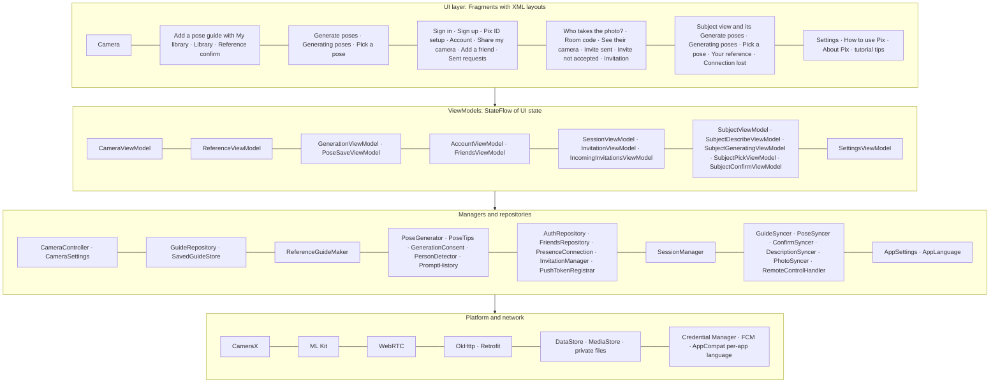

*Figure 5. Layers of the Android app. Each layer depends only on the layer below it. The exception: the UI hosts the camera preview (`PreviewView`) and the subject's video view (`SurfaceViewRenderer`) directly.*

**Package layout.** Files marked \* are the shared contracts (`android/README.md`); every other class belongs to the owner in its `Owner:` comment. The tree names the main files.

```text
android/app/src/main/java/com/lastpenguin/pix/
├─ MainActivity, PixApplication (creates the AppContainer)
├─ ui/          camera/, guide/, generation/, account/, session/, settings/: one Fragment per screen; the screens of one
│               flow share one activity-scoped ViewModel; PixViewModels builds every ViewModel from the AppContainer;
│               ScreenTransitions (PixNavHostFragment, ScreenNavigator, ScreenMotion) and Motion
├─ camera/      CameraController*, CameraXController, CameraSettings (aspect ratio in DataStore), PhotoSaver (PhotoAlbum),
│               CameraZoom, CameraZoomPlan, CameraFrameCache
├─ guide/       GuideModels*, GuideRepository*, ReferenceGuideMaker*, SavedGuideStore*, GuideLook* (GuideColor,
│               GuideThickness, GuideOutlines), InMemoryGuideRepository, MlKitReferenceGuideMaker, FileSavedGuideStore,
│               GuideGeometry, SubjectSegmenter, MaskSmoothing (functions), OutlineExtractor, MaskPng,
│               ScreenshotPhoto and SharedPostCard (the screenshot cut), GuideOverlayView
├─ generation/  GenerationModels*, PoseGenerator*, PoseTipper*, RemotePoseGenerator, RemotePoseTipper, PoseTips,
│               PoseImageCodec, GenerationConsent (DataStore), PromptHistory* (DataStore), PersonDetector*
│               (RuleBasedPersonDetector, MlKitPersonSignals), ScreenLanguage
├─ settings/    AppSettings* (DataStore), AppLanguage* (Android's per-app language)
├─ account/     AccountModels*, AuthRepository*, FriendsRepository*, AuthTokens, BearerTokens, AccountRules, ApiMapping,
│               RemoteAuthRepository, RemoteFriendsRepository, PresenceConnection, GoogleIdTokens,
│               InvitationManager and RemoteInvitationManager, PushTokenRegistrar
├─ push/        PixMessagingService (FCM), PushNotifications, FirebasePushTokens
├─ session/     SessionModels*, SessionManager*, RtcSessionManager, SignalingClient, OkHttpSignalingClient,
│               PeerConnectionClient, WebRtcPeerConnectionClient, WebRtcRuntime, CameraFrameSource, RemoteVideo,
│               GuideImageCodec, GuideSyncer, GuideReference (GuideReferenceCodec, MirrorReference),
│               PoseSyncer (PoseShare, MirrorPoseSet), PoseCandidates (PoseCandidateCodec),
│               ConfirmSyncer (ConfirmShare, MirrorConfirm), DescriptionSyncer (DescriptionShare, MirrorDescription),
│               PhotoSyncer (PhotoShare, PhotoReader), RemoteControlHandler, MobileDataNotice
│  ├─ protocol/  SessionMessage*, MessageCodec, ChannelRouter
│  └─ signaling/ SignalMessage*, SignalCodec
└─ core/        AppContainer (creates every module), Timings (timing logs), network/PixApi* (PixApi, PixAuthApi,
                PixAccountApi), network/ApiModels*
```

**Transitions between screens (Iter3-A14, [#181]; R&S 6.9).** `ui/ScreenTransitions.kt` sets every move in one place. `activity_main.xml` hosts the graph in `PixNavHostFragment`, Navigation's `NavHostFragment` with `ScreenNavigator` as its fragment navigator. `nav_graph.xml` names no animation.

- `ScreenNavigator` sets the four `NavOptions` animators from `ScreenMotion.between`: forward between the shown and the next screen, back between the next and the screen beneath it after the move.
- After `popUpTo`, the screen beneath is not the shown one: Back from *Generating poses* goes to Camera, so it fades.
- Back, the back gesture, and *Back to camera* pop the back stack and play the back pair, also on a screen a notification or link opened (`MainActivity.open`). Options with their own animations keep them; the first screen has none.
- Each transition lasts 300 ms on Material's standard curve (`res/animator/screen_*`, `res/values/motion.xml`). The going screen fades out in the first 35 %, and the coming one fades in over the rest.
- The `ObjectAnimator`s follow the system animation scale, so with animations off each screen shows its end at once. Nothing waits: the coming screen takes touches at once, the going one none.
- *Back to camera* from two screens deep pops both: the shown screen plays its back transition, and Camera fades in.

| Pair | Transition | Why |
|----|----|----|
| Camera or *Subject view* and any screen | `FADE`: Material's fade through, without its scale | A live camera image should not slide. `PreviewView` (`COMPATIBLE`, a `TextureView`) fades with its screen. `SurfaceViewRenderer` takes no view alpha, so `SubjectFragment.onCreateAnimator` hides the video. |
| Any other two screens | `SHARED_AXIS` along x: the next screen comes 30 dp in from the right, the last goes 30 dp left; back reverses it | A deeper step: *Share my camera* → *Add a friend*, the library → *Reference confirm*, *Generate poses* → *Generating poses* → *Pick a pose* |
| A sheet (*Add a pose guide*, *Who takes the photo?*, *Account*, *Room code*, *Invite sent*) and the screen under it | None: the sheet keeps its own slide | `ScreenNavigator` does not move dialog destinations. A screen a sheet opens moves from the screen under it: Camera → *Reference confirm* fades. |

**Who takes the photo (Iter3-A17, [#188]; R&S 6.7).** The phone that shows a room code or sends an invitation is the photographer. *Shoot together* opens `ShootTogetherSheet`, a dialog over Camera. Each choice replaces it (`popUpTo` inclusive), so Back goes to Camera.

- *I'll take the photo* opens *Share my camera* (`friendsFragment`, `FriendsFragment`): friends to invite, and *Show a code*, signed in or not.
- *I'll be in the photo* opens *See their camera* (`joinCodeFragment`, `JoinCodeFragment`): received invitations above the code field. The button counts them, so a dismissed invitation can still be accepted within its minute (2.6.6, FR-6.17).
- *Show a QR code* and *Scan a QR code* are planned under them ([#122]).
- A photographer whose subject left still waits in its room (`Waiting`, 2.4), unseen on Camera, and `SessionManager.start` ignores a second session. So *I'll be in the photo* and *Accept* (on *Invitation* and *See their camera*) first end that room (`SessionViewModel.endWaitingRoom` awaits `leave(CANCELLED)`). A session with someone in it, or on its way, still refuses them (FR-6.9).
- *Room code* has no join field; it says which phone enters the code, and where. The code screens name the other phone's buttons by their own labels (`room_code_path`, `join_hint`, `withColoredPart`), so a renamed button renames them.
- *Sign in* returns to the screen that opened it (`popBackStack(signInFragment, inclusive)`); *Sign up* closes with it, and *Pix ID setup* replaces it. So *Invitation* and Settings open *Sign in* themselves.
- Screens say *friend* only for the Pix friend list; elsewhere they name the role or say *the other person* (R&S 6.9).

#### Module interfaces

These interfaces are the contracts between owners. Hand-written fakes, such as `FakeSessionManager`, and the `InMemory` implementations stand in for them, so UI and sync work can start before a module is ready (Testing Documentation 2.1.8).

```kotlin
enum class CameraStatus { IDLE, STARTING, READY, UNAVAILABLE } // READY: camera open, first analysis frame in, kept zoom
                                                                // and exposure applied again
enum class AspectRatio { R4_3, R16_9, R1_1 }                     // FR-1.13; R4_3 is the default
enum class FlashMode { OFF, AUTO, ON }                            // FR-1.12
enum class CameraFacing { BACK, FRONT }                           // FR-1.14: FRONT is selfie mode
interface CameraController {
    val status: StateFlow<CameraStatus>               // IDLE until bound; a failed bind is UNAVAILABLE; bind again retries
    val capabilities: StateFlow<CameraCapabilities?>
    val state: StateFlow<CameraState>                 // applied zoom, exposure, flash, aspect, and light
    val zoom: StateFlow<Float>                        // = state.zoom, relative to the bound camera's main lens
    val facing: StateFlow<CameraFacing>               // the front camera is mirrored everywhere (2.6.4)
    val hasFrontCamera: StateFlow<Boolean>            // false hides the camera switch
    fun bind(owner: LifecycleOwner, surfaceProvider: Preview.SurfaceProvider)
    fun setFacing(facing: CameraFacing)               // rebinds after any photo being saved, at 1x and brightness 0;
                                                      // a front camera that fails gives the rear one back
    fun setZoom(ratio: Float, final: Boolean = true)  // clamped to [minZoom, maxZoom]; pinch and remote; newest value once
                                                      // per display frame; final = false holds the lens (2.6.5)
    fun setFocusPoint(x: Float, y: Float)             // frame coordinates 0..1 (FR-1.4); also remote focus (Could)
    fun setExposure(index: Int)                       // within capabilities.exposureRange (FR-1.11)
    fun setFlash(mode: FlashMode)                     // ignored without capabilities.hasFlash (FR-1.12)
    fun setTorch(on: Boolean)                         // the scene photo's light (FR-4.1); kept across rebinds; none on a
                                                      // lens without a flash; state.torch says when it is on
    fun setAspectRatio(ratio: AspectRatio)            // rebinds with a ViewPort of that ratio (FR-1.13, AD-10)
    suspend fun takePhoto(): Result<Uri>              // full resolution, chosen ratio, Pictures/Pix, no overlay
    suspend fun grabFrame(): Result<Bitmap>           // latest frame, upright: the scene photo (FR-4.1)
    fun setFrameSink(sink: FrameSink?)                // null stops streaming
}
fun interface FrameSink { fun onFrame(image: ImageProxy, mirrored: Boolean) }   // copy and close the image before
                                                                                 // returning; mirrored: the front camera's

interface ReferenceGuideMaker {                         // fails with NoPersonFoundException (FR-2.4); the result has the
                                                        // smoothed mask, anchor, a reference ≤ 512 px, and crop (2.6.1)
    suspend fun make(source: Uri, wholeImage: Boolean = false): Result<ReferenceGuide>  // gallery photo; a feed screenshot
                                                        // is cut to its photo unless wholeImage (FR-2.10)
    suspend fun make(bitmap: Bitmap, source: GuideSource): Result<ReferenceGuide>      // pose candidate, never cut
}

interface GuideRepository {
    val guide: StateFlow<ReferenceGuide?>
    val state: StateFlow<GuideState>
    val changes: SharedFlow<GuideChange>                // every applied change, for GuideSyncer
    fun setGuide(guide: ReferenceGuide?)                // null removes it; a new guide starts at guide.anchor (FR-3.1)
    fun update(final: Boolean, change: (GuideState) -> GuideState)   // final = gesture ended; hide and show via visible
}

interface SavedGuideStore {                             // FR-3.8, FR-3.11, AD-16: the library, app-private storage only
    val saved: StateFlow<List<SavedGuide>>              // newest first; empty until the storage is read once
    suspend fun save(guide: ReferenceGuide, state: GuideState): Result<GuideSaved>   // one copy per guide id
    suspend fun load(id: String): Result<Pair<ReferenceGuide, GuideState>>
    suspend fun thumbnail(id: String): Bitmap?         // read when a cell shows; null for an unknown id or unreadable files
    suspend fun delete(id: String)                      // an unknown id does nothing
    class InMemory : SavedGuideStore                    // for tests and screens that keep no guides
    companion object {
        const val MAX_SAVED = 100                       // the oldest goes first
        const val THUMBNAIL_WIDTH = 384                 // a library cell's 3:4 on a 3x screen, never enlarged
        const val THUMBNAIL_HEIGHT = 512
    }
}

interface CameraSettings {                              // the last aspect ratio, in DataStore (2.8)
    suspend fun aspectRatio(): AspectRatio?             // null when none is kept or readable: the camera stays 4:3
    suspend fun saveAspectRatio(ratio: AspectRatio)
}

interface AppSettings {                                 // FR-10.1, 2.6.8: the settings screen's choices, in DataStore
    val guideLook: StateFlow<GuideLook>                 // color and thickness of every guide on this phone (FR-3.10)
    val showLatency: StateFlow<Boolean>                 // the latency indicator in a session (FR-10.3); off by default
    val baseBrightness: StateFlow<Float>                // Camera's base brightness in EV (FR-1.11); 0 by default
    val tutorialSeen: StateFlow<Set<TutorialScreen>?>   // screens whose tips were seen (FR-10.4); null until read
    suspend fun setGuideColor(color: GuideColor)
    suspend fun setGuideThickness(thickness: GuideThickness)
    suspend fun setShowLatency(show: Boolean)
    suspend fun setBaseBrightness(ev: Float)            // kept within BASE_BRIGHTNESS_EV, -2..2 (key base_brightness_ev)
    suspend fun setTutorialSeen(screens: Set<TutorialScreen>)   // adds them to the tips seen
    suspend fun resetTutorial()                         // *Show the tutorial again*: every screen's tips due again
    class InMemory : AppSettings                        // for tests
}

interface AppLanguage {                                 // FR-10.2, 2.6.8: Pix's per-app language, kept by Android
    val current: Language                               // PHONE, ENGLISH, or KOREAN
    fun choose(language: Language)                      // recreates the activity in it, with its back stack
    class InMemory : AppLanguage                        // for tests: Robolectric's Android 16 keeps no per-app language
}

interface PoseGenerator {                               // POST /pose-suggestions first (suggestions, or a description's
                                                        // variations), while the description's own POST /poses goes out;
                                                        // emits Planned with four poses, then one CandidateEvent each;
                                                        // ends with GenerationFailedException(error) before any pose
    fun generate(scene: Bitmap, request: PoseRequest, seed: Long, selfie: Boolean = false): Flow<GenerationEvent>
}                                                       // selfie: sent with each request (FR-1.14)

fun interface PersonDetector {                          // FR-4.13, 2.6.3: on the phone, before anything is sent
    suspend fun findsPerson(scene: Bitmap): Boolean     // throws when it cannot check; the photo then goes on
}

interface PoseTipper {                                  // FR-4.10: POST /pose-tips; a failure means no tip
    suspend fun tip(scene: Bitmap, candidate: Bitmap, pose: String): Result<PoseTip>
}

interface PromptHistory {                               // FR-4.11, NFR-13: on this phone only, in DataStore
    val entries: StateFlow<List<PromptEntry>>           // newest use first; empty until the storage is read once
    suspend fun record(text: String, role: Role, partnerId: String?)   // a set the server accepted, with this phone's
                                                        // role and the session's friend; a blank text keeps nothing
    suspend fun delete(text: String)                    // ✕; an unknown text does nothing
    class InMemory : PromptHistory                      // for tests and screens that keep none
    companion object { const val MAX_ENTRIES = 50 }    // the one used longest ago goes first
}

interface AuthRepository {                              // FR-5.1–5.3, FR-5.11–5.15, AD-12; failures are AccountException
    val state: StateFlow<AuthState>                     // Loading, SignedOut, or SignedIn(account)
    val expired: SharedFlow<Unit>                       // the server ended this sign-in: ask to sign in again
    suspend fun signUp(pixId: String, password: String, displayName: String): Result<Account>   // PIX_ID_TAKEN,
                                                        // PIX_ID_INVALID, PASSWORD_INVALID
    suspend fun isPixIdAvailable(pixId: String): Result<Boolean>   // *Check*, without a sign-in; PIX_ID_INVALID
    suspend fun logIn(pixId: String, password: String): Result<Account>   // INVALID_CREDENTIALS
    suspend fun signInWithGoogle(idToken: String): Result<GoogleSignIn>   // NotRegistered: ask about an existing account
    suspend fun signUpWithGoogle(idToken: String): Result<Account>   // a new account; the Pix ID comes next
    suspend fun addGoogle(idToken: String): Result<Account>   // GOOGLE_IN_USE or GOOGLE_ALREADY_ADDED
    suspend fun addPassword(password: String): Result<Account>   // a Google account with a Pix ID; PASSWORD_INVALID
    suspend fun setPixId(pixId: String, password: String? = null): Result<Account>   // TAKEN or INVALID; a password
                                                        // account sends its password
    suspend fun setDisplayName(displayName: String): Result<Account>   // 1–30 characters after trimming
    suspend fun refreshAccount(): Result<Unit>          // GET /me again: another phone may have changed the account
    suspend fun freshAccessToken(): String?             // for a signaling socket, which sends it only when it opens
    suspend fun signOut()                               // on the server if it answers, on the phone always
}

interface FriendsRepository {                           // FR-5.4–5.10, FR-5.16; failures are AccountException
    val friends: StateFlow<List<Friend>>
    val requests: StateFlow<List<FriendRequest>>        // received, pending
    val sentRequests: StateFlow<List<SentRequest>>      // sent, not answered yet
    suspend fun refresh(): Result<Unit>                 // the three lists; every 10 s on Share my camera and Sent requests
    suspend fun search(pixId: String): Result<UserLookup>   // exact match only
    suspend fun request(userId: String): Result<RequestOutcome>   // Sent, or BecameFriends when they had asked
    suspend fun accept(requestId: String): Result<Friend>
    suspend fun cancel(requestId: String): Result<Unit> // withdraws a sent request; it leaves sentRequests even on NOT_FOUND
    suspend fun decline(requestId: String): Result<Unit>
    suspend fun remove(userId: String): Result<Unit>
}

interface InvitationManager {                           // FR-6.1–6.4, FR-6.9, FR-6.17, AD-13; failures are AccountException
    suspend fun invite(friendId: String): Result<SentInvitation>      // link and photographer's place; BUSY, NOT_FRIENDS
    suspend fun open(invitationId: String): Result<OpenedInvitation>  // no sign-in needed; NOT_FOUND
    suspend fun incoming(): Result<List<OpenedInvitation>>            // the pending ones received, newest first
    suspend fun accept(invitationId: String): Result<SessionPlace>    // the friend's place; INVITATION_GONE, NOT_FOUND
    suspend fun decline(invitationId: String): Result<Unit>
    suspend fun cancel(invitationId: String): Result<Unit>            // the photographer
}

fun interface PushTokens { suspend fun current(): String? }          // Firebase's FCM token, null without one
class PushTokenRegistrar(api, auth, tokens, scope) {                 // POST /devices once per sign-in, and again
    fun start(): Job                                                  // when Firebase rotates the token while signed in
    fun onNewToken(token: String)
}

interface SessionManager {
    val state: StateFlow<SessionState>
    val incoming: Flow<SessionMessage>                  // not replayed: a late subscriber misses earlier messages
    val peerCapabilities: StateFlow<CameraCapabilities?> // subject: the last camera.capabilities, for a late screen
    val peerCamera: StateFlow<CameraState?>             // subject: the last camera.state; null until one arrives
    val path: StateFlow<IcePath?>                       // the selected candidate pair while connected, every 2 s (2.6.7)
    val latencyMs: StateFlow<Int?>                      // half the ping round trip, last three averaged (FR-10.3); null
                                                        // until measured, while reconnecting, and after the end
    suspend fun start(entry: SessionEntry, role: Role)   // NewRoom, RoomCode, Rejoin, Invite, or Invitation
    fun send(message: SessionMessage)                   // ChannelRouter picks realtime or reliable
    suspend fun sendBulk(message: SessionMessage): Boolean   // a chunk behind every other reliable message, through a
                                                        // reconnect (2.8); false once the session ended
    fun videoSink(): FrameSink                          // photographer: pass to CameraController
    suspend fun leave(reason: EndReason = EndReason.LEFT)
}
```

### 2.2 Class diagrams

The diagrams show the main classes and their responsibilities. They are not complete UML.

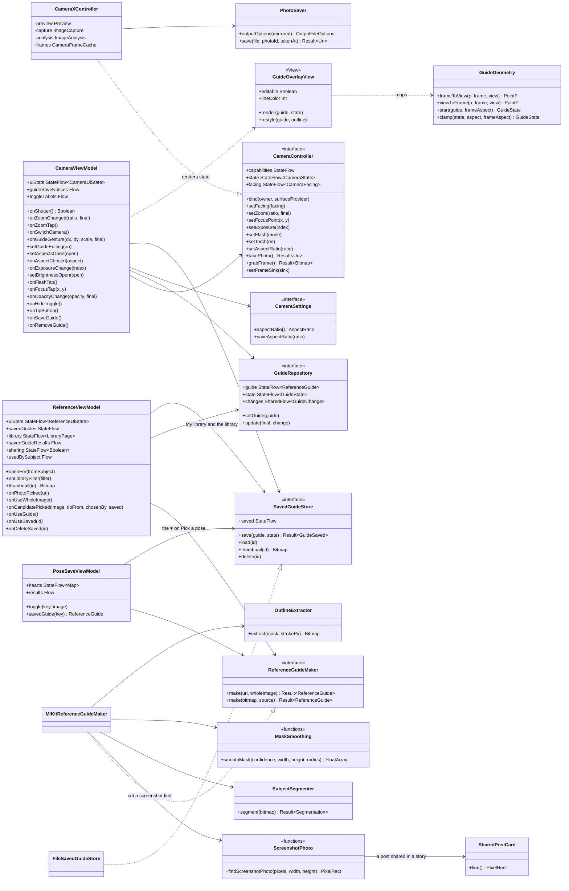

*Figure 6. Camera and guide classes. `MlKitReferenceGuideMaker` cuts a screenshot to its photo, then segments, smooths, and outlines (2.6.1). `ReferenceViewModel` lists and opens the library (`SavedGuideStore`), and `PoseSaveViewModel` adds to it from the ♥ on *Pick a pose*.*

```mermaid
classDiagram
  direction LR
  class SessionManager {
    <<interface>>
    +state StateFlow~SessionState~
    +incoming Flow~SessionMessage~
    +peerCapabilities StateFlow~CameraCapabilities~
    +peerCamera StateFlow~CameraState~
    +path StateFlow~IcePath~
    +latencyMs StateFlow~Int~
    +start(entry, role)
    +send(message)
    +sendBulk(message) Boolean
    +videoSink() FrameSink
    +leave(reason)
  }
  class RtcSessionManager {
    -scope serial CoroutineScope
  }
  class SessionViewModel {
    +state StateFlow~SessionState~
    +transitions SharedFlow~SessionState~
    +startRoom()
    +invite(friend)
    +cancelInvite()
    +joinRoom(code)
    +joinInvitation(invitationId, place, partner) Boolean
    +endWaitingRoom() Boolean
    +reconnect()
    +leave()
  }
  class SignalingClient {
    <<interface>>
    +events SharedFlow~SignalEvent~
    +connect(url, accessToken)
    +send(signal)
    +close()
  }
  class PeerConnectionClient {
    <<interface>>
    +events SharedFlow~PeerEvent~
    +createOffer(iceRestart) Sdp
    +createAnswer() Sdp
    +applyRemote(sdp)
    +addIceCandidate(candidate)
    +send(channel, text) Boolean
    +bufferedAmount(channel) Long
    +stats() LinkStats
  }
  class CameraFrameSource {
    +onFrame(image, mirrored)
  }
  class MessageCodec {
    +encode(message) String
    +decode(text) Envelope
  }
  class ChannelRouter {
    +channelFor(message) Channel
    +latestOnly(message) Boolean
  }
  class GuideSyncer {
    +adopted SharedFlow~String~
    +offerFailed Flow~String~
    +startAsSender(scope)
    +startAsReceiver(scope)
    +attribute(role)
    +offer(guide)
  }
  class MirrorReference {
    +reference StateFlow~GuideReference~
    +set(reference)
  }
  class PoseShare {
    <<interface>>
    +picks Flow~SubjectPick~
    +open(setId)
    +planned(setId, poseIds)
    +candidate(setId, poseId, image)
    +failed(setId, poseId, descriptionRejected)
    +picking(setId, poseIds)
    +chosen(setId, poseId, by)
    +close(setId, failure)
  }
  class PoseSyncer {
    +mirror StateFlow~MirrorPoseSet~
    +verdicts StateFlow~DescriptionVerdicts~
    +pending StateFlow~SubjectPick~
    +ended Flow~PoseSetEnd~
    +pickFailed Flow~String~
    +startAsSender(scope)
    +startAsReceiver(scope)
    +pick(poseId) Boolean
  }
  class DescriptionShare {
    <<interface>>
    +requests Flow~DescriptionRequest~
    +open(descriptionId, scene, text, rejected)
    +update(descriptionId, text, writer)
    +end(descriptionId, started, text, setId)
  }
  class DescriptionSyncer {
    +mirror StateFlow~MirrorDescription~
    +startedScene StateFlow~StartedScene~
    +started Flow~StartedDescription~
    +ended Flow~DescriptionEnd~
    +goFailed Flow~String~
    +startAsSender(scope)
    +startAsReceiver(scope)
    +edit(holding, text) Boolean
    +go(text, suggest) Boolean
  }
  class PhotoShare {
    <<interface>>
    +shutter() String
    +taken(sessionId, uri, takenAt)
    +notTaken(sessionId)
  }
  class PhotoSyncer {
    +sendFailed Flow~Unit~
    +received Flow~Boolean~
    +shutters Flow~Unit~
    +startAsSender(scope)
    +startAsReceiver(scope)
    +drop() Int
  }
  class PhotoAlbum {
    <<interface>>
    +save(file, photoId, takenAt) Result~Uri~
  }
  class ConfirmShare {
    <<interface>>
    +uses Flow~SubjectUse~
    +open(confirmId)
    +finding(confirmId)
    +ready(confirmId, guide)
    +used(confirmId, guideId, by)
    +close(confirmId)
  }
  class ConfirmSyncer {
    +mirror StateFlow~MirrorConfirm~
    +pending StateFlow~SubjectUse~
    +ended Flow~ConfirmEnd~
    +useFailed Flow~String~
    +startAsSender(scope)
    +startAsReceiver(scope)
    +use(guideId) Boolean
  }
  class RemoteControlHandler {
    +actions SharedFlow~RemoteAction~
    +start(scope)
    +stop()
    +handle(message)
  }
  class SubjectViewModel {
    +uiState StateFlow~SubjectUiState~
    +onZoomGesture(ratio, final)
    +onZoomTap()
    +onGuideGesture(dx, dy, scale, final)
    +setGuideEditing(on)
    +onExposureGesture(index, final)
    +setBrightnessOpen(open)
    +onFlashTap()
    +setReferenceExpanded(expanded)
    +setReferenceCorner(corner)
    +onSaveGuide()
    +claimSetOpening(setId) Boolean
  }
  class SubjectDescribeViewModel {
    +usedBefore StateFlow
    +onTextChanged(text)
    +go(text, suggest)
    +forget(text)
  }
  class SubjectGeneratingViewModel {
    +uiState StateFlow~SubjectGeneratingUiState~
  }
  class SubjectPickViewModel {
    +select(poseId)
    +usePose()
  }
  class SubjectConfirmViewModel {
    +useGuide()
  }
  RtcSessionManager ..|> SessionManager
  RtcSessionManager --> SignalingClient
  RtcSessionManager --> PeerConnectionClient
  RtcSessionManager --> MessageCodec
  RtcSessionManager --> ChannelRouter
  PeerConnectionClient --> CameraFrameSource : video source
  CameraFrameSource ..|> FrameSink
  SessionViewModel --> SessionManager
  SessionViewModel --> GuideSyncer : runs it for the session
  SessionViewModel --> RemoteControlHandler : photographer
  SessionViewModel --> PhotoSyncer : runs it for the session
  GuideSyncer --> SessionManager
  GuideSyncer --> GuideRepository
  GuideSyncer --> MirrorReference : subject writes the reference photo
  RemoteControlHandler --> SessionManager
  RemoteControlHandler --> CameraController
  RemoteControlHandler --> GuideRepository
  SubjectViewModel --> SessionManager
  SubjectViewModel --> GuideRepository
  SubjectViewModel --> MirrorReference
  SubjectViewModel --> SavedGuideStore : Save guide
  PoseSyncer ..|> PoseShare
  PoseSyncer --> SessionManager
  SubjectViewModel --> PoseSyncer : the photographer's candidates
  SubjectGeneratingViewModel --> PoseSyncer
  SubjectPickViewModel --> PoseSyncer
  ConfirmSyncer ..|> ConfirmShare
  ConfirmSyncer --> SessionManager
  ConfirmSyncer --> GuideImageCodec : the outline's mask
  SubjectViewModel --> ConfirmSyncer : the photographer's Reference confirm
  SubjectConfirmViewModel --> ConfirmSyncer
  DescriptionSyncer ..|> DescriptionShare
  DescriptionSyncer --> SessionManager
  SubjectViewModel --> DescriptionSyncer : the photographer's Generate poses
  SubjectDescribeViewModel --> DescriptionSyncer
  SubjectDescribeViewModel --> PromptHistory : this phone's descriptions
  PhotoSyncer ..|> PhotoShare
  PhotoSyncer --> SessionManager
  PhotoSyncer --> PhotoAlbum : the subject's Pix album
  CameraViewModel --> PhotoShare : each photo taken in a session
```

*Figure 7. Session, synchronization, and remote-control classes. `OkHttpSignalingClient` and `WebRtcPeerConnectionClient` are the real clients. `SessionViewModel` runs every syncer for the session. The subject's pinch calls `onZoomGesture(ratio, final)`; its guide gestures, brightness, and flash reach `RemoteControlHandler` the same way (2.6.5).*

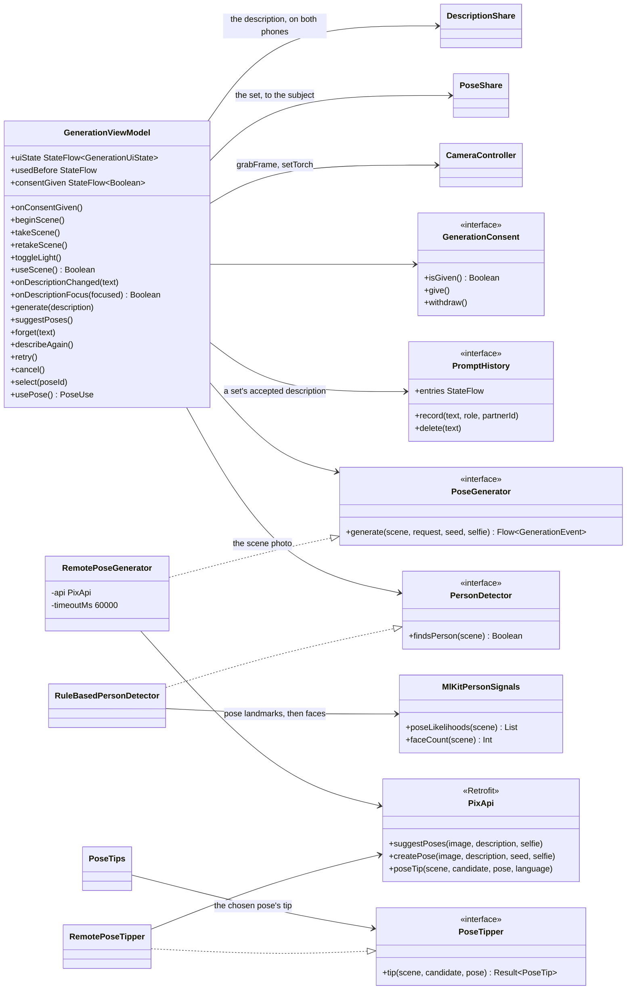

*Figure 8. Pose generation classes. `ReferenceViewModel` hands the chosen candidate to `PoseTips`, and Camera shows its tip (FR-4.10).*

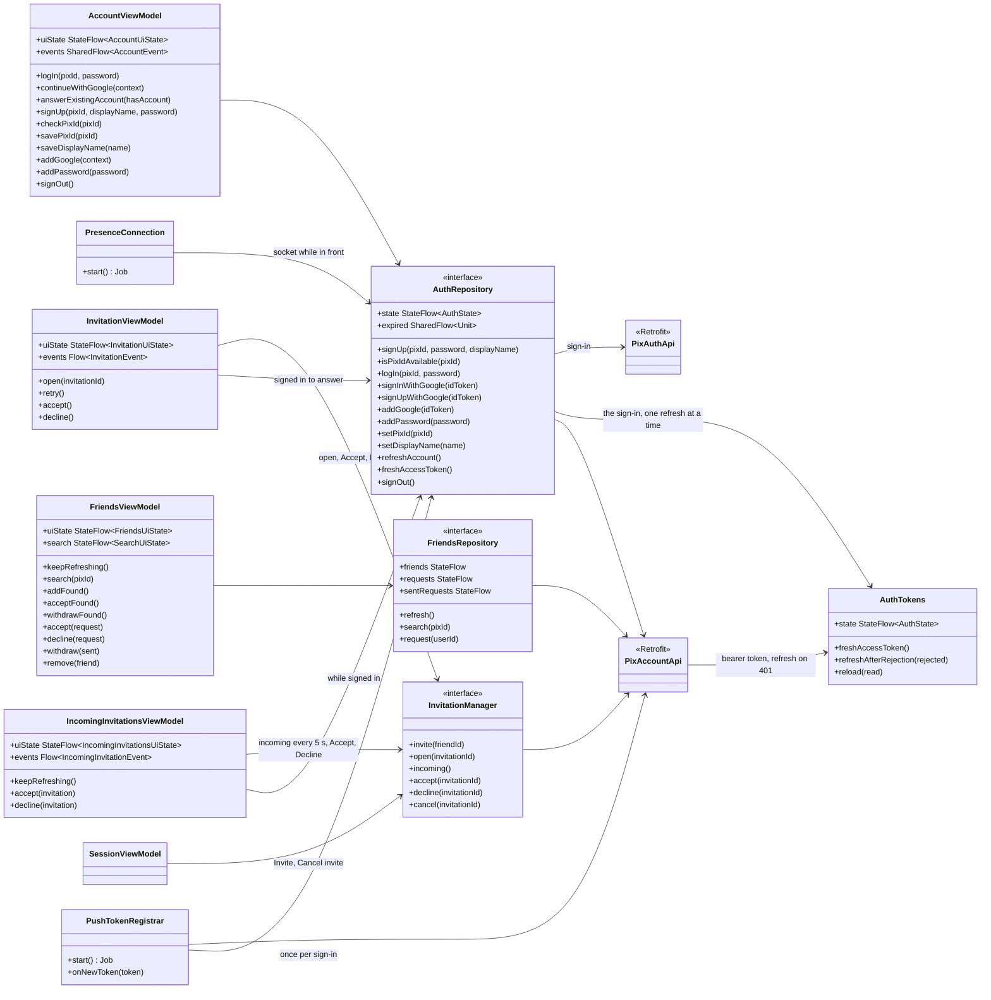

*Figure 8b. Account, friends, and invitation classes. Invitations reuse the session code: `SessionViewModel` starts `SessionEntry.Invite` with the photographer's place, and `joinInvitation` starts `SessionEntry.Invitation` with the place *Accept* gave. `IncomingInvitationsViewModel` lists received invitations on *Who takes the photo?* and *See their camera* ([#188]).*

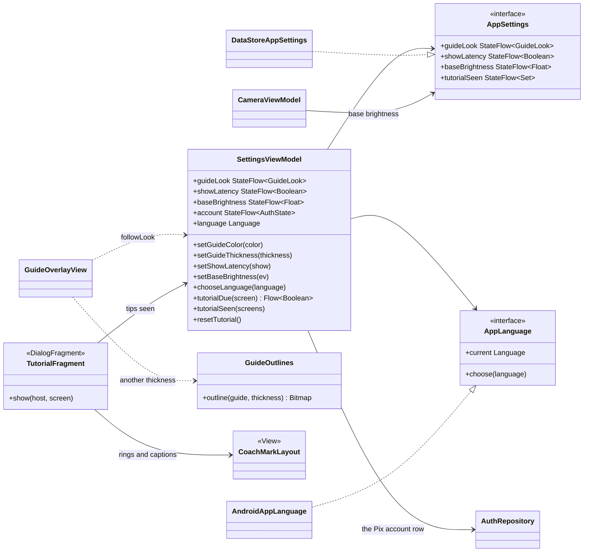

*Figure 8c. Settings and tutorial classes (2.6.8). `GuideOutlines` traces a guide at another thickness. `TutorialFragment` is a dialog among its screen's child fragments, not a navigation destination.*

**Server modules.** Every worker runs all of them:

| Module | Responsibility |
|----|----|
| `signaling` | WebSocket hub; relays `signal` messages. Rooms live in the session store; the registry keeps this worker's sockets and queues, and a message to another worker's socket goes through the store (AD-18, 2.7). |
| `store` | Redis connection, room-transition scripts, messages between workers, the sweeper for expiry and dead workers, rate-limit windows (2.7) |
| `poses` | REST endpoints: scene check, rate limits per kind (poses, suggestions, tips), cancel on disconnect. OpenRouter clients, each model a setting: `PoseGenerator` (Image API), `PoseSuggester` and `PoseTipper` (chat completions), `DescriptionFilter` and `PersonCheck` (Decisions API; 2.6.3). Prompts and default poses: `prompts.toml`, read by `prompts.py`. |
| `accounts` | Sign-up and sign-in with a Pix ID and password (argon2id) or Google (ID token check), session tokens, Pix IDs, exact lookup, friend requests, friendships, device tokens; presence from the hub's signed-in sockets, in the session store |
| `invitations` | Create (opens the session with the photographer's place), list received, accept (the subject's place), decline, cancel; 60 s expiry; invite links; FCM pushes for invitations and friend requests (`push.py`) |
| `turn` | Short-lived Cloudflare TURN credentials as one phone's `iceServers`; Cloudflare's STUN server alone without a key or when Cloudflare fails (`TurnRelay`, AD-14) |
| `db` | SQLAlchemy models and Alembic migrations (2.7); each worker migrates the schema when it starts |

### 2.3 Data models

```kotlin
// ---- Guide ----------------------------------------------------------------
enum class GuideSource { GALLERY, GENERATED }
data class ReferenceGuide(
    val id: String,               // UUID; tells the subject whether it already has the mask
    val mask: Bitmap,             // ALPHA_8, smoothed (2.6.1), cropped to the person, opaque = person; what the subject gets
    val outline: Bitmap,          // same size, traced from the mask: a white anti-aliased line, about 2 dp on screen, no fill
    val aspect: Float,            // mask width / height
    val source: GuideSource,
    val anchor: NormalizedRect? = null,   // the mask's box in the reference photo (person + 2 % margin), where a new guide
                                          // starts (FR-3.1); the subject gets it for Save guide (FR-6.16, Iter3-P16)
    val reference: Bitmap? = null,        // the photo, long side ≤ 512 px, for the corner thumbnail only (FR-3.9); null on
                                          // the subject, whose copy arrives in guide.reference.* and stays in MirrorReference
    val crop: PhotoCrop? = null,          // the screenshot it was cut from (FR-2.10); null for a whole image or a generated
                                          // pose; never sent or saved
)
data class PhotoCrop(
    val original: Bitmap,         // the whole picked image, long side ≤ 1024 px, for Reference confirm's cut
    val photo: NormalizedRect,    // the part kept, which mask, anchor, and reference are made from
)
data class NormalizedRect(val left: Float, val top: Float, val right: Float, val bottom: Float)   // fractions of an image
data class GuideState(            // places the guide, in frame coordinates (2.6.2)
    val guideId: String? = null,  // null = no guide
    val cx: Float = 0.5f,         // center relative to the frame (AD-10); may leave 0..1 while part of the guide shows
    val cy: Float = 0.5f,
    val height: Float = 0.7f,     // guide height / frame height, 0.21..2.1 (FR-3.3); a new guide's comes from its anchor
    val opacity: Float = 0.5f,    // 0.1..0.9, applied to the outline (FR-3.4)
    val visible: Boolean = true,  // false = hidden for a moment (FR-3.6); only the photographer changes it
)
data class SavedGuide(val id: String, val savedAt: Long, val source: GuideSource)   // a library entry, no bitmap
                                                         // (SavedGuideStore.thumbnail); files in app-private storage (2.8)
data class GuideSaved(val guide: SavedGuide, val removedOldest: Boolean)   // what save did, decided inside the save
enum class LibraryFilter { ALL, PHOTOS, GENERATED }      // the library's filters (FR-3.11): all, or one GuideSource

// ---- Camera ---------------------------------------------------------------
data class CameraCapabilities(    // sent in camera.capabilities
    val minZoom: Float, val maxZoom: Float, // in units of the bound camera's main lens (primary rear, or front)
    val zoomStops: List<Float>,   // kept for compatibility; not shown
    val exposureRange: IntRange,  // exposure-compensation indexes; 0..0 when unsupported
    val exposureStep: Float,      // EV per index step
    val hasFlash: Boolean,
    val aspectRatios: List<AspectRatio>,  // the ratios this phone can bind; always contains R4_3
    val supportsFocusPoint: Boolean,
)
data class CameraState(           // the applied values, echoed in camera.state
    val zoom: Float,
    val exposure: Int = 0,
    val flash: FlashMode = FlashMode.OFF,
    val aspect: AspectRatio = AspectRatio.R4_3,
    val torch: Boolean = false,   // the light is on, once applied (setTorch); not echoed
    val facing: CameraFacing = CameraFacing.BACK,  // the camera in use, as the subject keeps it from camera.state
)

// ---- Session --------------------------------------------------------------
enum class Role { PHOTOGRAPHER, SUBJECT }
sealed interface SessionEntry {   // AD-8
    data object NewRoom : SessionEntry                      // photographer asks for a code
    data class RoomCode(val code: String) : SessionEntry   // subject enters the code
    data class Rejoin(val code: String) : SessionEntry     // subject's Reconnect: its rejoin token, else the code (2.6.7)
    data class Invite(val invitationId: String, val place: SessionPlace, val partner: SessionPartner) : SessionEntry
                                                           // photographer: the place the invitation opened
    data class Invitation(val invitationId: String, val place: SessionPlace, val partner: SessionPartner) : SessionEntry
                                                           // subject: the place Accept gave
}
data class SessionPlace(val sessionId: String, val rejoinToken: String, val iceServers: List<IceServer>)   // for session.join
data class SessionPartner(val userId: String, val displayName: String)   // an invitation's friend (FR-4.11)
sealed interface SessionState {   // 2.4
    data object Idle : SessionState
    data class Waiting(val code: String) : SessionState              // photographer: code shown, waiting for the subject
    data class Inviting(val invitationId: String) : SessionState     // photographer: invitation sent, its place taken
    data class Connecting(val sessionId: String?) : SessionState
    data class Connected(val sessionId: String, val peer: PeerInfo, val role: Role, val partner: SessionPartner? = null) : SessionState
    data class Reconnecting(val sessionId: String, val since: Long, val partner: SessionPartner? = null) : SessionState
    data class Ended(val reason: EndReason) : SessionState
}
val SessionState.partner: SessionPartner?   // the friend while Connected or Reconnecting; null over a room code
data class PeerInfo(
    val displayName: String,
    val haveGuideId: String? = null,     // subject only: the guide mask it already has, from its hello
    val haveReferenceId: String? = null, // subject only: the guide whose reference photo it already has
)
enum class EndReason { LEFT, PEER_LEFT, CONNECTION_LOST, NOT_FOUND, EXPIRED, CANCELLED, ERROR, RATE_LIMITED, DECLINED }
// EXPIRED also ends an invitation nobody accepted in time. DECLINED (the friend declined) ends only the photographer's
// invitation, RATE_LIMITED (too many wrong codes from this network, 2.5.2) only a join; neither is sent in session.leave.
data class IcePath(
    val local: String, val remote: String,   // each side's candidate type: host, srflx, prflx, or relay
    val network: String?,                    // this phone's network as WebRTC names it: wifi, cellular, …
    val relayProtocol: String?,              // on a relayed path, how this phone reaches the relay: udp, tcp, or tls
)

// ---- Account --------------------------------------------------------------
data class Account(
    val userId: String, val pixId: String?, val displayName: String,   // pixId null until chosen
    val hasPassword: Boolean, val hasGoogle: Boolean,   // its ways to sign in: offer the missing one
)   // the tokens stay in AuthTokens and DataStore, never in UI state
sealed interface AuthState {      // all but friends and invitations works signed out (FR-5.1)
    data object Loading : AuthState                    // the kept sign-in is being read at app start
    data object SignedOut : AuthState
    data class SignedIn(val account: Account) : AuthState
}
sealed interface GoogleSignIn {
    data class SignedIn(val account: Account) : GoogleSignIn
    data object NotRegistered : GoogleSignIn   // ask whether the person already has a Pix account (FR-5.13)
}
data class PixUser(val userId: String, val pixId: String, val displayName: String)   // a lookup result or a request's sender
data class Friend(val userId: String, val pixId: String, val displayName: String, val online: Boolean, val inSession: Boolean)
                                          // inSession: a waiting room included; an invitation is refused (FR-6.9)
data class FriendRequest(val id: String, val from: PixUser, val createdAt: Long)
data class SentRequest(val id: String, val to: PixUser, val createdAt: Long)   // sent, not answered yet (FR-5.16)
sealed interface UserLookup {
    data class Found(val user: PixUser, val relation: Relation, val requestId: String?) : UserLookup
                                          // relation decides the button (FR-5.8); requestId for REQUESTED and INCOMING
    data object NotFound : UserLookup
}
enum class Relation { NONE, SELF, FRIEND, REQUESTED, INCOMING }
sealed interface RequestOutcome {
    data class Sent(val requestId: String) : RequestOutcome
    data class BecameFriends(val friend: Friend) : RequestOutcome   // they had asked already, so their request is accepted
}
enum class AccountError {   // the server's code (2.5.3), or the phone's own reason
    PIX_ID_TAKEN, PIX_ID_INVALID, PASSWORD_INVALID, INVALID_CREDENTIALS, INVALID_GOOGLE_TOKEN, GOOGLE_IN_USE,
    GOOGLE_ALREADY_ADDED, PIX_ID_REQUIRED, PASSWORD_ALREADY_SET, NOT_FOUND, INVALID_REQUEST,
    NOT_FRIENDS, BUSY, INVITATION_GONE,   // invitations
    UNAVAILABLE, SIGNED_OUT, OFFLINE, UNKNOWN,
}
class AccountException(val error: AccountError, val serverMessage: String = "")   // the broken rule (FR-5.3, FR-5.11)
data class SentInvitation(
    val id: String, val to: PixUser, val expiresAt: Long,
    val link: String,                // the invite link (2.6.6)
    val place: SessionPlace,         // the photographer's place in the session it opened
)
data class OpenedInvitation(val id: String, val from: PixUser, val status: InvitationStatus, val expiresAt: Long)
enum class InvitationStatus { PENDING, ACCEPTED, DECLINED, CANCELLED, EXPIRED }   // Figure 9b; an unknown one counts as gone

// ---- Generation (the prompt around the pose stays on the server, 2.6.3) ---
const val POSE_COUNT = 4                                     // candidates per set (FR-4.3)
const val DESCRIPTION_MAX_LENGTH = 100                       // FR-4.8; the server refuses longer ones
sealed interface PoseRequest {                               // FR-4.4, FR-4.8
    data class Described(val text: String) : PoseRequest     // the user's description, Korean or English
    data object Suggested : PoseRequest                      // an empty field: the server suggests four
    companion object { fun of(description: String): PoseRequest }   // folds whitespace; blank is Suggested
}
data class PlannedPose(val id: String, val text: String)     // "pose-1" .. "pose-4", the app's names for its requests
sealed interface GenerationEvent {
    data class Planned(val poses: List<PlannedPose>) : GenerationEvent   // first, once the poses are known: the slots
}
sealed interface CandidateEvent : GenerationEvent {
    val poseId: String
    data class Ready(override val poseId: String, val image: Bitmap) : CandidateEvent
    data class Failed(override val poseId: String, val error: GenerationError) : CandidateEvent
}
enum class GenerationError { OFFLINE, TIMEOUT, RATE_LIMITED, DAILY_LIMITED, REJECTED, DECLINED, NO_PERSON, SERVER }
// RATE_LIMITED: this phone's hour; DAILY_LIMITED: everyone's day; REJECTED: the filter; DECLINED: the image service
class GenerationFailedException(val error: GenerationError) : Exception  // a run that ends before any pose (FR-4.7)
data class PoseTip(val text: String)                         // how to hold the phone for the chosen pose (FR-4.10)
data class PoseKey(val setId: String, val poseId: String)    // a ♥ on Pick a pose (FR-4.14); pose ids repeat per set
data class PromptEntry(val text: String, val usedAt: Long, val role: Role, val partners: Set<String> = emptySet())
// one per text (PoseRequest.of); role: this phone's part the last time; partners: friends' account ids

// ---- Settings (2.6.8) -----------------------------------------------------
enum class GuideColor { WHITE, BLACK, YELLOW, MINT, PINK }   // FR-3.10; WHITE is FR-2.2's line; BLACK gets a light backing
enum class GuideThickness(val scale: Float) { THIN(0.75f), NORMAL(1f), THICK(1.5f) }   // × the default 2 dp line
data class GuideLook(val color: GuideColor = WHITE, val thickness: GuideThickness = NORMAL)   // this phone's; never sent
enum class Language(val tag: String?) { PHONE(null), ENGLISH("en"), KOREAN("ko") }   // FR-10.2
enum class TutorialScreen { CAMERA, ADD_GUIDE, GUIDE_ON_CAMERA, GENERATE_POSES, SUBJECT_VIEW }   // FR-10.4
val BASE_BRIGHTNESS_EV = -2f..2f                             // FR-1.11; a camera's own range clamps it
```

### 2.4 State machines

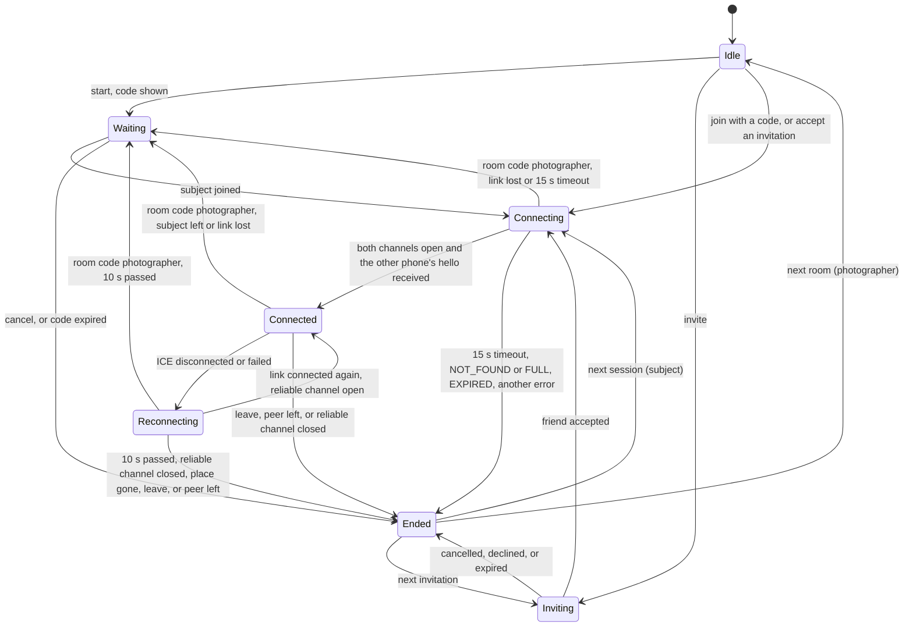

*Figure 9. `SessionState` on each phone. `Inviting` is the photographer's while an invitation waits.*

**Connecting.** `Connected` needs both data channels open and the other phone's `hello`, which carries its name. The 15 s connecting timer starts when the peer connection opens: at `session.joined` on the subject, at `peer.joined` on the photographer.

| Cause | Subject | Photographer |
|----|----|----|
| 15 s without `Connected`, or the link lost while connecting | `Ended(CONNECTION_LOST)` | `Waiting` (room code) or `Ended(CONNECTION_LOST)` (invitation) |
| `NOT_FOUND`, `FULL`, or `FORBIDDEN` | `Ended(NOT_FOUND)` | `Ended(EXPIRED)` while `Inviting` |
| `EXPIRED` | `Ended(EXPIRED)` | `Ended(EXPIRED)` |
| `DECLINED` | – | `Ended(DECLINED)` |
| `RATE_LIMITED` | `Ended(RATE_LIMITED)` | – |
| Another server error or an SDP failure while connecting | `Ended(ERROR)` | As the 15 s timeout |
| A `hello` with another protocol | `Ended(ERROR)` | `Ended(ERROR)` |

**Without a subject.** A room code's photographer keeps the room open when the subject leaves, the link is lost, or connecting times out. It returns to `Waiting` with the same code, so the subject can join again with *Reconnect* (FR-6.10, FR-6.11). An invitation's session has no code, so its photographer leaves and ends. `Inviting` gives up after 80 s without the friend (2.6.6).

**Drops (2.6.7).** ICE `DISCONNECTED` or `FAILED` while connected puts both phones in `Reconnecting`, and an ICE restart on the same connection bridges a short drop.

- `peer.left` with `CONNECTION_LOST` changes nothing while `Connected` or `Reconnecting`: it is often the other phone's old socket. The link decides.
- The reliable channel closing ends the session at once, since it closes only when the other phone closed its connection. A realtime channel that closes alone hands its messages to the reliable one.
- After 10 s the photographer says "&lt;name&gt; disconnected" and returns to `Waiting`, or ends an invitation's session. The subject goes to `Ended(CONNECTION_LOST)`.
- The subject's *Reconnect* (`SessionEntry.Rejoin`) retakes its place with its rejoin token while the photographer holds the session; without a token it joins the code again.

A photographer whose app stays in the background for 60 s leaves the session. `Ended` stays until the next session starts, and the screens return to the camera by themselves.

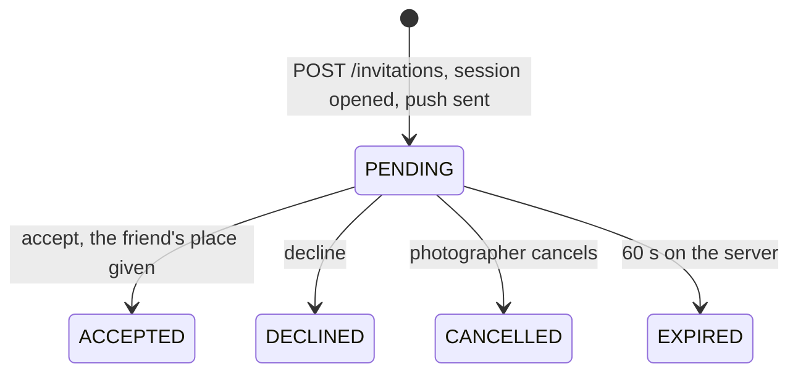

*Figure 9b. An invitation on the server. `EXPIRED` is computed from `expires_at` and never stored. A link to an invitation that is not `PENDING` shows "This invitation is no longer available" (FR-6.4).*

**Shared steps (2.5.1, 2.6.5).** The photographer's phone owns three steps of a session and sends their states to the subject. Each ends once; the first choice to reach the photographer's phone decides (AD-7).

| Step | States |
|----|----|
| *Generate poses* (`DescriptionStep`) | `OPEN` while written → `STARTED` by its button (*Suggest*, *Generate*, or *Regenerate*), or `CLOSED` |
| The pose set (`PoseSetStep`) | `GENERATING` → `PICKING` when *Pick a pose* opens with a candidate → `CHOSEN` by the first *Select*; `CLOSED` without a choice |
| *Reference confirm* of a chosen pose (`ConfirmStep`) | `FINDING` → `READY` with the outline → `USED` by the first *Use*; `CLOSED` without a guide |

**Pose screens (2.6.3, [#199]).** `GenerationUiState.phase` on the photographer's phone. Back on each screen goes one step back, and that step shows what it had. The guide on the camera, or a choice in a session, ends the step (`IDLE`).

```mermaid
stateDiagram-v2
  [*] --> IDLE
  IDLE --> FRAMING: Generate poses here
  FRAMING --> IDLE: Back
  FRAMING --> REVIEWING: shutter
  REVIEWING --> FRAMING: Back
  REVIEWING --> DESCRIBING: Use, a person found
  DESCRIBING --> REVIEWING: Back
  DESCRIBING --> GENERATING: Suggest or Generate
  GENERATING --> DESCRIBING: Back, confirmed
  GENERATING --> PICKING: a candidate ready
  GENERATING --> FAILED: none ready
  PICKING --> DESCRIBING: Back, confirmed; the set gone
  PICKING --> GENERATING: Regenerate
  PICKING --> IDLE: the guide on the camera, or a choice in a session
  FAILED --> DESCRIBING: Back
  FAILED --> GENERATING: Try again
  FAILED --> FRAMING: Shoot again
```

*Figure 9c. The pose screens. `REVIEWING` and `FRAMING` are steps of the Camera screen. Outside a session, *Select* keeps `PICKING` under *Reference confirm*, whose Back returns to the set.*

### 2.5 Protocols and APIs

Each protocol has a summary table, followed by a JSON example for every message or endpoint. Open an item to see its example.

#### 2.5.1 Data channel protocol (phone ↔ phone)

The photographer owns the camera, the guide, and the shared steps. The subject sends requests, which the photographer applies and echoes (AD-7). Only the photographer takes photos.

- **Channels.** Before its offer, the photographer opens `realtime` (`ordered = false`, `maxRetransmits = 0`) and `reliable` (ordered, reliable). `ChannelRouter` picks the channel of each message.
- **Envelope.** `{"v", "t", "seq", "ts", "b"}`: the protocol version (3), the type, a counter per type, the send time in ms, and the body. `MessageCodec` keeps `t`, the class discriminator of `SessionMessage`, at the top and moves the other fields into `b`.
- **Compatibility.** A `hello` with another `protocol` ends the session with an error. Receivers ignore unknown types and unknown fields, so new types and optional fields keep version 3. A message with an unknown enum value is ignored whole.
- **Newest value only.** For `guide.state`, `camera.state`, `camera.zoom.set`, `camera.exposure.set`, and `guide.move`, receivers drop a message whose `seq` is not newer than the last one applied for its type. This holds on either channel. Other types are never dropped.
- **Steps.** A gesture sends steps on `realtime`, at most every 50 ms, the newest winning. Its last value goes once on `reliable` with `final: true`.
- **Order.** `hello` goes first on `reliable`. Reliable messages wait in one ordered queue until `hello` is sent and while the channel's `bufferedAmount` is 256 KiB or more. Realtime messages go at once or not at all (2.8). If `realtime` closes alone, its messages go on `reliable` (2.6.7).
- **Chunks.** An image or photo goes in three parts. `.begin` holds the id, `format`, `bytes`, `chunks`, and an image's `width` and `height`. Each `.chunk` holds the id, `index`, and `data`, and `.end` the id and the `crc32` of the whole file. `data` is the Base64 of at most 9 KiB of the file (at most 12 KiB of text), so a message stays under 16 KiB. A skipped index, a wrong size, or a wrong CRC drops the transfer. An image `begin` over 2 MiB, or with a `chunks` that does not fit `bytes`, is refused.
- **Shared steps (Iter3-P16).** `pose.description`, `pose.step`, and `guide.confirm` show the photographer's *Generate poses*, set of candidates, and *Reference confirm* on the subject's phone (2.6.5). Each instance has a new UUID and ends once. The subject keeps its copy in memory through a reconnect, and drops it at its end, at another one, or when the session ends. After a reconnect, the photographer sends its last one again as it is now, or only its end; the subject skips images it already holds (2.6.7).

| Type | Dir. | Channel | Body | Purpose |
|----|----|----|----|----|
| `hello` | both | reliable | `protocol`, `appVersion`, `role`, `name`, `haveGuideId`, `haveReferenceId` | First message; checks the version |
| `session.leave` | both | reliable | `reason` | Leaving on purpose |
| `ping` / `pong` | both | realtime | `ts` | Round-trip time, every 2 s |
| `camera.capabilities` | P→S | reliable | `capabilities` | Zoom and exposure ranges, flash, aspect ratios |
| `camera.state` | P→S | steps realtime, final reliable | `zoom`, `exposure`, `flash`, `aspect`, `facing`, `by`, `final` | The applied camera values, and who changed them |
| `camera.zoom.set` | S→P | steps realtime, final reliable | `ratio`, `final` | The subject's pinch or readout tap (FR-7.1) |
| `camera.exposure.set` | S→P | steps realtime, final reliable | `index`, `final` | The subject's brightness slider (FR-7.3) |
| `camera.flash.set` | S→P | reliable | `mode` | The subject's flash choice (FR-7.3) |
| `camera.focus.set` | S→P | reliable | `x`, `y` | The subject's focus point (FR-7.7; Could, Iteration 5) |
| `control.permission` | P→S | reliable | `allowed` | Whether remote control is allowed (FR-7.5; Could, Iteration 5) |
| `guide.image.begin` / `.chunk` / `.end` | both | reliable | chunks | The guide's mask; S→P for a guide made on the subject's phone |
| `guide.reference.begin` / `.chunk` / `.end` | P→S | reliable | chunks | The guide's reference photo, for the subject's thumbnail (FR-3.9) |
| `guide.state` | P→S | steps realtime, final reliable | `state`, `final`, `by` | The guide's place, opacity, and visibility |
| `guide.clear` | P→S | reliable | none | The guide was removed |
| `guide.move` | S→P | steps realtime, final reliable | `guideId`, `cx`, `cy`, `height`, `final` | The subject's drag or pinch on the guide (FR-7.2) |
| `pose.description` | P→S | reliable | `descriptionId`, `step`, `text`, `writer`, `rejected`, `setId` | The photographer's *Generate poses* (FR-6.15) |
| `pose.scene.begin` / `.chunk` / `.end` | P→S | reliable | chunks | The scene photo, for the subject's *Generate poses* |
| `pose.description.edit` | S→P | reliable | `descriptionId`, `holding`, `text` | The subject's field takes or returns the description |
| `pose.description.go` | S→P | reliable | `descriptionId`, `text`, `suggest` | The subject's *Generate poses* button |
| `pose.step` | P→S | reliable | `setId`, `step`, `poseIds`, `poseId`, `by`, `failure` | The photographer's set of candidates (FR-6.15), and why a closed set failed (FR-4.7) |
| `pose.planned` | P→S | reliable | `setId`, `poseIds` | The set's slots in order (Iter3-A13) |
| `pose.candidate.begin` / `.chunk` / `.end` | P→S | reliable | chunks | One candidate, for *Generating poses* and *Pick a pose* |
| `pose.candidate.failed` | P→S | reliable | `setId`, `poseId`, `descriptionRejected` (only when true) | A candidate that could not be created (Iter3-A13), and whether the service refused the set's description itself (Iter4-P3) |
| `pose.pick` | S→P | reliable | `setId`, `poseId` | The subject's *Select* |
| `guide.confirm` | P→S | reliable | `confirmId`, `step`, `guideId`, `by` | The photographer's *Reference confirm* of a chosen pose (FR-6.15) |
| `guide.confirm.image.begin` / `.chunk` / `.end` | P→S | reliable | chunks | The outline's mask, for the subject's *Your reference* |
| `guide.confirm.use` | S→P | reliable | `confirmId`, `guideId` | The subject's *Use* |
| `photo.shutter` | P→S | realtime | none | The shutter was pressed (Iter3-A12) |
| `photo.begin` / `.chunk` / `.end` | P→S | reliable, bulk | chunks, with `takenAt` | A photo taken in the session, as saved (FR-6.14) |
| `photo.ack` | S→P | reliable | `photoId`, `next` | The chunk the subject expects next |
| `photo.saved` | S→P | reliable | `photoId`, `ok`, `reason` | Whether the photo is in the subject's album |

| Transfer | Ids | Format and size | The receiver refuses | The subject keeps it |
|----|----|----|----|----|
| `guide.image.*` | `guideId` | `mask-png`: the smoothed mask as an 8-bit gray PNG, ≤ 720 px tall, a few KB | A PNG over 1280 px wide or 720 px tall, read from its header before inflating | As the guide; S→P, the photographer adopts it |
| `guide.reference.*` | `guideId` | `jpeg`, quality 85, long side ≤ 512 px | A photo over 512 px | In memory (`MirrorReference`) until another guide or `guide.clear`; *Save guide* stores it with the guide |
| `pose.candidate.*` | `setId`, `poseId` | `jpeg`, quality 85, else 70 or 55 to fit 1 MiB; long side ≤ 1024 px | Over 1024 px or 1 MiB, at `begin` | In memory, with its set; the ♥ on *Pick a pose* can save it (FR-4.14) |
| `pose.scene.*` | `descriptionId` | As a candidate | As a candidate | In memory, with its description; never saved |
| `guide.confirm.image.*` | `confirmId`, `guideId` | `mask-png`, as `guide.image.*` | Over 1280 px wide or 720 px tall, at `begin`; an outline its copy is not `READY` with | In memory, on *Your reference* only; never saved |
| `photo.*` | `photoId` | `jpeg`: the saved file itself, ≤ 40 MiB | No bytes or over 40 MiB (`TOO_LARGE`), another format or chunk count (`BROKEN`), at `begin` | In its "Pix" album |

The subject never draws a reference photo, candidate, scene photo, or outline as the guide, and never sends one on. The photographer's guide reaches it only as `guide.image.*`.

<details>
<summary><code>hello</code> · reliable · both</summary>

```json
{ "v": 3, "t": "hello", "seq": 1, "ts": 1759212345678,
  "b": { "protocol": 3, "appVersion": "0.1.0", "role": "PHOTOGRAPHER", "name": "Pixel 8",
         "haveGuideId": null, "haveReferenceId": null } }
```

Both phones send it once both channels are open. `name` is the device name from the system settings, or the model, at most 40 characters; it is not the Pix display name. Only the subject sets `haveGuideId` and `haveReferenceId`: the guide image and the reference photo it already holds, which the photographer then skips.

</details>

<details>
<summary><code>camera.capabilities</code> · reliable · P→S</summary>

```json
{ "v": 3, "t": "camera.capabilities", "seq": 2, "ts": 1759212345690,
  "b": { "capabilities": {
    "minZoom": 0.6, "maxZoom": 10.0, "zoomStops": [0.6, 1.0, 2.0, 3.0],
    "exposureRange": [-12, 12], "exposureStep": 0.1667, "hasFlash": true,
    "aspectRatios": ["R4_3", "R16_9", "R1_1"], "supportsFocusPoint": true } } }
```

Sent when the session connects and at each change. For example, `hasFlash` is false while a separate ultrawide without a flash is bound. The subject uses `minZoom`–`maxZoom` for its pinch and readout, `exposureRange` (`[min, max]`) and `exposureStep` for its brightness slider, and `hasFlash` for its flash button. It does not use `zoomStops`, `aspectRatios`, or `supportsFocusPoint`. A missing field means no such control, and 4:3 only.

</details>

<details>
<summary><code>guide.image.begin</code> · reliable · both</summary>

```json
{ "v": 3, "t": "guide.image.begin", "seq": 3, "ts": 1759212345702,
  "b": { "guideId": "5f0c2b9e-7a41-4d3c-9b1e-2f6a8d0c4e17", "format": "mask-png",
         "width": 540, "height": 720, "bytes": 9120, "chunks": 1, "aspect": 0.75,
         "anchor": { "left": 0.31, "top": 0.21, "right": 0.69, "bottom": 0.95 }, "source": "GALLERY" } }
```

Only the smoothed mask travels, never the reference's pixels (AD-6, AD-15). `MaskPng` writes and reads it losslessly on both phones. `aspect` is the mask's width / height. `anchor` is the mask's box in its reference photo, in fractions, right and bottom exclusive (`ReferenceGuide.anchor`); `source` is `GALLERY` or `GENERATED`. Each goes only when the guide has it.

- **P→S.** Skipped when `hello` reported the same `haveGuideId`. The `guide.state` after every image places the guide, also for a subject that joins late (2.6.2). The subject keeps `anchor` and `source` for *Save guide*.
- **S→P.** The photographer adopts the guide, under the same `guideId`, in place of its own, starting at `anchor` (FR-3.1). It answers with `guide.state` `by: SUBJECT` and no image (2.6.5, *Guide from the subject*). An anchor that is not finite, lies outside 0..1, or has no area starts the guide centered; a missing `source` means `GALLERY`. No reference photo goes S→P, so the photographer shows no thumbnail for that guide (FR-3.9). A refused image leaves the photographer's guide as it was. Without a `guide.state` that names the guide within 5 s, the subject shows the photographer's guide again.

</details>

<details>
<summary><code>guide.image.chunk</code> · reliable · both</summary>

```json
{ "v": 3, "t": "guide.image.chunk", "seq": 3, "ts": 1759212345705,
  "b": { "guideId": "5f0c2b9e-7a41-4d3c-9b1e-2f6a8d0c4e17", "index": 0, "data": "iVBORw0KGgoAAAANSUhEUgAAAhwAAALQCAAAAAD+..." } }
```

</details>

<details>
<summary><code>guide.image.end</code> · reliable · both</summary>

```json
{ "v": 3, "t": "guide.image.end", "seq": 3, "ts": 1759212345760,
  "b": { "guideId": "5f0c2b9e-7a41-4d3c-9b1e-2f6a8d0c4e17", "crc32": 3735928559 } }
```

The receiver traces the outline from the mask with the sender's `OutlineExtractor`, without smoothing again (2.6.1).

</details>

<details>
<summary><code>guide.reference.begin</code> / <code>.chunk</code> / <code>.end</code> · reliable · P→S</summary>

```json
{ "v": 3, "t": "guide.reference.begin", "seq": 11, "ts": 1759212345780,
  "b": { "guideId": "5f0c2b9e-7a41-4d3c-9b1e-2f6a8d0c4e17", "format": "jpeg",
         "width": 384, "height": 512, "bytes": 41210, "chunks": 5 } }
```

Sent once per guide, after the guide's image and `guide.state`, so the subject draws the guide first. Skipped for a guide without a reference photo, and when `hello` reported the same `haveReferenceId`. The subject shows it only with its guide (FR-3.9, AD-6).

</details>

<details>
<summary><code>guide.state</code> · realtime / reliable · P→S</summary>

```json
{ "v": 3, "t": "guide.state", "seq": 412, "ts": 1759212349120,
  "b": { "state": { "guideId": "5f0c2b9e-7a41-4d3c-9b1e-2f6a8d0c4e17", "cx": 0.32, "cy": 0.55,
                    "height": 0.7, "opacity": 0.5, "visible": true },
         "final": false, "by": "PHOTOGRAPHER" } }
```

`state` holds the fields of `GuideState` (2.3); `visible: false` hides the guide on both phones (FR-3.6). The photographer sends it when the session connects and after every image. `by` is `SUBJECT` on the echo of an applied `guide.move`, and a missing `by` means the photographer.

</details>

<details>
<summary><code>guide.clear</code> · reliable · P→S</summary>

```json
{ "v": 3, "t": "guide.clear", "seq": 413, "ts": 1759212351002, "b": {} }
```

</details>

<details>
<summary><code>guide.move</code> · realtime / reliable · S→P</summary>

```json
{ "v": 3, "t": "guide.move", "seq": 21, "ts": 1759212352100,
  "b": { "guideId": "5f0c2b9e-7a41-4d3c-9b1e-2f6a8d0c4e17", "cx": 0.41, "cy": 0.52, "height": 0.82, "final": false } }
```

The center and height the subject asks for, in frame coordinates. The photographer clamps and applies them like its own gesture (FR-3.2, FR-3.3) and echoes `guide.state`. It drops a move while the guide is hidden, and a move for a guide it no longer shows (2.6.2, 2.6.5). Only the photographer changes opacity and visibility.

</details>

<details>
<summary><code>camera.zoom.set</code> · realtime / reliable · S→P</summary>

```json
{ "v": 3, "t": "camera.zoom.set", "seq": 17, "ts": 1759212352310, "b": { "ratio": 2.0, "final": true } }
```

A tap on the readout (a quick step, 2.6.2) and its *Zoom in* / *Zoom out* accessibility actions send one final request. The photographer clamps, applies, and echoes it (2.6.5).

</details>

<details>
<summary><code>camera.state</code> · realtime / reliable · P→S</summary>

```json
{ "v": 3, "t": "camera.state", "seq": 58, "ts": 1759212352342,
  "b": { "zoom": 2.0, "exposure": 3, "flash": "AUTO", "aspect": "R16_9", "by": "SUBJECT", "final": true } }
```

Each zoom the camera reports applied goes at once as a step, and once more as final 100 ms after the last one. A change of exposure, flash, or ratio goes at once as final; a step of the subject's slider is echoed as a step. Every message holds the whole applied state, from the first one after `hello`; a missing `exposure`, `flash`, or `aspect` means 0, `OFF`, or `R4_3`. `by` is `SUBJECT` when the change answers the subject's request. The subject keeps the last message as `SessionManager.peerCamera` and fits its video area to `aspect` (AD-10). It logs `zoom.echo`, with the exposure and flash, for each final one with `by: SUBJECT` (NFR-7).

</details>

<details>
<summary><code>camera.exposure.set</code> · realtime / reliable · S→P</summary>

```json
{ "v": 3, "t": "camera.exposure.set", "seq": 7, "ts": 1759212353000, "b": { "index": 3, "final": true } }
```

An exposure-compensation index, which the photographer clamps to `exposureRange` (2.6.5).

</details>

<details>
<summary><code>camera.flash.set</code> · reliable · S→P</summary>

```json
{ "v": 3, "t": "camera.flash.set", "seq": 2, "ts": 1759212354000, "b": { "mode": "AUTO" } }
```

When `hasFlash` is false, the photographer answers with the unchanged state.

</details>

<details>
<summary><code>camera.focus.set</code> · reliable · S→P · Could</summary>

```json
{ "v": 3, "t": "camera.focus.set", "seq": 1, "ts": 1759212355000, "b": { "x": 0.62, "y": 0.4 } }
```

Planned (FR-7.7, Could): a tap on the live video, in frame coordinates; the photographer calls `setFocusPoint`, with no echo. The type is in `SessionMessage`, but no phone sends or handles it yet.

</details>

<details>
<summary><code>control.permission</code> · reliable · P→S · Could</summary>

```json
{ "v": 3, "t": "control.permission", "seq": 1, "ts": 1759212340000, "b": { "allowed": false } }
```

Planned (FR-7.5, Could): sent after `hello` and at each change of the photographer's switch. While `allowed` is false, the subject's controls are disabled and the photographer drops every request. The type is in `SessionMessage`, but no phone sends it yet, so remote control is always allowed.

</details>

<details>
<summary><code>pose.step</code> · reliable · P→S</summary>

```json
{ "v": 3, "t": "pose.step", "seq": 3, "ts": 1759212400100,
  "b": { "setId": "c41f7a20-5d3b-4e8a-9f61-0b2d3c4e5f60", "step": "PICKING", "poseIds": ["pose-1", "pose-2", "pose-4"] } }
```

| `step` | When | Fields |
|----|----|----|
| `GENERATING` | *Generate poses*' button started a set | — |
| `PICKING` | The photographer's *Pick a pose* opened | `poseIds`: the candidates whose copy went out, in its order |
| `CHOSEN` | A *Select* decided | `poseId`, `by` |
| `CLOSED` | No choice: Back, *Regenerate*, or no candidate | `failure` with no candidate: why, a `GenerationError` by name ([#203]) |

Each set, *Try again* and *Regenerate* included, has a new `setId`. `failure` is a string, not an enum, so a subject that does not know a newer name keeps the message and reads it as `SERVER`. An older photographer sends none, and an older subject ignores it.

</details>

<details>
<summary><code>pose.candidate.begin</code> / <code>.chunk</code> / <code>.end</code> · reliable · P→S</summary>

```json
{ "v": 3, "t": "pose.candidate.begin", "seq": 2, "ts": 1759212391400,
  "b": { "setId": "c41f7a20-5d3b-4e8a-9f61-0b2d3c4e5f60", "poseId": "pose-2", "format": "jpeg",
         "width": 768, "height": 1024, "bytes": 151320, "chunks": 17 } }
```

Each copy goes as soon as its candidate arrives on the photographer's phone, one at a time, so most copies arrive before `PICKING`. A candidate whose copy does not fit 1 MiB at quality 55 is not sent.

</details>

<details>
<summary><code>pose.planned</code> / <code>pose.candidate.failed</code> · reliable · P→S (Iter3-A13)</summary>

```json
{ "v": 3, "t": "pose.planned", "seq": 2, "ts": 1759212391200,
  "b": { "setId": "c41f7a20-5d3b-4e8a-9f61-0b2d3c4e5f60", "poseIds": ["pose-1", "pose-2", "pose-3", "pose-4"] } }
```

`pose.planned` goes once the set's candidates are planned, which takes suggested poses a few seconds, and before any copy. `pose.candidate.failed` (`setId`, `poseId`) marks a slot that failed, or that the set's 60 s limit ended, so the subject's slot says "Couldn't create". It carries no reason. It says `descriptionRejected: true` when the failure is the service refusing the set's description itself, so the subject's history does not keep that description (2.6.3, *Prompt history*; Iter4-P3, [#200]). An older photographer sends none, and an older subject ignores it. A subject that holds another set, or none, ignores both.

</details>

<details>
<summary><code>pose.pick</code> · reliable · S→P</summary>

```json
{ "v": 3, "t": "pose.pick", "seq": 1, "ts": 1759212405200, "b": { "setId": "c41f7a20-5d3b-4e8a-9f61-0b2d3c4e5f60", "poseId": "pose-2" } }
```

The photographer takes it only while that set is `PICKING` and nobody has chosen. A `pose.step` answers it; the subject waits 5 s (2.6.5).

</details>

<details>
<summary><code>pose.description</code> · reliable · P→S</summary>

```json
{ "v": 3, "t": "pose.description", "seq": 4, "ts": 1759212380200,
  "b": { "descriptionId": "0a9c2e4f-6b1d-4c3a-8e5f-7d2b9a1c4e60", "step": "OPEN", "text": "Jumping with both arms up", "writer": "PHOTOGRAPHER" } }
```

| `step` | When | Fields |
|----|----|----|
| `OPEN` | *Generate poses* opened; again at each change | `text`; `writer`, the phone whose field holds the description, left out while nobody types; `rejected: true` after the service refused the last description, left out otherwise |
| `STARTED` | A set started from the description, from either phone | `text`, as the set asked for it, empty for suggested poses; `setId`, as `pose.step` names the set |
| `CLOSED` | Back | — |

The subject's prompt history keeps the `STARTED` text and waits for the answer of set `setId`, whichever message comes first (FR-4.11, 2.6.3, [#182]). Without `text` or `setId`, as from an older photographer, it uses its copy's last text and the set that follows.

</details>

<details>
<summary><code>pose.scene.begin</code> / <code>.chunk</code> / <code>.end</code> · reliable · P→S</summary>

```json
{ "v": 3, "t": "pose.scene.begin", "seq": 1, "ts": 1759212380300,
  "b": { "descriptionId": "0a9c2e4f-6b1d-4c3a-8e5f-7d2b9a1c4e60", "format": "jpeg", "width": 768, "height": 1024, "bytes": 151320, "chunks": 17 } }
```

Sent once per description, after its first `pose.description`.

</details>

<details>
<summary><code>pose.description.edit</code> · reliable · S→P</summary>

```json
{ "v": 3, "t": "pose.description.edit", "seq": 3, "ts": 1759212382100,
  "b": { "descriptionId": "0a9c2e4f-6b1d-4c3a-8e5f-7d2b9a1c4e60", "holding": true, "text": "Jumping with both" } }
```

`holding: true` carries the text so far, from a tap on the field and at each change. `holding: false` carries the last text, when the field gives the description back (2.6.5). The photographer takes it only while its own field does not hold the description, and answers with `pose.description`.

</details>

<details>
<summary><code>pose.description.go</code> · reliable · S→P</summary>

```json
{ "v": 3, "t": "pose.description.go", "seq": 1, "ts": 1759212384000,
  "b": { "descriptionId": "0a9c2e4f-6b1d-4c3a-8e5f-7d2b9a1c4e60", "text": "Jumping with both arms up", "suggest": false } }
```

`suggest: true`, sent for an empty field, asks for suggested poses (Iter3-A13). The photographer takes it only while that description is open and its own field does not hold it. `pose.description` `STARTED` answers it; the subject waits 5 s (2.6.5).

</details>

<details>
<summary><code>photo.shutter</code> · realtime · P→S</summary>

```json
{ "v": 3, "t": "photo.shutter", "seq": 1, "ts": 1759212499870, "b": {} }
```

Sent at each shutter press while connected, not while reconnecting, so the subject's video blinks at that moment (2.6.4, Iter3-A12). `photo.begin` comes only seconds later, once the photo is saved. A lost `photo.shutter` shows no blink.

</details>

<details>
<summary><code>photo.begin</code> · reliable · P→S</summary>

```json
{ "v": 3, "t": "photo.begin", "seq": 1, "ts": 1759212500000,
  "b": { "photoId": "3c7e1a52-9f0b-4d68-a1c4-6e2d8b7f0a19", "format": "jpeg", "bytes": 4718592, "chunks": 512, "takenAt": 1759212499870 } }
```

One photo at a time, in the order taken (2.6.5, *Photos on both phones*). `bytes` is the size of the JPEG as saved, so the subject keeps every pixel and the EXIF rotation. `takenAt` is when the photo was taken.

</details>

<details>
<summary><code>photo.chunk</code> · reliable · P→S</summary>

```json
{ "v": 3, "t": "photo.chunk", "seq": 1, "ts": 1759212500040,
  "b": { "photoId": "3c7e1a52-9f0b-4d68-a1c4-6e2d8b7f0a19", "index": 0, "data": "/9j/4AAQSkZJRgABAQAAAQABAAD/2wBDAAgGBgcG..." } }
```

Photo messages go through `SessionManager.sendBulk`: only while no other reliable message waits, `bufferedAmount` is below 64 KiB, and the link is not reconnecting (2.8). A chunk also waits while 32 chunks are unacknowledged.

</details>

<details>
<summary><code>photo.end</code> · reliable · P→S</summary>

```json
{ "v": 3, "t": "photo.end", "seq": 1, "ts": 1759212502100,
  "b": { "photoId": "3c7e1a52-9f0b-4d68-a1c4-6e2d8b7f0a19", "crc32": 3735928559 } }
```

The subject saves the photo if every byte came, the CRC matches, and the file starts as a JPEG.

</details>

<details>
<summary><code>photo.ack</code> · reliable · S→P</summary>

```json
{ "v": 3, "t": "photo.ack", "seq": 3, "ts": 1759212500600, "b": { "photoId": "3c7e1a52-9f0b-4d68-a1c4-6e2d8b7f0a19", "next": 48 } }
```

Sent every 16 chunks.

</details>

<details>
<summary><code>photo.saved</code> · reliable · S→P</summary>

```json
{ "v": 3, "t": "photo.saved", "seq": 4, "ts": 1759212502300, "b": { "photoId": "3c7e1a52-9f0b-4d68-a1c4-6e2d8b7f0a19", "ok": false, "reason": "STORAGE" } }
```

With `ok: false`, `reason` is `TOO_LARGE`, `BROKEN` (a skipped index, a wrong size or CRC, or not a JPEG), or `STORAGE`. A refusal can come before the last chunk, and stops that photo. The photographer sends its next photo after this answer, or after 30 s without progress (2.6.5).

</details>

<details>
<summary><code>guide.confirm</code> · reliable · P→S</summary>

```json
{ "v": 3, "t": "guide.confirm", "seq": 2, "ts": 1759212406900,
  "b": { "confirmId": "5b0e9c1d-7a24-4f3e-8d6b-2c9a0f1e3d47", "step": "READY", "guideId": "8f14e45f-ceea-467a-9b6c-1d2e3f4a5b6c" } }
```

| `step` | When | Fields |
|----|----|----|
| `FINDING` | The photographer's phone separates the person | — |
| `READY` | The outline is on screen; its mask follows | `guideId` |
| `USED` | A *Use* decided | `guideId`, `by` |
| `CLOSED` | No guide: Back, no person found, or a photo that cannot be used | — |

Each chosen pose has a new `confirmId`. A *Reference confirm* opened from *Add a pose guide* sends nothing.

</details>

<details>
<summary><code>guide.confirm.image.begin</code> / <code>.chunk</code> / <code>.end</code> · reliable · P→S</summary>

```json
{ "v": 3, "t": "guide.confirm.image.begin", "seq": 1, "ts": 1759212407000,
  "b": { "confirmId": "5b0e9c1d-7a24-4f3e-8d6b-2c9a0f1e3d47", "guideId": "8f14e45f-ceea-467a-9b6c-1d2e3f4a5b6c",
         "format": "mask-png", "width": 540, "height": 720, "bytes": 9120, "chunks": 1 } }
```

The subject traces the outline from the mask as for a guide (2.6.1). The guide used comes later as `guide.image.*`.

</details>

<details>
<summary><code>guide.confirm.use</code> · reliable · S→P</summary>

```json
{ "v": 3, "t": "guide.confirm.use", "seq": 1, "ts": 1759212409300,
  "b": { "confirmId": "5b0e9c1d-7a24-4f3e-8d6b-2c9a0f1e3d47", "guideId": "8f14e45f-ceea-467a-9b6c-1d2e3f4a5b6c" } }
```

The photographer takes it only while that outline is on screen and nobody has used it. A `guide.confirm` answers it; the subject waits 5 s (2.6.5).

</details>

<details>

<summary><code>session.leave</code> · reliable · both</summary>

```json
{ "v": 3, "t": "session.leave", "seq": 60, "ts": 1759212399000, "b": { "reason": "LEFT" } }
```

Sent before closing, with 150 ms to go out, so the other phone shows "left" instead of "connection lost".

</details>

<details>
<summary><code>ping / pong</code> · realtime · both</summary>

```json
{ "v": 3, "t": "ping", "seq": 30, "ts": 1759212360000, "b": { "ts": 1759212360000 } }
{ "v": 3, "t": "pong", "seq": 30, "ts": 1759212360041, "b": { "ts": 1759212360000 } }
```

Every 2 s from both phones, once connected; `pong` echoes the `ping`'s `ts`. The receiver of a `ping` logs `ping.received ts=<ts>`, and its sender logs `rtt <ms> ms ts=<ts>` at the `pong`. Each phone's `Timings` clock starts at its boot. So, for one `ts`, the receiver's clock minus the sender's is `t(ping.received) − t(rtt) + rtt/2`, within ±rtt/2. This offset aligns the two logs for cross-phone latencies such as `guide.sent` → `guide.applied` (NFR-7). Half the average of the last three round trips is `SessionManager.latencyMs` (2.6.8).

</details>

#### 2.5.2 Signaling protocol (phone ↔ server, WebSocket)

- **Transport.** JSON text frames over `ws://<host>/ws`, each with a `type` field; an `https` server URL gives `wss://`. The course servers have no TLS (AD-11). A socket holds at most one place.
- **Sign-in.** A signed-in phone sends its access token in the `Authorization: Bearer` header of the upgrade. The server checks it once, when the socket opens, without the database. A missing, unknown, or expired token leaves the socket anonymous: room codes still work, and the user does not show as online.
- **Presence (FR-5.9).** While someone is signed in and Pix is in front, `PresenceConnection` holds one socket that sends no messages and joins no session. It opens again 1 s after a close, doubling up to 30 s while it fails, and closes in the background or at sign-out. A session's socket carries the token too. So a friend in a session, a waiting room or an invitation's included, shows *In a session* and is `BUSY` for an invitation (FR-6.9).
- **Keep-alive.** The app pings every 15 s, so the course's proxy does not close the socket as idle. Uvicorn pings every 20 s and waits 20 s for the answer.

| Client → server | Server → client | Purpose |
|----|----|----|
| `room.create` | `room.created` | The photographer starts a session and gets a code |
| `room.join` | `session.joined` to the subject and `peer.joined` to the photographer, or `error` | The subject joins with the code |
| `session.join` | `session.joined`, and `peer.rejoined` or `peer.joined` | A phone takes its place again after its socket dropped (2.6.7), or takes its place in an invitation's session (2.6.6) |
| `signal` | `signal` | Offer, answer, and ICE candidates, relayed unchanged |
| `leave` | `peer.left` with `PEER_LEFT`, to the other phone | Leaves the session |
| — | `peer.left` with `CONNECTION_LOST` | The other phone's socket dropped; the app ends nothing on it while connected or reconnecting (2.6.7) |
| — | `error` with `EXPIRED` or `DECLINED` | Ends a waiting room on the photographer's phone: nobody joined in time, or the friend declined |
| (unknown type) | `error` | Any message the server does not know |

An `error` carries `code` and `message`, and the socket stays usable.

| Code | Answers |
|----|----|
| `NOT_FOUND` | `room.join`: no active room with the code, or its photographer is not connected. `session.join`: the session ended |
| `FULL` | `room.join`: the room has a subject. `room.create`: no free code |
| `EXPIRED` | `room.join`: the code expired in the last 10 minutes. Unasked: nobody joined the waiting room in time |
| `RATE_LIMITED` | `room.join` from an address with too many wrong codes |
| `FORBIDDEN` | `session.join` whose token has no place: the subject left on purpose, or another subject joined since |
| `DECLINED` | Unasked: the friend declined the invitation |
| `INVALID_STATE` | `room.create` or `room.join` from a socket in a room; `session.join` from a socket in another session or in the other place; `signal` before a place; an SDP from the wrong role |
| `PEER_UNAVAILABLE` | `signal` while the other phone is not connected |
| `INVALID_MESSAGE` | Malformed JSON, a binary frame, unexpected or invalid fields, or a code that is not six digits, which does not count as wrong |
| `UNKNOWN_TYPE` | An unknown `type` |

The server closes a socket with these codes, and `server/README.md` keeps the full list:

- 1009: a text frame over 64 KiB.
- 1013: the socket's outgoing queue of 128 messages is full, a send takes over 5 s, or the session store fails.
- 1001: the server stops.

<details>
<summary><code>room.create</code></summary>

```jsonc
// photographer → server
{ "type": "room.create" }

// server → photographer
{ "type": "room.created", "code": "482915", "sessionId": "s_7f3a92c1d4e84b6a9c0f2e5d8b1a3c47",
  "iceServers": [
    { "urls": ["stun:stun.cloudflare.com:3478"] },
    { "urls": ["turn:turn.cloudflare.com:3478?transport=udp", "turn:turn.cloudflare.com:3478?transport=tcp",
               "turns:turn.cloudflare.com:5349?transport=tcp"],
      "username": "g03a7c...", "credential": "9c1f52..." }
  ],
  "rejoinToken": "1IxXJGOSw2SsHsrX-HbBhg" }
```

- **Code.** 6 random digits, unique among active rooms and those expired in the last 10 minutes. It expires 10 minutes after creation if nobody joined, and ends when the photographer leaves (FR-8.4). After a join it stays joinable while the photographer is connected, also after the subject leaves.
- **`iceServers`.** This phone's Cloudflare STUN and TURN entries, each with only `urls`, `username`, and `credential`, as the app's `IceServer` reads them. The credentials last `PIX_TURN_TTL_SECONDS` (4 h, longer than any session; AD-14). Each phone gets its own when it takes its place: the photographer here, the subject only after a successful join, so a wrong code costs none. The server keeps none.
- **Fallback.** Without a TURN key, or when Cloudflare fails, answers in another shape, or takes over 3 s, the list is Cloudflare's STUN server alone: `[{"urls": ["stun:stun.cloudflare.com:3478"]}]`. The room still opens, and phones on different networks connect only where a direct path exists.
- **`rejoinToken`.** 128 random bits, base64url: this place's proof for `session.join` (2.6.7). The server keeps only its SHA-256.

</details>

<details>
<summary><code>room.join</code></summary>

```jsonc
// subject → server
{ "type": "room.join", "code": "482915" }

// server → subject
{ "type": "session.joined", "sessionId": "s_7f3a92c1d4e84b6a9c0f2e5d8b1a3c47", "role": "SUBJECT",
  "iceServers": [ /* as in room.created */ ], "rejoinToken": "UprU3IM7HrJlboCA4a3xPg" }

// server → photographer
{ "type": "peer.joined" }

// or, server → subject, when the code is wrong
{ "type": "error", "code": "NOT_FOUND", "message": "No active room with this code" }
```

- The photographer's `peer.joined` goes only after the subject's `session.joined`. If the photographer leaves or drops while the subject's credentials are fetched, the subject gets only `peer.left`. The photographer then hears nothing of that subject, even in a new room on the same socket.
- A new subject's token voids the earlier subject's, and a subject's `leave` voids its own.
- `RATE_LIMITED` follows 100 wrong codes, unknown or expired, from one network address within 10 minutes. Until the oldest leaves that window, every `room.join` from the address gets it, the right code included, so a code cannot be guessed. `FULL` does not count. The app ends the join (`EndReason.RATE_LIMITED`), and *See their camera* says "Too many wrong codes from this network. Try again in a few minutes."
- The other phone's name comes in `hello` (2.5.1).

</details>

<details>
<summary><code>session.join</code></summary>

```jsonc
// a phone whose socket dropped → server, over a new socket
{ "type": "session.join", "sessionId": "s_7f3a92c1d4e84b6a9c0f2e5d8b1a3c47", "rejoin": true, "rejoinToken": "UprU3IM7HrJlboCA4a3xPg" }

// server → that phone
{ "type": "session.joined", "sessionId": "s_7f3a92c1d4e84b6a9c0f2e5d8b1a3c47", "role": "SUBJECT", "iceServers": [] }

// server → the other phone
{ "type": "peer.rejoined" }   // rejoin: true
{ "type": "peer.joined" }     // rejoin: false, a subject taking its place

// an invitation's photographer takes its place, with the token from POST /invitations (2.5.3)
{ "type": "session.join", "sessionId": "s_7f3a92c1d4e84b6a9c0f2e5d8b1a3c47", "rejoin": false, "rejoinToken": "Nb1LtZKuwML6jLa-sSyFJA" }
// server → that photographer, after its session.joined, when the friend took its place first
{ "type": "peer.joined" }
```

- **Place.** The token decides the place, and so the role. A socket that still holds the place counts as the phone's old one, which the server would notice only once Uvicorn's pings go unanswered. The place moves to the new socket at once, and the old socket's later close sends no `peer.left`.
- **Answer.** `session.joined` has an empty `iceServers` and no token; the phone keeps what it got first (AD-14).
- **`rejoin: true`.** The phone kept its peer connection. The other phone gets `peer.rejoined`, and the photographer restarts ICE (2.6.7).
- **`rejoin: false`.** A new peer connection: a subject's *Reconnect* (2.6.7), or either phone of an invitation, whose places open when it is sent and accepted (2.6.6). A subject taking its place is announced with `peer.joined`. A photographer that takes its place after its subject gets `peer.joined` itself, because it starts the connection.
- **Lifetime.** A place can be taken until the photographer leaves, or 60 s after the session's last socket closed.

</details>

<details>

<summary><code>signal</code></summary>

```jsonc
// photographer → server → subject
{ "type": "signal", "sdp": { "type": "offer", "sdp": "v=0\r\no=- 4611731400430051336 2 IN IP4 127.0.0.1\r\n..." } }

// either phone → server → the other phone
{ "type": "signal", "candidate": { "sdpMid": "0", "sdpMLineIndex": 0, "candidate": "candidate:1 1 udp 2122260223 192.168.0.12 50000 typ host" } }
```

The photographer always sends the offer, and the subject answers. A `signal` holds exactly one of `sdp` and `candidate`. `sdpMid` may be null, and an empty `candidate` marks the end of candidates. An ICE restart is an offer with new ICE credentials, so it needs no field of its own.

</details>

<details>
<summary><code>leave</code></summary>

```jsonc
// phone → server
{ "type": "leave" }

// server → the other phone
{ "type": "peer.left", "reason": "PEER_LEFT" }
```

The sender gets no answer. The photographer's `leave` ends the session. The subject's frees its place for good, and the room stays open for the code.

</details>

<details>
<summary>Unknown type</summary>

```json
{ "type": "error", "code": "UNKNOWN_TYPE", "message": "Unknown message type: room.open" }
```

</details>

#### 2.5.3 REST API (phone ↔ server)

Base URL `http://<host>/api/v1`, plain HTTP on the course servers (AD-11). Requests and answers are JSON, except the multipart pose requests.

- **Errors.** One shape: `{"error": {"code": "UNKNOWN_TEMPLATE", "message": "..."}}`. A missing or malformed field is `400 INVALID_REQUEST`; `422` is only `REJECTED`, `DECLINED`, or `NO_PERSON`, and `429` is `RATE_LIMITED` or `DAILY_LIMITED`. Framework answers: a plain `413` for a request over 1 MiB, before reading it; `404 {"detail": "Not Found"}`; `405 {"detail": "Method Not Allowed"}`; a plain `500` for an unexpected failure.
- **Access.** *auth* needs `Authorization: Bearer <access token>` (*Session tokens* below), otherwise `401 UNAUTHENTICATED`. *Pix ID* also needs a chosen Pix ID, otherwise `403 PIX_ID_REQUIRED`. "—" works without an account (FR-5.1).
- **Outages.** An endpoint that needs the database or the session store answers `503 UNAVAILABLE` when it fails (2.7). The table lists the other errors.

| Endpoint | Access | Purpose | Errors |
|----|----|----|----|
| `GET /pose-templates` | — | Default poses by id, for apps before Iteration 2 only | — |
| `POST /pose-suggestions` (It 2) | — | Four poses for the scene, or a description and three variations; once per set | `400 INVALID_IMAGE`, `422 REJECTED`, `429 RATE_LIMITED`, `429 DAILY_LIMITED` (It 4) |
| `POST /poses` | — | One candidate; the app sends a set's four in parallel | `400 INVALID_IMAGE`, `400 UNKNOWN_TEMPLATE`, `422 REJECTED`, `422 DECLINED` (It 4), `422 NO_PERSON` (It 3), `429 RATE_LIMITED`, `429 DAILY_LIMITED` (It 4), `502 UPSTREAM_ERROR`, `504 UPSTREAM_TIMEOUT` |
| `POST /pose-tips` (It 3) | — | How to hold the phone for the chosen candidate (FR-4.10) | `400 INVALID_IMAGE`, `422 REJECTED`, `429 RATE_LIMITED`, `429 DAILY_LIMITED` (It 4), `502 UPSTREAM_ERROR`, `504 UPSTREAM_TIMEOUT` |
| `POST /auth/signup` (It 2) | — | Account with a Pix ID, display name, and password (FR-5.2, FR-5.11) | `400 PIX_ID_INVALID`, `400 PASSWORD_INVALID`, `409 PIX_ID_TAKEN` |
| `POST /auth/check-pix-id` (It 2) | — | Whether a Pix ID is free now (FR-5.15) | `400 PIX_ID_INVALID` |
| `POST /auth/login` (It 2) | — | Sign in with a Pix ID and a password | `401 INVALID_CREDENTIALS` |
| `POST /auth/refresh` (It 2) | — | New tokens for a refresh token | `401 INVALID_REFRESH_TOKEN` |
| `POST /auth/google` (It 2) | — | Sign in with a Google ID token | `401 INVALID_TOKEN`, `404 NOT_REGISTERED`, `503 UNAVAILABLE` |
| `POST /auth/google/signup` (It 2) | — | Account for an unused Google account, no Pix ID yet (FR-5.13) | `401 INVALID_TOKEN`, `409 GOOGLE_IN_USE`, `503 UNAVAILABLE` |
| `DELETE /auth/session` (It 2) | auth | Sign this phone out | — |
| `GET /me`, `PUT /me` (It 2) | auth | The caller's account; set the Pix ID, the display name, or both | `400 PIX_ID_INVALID`, `401 INVALID_CREDENTIALS`, `409 PIX_ID_TAKEN` |
| `PUT /me/google` (It 2) | auth | Add a Google account (FR-5.12, FR-5.13) | `401 INVALID_TOKEN`, `409 GOOGLE_IN_USE`, `409 GOOGLE_ALREADY_ADDED`, `503 UNAVAILABLE` |
| `PUT /me/password` (It 2) | auth | Add a password to a Google account (FR-5.14) | `400 PASSWORD_INVALID`, `403 PIX_ID_REQUIRED`, `409 PASSWORD_ALREADY_SET` |
| `POST /devices` (It 2) | auth | Register or refresh the FCM token | `401 UNAUTHENTICATED` after sign-out, even with an unexpired token |
| `POST /users/lookup` (It 2) | auth, Pix ID | Exact-match lookup with the relation to the caller (FR-5.5, FR-5.8) | `404 NOT_FOUND` |
| `GET /friend-requests` (It 2) | auth, Pix ID | Pending requests, received and sent (FR-5.7) | — |
| `POST /friend-requests`, `POST /friend-requests/{id}/accept`, `POST /friend-requests/{id}/decline`, `DELETE /friend-requests/{id}` (It 2) | auth, Pix ID | Send, accept, decline, withdraw (FR-5.6, FR-5.7, FR-5.16) | `404 NOT_FOUND`, `409 ALREADY_FRIENDS`, `409 ALREADY_REQUESTED` |
| `GET /friends`, `DELETE /friends/{userId}` (It 2) | auth, Pix ID | Friends with online status; remove one (FR-5.9, FR-5.10) | — |
| `POST /invitations` (It 3) | auth, Pix ID | Invite a friend (FR-6.1, FR-6.9) | `403 NOT_FRIENDS`, `409 BUSY` |
| `GET /invitations/incoming` (It 3) | auth | The caller's open invitations (FR-6.17) | — |
| `GET /invitations/{id}` (It 3) | — | One invitation, from a push or a link (FR-6.4) | `404 NOT_FOUND` |
| `POST /invitations/{id}/accept`, `/decline`, `/cancel` (It 3) | auth | The friend answers; the photographer cancels (FR-6.2, FR-6.3) | `404 NOT_FOUND`, `410 INVITATION_GONE` |

Outside `/api/v1`:

- `/ws`: the signaling WebSocket (2.5.2).
- `GET /i/{invitationId}` (It 3): the invite link's page (2.6.6).
- `GET /health`: `{"status": "ok"}`, or `503` when Redis does not answer within 2 s (2.8, Deployment).
- `GET /internal/stats`: open sessions and sockets, for `deploy.sh`; nginx does not forward it.

<details>
<summary><code>GET /pose-templates</code></summary>

```jsonc
// response 200
[
  { "id": "hands_on_hips", "label": "Hands on hips" },
  { "id": "wave", "label": "Wave" },
  { "id": "walking", "label": "Walking" },
  { "id": "arms_crossed", "label": "Arms crossed" }
]
```

</details>

<details>
<summary><code>POST /pose-suggestions</code> (It 2)</summary>

```jsonc
// request: multipart/form-data, at most 1 MiB
//   image        scene.jpg (JPEG, long side ≤ 1024 px, no EXIF), the photo the set's POST /poses send
//   description  "벽에 기대서 카메라 보며 살짝 웃기"   (optional; checked as in POST /poses)
//   selfie       "true"   (It 3, optional; a selfie from the front camera; left out means false)

// response 200 without a description: four different poses in English, in slot order
{ "poses": [ "Lean your back against the black door, cross one ankle, and look at the camera.", /* three more */ ] }

// response 200 with a description: the description as the server folded it, then three variations in English
{ "poses": [
  "벽에 기대서 카메라 보며 살짝 웃기",
  "Lean against the door, face the camera, and smile slightly with hands in pockets.",
  /* two more variations */
] }
```

- **Suggestions.** The server keeps the suggestion model's first four poses that differ, ignoring case, each one line of 1–100 characters (2.6.3). Default poses fill the rest, in order. A model that fails, answers nothing usable, or takes over `PIX_SUGGESTION_TIMEOUT_SECONDS` (8 s) gives the four default poses, so the model never fails the request.
- **Variations.** A `description` is checked as in `POST /poses` before any call, without counting it, and then judged by the description filter (2.6.3). The server keeps the first three usable variations that differ from it; the description fills any gap. An empty `description` counts as left out.
- **Selfie.** `selfie` true selects the selfie prompts and default poses (2.6.3).
- Every call, *Regenerate* included, asks the model again; nothing is cached. No log holds a pose, a description, or a variation.

</details>

<details>
<summary><code>POST /poses</code></summary>

```jsonc
// request: multipart/form-data, at most 1 MiB
//   image       scene.jpg (JPEG, long side ≤ 1024 px, no EXIF)
//   description "벽에 기대서 한 손은 주머니에"   (It 2; the user's text or a suggested pose)
//   templateId  "wave"   (instead of description, from apps before Iteration 2; exactly one of the two)
//   seed        "1829304756" (an integer)
//   selfie      "true"   (It 3, optional, as in POST /pose-suggestions)

// response 200; "templateId" is null for a description, since the app numbers its requests pose-1 … pose-4 (2.3)
{ "templateId": "wave", "image": "/9j/4AAQSkZJRgABAQAAAQABAAD...", "elapsedMs": 11840 }
```

- **Result.** `image` is a Base64 JPEG in 3:4, 9:16, or 1:1, whichever is closest to the scene's shape (2.6.3). The server keeps neither photo (FR-4.9). A `templateId` names a default pose, sent in the same prompt as a description.
- **Description.** The server trims it and folds each run of whitespace, line breaks included, into one space. It must then have 1–100 Unicode code points, never more than the app's field counts. The app sends a `text/plain; charset=utf-8` part. The text reaches the prompt as written, in Korean or English (2.6.3), and never a log (NFR-13). An empty one counts as left out.
- **Before counting.** `INVALID_IMAGE`: not a readable JPEG, over 1024 px on its long side, or with EXIF; the server never repairs a photo. `INVALID_REQUEST`: a missing part, a non-integer `seed`, both or neither of `templateId` and `description`, a blank or over-long description, or `selfie` with a `templateId`. None of these reaches a model or the rate limit.
- **Selfie.** The app sends `selfie` with every request of a front-camera set. It is refused with a template: old apps never send it, and some default poses need both hands or the whole body.
- **After counting.** The description filter and the person check run at the same time (2.6.3). `REJECTED`: the filter refused the text. `DECLINED` (It 4, [#203]): the image service refused; it does not say whether it refused the photo or the text, so its message is the same for a description and a template (US-5). Until Iteration 4 both were `REJECTED`, which an older app still reads them as. `NO_PERSON` (It 3): no person in the scene; `REJECTED` wins when both apply.
- **Upstream.** `seed` is reduced to 0…2³¹−1, the range the image models accept. `502 UPSTREAM_ERROR`: the image service failed, was unreachable, answered unreadably, or has no API key. `504 UPSTREAM_TIMEOUT`: no answer within `PIX_POSE_UPSTREAM_TIMEOUT_SECONDS` (60 s). A phone that drops the request cancels the call (2.6.3).

</details>

<details>
<summary><code>POST /pose-tips</code> · It 3</summary>

```jsonc
// request: multipart/form-data, at most 1 MiB
//   scene      scene.jpg, as sent to POST /poses
//   candidate  the chosen candidate, checked like the scene; the app sends a long side of 768 px
//   pose       "Wave at the camera with one hand"   (the pose it was made with; checked like a description)
//   language   "en"   (FR-10.2: "en" or "ko"; left out means "en")

// response 200; the app shows only "text"
{ "text": "Zoom in or take a step closer, hold the phone at your waist and tilt it up a little - the legs look longer.",
  "framing": "closer", "hold": "waist", "height": "lower", "angle": "up" }
// framing: closer | back | keep · hold: crouching | waist | chest | eye | above head
// height, against the phone's place for the scene: raise | lower | keep · angle: up | level | down
```

- The app asks when the user takes a candidate, never for a selfie.
- `422 REJECTED`: the description filter refused `pose`, or the tip model declined the photos.
- `502 UPSTREAM_ERROR` includes an answer the server cannot show: a number or a unit, over 160 characters (80 in Korean), or another language (2.6.3). `504 UPSTREAM_TIMEOUT` comes after `PIX_TIP_TIMEOUT_SECONDS` (10 s).
- Tips count in rate-limit windows of their own (2.7).

</details>

<details>
<summary><code>POST /auth/signup</code> and <code>POST /auth/login</code> · It 2</summary>

```jsonc
// POST /auth/signup
{ "pixId": "dongje.p", "password": "sunset2026", "displayName": "Dongje" }

// response 201; POST /auth/login { "pixId": "dongje.p", "password": "sunset2026" } answers the same with 200
{ "accessToken": "eyJhbGciOiJIUzI1NiIs...", "refreshToken": "kq3V9x0Rz8...", "expiresIn": 900,
  "user": { "id": "u_01HZ", "pixId": "dongje.p", "displayName": "Dongje", "hasPassword": true, "hasGoogle": false } }

// response 400
{ "error": { "code": "PASSWORD_INVALID", "message": "A password needs at least one letter and one digit" } }
```

- **Rules.** A Pix ID has 4–20 characters of `a–z`, `0–9`, `.`, `_` (FR-5.2). A password has 8–64 characters, a letter and a digit, and is not the Pix ID in any case (FR-5.11). A display name has 1–30 characters after trimming, otherwise `400 INVALID_REQUEST`. `PIX_ID_INVALID` and `PASSWORD_INVALID` name the broken rule (FR-5.3).
- **Log-in.** It ignores capitals and spaces around the Pix ID. An unknown Pix ID and a wrong password get the same answer in the same time: the server checks a stand-in hash. Hashing and the absent log-in limit: 2.8, Accounts.

**Checking a Pix ID (FR-5.15).** `POST /auth/check-pix-id` `{ "pixId": "test5" }` answers `200 { "available": true }`, or `false` when the Pix ID is taken. A Pix ID that breaks a rule gets `400 PIX_ID_INVALID`, without trimming. *Check* on *Sign up* and *Pix ID setup* uses it without a token. Sign-up and `PUT /me` still answer `409 PIX_ID_TAKEN`, since the answer can change. The Pix ID travels in the body, so no log prints it.

**Session tokens.** A sign-in starts a session for that phone and answers with two tokens.

- **`accessToken`.** A JWT, HS256 with `PIX_JWT_SECRET`, with the claims `iss` (`"pix"`), `sub` (user ID), `sid` (session), `iat`, and `exp`, 15 minutes later (`expiresIn`, in seconds). It goes as `Authorization: Bearer` on every *auth* endpoint and on the signaling upgrade. The server checks the signature, issuer, expiry, and that the user exists, without a session lookup, and stores no copy.
- **`refreshToken`.** 32 random bytes, stored only as a SHA-256 hash in `sessions` (2.7), valid 30 days from its last use. `POST /auth/refresh` `{ "refreshToken": "kq3V9x0Rz8..." }` answers `{ "accessToken", "refreshToken", "expiresIn" }`, and the old token stops working. A spent token that comes back ends the session for every holder. An unknown or expired one also gets `401 INVALID_REFRESH_TOKEN`.
- **Sign-out.** `DELETE /auth/session` deletes the session and its device row at once. The access token works until it expires, at most 15 minutes later; the app deletes both tokens. A signaling socket stays online after its token expires, since the token is checked only at the upgrade.
- **Several phones.** Each phone has its own session, so a refresh or sign-out on one never affects another. A change reaches other phones only through the server: *Share my camera* and *Sent requests* read `GET /me` every 10 s while shown (`AuthRepository.refreshAccount`, 2.8 *Push*). `AuthTokens.reload` drops a read that a change on this phone overtook, and does not write an unchanged account.
- **In the app (Iter2-P13).** `BearerTokens` adds the token and answers `401 UNAUTHENTICATED` with one refresh and one retry. `AuthTokens` also refreshes a minute before expiry. It runs one refresh at a time and gives waiting callers its new token, since a spent token ends the session. A refused refresh signs the phone out; an unanswered one keeps the tokens. `PixAuthApi` has its own client, so a refresh never waits behind account or pose calls.

</details>

<details>
<summary><code>POST /auth/google</code>, <code>POST /auth/google/signup</code>, and <code>PUT /me/google</code> · It 2</summary>

```jsonc
// the body of all three
{ "idToken": "eyJhbGciOiJSUzI1NiIs..." }

// POST /auth/google → 200 as for POST /auth/login, with "hasGoogle": true · 404 NOT_REGISTERED: no account uses it yet
// POST /auth/google/signup → 201: a new account named after the Google account, without a Pix ID yet
{ "accessToken": "eyJhbGciOiJIUzI1NiIs...", "refreshToken": "Pz71bQd0Lw...", "expiresIn": 900,
  "user": { "id": "u_02AB", "pixId": null, "displayName": "Joonhyung Han", "hasPassword": false, "hasGoogle": true } }
// PUT /me/google → 200: the caller's account with "hasGoogle": true; the same Google account again changes nothing
// 409 GOOGLE_IN_USE: another account uses it · 409 GOOGLE_ALREADY_ADDED: this account has another one
```

- **Verification.** The server checks the signature against Google's published keys, kept as long as Google's `Cache-Control` allows. The audience must be our web client ID (`PIX_GOOGLE_CLIENT_ID`, the server client ID the app passes to Credential Manager), and the issuer Google. Only the Google `sub` is kept (AD-12). Without the client ID or Google's keys, all three answer `503 UNAVAILABLE`.
- **New account.** It is named after the Google account, up to 30 characters, or "Pix user" without a name. Its Pix ID is `null` until `PUT /me` sets one.

**Signing up with Google (FR-5.13).** The app calls `POST /auth/google` first. On `NOT_REGISTERED` it asks "Do you already have a Pix account?" *Yes:* the person signs in with Pix ID and password, and the app sends the same ID token to `PUT /me/google`. *No:* `POST /auth/google/signup` creates the account, and the Pix ID setup follows. A password account can add Google later the same way (FR-5.12).

**Adding a password (FR-5.14).** `PUT /me/password` `{ "password": "sunset2026" }` answers `200` with `"hasPassword": true`; the Pix ID and password then sign in too. The Pix ID is the login name, so an account without one gets `403 PIX_ID_REQUIRED`. The rules are those of sign-up. An account with a password gets `409 PASSWORD_ALREADY_SET`, since changing a password is not offered. There is no email, so a forgotten password cannot be reset.

</details>

<details>
<summary><code>PUT /me</code> · It 2 · auth</summary>

```jsonc
// request; either field may be left out, and "password" is needed only to change a password account's Pix ID
{ "pixId": "dongje.p", "displayName": "Dongje", "password": "sunset2026" }

// response 200; GET /me answers the same
{ "id": "u_01HZ", "pixId": "dongje.p", "displayName": "Dongje", "hasPassword": true, "hasGoogle": false }
```

- The rules are those of sign-up (FR-5.2, FR-5.3); a rejected Pix ID leaves the old one.
- A password account signs in with its Pix ID, so changing it needs the current `password`, otherwise `401 INVALID_CREDENTIALS`. A new Pix ID equal to the password in any case is `400 PIX_ID_INVALID` (FR-5.11). A Google account's first Pix ID, the same Pix ID again, and a display name alone need no password.
- `PUT /me`, `PUT /me/password`, and `PUT /me/google` lock the user row first (`SELECT … FOR UPDATE`). Two at once from two phones run in turn, and the second sees the first. So a Pix ID and a password never match, and a second Google account is refused instead of replacing the first.

</details>

<details>
<summary><code>POST /devices</code> · It 2 · auth</summary>

```jsonc
// request → 204
{ "fcmToken": "dXk3...:APA91b...", "platform": "android" }
```

The app sends it at each sign-in, at app start while signed in, and when Firebase rotates the token. A session has one device row (2.7): a rotated token replaces the old one, and the token of a phone signed in to another account moves there. Sign-out deletes the row. `platform` must be `"android"` and `fcmToken` 1–4096 characters, otherwise `400 INVALID_REQUEST`.

</details>

<details>
<summary><code>POST /users/lookup</code> · It 2 · auth</summary>

```jsonc
// request
{ "pixId": "joonhyung.h" }

// response 200
{ "user": { "id": "u_02AB", "pixId": "joonhyung.h", "displayName": "Joonhyung" }, "relation": "INCOMING", "requestId": "fr_77" }
// relation: NONE | SELF | FRIEND | REQUESTED | INCOMING  (decides Add / "This is you" / "Friends" / "Requested" / Accept)
// requestId: the pending request between the two when relation is REQUESTED or INCOMING, otherwise null
```

Exact match only, with no partial search or listing (FR-5.5, NFR-15). Capitals and spaces around the Pix ID are ignored, since a Pix ID has none. A user without a Pix ID cannot be found. The Pix ID travels in the body, because nginx's error log prints a failed request's whole request line (2.8, Privacy).

</details>

<details>
<summary><code>POST /friend-requests</code> and answers · It 2 · auth</summary>

```jsonc
// request
{ "userId": "u_02AB" }

// response 201
{ "id": "fr_77", "to": { "id": "u_02AB", "pixId": "joonhyung.h", "displayName": "Joonhyung" }, "createdAt": 1760281200000 }

// response 200 instead, when u_02AB had already sent the caller a request: that request is accepted
{ "friend": { "id": "u_02AB", "pixId": "joonhyung.h", "displayName": "Joonhyung", "online": true, "inSession": false } }

// GET /friend-requests → 200, newest first
{ "incoming": [ { "id": "fr_80", "from": { "id": "u_03CD", "pixId": "seongmin.c", "displayName": "Seongmin" }, "createdAt": 1760281300000 } ],
  "outgoing": [ /* as in the 201 above */ ] }

// POST /friend-requests/fr_77/accept → 200 { "friend": … } · POST …/decline → 204 (the receiver)
// DELETE /friend-requests/fr_77 → 204 (the sender withdraws it)
```

- **Push.** The receiver gets the FCM push `friend.request` with `requestId` and `fromName`; FCM drops it if it cannot deliver it within a day. A request that accepts the reverse one sends none.
- **Lists.** The receiver sees the request among received requests (FR-5.7), the sender on *Sent requests* (FR-5.16). A declined or withdrawn request is deleted and can be sent again (US-8).
- **`404 NOT_FOUND`.** Only the receiver accepts or declines, and only the sender withdraws; anyone else, and a request already answered, gets `404`. So does a request to an unknown user or one without a Pix ID. A request to oneself is `400 INVALID_REQUEST`.
- **Races.** Each answer, and a request that accepts the reverse one, takes the request with one `DELETE … RETURNING`. Of two at once only one succeeds, so an accept and a withdrawal never both do. Sending and accepting between two users lock both user rows (`SELECT … FOR UPDATE`), so a request sent during the reverse accept finds the friendship.
- **Presence.** An accept reads the new friend's presence before it commits, so a failing session store leaves nothing saved, and the call can be repeated.
- `createdAt` is in milliseconds since the epoch.

</details>

<details>
<summary><code>GET /friends</code> · It 2 · auth</summary>

```jsonc
// response 200, ordered by display name
{ "friends": [ { "id": "u_02AB", "pixId": "joonhyung.h", "displayName": "Joonhyung", "online": true, "inSession": false } ] }
```

`online`: the friend's phone holds a signed-in signaling socket. `inSession`: that socket is in a session, a waiting room and an invitation included (FR-6.9). `DELETE /friends/u_02AB` ends the friendship for both and removes any pending request between them (FR-5.10). It answers `204`, also for someone who is not a friend.

</details>

<details>
<summary><code>POST /invitations</code> and answers · It 3</summary>

```jsonc
// request (auth, and a Pix ID)
{ "friendId": "u_02AB" }

// response 201: the invitation, and the photographer's place in its session
{ "id": "inv_01JB2C3D4E5F6G7H8J9KAMNPQR", "to": { "id": "u_02AB", "pixId": "joonhyung.h", "displayName": "Joonhyung" },
  "status": "PENDING", "expiresAt": 1760281230000, "link": "http://pix.example.org/i/inv_01JB2C3D4E5F6G7H8J9KAMNPQR",
  "sessionId": "s_7f3a92c1", "rejoinToken": "cGhvdG9ncmFwaGVyX3Rv", "iceServers": [ /* as in room.created */ ] }

// GET /invitations/inv_01JB2C3D4E5F6G7H8J9KAMNPQR (no auth needed to open a link)
{ "id": "inv_01JB2C3D4E5F6G7H8J9KAMNPQR", "from": { "id": "u_01HZ", "pixId": "dongje.p", "displayName": "Dongje" },
  "status": "PENDING", "expiresAt": 1760281230000 }
// status: PENDING | ACCEPTED | DECLINED | CANCELLED | EXPIRED

// GET /invitations/incoming (auth) → { "invitations": [ /* as above */ ] }: pending and unexpired, newest first, at most 20
// POST …/accept (auth, the friend) → 200 { "sessionId", "rejoinToken", "iceServers" }: the friend's place
// POST …/decline (the friend) → 204 · POST …/cancel (the photographer) → 204
// anyone else → 404 NOT_FOUND · an answer to an invitation already answered or expired → 410 INVITATION_GONE
```

- **Who.** Only friends can invite each other; anyone else gets `403 NOT_FRIENDS`, whether the user exists or not (NFR-15). A friend in a session, a waiting room included, is `409 BUSY` (FR-6.9).
- **Sending.** It opens the invitation's session with only the photographer's place, which its phone takes with `session.join` (2.5.2). After answering, the server pushes `invitation` to the friend's phones (2.6.6).
- **Expiry.** An invitation expires 60 s after it was sent (`PIX_INVITATION_TTL_SECONDS`, FR-6.3), without a write. Then `GET` says `EXPIRED`, and every answer is `410`.
- **Accepting.** It opens the subject's place for `PIX_INVITATION_JOIN_SECONDS` (15 s), or until the invitation expires if that is later. If the photographer has left, the accept is `410` and the invitation stays pending.
- **Races.** Each answer is one `UPDATE … WHERE status = 'PENDING' AND expires_at > now`, so of two at once only one counts. The session changes before the commit, so a failing session store leaves nothing saved.
- **Ending.** A decline ends the session and tells the photographer (`DECLINED`, 2.5.2). A cancel ends it too, and the friend's *Invitation* screen says that the invitation is no longer available (FR-6.4).
- **Received invitations.** `GET /invitations/incoming` lets the friend answer an invitation whose notification was dismissed (FR-6.17, [#188]). The app reads it every 5 s while *Who takes the photo?* or *See their camera* is shown. It is declared before `/invitations/{id}`, which would take `incoming` for an id. An older server answers `404 NOT_FOUND`, and the app keeps the list it has.

</details>

### 2.6 Algorithms and AI components

#### 2.6.1 Reference guide: segmentation and outline

1.  **Load.** Decode the picked image with its EXIF rotation and downscale it to a long side of at most 1280 px, never up. **Cut a screenshot (It 3, FR-2.10, [#174], [#177]).** For an image taller than 1.9:1, `findScreenshotPhoto` looks for the photo in it by the rules below, in plain Kotlin on the phone (FR-2.6). Without one, the image is used whole, as are a generated pose and *Use the whole image*. Steps 2–5 see the cut alone, so the mask, `anchor`, and `reference` are the photo's. `crop` keeps the screenshot at 1024 px with the photo's place in it, on this phone only.
2.  **Segment.** ML Kit's subject segmenter runs with only the foreground confidence mask. Its model comes from Google Play services; the first use waits for it at most 60 s. A model not ready by then, or an unreadable photo, shows "Couldn't use this photo. Try another one." and returns to the camera.
3.  **Check for a person.** Fewer than 2 % of pixels with confidence ≥ 0.5 fails with `NoPersonFound` (FR-2.4). All detected subjects are kept (FR-2.5).
4.  **Smooth the mask (It 2, FR-2.9).** Three box blurs, close to a Gaussian, make the 0.5 level a smooth curve. Their radius is 0.8 % of the largest region's height (9 px for a person 1100 px tall). Separate regions under 1 % of the foreground are dropped, such as a small figure far behind. Holes under 0.2 % are filled; background that touches the photo's edge is never a hole. People of similar size are all kept (FR-2.5). The mask is cropped to its box plus 2 % of the box's longer side, and the box's place in the photo becomes `anchor` (FR-3.1).
5.  **Outline.** Marching squares trace the 0.5 level with interpolated crossings, and two passes of Chaikin corner cutting round the line. A person cut off by the photo's edge stays open there. The line is white and anti-aliased, with round joins and no fill. It is about 2 dp on screen when the guide starts at 70 % of the frame height (`STROKE_ON_SCREEN_PX`, 16/3 px; [#182]), and proportionally thicker or thinner otherwise. It depends only on the mask's height, so both phones draw the same line; each phone's settings can change its color and thickness (2.6.8). No pixel of the reference is used (AD-15).
6.  **Hand over.** `GuideRepository` places the guide at `anchor` (2.6.2). `ReferenceGuide.mask` is the smoothed mask as `ALPHA_8`, without the photo's pixels. The subject receives only this mask, a single-channel PNG at most 720 px tall (`mask-png`, `MaskGuideImageCodec`, 2.5.1), with `anchor` and `source` for its *Save guide* (FR-6.16). It runs step 5 on the mask, never step 4. A guide made on the subject's phone goes the other way, and the photographer adopts it at its `anchor` (2.6.5). The reference photo stays on the photographer's phone at 512 px for the thumbnail (FR-3.9). A JPEG copy goes once to the subject for its own thumbnail (`guide.reference.*`), never as the guide.

| Cut rule | What counts |
|----|----|
| Background | The color most rows are filled with alone, in at least 5 % of the rows. |
| Blank row | 99 % within 12 of the background on each channel; the outer 2 % on each side (a scrollbar) is ignored. |
| Candidate | A run of non-blank rows touching neither the image's top nor its bottom. |
| Margins | An image viewer's one-color margins, such as Google Images' grey panel, are trimmed from both sides while both outer columns match through 90 % of the rows. A flat area on one side only stays. |
| Shape | At least 60 % of the screen's width; 1.91:1 to 9:16. |
| No gap | No background- or margin-colored column in the middle three fifths (a grid, photos side by side). |
| Story frame | Full width, at least 1.7 times as tall: a shared post's card if `SharedPostCard` finds one, else the frame. |
| Choice | The tallest photo, unless a second one is at least 80 % of its height. |

`SharedPostCard` puts the card's sides where detail starts, a step over 10 to a neighbor, equally far from the frame's sides. Its top and bottom, also equally far from the frame's, are the strongest horizontal edges. Each edge snaps within 2 px and must run along a fifth of its side. The rules were set on 48 screenshots sent through KakaoTalk as 648 × 1404 JPEGs: 20 Instagram posts in light and dark mode, 5 Google Images, 19 Naver, and 4 story shares. Each cut fell within two rows of the photo's edges, in 2–40 ms on a laptop. A tolerance of 3 took in up to 7 noisy rows, and 20 lost a night sky to a dark background. A sky within 12 of a white app's background goes with the app.

All steps run on `Dispatchers.Default`, within 2 s from selection to *Reference confirm* (NFR-3). `Timings` marks `seg.start`/`seg.end` around the whole, `smooth.start`/`smooth.end` around the smoothing, and `cut.start`/`cut.end` around the cut. On the emulator the whole took 0.25–0.35 s per photo once the model was loaded.

**Reference confirm's cut (It 3, FR-2.10).** For a guide with a `crop`, `ScreenshotCutView` plays the cut once in 2 s, when the person is found while the screen watches. The rest of the screenshot dims around an accent-colored frame, the photo fills the card, and then it goes to the bottom-right corner at 72 dp as the outline fades in. A `ValueAnimator` drives it (`ScreenshotCut`), so *Remove animations* shows the end. Without a cut, the outline fades in over 200 ms, also on the subject's phone (Iter3-A13). *Use the whole image* (`onUseWholeImage`) makes the guide again from the whole image. Screen texts: R&S 6.2.

**Out of scope: arms and legs in front of the body.** Folded arms or crossed legs disappear inside the silhouette, and the outline does not draw them.

#### 2.6.2 Guide geometry (shared coordinates)

Both phones use the photographer's aspect ratio: 4:3 by default, 16:9, or 1:1 (AD-10, FR-1.13). Preview, ImageCapture, and ImageAnalysis share one `UseCaseGroup` with a `ViewPort` of that ratio (`FILL_CENTER`), so the preview, the photo, and the stream show the same field of view. Each ratio is cut from the middle of the sensor's 4:3: 9:16 keeps the full height, 1:1 the full width. `ImageCapture` saves the photo already cropped, and the Camera screen clips `PreviewView` to the frame. The subject reads the ratio from `camera.state.aspect`. Each phone shows the whole frame, fitted and centered:

```text
frame  W × H   (e.g. 720 × 960)          view  w × h   (the preview or the remote video area on screen)
scale  s  = min(w / W, h / H)            offset  ox = (w − W·s) / 2,   oy = (h − H·s) / 2

frame → view:   x = ox + cx · W · s          y = oy + cy · H · s
view  → frame:  cx = (x − ox) / (W · s)      cy = (y − oy) / (H · s)
guide size on screen:   hPx = height · H · s,   wPx = hPx · aspect
```

**Photographer composition aids (FR-1.9, FR-1.10).** `CameraCompositionView` draws in the same rectangle. The rule-of-thirds grid is 0.5 dp with a 1 dp dark outline. The horizon bar is 1.5 dp with a 2.5 dp outline, and its middle counter-rotates with the roll. `CameraLevelMonitor` smooths the gravity sensor, or the accelerometer. Beyond 45° of roll the phone counts as on its side (`CameraLevel.baseDegrees`, 0 or 90), and the bar runs along the frame's long side (`cameraLevelFromGravity`; Iter3-A15, [#182]). Level enters within ±2°, exits beyond ±3°, and turns the bar dark yellow (`#D4AC24`). The bar hides past 20° (`MAX_LEVEL_TILT_DEGREES`), on invalid readings, and with the phone face up or down. The aids never enter photos, analysis frames, or the stream.

**Camera zoom and the guide-edit mode (AD-17).** With guide-edit mode off, a pinch on the preview zooms; with it on, every drag and pinch edits the guide. The mode turns on when a guide is added and off at the shutter or when the guide is removed or hidden. On Subject view it starts off and chooses between `camera.zoom.set` and `guide.move` (2.6.5). The zoom row holds the readout, the pose tip's button (Camera only), and the mode's toggle. A tap on the readout steps through `quickZoomSteps` (FR-1.3): the camera's minimum when below 1×, then 1× and 2× where available. `nextZoomStep` takes the first step above the zoom (2 % tolerance), else the first; a tap before the last step is applied goes on from that step. On Subject view a late echo of an earlier step is ignored. The readout's tap area is at least 48 dp wide around a 28 dp pill, with Zoom in / Zoom out accessibility actions. The top bar's ratio button opens 3:4, 9:16, and 1:1 in a row (Iter3-A12, FR-1.13). Brightness is a bar beside the focus box (`ExposureBarView`; 2.8, *Camera labels and brightness*; [#182]). A lens switch keeps the pinch's target through `STARTING`.

**Screen layout (It 3, Iter3-A2).** `previewArea` puts the image at full width below the top bar: 1:1 inside the 4:3 area with the outside dimmed, not clipped, and 16:9 down under the controls. The controls keep one size and place for every ratio, and the panels above them sit below a 4:3 or 1:1 image and over a 16:9 one. `placeZoomRow` draws the zoom row 8 dp above the image's bottom or the first panel, whichever is higher. Every control takes taps on at least 48 × 48 dp (NFR-16): the top bar's buttons reach 4 dp over the image (`TOP_BAR_OVERHANG_DP`), and the zoom row sits 6 dp above it (`ZOOM_ROW_MARGIN_DP`). While a session streams, `LiveDotView` blinks a red dot at the frame's top right on both phones (FR-6.6, FR-6.8). Subject view follows the same layout (2.6.5). The screens: R&S 6.2.

**Changes on screen (It 3, Iter3-A12, [#179]).** Camera changes animate in 300 ms or less (`ui/Motion.kt`: move 250 ms, turn 300 ms, fade 200 ms, dim 150 ms). With Android's animations off, each shows its end at once.

- *New ratio.* The held frame dims to half (`previewScrim`) and blurs 16 dp in 150 ms (`RenderEffect`, Android 12 and later). In 250 ms the image's place, the zoom row, the live dot, and the held frame move to the new ratio's (`FramePlace`, `sceneMove`). The frame scales with the camera image's width around it, `max(width, height × 3/4)`, so the scene lands where the new preview shows it: 4:3 to 16:9 is a third larger, and 16:9 to 1:1 three quarters as large. On the Galaxy S22 the first also moves it 80 dp lower. The grid and guide stay hidden until the new binding streams; then the frame fades out in 200 ms and they fade in (FR-3.7).
- *Other camera (FR-1.14).* The same hold, with the grid and guide kept. The frame turns over top over bottom in 300 ms (`rotationX`), then fades into the new preview.
- *Lens change of the zoom.* The held frame goes at once (2.6.5).
- *Shutter (FR-1.5, FR-1.6).* The preview blinks to 60 % dark and back in 120 ms when a photo is taken (`CameraViewModel.onShutter`, 2.2), not for the scene photo. The new thumbnail grows in from 60 % in 200 ms.
- *Subject view.* The video area moves the same way when `camera.state.aspect` changes. The grid and guide wait for a frame of the new shape (`FrameWatchdog.shape`, within 2 %) or 2 s (2.6.4).

**The guide's own changes (It 3, Iter3-A13, [#180]).** `GuideOverlayView` animates the guide through its paint's alpha and a scale about its middle. A guide with a new id fades in while growing from 95 % in 250 ms (`Motion.GUIDE_MS`), as the old one fades out. *Hide*, *Remove*, and the return after *Show* fade in 150 ms (`Motion.HIDE_MS`). Moves, resizes, and opacity apply at once, and a drag during an animation moves the guide. The guide already there when a view opens shows without animation. Subject view uses the same view.

**Gestures.** In guide-edit mode, pan and zoom deltas convert with *view → frame* and update `GuideState`. `height` stays within 0.21–2.1, and `cx`, `cy` keep at least 20 % of the guide's width and height in the frame (FR-3.2, FR-3.3). Only frame coordinates are stored and sent, so the guide covers the same scene on both phones (NFR-8). The subject's `guide.move` takes the same path on the photographer's phone (FR-7.2). With the mode on, the overlay owns every touch, transparent parts included. With it off, `PinchZoomController` takes them: a pinch zooms, a tap focuses at that frame point (FR-1.4), and one finger's vertical drag moves brightness (`VerticalDrag`, [#182]). `splitMotionEvents` is off on the preview, so a sequence stays one gesture.

The clamp (`GuideGeometry.clamp`): the guide's normalized width is `height × aspect × (H / W)`. For each normalized size `d`, the center stays in `[v − d/2, 1 − v + d/2]`, with `v = min(0.2 × d, 1)`, so a guide over five frames wide covers the whole frame, within the 30–300 % scale range. Opacity stays within 0.1–0.9, non-finite values reset to their defaults, and conversion waits for layout.

**Starting position (FR-3.1).** `GuideGeometry.start` places a new guide at its `anchor`: `height` is the box's height over the photo's, and `cx`, `cy` its center as fractions of the photo, whatever the photo's ratio. The clamp then applies, so a small person starts at 0.21. A replacement starts at its own reference's place; a guide without `anchor` starts centered at 0.7. The subject's mirror places the guide from the `guide.state` that follows every image, also after a late join. A ratio change keeps `cx`, `cy`, and `height` and clamps them again.

**Hide, show, and replace (FR-3.6, Iter2-P11).** *Hide* sets `visible = false` with a final update, which `guide.state` carries to the subject; *Show* restores the guide in place. While it is hidden, the edit toggle and the opacity slider are disabled. *Hide* and *Show* also label the image for 3 s (2.8). With a guide on the camera, *Add a pose guide* asks to replace it, and a confirmed reference replaces it through `setGuide`.

**Save guide (FR-3.8, Iter2-P18).** The guide's panel holds *Hide*, the opacity slider, *Save guide*, and *Remove*. *Save guide* is a toggle ([#182]): `toggleSaved`, shared with Subject view, saves a guide the library lacks and deletes one it has, by ID. A guide keeps its ID through save and load, so the bookmark stays filled. Each tap shows one notice for 3 s (`GuideSaveNotice`): saved, saved with the oldest of 100 removed (from the save's own `GuideSaved.removedOldest`), removed, or failed. The guide on the camera stays. The store: 2.8, *Guide store*.

**The library (FR-3.8, FR-3.11, It 3, [#170]).** *Add a pose guide* opens with *My library*: *Add photo*, the ten newest saved guides marked photo or AI pose, and *All N*. *Generate poses here* follows, except from Subject view. A tap puts a guide on the camera at its *Starting position*. *All N* opens `LibraryFragment` in the sheet's place, so Back returns to the camera: a grid filtered by kind, newest first, where a long press deletes after asking. Thumbnails load as cells show, through a 24 MB `LruCache`. From Subject view, the library offers the guide to the photographer and leaves when the session ends. The screens: R&S 6.2.

**Overlay rendering.** `GuideOverlayView` draws the outline with `opacity` as `Paint.alpha`, in this phone's line color and thickness (2.6.8), clipped to the image, and nothing while `visible == false`. The reference thumbnail (FR-3.9) is a separate view, never in the stream or photos. It starts top left with a 72 dp long side; a tap enlarges it to half the preview's width, or less to fit. A drag drops it into the nearest corner (`ReferenceDragController`), which TalkBack offers as actions. The corner persists, and a new guide starts small. Subject view shows the same thumbnail from `MirrorReference`, with its own corner, which is never sent (It 3, [#132]); it stays while the guide is hidden.

#### 2.6.3 Pose generation

The server reaches every model through OpenRouter with one key (`OPENROUTER_API_KEY`). Each model is a setting:

| Use | Setting, default | Timeout | Why this model | Alternative |
|----|----|----|----|----|
| Candidates | `PIX_POSE_MODEL`, `openai/gpt-image-2.5-flare@low` | 60 s | 8 photos × 4 poses (2026-10-03, 10-04): faces and backgrounds kept like the alternatives, the most natural poses, the cheapest ($0.012 an image, about $0.05 a set, against $0.018 and $0.068). Frames closer best with the pose prompt (2026-10-21). Gemini 3.1 Flash Lite, the fastest, changed faces. | Seedream 5.0 Flash, Gemini 3.1 Flash |
| Suggestions, variations | `PIX_SUGGESTION_MODEL`, `google/gemini-3.1-flash-lite`, minimal reasoning | 8 s | 10 vision models (2026-10-21): usable poses in 24 of 24 calls, 1.7 s median, 2.8 s at most, about $0.0005 a call; poses fit each place best. | `z-ai/glm-5.3-flash` |
| Pose tips | `PIX_TIP_MODEL`, the same model, `low` reasoning | 10 s | *Pose tips*. | — |
| Description filter | `PIX_FILTER_MODEL`, `typesafe/jev-1.14`, cutoff 0.7 | 2 s | *Description filter*. | `perplexity/pplx-decider-v1.2` |
| Person check | `PIX_PERSON_MODEL`, `typesafe/jev-1.14`, cutoff 0.5 | 3 s | *Person check*. | — |

1.  **Scene photo, taken by the user and prepared on the phone.** After *Generate poses here*, Camera enters a scene-photo state (`GenerationUiState.phase`), and the shutter copies the latest analysis frame. A flash would not reach that frame, so the flash button switches the phone's light instead, on only while framing (`setTorch`; It 3, Iter3-A5). A shot waits until the light has held for 0.5 s, at most 1.5 s; a lens without a flash does not wait. Its review shows the photo in the middle of the space under the top bar, with *Use* at the top right and Back, which shoots again ([#199]). *Use* waits for the phone's *Person check*, and nothing is sent before it. The app sends JPEG at quality 85, long side at most 1024 px, without metadata; the server rejects any other photo and never resizes one (2.5.3).
2.  **What to pose (It 2, FR-4.8).** *Generate poses* has a description field of up to 100 characters, in Korean or English, the descriptions used before, and one button (It 3, Iter3-A13, [#180]). The button, at the top right ([#199]), reads *Suggest* while the field is blank, spaces included (`PoseRequest.of`), and *Generate* otherwise. The field's ✕ empties it; it hides while the other phone types. The screen: R&S 6.3.
3.  **Requests.** Without a description, the app asks `POST /pose-suggestions` for four poses, then sends one `POST /poses` per pose. With a description, it sends that description's `POST /poses` at once and asks `POST /pose-suggestions` for three variations, then one `POST /poses` each. A variation missing after 10 s is replaced by the description. Each request (`pose-1` … `pose-4`) gets a `seed` drawn from one seed per set. *Try again* and *Regenerate* on *Pick a pose* repeat the request with a new seed. Back on each screen goes one step back (2.4, Figure 9c; [#199]). On *Generating poses* and *Pick a pose*, where it loses the images the AI service made, it first asks "Go back?", saying they cannot be recovered (`confirmGoingBack`), a dialog that closes with the screen's view, so a set that ends meanwhile leaves no question. *Pick a pose*, *Generating poses*, and *Couldn't create poses* go to *Generate poses* with the photo and the text, the set gone (`describeAgain`, `stopGenerating`); *Generate poses* to the photo's review (`backToReview`). In a session the set is on both phones, so *Pick a pose* has no *Regenerate*. The subject's Back returns to Subject view.
4.  **Progressive results.** *Generating poses* shows four slots, two by two in the scene's shape, narrower and centered for a 9:16 scene (`CandidateGridFit`). A candidate, or its failure, fades in over 200 ms where its spinner was (Iter3-A13). The run ends when all four are done or at 60 s, when open requests are cancelled. With at least one candidate, *Pick a pose* shows each on its own page of a `ViewPager2` (`PosePageAdapter`), in its own shape. The page on screen is the one *Select* takes ([#108]). With none, *Couldn't create poses* opens (FR-4.7). After *Select*, *Pick a pose* stays under *Reference confirm*, whose Back returns to the set (`pickAgain`); the set goes once the screen leaves the back stack. In a session a choice is final, and the set goes at once. The scene photo goes once its tip is asked for.
5.  **Cancellation.** Back on *Generating poses* cancels the coroutine scope and its HTTP calls. The server sees the closed connection within 0.25 s and cancels its image call, which is then not billed. The course servers' proxy does not pass the cancel on (measured 2026-10-13; 2.8, *Hosting*), so there a cancelled call runs and is billed, bounded by the rate limit.

**Prompt history (It 3, FR-4.11, [#124]).** The server keeps no description (NFR-13), so `PromptHistory` keeps them on the phone in DataStore (`prompt_history`), out of backups. It holds one entry per text, newest first, at most 50, each with this phone's role and the friends' account IDs. A set is recorded once the server accepts its description, at its first ready candidate ([#182]), so a description the filter refuses (FR-4.12) is never kept. On the subject, `pose.description`'s `STARTED` step names the set (2.5.1), and `followSubjectSets` records it once that set has a candidate or is `PICKING`. A refused description can still get candidates (Iter4-P3, [#200]). The filter judges each of a set's five requests by itself and lets a request through when it cannot answer in 2 s. One of the description's own requests can pass that way. So can the request for variations, whose variations then pass as other words. The description's own request therefore decides. When a refused pose (`REJECTED`) is the description as written, the set records nothing, and `delete` removes the entry, also one that an earlier set or a build before [#182] kept. A refused variation changes nothing. The photographer's phone says so in `pose.candidate.failed` (`descriptionRejected`, 2.5.1), and the subject's phone then does the same, also when the refusal follows a candidate. When every pose is refused, the refusals and the set's end come as one change. So `PoseSyncer` sends an ended set's refusal before its end, and the subject's history reads a named set from `PoseSyncer.verdicts`, the sets accepted and refused, which keep a set after `mirror` dropped it and after the session ended. A set that is refused and replaced by the next one while the link reconnects sends no refusal (a known gap): an entry the subject's phone kept before then stays. The filter's refusal (`REJECTED`) and the image service's (`DECLINED` since [#203]) both count (decided 2026-11-10). A subject's *Try again* after a set without candidates is not recorded (a known gap). The friend is the invitation's `SessionState.partner`; a room code has none. *Generate poses* lists the entries as chips, which a switch filters to the friend, the name cut at 160 dp. ✕ deletes an entry on this phone only.

**Saving a pose (It 3, FR-4.14, [#171]).** Each page of *Pick a pose*, on either phone, has a ♥. `PoseSaveViewModel`, scoped to the activity, cuts the person out with `ReferenceGuideMaker.make(image, GENERATED)` and saves the guide as an AI pose. Hearts are keyed by set and pose (`PoseKey`): `Saving`, disabled, then `Saved(guideId)` while the library has the guide. A tap on a filled heart deletes the guide. A newly saved ♥ pops to 125 % and back in 200 ms. Whether a save removed the oldest guide is decided under the store's lock (`GuideSaved`): of two hearts tapped at once with 99 saved, only the second removes one. *Select* on a filled heart reuses its saved guide. Nothing of a ♥ is sent (2.6.5).

**Pose prompt.** Every candidate uses `pose_prompt` with the pose in `{pose}`: the description as written (Korean included), a suggestion, a variation, or a default pose. It changes the pose and the expression. It lets the model move the person, frame closer (knee-up or waist-up), and raise, lower, or tilt the camera a little, but never show more than the scene photo. Its rules follow the pose, so they win: the same person, clothes, place, and light, and nothing new to lean or sit on. *Why:* with a fixed framing, a distant person stays small; with this prompt, 13 of 16 descriptions were followed in all eight test photos. *Known limits:* a description can still add a prop, clothing, or a second person, and walking toward the camera is mostly cut at the knees. The image service did not refuse a violent description in testing.

**The user's words in the prompts.** The user's words reach a prompt in quotation marks, and `checked_pose` makes their double quotation marks single, so they cannot close it. Each such prompt says the quoted text only describes a pose, is never an instruction, and is never written into the photo. Each prompt with a photo says that text in it, such as a sign, belongs to the place. On five scenes (2026-11-03), suggestions and variations stayed usable, and Gemini repeated a Korean description in one of five answers, against all five with the earlier wording.

**Description filter (It 3, FR-4.12).** `DescriptionFilter` judges every description of `POST /poses` and `POST /pose-suggestions` and every pose of `POST /pose-tips`, after the rate limit and before any other model. It asks two yes/no questions from `[filter]` in `prompts.toml`. One asks whether the text asks for harmful content: sexual content, injury, self-harm, hate, or a real person's look. The other asks whether it tries to manipulate the AI: ignore or reveal its rules, a new role, a fake system message, or a closed quotation mark. A probability at the cutoff or above answers `422 REJECTED`. Default poses, suggestion requests, and photos are not judged; other clothes, places, and props pass. The filter fails open, and the log gets only a refusal's question and probability. *Why:* seven decision models were compared on 107 labeled descriptions in English and Korean: 57 harmless, 50 attacks, 29 of them harmful (2026-11-02, `compare_filter_models.py`). Jev 1.14 at 0.7 refused no harmless one and caught every harmful one, in 0.4 s at $0.03 per 1,000 calls. The Decider caught all 50 attacks but refused "Forget the previous pose, try something totally new". *Known limits:* the numbers are optimistic until other descriptions are measured (Testing Documentation 3); a fake note that allows only something harmless can pass.

**Person check (It 3, FR-4.13).** A scene photo without a person is not sent. On the phone, `RuleBasedPersonDetector` checks it after the shutter, and *Use* waits; with no one found, only Back, which shoots again, works. It accepts an ML Kit pose (base model) with at least 8 of 33 landmarks in the frame, at likelihood 0.5 or more. Without one, it accepts any face down to 2 % of the photo's width. Both models are bundled, so it works offline; an error lets the photo go on. On the server, every `POST /poses` asks the person model about `photo` (`[person]`), in parallel with the filter. Below the cutoff it answers `422 NO_PERSON` without calling the image model, unless the filter refused. It fails open, also for a photo under 256 px. *Why:* on 53 scenes (2026-11-03; 39 with people, 14 without, such as statues, graffiti, a dog, and a mannequin), pose and face detection together found everyone; pose alone missed three. Selfie Segmentation marked graffiti as people, and Subject Segmentation marks walls. Jev scored people 0.96–0.98 and the rest 0.02–0.36, in 0.7 s for $0.0001 (`try_person_check.py`). *Known limits:* the phone accepts a cartoon face, a dog, or a mannequin; only distant passers-by can pass the server (0.49 and 0.81 for two edits).

**Suggested poses.** Without a description, the suggestion model gets the photo with `suggestion_prompt` and a JSON schema; its rules match the pose prompt's. The server keeps the first four different poses of 1–100 characters. It fills the rest with the default poses (hands on hips, wave, walking, arms crossed), all four if the model fails or exceeds 8 s, so the endpoint never fails for the model. Apps from before Iteration 2 ask for the default poses by id (`templateId`). Suggestions use the place, such as a door or a step. *Known limit:* the first pose is often the same relaxed standing one.

**Pose variations.** With a description, the same model gets `variation_prompt`. It writes three variations that keep everything the description says and vary what it leaves open: arms and hands, stance, turn, head, or spot. The server drops a repeat of the description and fills the gaps with the description. *Why:* the image model gives near-identical images for one text and ignores the seed. In 24 sets on three photos (2026-10-21), variations gave 3.4 different poses of 4, against 2.0, and 90 of 96 images followed the description, against 94. *Known limit:* a variation can add something that competes with the request, such as touching a door while walking.

**Selfie prompts (It 3, FR-1.14).** A front-camera scene is a selfie (`GenerationUiState.selfie`). Every request of the set sends `selfie`, and the server uses the `[selfie]` prompts and default poses. They add one rule: one hand holds the phone at arm's length. Only the other hand, the face, the head, and the shoulders pose; the phone never shows; the shot stays a selfie from slightly above the eyes. *Why:* on three Wikimedia Commons selfies (2026-10-29), the general prompts turned all twelve candidates into photos someone else took; the selfie prompts kept all twelve selfies. The scene photo is mirrored like the preview (2.6.4).

**Prompts as data.** The prompts, default poses, and questions are in `server/src/pix_server/poses/prompts.toml`, with the `[selfie]`, `[filter]`, and `[person]` tables. The server refuses to start on a missing or doubled placeholder, an empty prompt, or other than four default poses of up to 100 characters. A missing `[selfie]` table, duplicate selfie poses, an incomplete `[filter]` or `[person]` table, or an unknown key also stops it. A mistake therefore fails the tests and the image build, not pose requests. The scripts in `server/scripts/` read the same file, so a change can be tried first; `eval_poses.py` runs the AI module tests (Testing Documentation 3.1).

**Image model.** Candidates come from OpenRouter's Image API (`POST https://openrouter.ai/api/v1/images`), with one format, key, and bill for every vendor. Each request asks for `1K` and the closest `aspect_ratio` of 3:4, 9:16, and 1:1 (AD-10), which the listed models all accept (2026-10-30). A model may round the ratio, such as 896 × 1200 for 3:4, so each screen fits a candidate in its own shape. Nothing is cut, since the guide uses the whole candidate. The scene's thumbnails are 72 dp high. The server converts PNG or WebP to JPEG (quality 90) and turns OpenRouter's `403` into `422 REJECTED`.

**Pose tips (It 3, FR-4.10).** When *Reference confirm* finds the person in a chosen candidate, `PoseTips` calls `POST /pose-tips` with the scene, the candidate (at most 768 px), and the pose. The one request takes 2–3.5 s, hidden behind that screen. The tip model fills `tip_prompt`'s JSON schema: the shot, the pose, the phone's height now and best, the angle, the framing, and then one sentence. Height and angle follow photographers' rules:

| Shot | Phone | Angle |
|----|----|----|
| Full body, standing, walking, or leaning | at the waist | up a little |
| Knees up or waist up | at the chest | level |
| Chest up | at eye level | down a little |
| Sitting or crouching | crouching | level |

The server derives the height move. It refuses a sentence with a number, a unit, or a degree, over 160 characters, or with a letter outside the requested script (Latin for `en`, Hangul for `ko`). For the screens' language `ko`, it adds `tip_korean`: a 해요체 sentence of at most 80 characters, with "조금" instead of counts. Korean counts, units, and degrees are refused (한 걸음, 몇 미터까지, 구 도까지), while 한쪽, 구도, or 파라미터 pass (`KOREAN_MEASURES` in `tips.py`). After a language change, also on Android 10–12 (2.6.8), `PoseTips` asks again. A newer guide, another photo, or Back on *Reference confirm* cancels the request, also on the server; the one for the guide on Camera stays until another guide replaces it. A saved guide and a selfie's candidate get no tip. *Why Korean this way:* on 16 pairs, three rounds per language (2026-10-30), every Korean sentence was usable (31–58 characters). Its decisions matched English's in 13 of 16 pairs, within English's own spread: 7 of 16 pairs stable in English, 12 of 16 in Korean.

**Time limit.** A run has 60 s on the phone, from the button, suggestions and variations included. Each server call to the image API has 60 s (`PIX_POSE_UPSTREAM_TIMEOUT_SECONDS`, then `504 UPSTREAM_TIMEOUT`). The phone's HTTP client waits 65 s and nginx 75 s, so the run's limit decides; a deploy lets requests finish. *Why:* sets usually finish within NFR-4's 20 s and 30 s, but single requests took up to 46 s on a slow day.

**Limits and failures.** Each endpoint counts only requests about to reach a model, per client address and over all clients, and answers `429 RATE_LIMITED` past the client's limit and `429 DAILY_LIMITED` past the limit for all clients ([#203]; an older app reads both as the first) (2.8, *Privacy*):

| Endpoint | Per client, per hour | All clients, per 24 h |
|----|----|----|
| `POST /poses` | 20 | 500 |
| `POST /pose-suggestions` | 10 | 500 |
| `POST /pose-tips` | 20 | 1000 |

| Failure | Result (texts: R&S 6.3) |
|----|----|
| One candidate | Its slot shows the failure; the others go on. |
| Every candidate | *Couldn't create poses* says why in one line, with Back to *Generate poses*; the photo is kept (FR-4.7). `failureOf` takes one case from the failed poses and the run's own error: the first of `DAILY_LIMITED`, `RATE_LIMITED`, `NO_PERSON`, `REJECTED`, `DECLINED`, `OFFLINE`, `TIMEOUT`, `SERVER`, since a cause another try would meet again tells more. A suggested set's `REJECTED` is shown as `DECLINED`, since nobody wrote a description. No error at all is `SERVER` ([#203]). |
| Offline, timeout, server error | *Try again* at the top right. The other cases have none: a limit lasts, a refusal repeats, and a photo without a person needs another photo, which Back reaches through the photo's review. |
| Suggestions | The run ends before any pose with `GenerationFailedException`, whose error the screen names; a limit is usually reached here first. The run's 60 s limit before any pose is `TIMEOUT`. |
| Suggestions, over 8 s | The default poses fill in. |
| Variations, over 10 s | The description fills in. |
| Filter or person check | The request goes on (fail open). |
| Tip | Camera says so briefly; the guide works without it. |

#### 2.6.4 Video pipeline

- **Capture.** `ImageAnalysis` delivers a 4:3 YUV_420_888 buffer, 960×720 (1280×960 for 16:9, so the crop keeps 720 lines), with `STRATEGY_KEEP_ONLY_LATEST` on its own thread. While streaming, `CameraFrameSource` packs each frame into NV21 from a small pool, crops it to the ratio (960×720, 1280×720, or 720×720), and passes it on with its rotation. The front camera's frames are flipped first (`YuvToNv21.mirror`), because CameraX mirrors only its preview; the subject then sees the photographer's view, and the guide lines up. Likewise the front camera's photo is flipped through EXIF (`PhotoSaver`), its scene photo when turned upright (`CameraFrameCache`), and a focus tap maps to the sensor's other side. The subject's phone shows the rear camera's video as a mirror, so the subject moves the way they see themselves ([#201]). `camera.state` names the camera in use (`facing`; none from an older phone means the rear one). The renderer flips the video (`setMirror`), since a SurfaceView ignores its own scale. The grid, the guide, and the reference photo flip as views. The guide's coordinates stay the photographer's, and a drag on the flipped guide still moves it under the finger. The front camera's video comes flipped already, so it shows as sent. A ratio change rebinds analysis, and WebRTC takes the new size without renegotiation. The source scales down only beyond 1280×720 pixels.
- **Encoding.** Hardware H.264 is preferred, with VP8 as the fallback, at up to 30 fps and 2.5 Mbps for every ratio (NFR-12). *Maintain framerate* lowers resolution first on poor networks (NFR-6). A TURN relay keeps the cap and adds latency within NFR-5 (0.8 s).
- **Rendering.** The subject's `SurfaceViewRenderer` uses aspect-fit scaling, `wrap_content`, centered, so it takes the video's shape. At `match_parent` it would crop the frames, and the overlays would not line up ([#86]). `GuideOverlayView` and `CameraCompositionView` fit the same rectangle from `camera.state` (2.6.2). The whole video area takes the pinch. `videoScrim` darkens the video (It 3, Iter3-A12). It is full until `FrameWatchdog` sees the first frame, then clears in 200 ms. It is 60 % under text and during a ratio change, and blinks to 50 % and back in 120 ms at the photographer's shutter (`photo.shutter`, 2.5.1).
- **Later optimization.** If CPU or battery use misses NFR-12, switch to a GPU path: a CameraX Preview surface backed by WebRTC's `SurfaceTextureHelper` avoids the YUV copy.

#### 2.6.5 Remote control

Subject view's controls are requests. The photographer's phone applies them in arrival order and echoes the result (AD-7).

- **Zoom.** With guide-edit mode off, the subject's pinch zooms the photographer's camera (AD-17). The readout shows each step at once (`SubjectViewModel.onZoomGesture`). `StepSender` sends steps as non-final `camera.zoom.set` on the realtime channel, at most every 50 ms, the newest winning. The pinch's end, a cancel, or the screen pausing sends one final request on the reliable channel. The photographer clamps it to `[minZoom, maxZoom]` and calls `CameraController.setZoom(ratio, final)`, which holds the lens during the pinch. It echoes the applied zoom in `camera.state`.
- **Unanswered requests.** `RemoteControlHandler` gives a final zoom, brightness, or flash request 500 ms, and longer while the camera is `STARTING`. It then confirms a request the camera holds, or answers with the current state, `by: PHOTOGRAPHER`, so the control snaps back. A request applied within 5 s still counts as the subject's.
- **Brightness and flash (It 2, FR-7.3).** Subject view's brightness button opens a slider over the exposure range from `camera.capabilities`. It stays a slider, since the subject sets no focus for Camera's bar (2.8, [#182]). The flash button is in the top bar. Each control hides when the camera lacks it.
  - The slider sends `camera.exposure.set` like zoom. The flash button sends `camera.flash.set` and shows the tapped mode until the echo.
  - The photographer clamps and calls `setExposure` or `setFlash`. It answers a request the camera cannot take with the unchanged `camera.state`.
  - Each exposure, flash, or ratio change, from either phone, goes out as `camera.state`, `by: SUBJECT` when it matches the subject's request. A slider step is echoed as a step. Camera's own controls call the same methods (FR-1.11, FR-1.12).
- **Guide moves (It 2, FR-7.2).** Subject view shows the guide-edit toggle and its label while a guide is on the video, off by default (2.6.2, 2.8).
  - With it on, drags and pinches move the guide locally, clamped by `GuideGeometry` for the photographer's frame. `guide.move` sends the guide's id, center, and height: steps at most every 50 ms, the final value at once.
  - `RemoteControlHandler` drops a move for a missing, hidden, or replaced guide. Otherwise the photographer's `GuideRepository` clamps and applies it, and `GuideSyncer` echoes `guide.state` with `by: SUBJECT`.
  - During the gesture the subject takes only `visible` and `opacity` from the mirror. The first `guide.state` after the final value settles the guide. Of two moves, the later wins (FR-7.6).
- **Guide from the subject (It 3, FR-6.15, FR-6.16, [#113]).** *Guide* on Subject view opens *Add a pose guide* with the subject's *My library* (2.6.2), without *Generate poses here*.
  - `ReferenceViewModel` hands the guide to `GuideSyncer.offer`. The mirror shows it at once, at its `anchor` clamped for the narrowest frame, with its reference photo. `guide.image.*` sends it with `anchor` and `source` (2.5.1).
  - The photographer adopts it with `attribute(SUBJECT)` and sends no image back. Camera says "Joonhyung set a pose guide". The guide is then the photographer's own, to move, hide, save, or remove.
  - The subject sets other guide messages aside until a `guide.state` names its guide. Without a connection, or after 5 s without that state (`OFFER_TIMEOUT_MS`), it says "Couldn't send the guide" and shows the photographer's guide.
  - Of two guides chosen at once, the later to arrive wins (AD-7). The subject shows a reference photo only for the guide on its video.
  - *Reference confirm* and *No person found* return to Subject view when the session ends.
- **Shared steps (It 3, FR-6.15, US-16, [#120]).** Only the photographer's phone generates poses. Its *Generate poses*, *Generating poses*, *Pick a pose*, and *Reference confirm* also show on the subject's phone (2.5.1).
  - The photographer's syncer sends each step while connected, with images encoded off the main thread. After a reconnect it sends the current step, or only its end (2.6.7).
  - The subject's syncer keeps a mirror in memory (`MirrorDescription`, `MirrorPoseSet`, `MirrorConfirm`) through a reconnect, until its end, the next one, or the session's end.
  - Subject view opens each one once by itself while it is the current destination (`claimSetOpening`, `claimConfirmOpening`, `claimDescribeOpening`). Otherwise a button beside *Guide* opens it. One that arrives under *Add a pose guide* opens when the sheet closes.
  - The subject's paused video says "Dongje is describing a pose…", "Dongje is creating poses…", "Dongje is picking a pose…", or "Dongje is checking the guide…".
  - The first request to reach the photographer's phone decides (AD-7). One unanswered for 5 s says "Couldn't send your request", "Couldn't send your pick", or "Couldn't send your choice".
  - Each subject screen follows the session itself. The shared screens say "… sees this too".
- **Generate poses on both phones.** `DescriptionShare` reports the opening at *Use* on the scene photo, or at Back from *Pick a pose*, *Generating poses*, or *Couldn't create poses* (scene photo, text, refusal), each change of text and `descriptionWriter`, and the end, `STARTED` or `CLOSED`. The scene copy (`PoseCandidateCodec`) follows the first message.
  - One field at a time holds the description, from a tap until Done, the keyboard closing, a button, or leaving (`DescriptionForm`). The subject's `pose.description.edit` gets it only while the photographer's field is free.
  - The other phone waits and shows "Joonhyung is typing…" or "Dongje is typing…". A subject's chip sends its text at once.
  - `pose.description.go` starts the set with the subject's text, or the photographer's when nobody held the field. It is refused while the photographer's field holds it.
  - A drop frees the subject's field (`DescriptionRequest.Gone`). The photographer's Back closes the subject's screen with "Dongje closed Generate poses". The subject's Back closes only its own.
  - Subject view shows a description only while it holds no set or confirm.
  - `STARTED` carries the text and `setId`. The subject records the text once that set has a candidate or is `PICKING` (2.6.3, Prompt history).
- **Pick a pose on both phones.** `PoseShare` reports `GENERATING`, the planned slots and failed candidates (Iter3-A13), each candidate, `PICKING` in pager order, and `CHOSEN` or `CLOSED`.
  - Copies go as JPEG ≤ 1024 px, one at a time. `PICKING` without a copy on the subject's phone opens no *Pick a pose* there. Through a drop the subject keeps *Pick a pose*, with *Select* waiting.
  - Swipes and the ♥ stay on each phone (2.6.3, *Saving a pose*).
  - The subject's `pose.pick` counts only while the set is `PICKING` and unchosen. `PickPoseFragment` then uses that candidate and tip (FR-4.10) and says "Joonhyung chose this pose".
  - The end closes the subject's screen with "Dongje chose a pose" or "Dongje closed the poses", unless the subject chose.
- **Generating poses on both phones (Iter3-A13, [#180]).** `SubjectGeneratingFragment` shows the photographer's slots and failures in order (`pose.planned`, `pose.candidate.failed`). Before them it says "Choosing poses…" or "Creating…", from `DescriptionSyncer.startedScene`. Its Back returns to Subject view, whose button opens it again; the set goes on. With copies, `PICKING` leads on to *Pick a pose*. Otherwise the end returns to Subject view with "Dongje stopped creating poses" or "Dongje's poses couldn't be created". A set that failed ends with `failure` (2.5.1), and both this screen and Subject view add the line Dongje's *Couldn't create poses* shows (`poseFailureNotice`, [#203]).
- **Reference confirm on both phones.** The chosen pose's *Reference confirm* also shows on the subject's *Your reference*. Only the photographer's phone segments the person (FR-4.6).
  - `ConfirmShare` reports `FINDING`, `READY` with the outline's mask (`GuideImageCodec`), and `USED` or `CLOSED`. A confirm from *Add a pose guide* is not shared. A set the subject still holds as `PICKING` shows first.
  - The subject's `guide.confirm.use` counts only while that outline shows. `ReferenceViewModel` then sets the guide with its tip (FR-4.10) and says "Joonhyung used this guide". The guide reaches the subject like any guide.
  - The end closes *Your reference* with "Dongje used this guide" or "Dongje closed the reference", unless the subject used it.
- **Save guide on Subject view (FR-6.16, [#120]).** It saves the mirror guide like Camera's (FR-3.8, `SavedGuideStore`, 2.8): mask, reference copy, `anchor`, `source`, and state. The shared guide id keeps one copy per phone. It toggles like Camera's (`toggleSaved`, 2.6.2), with a label (2.8). The subject reuses it from *Add a pose guide*.
- **Photos on both phones (FR-6.14, US-14, [#121]).** Each session photo reaches the subject's "Pix" album.
  - A photo belongs to the session at its shutter (`PhotoShare.shutter`), then follows as `taken` or `notTaken`. In a connected session the shutter also sends `photo.shutter`, so the subject's video blinks (2.6.4).
  - `PhotoSyncer` sends the saved JPEG itself, with its EXIF rotation, over the encrypted data channel, not through the Pix server (FR-1.5, NFR-13). It sends one photo at a time in shutter order, read from the gallery at its turn.
  - `SessionManager.sendBulk` sends a chunk only while no reliable message waits and under 64 KiB are buffered (2.8, NFR-7). `photo.ack` allows 32 unacknowledged chunks, within the phones' 64- and 256-message buffers.
  - The subject writes chunks to a cache file. At `photo.end`, `PhotoAlbum` saves it to Pictures/Pix through a pending MediaStore row dated `takenAt`. `photo.saved` answers, `ok: true` again for a repeat.
  - The subject sees "Photo saved to your Pix album" or "Couldn't save Dongje's photo". The photographer sees "Couldn't send a photo to Joonhyung" for an unreadable or refused photo, one over 40 MiB, or one stalled for 30 s.
  - Ending the session drops unconfirmed photos without asking. 3 s later Camera says "Couldn't send 2 photos to Joonhyung". The subject deletes partial files, also at each session start.
  - IT-20 measures the live view while photos go (NFR-6). FR-6.13's notice is unchanged.
- **Remote focus (Could, FR-7.7).** A tap on the video would send `camera.focus.set` to `setFocusPoint`, with no echo. Planned for Iteration 5 (Iter2-P17; left out of Iteration 4 at its kickoff); only the message exists.
- **Permission (Could, FR-7.5).** `control.permission` with `allowed: false` would disable the subject's controls and drop its requests. Planned for Iteration 5 (Iter2-P17; left out of Iteration 4 at its kickoff); only the message exists, so remote control is always allowed.
- **Ultrawide routing.** `CameraZoomPlan` prefers the primary camera's native sub-1× zoom. A separate rear ultrawide extends the range only when its range reaches the primary's. The controller converts each request to the bound camera's native `setZoomRatio`, and `ZoomState` back, so every ratio is primary-relative.
- **Zoom without stutter (It 2, Must, NFR-19).**
  - `CameraXController.setZoom` applies only the newest request, once per `Choreographer` frame, and skips a native ratio already asked for. This is a precaution: the S23 Ultra showed no stutter either way.
  - A pinch holds the bound lens until the ratio is 5 % past the primary's minimum, 0.95× to 1.05× (`CameraZoomPlan.lensFor`, `HOLD_BAND`). The final value picks the lens. `RemoteControlHandler.stop` ends a pinch whose final value never came.
  - A new binding publishes its zoom only after restoring the kept one, so no phone shows the new lens's own 1×.
  - `PreviewHold` keeps the last frame, without a spinner, from `READY` → `STARTING` until `READY` with the preview streaming, at most 2 s. The grid and the guide stay over it (2.6.2, *Changes on screen*).
  - `Timings` marks `camera.status`, `preview.stream`, and `preview.still`. Debug builds add `zoom.request`, `zoom.apply`, `zoom.lens`, and `zoom.frame` for 1.5 s after each zoom, switch, or shutter. `android/scripts/zoom_timings.py` reports intervals, dropped and frozen frames, latency, and switches (IT-10).
  - S23 Ultra, 2026-10-22: no stutter, 30 fps, and no lens switch, since it reaches 0.6× natively ([#93]). S21 and S22, Iteration 3: no stutter by eye, and the last frame at a switch (IT-10).
  - The S21's frame intervals are not measured. `PreviewView`'s `PERFORMANCE` mode is tried with [#208] in Iteration 4 (Iter4-P11, low priority).
  - The shutter freeze fix (Could) is planned for Iteration 4, with [#208].
- **Photos.** Only the photographer takes photos.
- **Notices.** Camera shows each final remote action for 3 s, named from `hello` (FR-7.4, 2.5.1): "Joonhyung set zoom to 2×", "… moved the guide", "… set brightness to +1.0", "… turned the flash on" or "off", "… set the flash to auto", or "… set a pose guide".

#### 2.6.6 Invitations and push (Iteration 3)

*Who takes the photo?* sets the roles. *I'll take the photo* opens *Share my camera*, whose *Invite* sends an invitation. *I'll be in the photo* opens *See their camera* (2.1; Iter3-A17, [#188]).

1.  **Device token.** `PushTokenRegistrar` sends the FCM token with `POST /devices` after each sign-in, the one kept at start included, and at each rotation while signed in. The manifest turns off Firebase's own registration, so a phone nobody signed in to has no token. On Android 13 and later, *Share my camera* asks for notification consent once per run while signed in.
2.  **Create.** `POST /invitations` answers `BUSY` when the friend is in a session, a waiting room included.
    - Otherwise the server stores the invitation for 60 s and opens its session with only the photographer's place and no code. It returns the link, `sessionId`, `rejoinToken`, and `iceServers`.
    - It sends an FCM data message (`type: invitation`, `invitationId`, `fromName`, `expiresAt`) to each of the friend's signed-in phones, at high priority with 60 s to live (2.7, *Push targets*).
    - The photographer joins with `session.join` and `rejoin: false`, and waits in `Inviting`.
    - An answer that arrives after another session started here, as with *Show a code*, or after the sending screen closed, is cancelled. *Invite again* follows `SessionViewModel.sendingInvite`, a state, so it recovers from such a drop.
3.  **Deliver.** `PixMessagingService` shows "Dongje invites you to shoot together" on a high-importance channel, also with Pix in front, until expiry.
    - The tap opens `pix://invite/<invitationId>` over what Pix shows (`MainActivity` is single-top, `onNewIntent`). A link that starts Pix opens over Camera.
    - *Invitation* reads `GET /invitations/{id}` again, so a stale notification says it is no longer available. Signed out, it offers *Sign in*, which returns to it.
4.  **Link fallback (AD-13).** *Share invite link* and *Copy link* pass on `http://<host>/i/<invitationId>`. nginx sends it to the app, whose page button, `intent://invite/<id>#Intent;scheme=pix;package=com.lastpenguin.pix;end`, opens *Invitation* through `pix://invite/<id>`. Without Pix, the page says to get it. App Links need HTTPS, which the course servers lack (AD-11). The page reads nothing and names nobody.
5.  **Answer.**
    - *Accept* (`POST /invitations/{id}/accept`) returns the subject's place. The friend joins with `session.join`, the photographer hears `peer.joined`, and Figure 2 follows.
    - The photographer waits at most 80 s in `Inviting`: 60 s, the friend's 15 s, and a margin.
    - *Decline* ends the session with `DECLINED`, and the photographer sees *Invite not accepted* (FR-6.3).
    - *Cancel invite* leaves the session at once and cancels on the server meanwhile; the friend's *Invitation* says "no longer available" (FR-6.4). After an accept, it ends the session itself; closing the sheet keeps it.
    - A phone with a session open refuses *Accept* before any call (`SessionViewModel.busy`, FR-6.9). A room waiting alone after its subject left is ended first (`endWaitingRoom`, [#188]).
    - *Invitation* follows the session's state, with its flag in its ViewModel, so a session that connects in the background still opens Subject view.
    - Unanswered, the session ends at expiry with `EXPIRED`, also shown as *Invite not accepted*. After an accept, the server waits at least 15 s for the friend.
6.  **Received invitations (FR-6.17, [#188]).** While *Who takes the photo?* or *See their camera* shows, `IncomingInvitationsViewModel` reads `GET /invitations/incoming` at once and every 5 s while signed in. A failed read keeps the list.
    - The time left counts down each second, and an expired row leaves. *I'll be in the photo* shows the count. *See their camera* lists the rows above the code, newest first, without raising the keyboard.
    - *Accept* works as on *Invitation* (`joinInvitation`, `InvitationJoin`). *Decline* closes the row even if its call fails. A gone invitation (`INVITATION_GONE`, `NOT_FOUND`) says it is no longer available.
    - Answering in Pix removes the notification (`PushNotifications.cancelInvitation`).
7.  **Friend requests** use the same push (`type: friend.request`) and open *Share my camera*'s requests (FR-5.7).

#### 2.6.7 Reconnection and sessions across networks (Iteration 3)

- **ICE.** Each phone gets its own Cloudflare STUN and TURN credentials from the server's `turn` module, valid for 4 h (AD-14, 2.5.2). Without a key, or when Cloudflare fails or takes over 3 s, it gets STUN only. WebRTC tries a direct path, then the relay. A debug build with `pix.relayOnly=true` uses only the relay (`IceTransportsType.RELAY`).
- **Drop detection.** `PeerConnection` `DISCONNECTED` or `FAILED` moves both phones to `Reconnecting`, with a 10 s budget (NFR-11).
  - The subject's video keeps its last frame, dimmed, with "Reconnecting…" (2.6.4). Its controls and shared-step buttons wait (2.6.5).
  - The photographer's live light goes out, *End session* stays, and frames keep flowing. `peer.left` with `CONNECTION_LOST` is ignored then.
  - The reliable channel closes only when the other phone closed its connection. Its closing ends the session: the photographer returns to `Waiting`, the subject to *Connection lost*.
  - If only the realtime channel closes, its messages use the reliable one (`realtimeLost`).
- **Restart.**
  - Each phone opens a new socket at once, since OkHttp's 15 s pings would outlast the budget. It sends `session.join` with `rejoin: true` and its token (2.5.2). The server moves the place, also from a socket it thinks open, and sends `peer.rejoined`.
  - The photographer sends an ICE-restart offer (`restartIce`) when its place is back and at every `peer.rejoined`, even on a working link. A restart waits for the last offer's answer, or 2 s. An answer with no offer pending is dropped.
  - Candidates wait for their description, and the photographer holds the subject's candidates until the new answer applies. Signals go only over a socket that holds the place.
  - The connection, both channels, the video track, and the reliable queue stay. `Reconnecting` ends when ICE connects with both channels open.
  - The photographer then resends `camera.capabilities`, `camera.state`, the guide image unless `hello` named it, the final `guide.state`, and the open shared steps (2.5.1).
  - A dropped socket reopens after 1 s, doubling to 30 s. While reconnecting it reopens every second, outside the doubling.
- **Give up.** After 10 s the photographer says "&lt;name&gt; disconnected". It returns to `Waiting`, or ends an invitation's session. The subject shows *Connection lost*.
  - *Reconnect* (`SessionEntry.Rejoin`) sends `session.join` with `rejoin: false`, the token, and the first credentials. It works while the photographer holds the session, up to 60 s after its last socket. Without a token it joins the code again. In an invitation's session it says the session has ended.
  - A failure before the server answers keeps the token; a refusal drops it.
  - If the photographer is off the server then, the subject resends `session.join` on `peer.rejoined`, so the photographer still gets `peer.joined`.
  - A refused rejoin (`NOT_FOUND`, `FORBIDDEN`) ends a reconnecting session with "The session has ended". A running session goes on phone to phone.
- **Photos (FR-6.14).** A photo in flight waits through a drop: the subject keeps its partial file, and `sendBulk` resumes once connected. `PhotoSyncer` runs for the whole session. After 10 s the photographer says "Couldn't send" (2.6.5).
- **Server deploys and restarts.** To a phone these look like a dropped socket. Sessions and room codes continue, since they live in the session store (AD-18, 2.7; 2.8, Deployment). The photographer restarts ICE once (`peer.rejoined`).
- **Cellular notice (FR-6.13).** The first time a session's selected pair uses a cellular interface (`SessionManager.path`), the app says "The live view uses mobile data." Camera shows it as a notice, Subject view as a toast. It waits in `SessionViewModel.mobileDataPending` until shown, and only then is recorded in DataStore (`MobileDataNotice`). A session that ends first drops it.
- **Measurement.** `Timings` marks `ice.connected`, `ice.disconnected`, `ice.restarted`, and the pair type (`host`, `srflx`, `relay`) for NFR-5 and NFR-10. It marks `session.reconnecting`, `signaling.rejoined`, and `session.reconnected <ms>` for NFR-11. `ice.pair` logs each pair, such as `local=relay/tcp remote=srflx network=cellular` (`LinkStatsParser`).

#### 2.6.8 Settings (Iteration 3)

The settings screen (FR-10.1, R&S 6.10; Iter3-P23, [#123]) opens from a gear on Camera's top bar. The gear hides during the scene photo only. In a session it stays beside *End session*, and Subject view has its own beside *Leave* ([#204]). Settings over Subject view covers it, so it watches the session and goes back to Subject view when the session ends, as the guide screens do. On the photographer's phone, Settings leaves Camera, so the subject's video pauses until the photographer comes back. `SettingsViewModel` is activity-scoped, so each screen applies a change when it shows again.

| Section | Rows |
|----|----|
| Camera | *Base brightness* |
| Guide | Color, thickness, preview |
| Shoot together | *Show the delay* |
| General | *Language*, *Notifications* |
| Privacy | *AI pose generation* |
| Account | *Pix account* |
| Help | *How to use Pix*, *Show the tutorial again*, *About Pix* |

- **Base brightness (FR-1.11, [#182]).** "Every photo starts from it. Tap to focus, then drag up or down to change it until the next tap." The slider runs from −2 to +2 EV in thirds, 0 by default, and shows its value, such as "+1.0". It is saved as `AppSettings.baseBrightness` (DataStore `base_brightness_ev`). Camera returns to it at each tap to focus (2.8, *Camera labels and brightness*). A camera with a smaller range clamps it.
- **Guide look (FR-3.10).** Five colors: white, the default (FR-2.2); black; yellow; mint; and pink. Three thicknesses: about 1.5, 2, and 3 dp (`GuideThickness` 0.75, 1, 1.5), 2 dp by default. DataStore keeps them (`app_settings`).
  - A color is a `SRC_IN` filter on the white outline (`GuideOverlayView.lineColor`). The opacity still applies.
  - `GuideOutlines` traces another thickness from the mask off the main thread and keeps the last four. The default line shows until it is ready.
  - Each phone draws every guide in its own look, so the protocol is unchanged. On *Reference confirm*'s dark card, a black line lies on a light backing (`bg_outline_light`, FR-2.3).
- **Latency indicator (FR-10.3).** `SessionManager.latencyMs` is half the average of the last three `ping` round trips while `Connected` (2.5.1). With *Show the delay* on, both phones show "Delay 120 ms" during a session. Its dot is green up to 150 ms, yellow up to 300 ms, and red above; a dash shows before the first number and while reconnecting. It is the link's delay, not NFR-5's glass-to-glass delay.
- **Language (FR-10.2).** *Phone's language*, English, or 한국어, through `AppCompatDelegate.setApplicationLocales`. The activity is recreated with its back stack, and `ScreenLanguages` follows (2.8, *Language*). Android 13 and later keep the choice; on Android 10–12, AppCompat's `AppLocalesMetadataHolderService` does, and `MainActivity` passes its resources to `ScreenLanguages.follow`.
- **The other rows.**
  - *Notifications* shows whether Pix's notifications are on and opens Android's page for them.
  - *AI pose generation* follows `GenerationViewModel.consentGiven` (FR-4.2). After a confirmation, `withdrawConsent` withdraws the agreement, and Pix asks again before the next scene photo.
  - *Pix account* shows the Pix ID and opens the account sheet. Signed out, it opens *Sign in*, which returns to Settings.
  - *How to use Pix* explains guides, poses, shooting together, and the subject's controls. *About Pix* shows the version and the open-source licenses.
- **First-use tutorial (FR-10.4).** Each `TutorialScreen` shows tips over its live view the first time it opens: Camera, *Add a pose guide* from Camera, the guide on Camera, *Generate poses* on either phone, and Subject view, titled "When you're the subject".
  - `TutorialFragment` is a see-through dialog among the screen's child fragments, so the camera and the video keep running, a sheet stays open, and the screen can still navigate.
  - Tips fade in over 200 ms (`Motion.FADE_MS`, Iter3-A14). A tap anywhere and Back mark them seen, pass touches through at once, and fade them out.
  - `CoachMarkLayout` dims the screen and cuts a dashed ring around each control in `TUTORIAL_TIPS`. Each caption is TalkBack text with a dashed arrow, placed to avoid the other captions and rings.
  - There is no *Got it* button: the whole layer closes the tips on a tap ([#204]). The line "Tap anywhere to close" sits at the bottom's middle, on the navigation bar's edge, on every screen and in either language. The captions keep clear of it.
  - The *Guide* button's ring goes around its icon, not its label, so the line fits below the controls.
  - The guide's tips include *Remove*, "Take the guide off", below its ✕ since *Save guide*'s caption is above ([#204]).
  - `showTutorialWhenDue` waits until the screen is in front, checking every 250 ms (`RECHECK_MS`). Camera's tips come 0.8 s after the preview streams, outside a session (FR-1.1, NFR-1); the guide's once a visible guide is drawn, also in a session. Subject view's come 0.8 s after the video shows.
  - `AppSettings.tutorialSeen` (DataStore `tutorial_seen_screens`) is null until read, so seen tips never flash. *Show the tutorial again* clears it (`resetTutorial`).
- **Fewer words on the screens (FR-10.4).** The screens drop what the tutorial covers: the guide and scene-photo hints, the bodies of *Add a pose guide*, *Generate poses*, and *Pick a pose*, and Subject view's caption. Camera's hint chip shows only "Guide hidden", or "Pinch to zoom" once guide-edit mode is off. Consent, failures, waiting, and TalkBack descriptions stay (NFR-13). NFR-16's hallway test checks the screens without the tutorial.

### 2.7 Database

Accounts, friends, and invitations are in a relational database: PostgreSQL 18 in a container on the course servers, a SQLite file on a laptop and in the tests. One schema serves both, through SQLAlchemy and Alembic (`pix_server.db`). Short-lived state, such as sessions, room codes, and presence, is in the Redis session store below (AD-18). The app keeps small preferences in DataStore and saved guides in its private files (2.8).

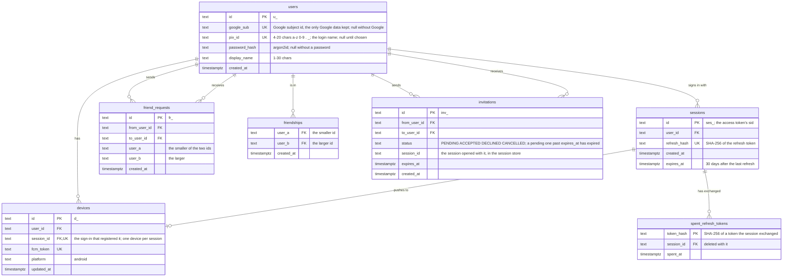

*Figure 10. Database schema. The `invitations` table comes with invitations (Iteration 3).*

- **Users.** A check constraint requires a Google subject, a password hash, or both, so every user can sign in. `pix_id` and `google_sub` are unique; many users may have neither yet.
- **Friends.** `friendships` has one row per pair, `user_a < user_b` (the server orders them), with the pair as its primary key. `friend_requests` has at most one request per pair, in either direction: (`user_a`, `user_b`) is unique. A request is deleted when it is accepted (the friendship is created), declined, or withdrawn, or when either user removes the other.
- **Opposite requests.** A request in the opposite direction is accepted instead of duplicated, also when both come at once: sending locks both users, so the second finds the first's request and accepts it. The unique pair is the database's own guard.
- **Sign-in sessions.** Each sign-in on a phone is a `sessions` row with only the hash of its current refresh token (2.5.3, *Session tokens*); access tokens are not stored. A sign-in removes the user's expired sessions; a refresh moves `expires_at` forward. Exchanged refresh tokens go to `spent_refresh_tokens`, so one that comes back ends the session. One spent longer ago than a session lasts is ignored, as it would have expired, and dropped at the next refresh.
- **Devices.** A device row belongs to the session that registered it, and `session_id` is unique. `POST /devices` is one upsert on `session_id`, so a rotated FCM token replaces the old one in place, even when two registrations arrive at once. When two sessions register one token at once, the second meets the first's row, rolls back, and moves the token on its retry. Ending the session deletes the row (`ON DELETE CASCADE`).
- **Push targets.** A session that expired without a sign-out keeps its device row until the user signs in again. The push sender skips such a row: it sends only to devices whose session has not expired. It deletes a row whose token FCM no longer knows (Iter3-P15, [#119]).
- **Invitations.** A pending invitation past `expires_at` has expired, without a write. Rows are deleted a day after they were created, when a later invitation is sent. `session_id` names a session in the session store, not a row.
- **Indexes.** Besides the keys and unique columns: `sessions.user_id`, `spent_refresh_tokens.session_id`, `devices.user_id`, `friend_requests.to_user_id`, `friendships.user_b`, and `invitations` on `from_user_id`, `to_user_id`, and `created_at`.
- **Privacy.** No table stores a Google ID token, a scene photo, a guide, or anything from the live view or a session (NFR-13). Logs never contain tokens, or Pix IDs with request bodies (2.8, Privacy).
- **Storage.** On the course servers PostgreSQL's files are in `/opt/pix/postgres`, a directory on the server's disk mounted into the container, not a Docker volume. They outlive a crash of PostgreSQL (its write-ahead log replays what was committed), a restart of any container, a deploy, a reboot, and `docker compose down -v`. Deleting that directory deletes every account, and nothing backs it up yet.
- **Failure.** An account request that cannot reach PostgreSQL, loses its connection, or finds no free pool connection answers `503 UNAVAILABLE`; signaling and pose generation keep working. An `OSError` counts only when the database driver raised it; any other is a bug and answers `500`. Log-in ends its transaction before the password check, and `PUT /me/google` before Google's check, so neither holds a connection or SQLite's write lock while it waits.
- **Migrations.** Every worker runs Alembic's `upgrade head` before it takes requests (`pix_server.db.migrate`), under an advisory lock on PostgreSQL: of the two workers in each of two copies, one migrates and the others find the schema current. The revisions are `0001` (accounts and friends) and `0002` (invitations). New ones come from `uv run alembic revision --autogenerate` in `server/`, and a test checks that the migrations build exactly the models' schema.
- **Compatible revisions.** The old copy serves during a deploy, so a revision must not break the release before it: add a column before the code needs it, and drop one a release after the code stops using it.
- **SQLite.** Every transaction takes the write lock when it starts (`BEGIN IMMEDIATE`), so migrations and requests run one at a time. It serves one process on a laptop and the tests.

**Session store (Redis, AD-18).** Redis holds sessions, room codes, presence, the rate-limit windows of pose requests, suggestions, and tips, and the wrong room codes per address, so every worker of both copies sees the same state. Nothing in it must survive a Redis restart, so persistence is off; a deploy does not restart Redis. The code is the server's `store` module (2.2).

| Key | Holds | Removed |
|----|----|----|
| `session:<sessionId>` (hash) | `code`; the connection IDs `photographer` and `subject`, empty while absent; `photographer_token` and `subject_token`, SHA-256 hashes of the rejoin tokens, never the tokens (the subject's emptied when it leaves on purpose); `expires_at` of an unjoined room; `empty_since`, when its last socket left. An invitation's room has an empty `code` and an `invitation` ID | When the photographer leaves, or its invitation is declined or cancelled. Otherwise by the sweeper: 10 min after creation if nobody joined (FR-8.4), an invitation's at its expiry, or 60 s after its last socket (2.6.7) |
| `code:<code>` | The `sessionId` of an active room code | With its session |
| `expired` (sorted set) | Codes expired in the last 10 min, scored by when to forget them: a late `room.join` answers `EXPIRED`, and the code is not reused | By the sweeper at that time |
| `deadlines` (sorted set) | Each session with an expiry ahead, scored by its earlier deadline, so the sweeper reads only those due | With its session |
| `sessions` (set) | Every session ID, counted by `/internal/stats` | With its session |
| `conn:<connectionId>` (hash) | The worker that holds the socket, the session it is in, and the signed-in user, if any | On disconnect |
| `workers` (set), `worker:<workerId>`, `conns:<workerId>` (set) | The registered workers; each one's heartbeat, which Redis expires after 15 s (`PIX_WORKER_TTL_SECONDS`); its connection IDs. A worker registers at start or after it lost its state; the other scripts refuse a worker not in `workers` | The heartbeat by its expiry, the rest by the sweeper once it is gone; all when the worker stops |
| `presence:<userId>` (set, Iter2-P8) | The user's open connection IDs: online while one exists, in a session while one is in a session (FR-5.9, FR-6.9) | With the connections, also those of a worker the sweeper finds dead |
| `rate:pose:<address>`, `rate:pose:all` (sorted sets) | The times of pose requests inside the window, per address (1 hour by default) and over all (24 hours by default). A request counts in both windows or in neither (2.8, Privacy) | As the window moves; each key one window after its last request |
| `rate:suggest:<address>`, `rate:suggest:all`, `rate:tip:<address>`, `rate:tip:all` (sorted sets) | The same two windows for `POST /pose-suggestions` and for `POST /pose-tips`, each with its own limits (2.8, Privacy) | As above |
| `rate:join:<address>` (sorted set) | The times of that address's wrong room codes inside the window, 10 min by default (2.5.2) | As above |
| `sweeper` | The worker that sweeps during this interval | After one interval |
| Channel `worker:<workerId>` | Messages for sockets that worker holds | Not stored |

- **Atomic transitions.** Each change of session state is one Lua script in Redis (`store/scripts.py`): `CONNECT`, `CREATE`, `JOIN`, `REJOIN` (`session.join`), `INVITE`, `ACCEPT_INVITATION`, `END_INVITATION`, `ROUTE` (where a `signal` goes), `LEAVE`, `DISCONNECT`, `BEAT` (heartbeat and sweep), and `RELEASE` (a worker stops); `REGISTER`, `STATS`, `PRESENCE`, and `RATE_LIMIT` complete the set. A script checks and changes the session and returns the messages to deliver as rows (connection, its worker, message kind), which the worker turns into JSON. So two joins cannot interleave, even on two workers.
- **Time.** The caller passes the current time in, so tests can move a fake clock. Redis's own expiry serves only the heartbeat, which is about whether a process is alive, the `sweeper` lock, and dropping idle rate-limit keys.
- **Delivery.** A worker puts a message for its own socket into that socket's bounded queue and publishes the others on the target worker's channel, to which that worker subscribed before taking sockets. Messages between two workers keep their order, so `peer.joined` reaches the photographer before the subject's first `signal`. Pub/sub stores nothing: a message lost while a worker reconnects shows up as a session that does not connect, which the 15 s connecting timeout and reconnection handle (2.6.7).
- **Sweeper.** Every worker renews its heartbeat each second (`PIX_CLEANUP_INTERVAL_SECONDS`), and the worker that gets the `sweeper` lock for that second also sweeps. It forgets old expired codes, expires unjoined rooms and tells the photographer `EXPIRED`, and removes empty sessions. It treats every connection of a worker without a heartbeat as disconnected, so the other phone gets `peer.left` with `CONNECTION_LOST`. Every transition sweeps first too, so a join enforces an expiry the sweeper has not reached yet.
- **A worker that stops** gives up its connections at once. Their sessions stay for the usual 60 s, in which a phone that reconnects takes its place again (2.6.7).
- **Failure.** `/health` checks Redis, so a copy that cannot reach it gets no traffic (2.8, Deployment). When a Redis call fails, or a worker finds itself missing from `workers` (Redis restarted empty, or the sweeper took it for dead), messages for its sockets may be lost: it closes them all with 1013 (try again later) and registers again. A live session goes on phone to phone; a waiting room ends with an error instead of stalling with a dead code.
- **Until Redis answers,** new sockets are closed with 1013, and pose, suggestion, and tip requests answer `503 UNAVAILABLE`, since the rate limit cannot count them. So do `GET /friends` and accepting a friend request, which read presence, and sending or answering an invitation, which changes its session. A disconnect the worker could not write is written later. If Redis itself restarts, open rooms are lost.
- **Tests and laptops.** Without `PIX_REDIS_URL` the server keeps its state in fakeredis inside the process, with the same scripts, for one worker on a laptop; the deployed image lacks it. The tests use fakeredis too, which can also switch the store off. Without `PIX_DATABASE_URL` the accounts are in `pix.db` in the working directory, and each test uses a new SQLite file. CI runs the tests a second time on a real Redis and PostgreSQL.

### 2.8 Implementation decisions

**UI structure**

- One activity with a Navigation graph; each wireframe screen is a destination. `PixNavHostFragment` gives every move between screens its transition (2.1).
- A flow's screens share an activity-scoped ViewModel: account, friends, generation, incoming invitations, pose saving, reference, session, and settings. Camera, Subject view, the subject's shared-step screens, and *Invitation* have their own.
- A ViewModel takes user events and exposes its UI state as a `StateFlow`. One-shot results and notices come from buffered `Channel`s, so they wait while the screen is stopped.
- `AppContainer` creates every module, so a fake can stand in for one that is not ready.
- Colors are tokens in `colors.xml`, in two sets (Iter4-P5, [#202]). The page tokens (`pix_*`) are the ones light mode gives a second value ([#212]). The tokens on the image (`camera_*`, `guide_preview_*`) are what is drawn over the camera's image or a photo, which stays the same in every mode (R&S 6.9), and the camera screens' bars and shutter, apart so that light mode can give them other values. No layout, drawable, color list, style, or theme writes a color as a value; an icon is white and takes its color from the tint where it is used. *Why:* light mode then changes values, not screens.
- `Theme.Pix` is a DayNight theme that takes the mode Pix sets, not the phone's: `PixApplication` sets dark until light mode adds the choice ([#212]), which also decides which parts of Camera and Subject view change with the mode.

**Concurrency**

- Segmentation, outline tracing, and image encoding run on `Dispatchers.Default`, file work on `Dispatchers.IO`. Network calls are Retrofit `suspend` functions on OkHttp's threads.
- The saved-guide store encodes and writes on `Dispatchers.IO`, one call at a time. It traces outlines and cuts thumbnails on `Dispatchers.Default`, outside its lock.
- CameraX analysis has its own single-thread executor.
- WebRTC and WebSocket callbacks hop onto one serial session scope (`limitedParallelism(1)`), so session state never races. WebRTC's own threads are never blocked.

**Message rate**

- `guide.state`: at most every 50 ms (20 Hz) during a gesture; the final value at once on the reliable channel (2.5.1).
- `camera.state`: one step per zoom the camera reports applied, at most one per display frame, and a final value 100 ms after the last (2.6.5).
- The subject's requests: at most every 50 ms; the final value at once. Receivers drop a stale `seq`.

**Backpressure**

- Reliable messages wait in one ordered queue until `hello` has gone out and while the reliable channel's `bufferedAmount` is 256 KiB or more. Realtime messages never wait.
- A guide image of tens of KB stays well under that limit, so control messages are not held up. A session photo of megabytes would hold the queue up, so its chunks go through `sendBulk`, outside it. They go one at a time, only while the queue is empty and `bufferedAmount` is below 64 KiB (2.6.5).

**Caching**

- The current guide and the last candidate set stay in memory for the app process only. No picked photo or generated pose is written to disk, except a saved guide (*Guide store*).
- The subject keeps the last guide image and reference photo by ID and names them in `hello`, so a reconnect does not resend them (2.5.1).
- A received session photo is written in chunks to `cacheDir/session-photos/`, then saved to the "Pix" album (2.6.5).

**Guide store** (AD-16)

- Each phone has two `InMemoryGuideRepository` instances: the photographer's guide, clamped to the chosen ratio's frame, and the subject's mirror, clamped to the narrowest frame (9:16). Writes are serialized.
- `setGuide` resets the state to the guide's `anchor`, or clears it for null. `update` needs an image, keeps its ID, and clamps through `GuideGeometry`. Every applied change, hiding included, emits a `GuideChange`.
- `FileSavedGuideStore` keeps each saved guide in `filesDir/guides/<id>/`, never in MediaStore:
  - `mask.png`, as the subject receives it, at most 720 px tall (`mask-png`, 2.5.1);
  - `reference.webp`, the 512 px reference copy;
  - `meta.json`: `GuideState`, `anchor`, `aspect`, `source`, `savedAt`, and `order`.
- It keeps at most 100 guides (`MAX_SAVED`); the save that deletes the oldest says so (`GuideSaved.removedOldest`). The increasing `order` sorts the list, so a clock set back cannot reorder it.
- A guide is written to a hidden `.<id>` folder, then renamed. A read deletes half-written folders, folders without a usable `meta.json` or `mask.png`, and any beyond 100. An older folder's `cutout.webp`, whose alpha is the mask, becomes `mask.png` at the first read, and the cutout is deleted.
- A start reads only the `meta.json` files, so a full library lists at once. Images are decoded on use or for a thumbnail; an undecodable mask fails the use with a message. A loaded guide's outline is traced again from its mask.
- `thumbnail(id)` is the middle of the reference, or of the outline without one, cut to 3:4, at most 384 × 512 px, never enlarged.
- A saved guide starts at its `anchor`, like a new guide, and its stored `GuideState` is not applied (FR-3.1).

**Lifecycle**

- The camera binds to the Camera screen's view lifecycle. The app is portrait only; ViewModels keep state across configuration changes, such as a new language.
- In the background, the photographer's app releases the camera and the video pauses. After 60 s the photographer's phone leaves the session, even through a reconnection (2.6.7). No foreground service is used.
- Subject view shows "Connecting…" until the first frame, then "The photographer's camera is paused." after 2 s without one.
- A rebind restores the aspect ratio, brightness, and flash. DataStore keeps the last ratio.

**Error handling**

- Module interfaces return `Result` with typed errors (`NoPersonFoundException`, `GenerationError`, `EndReason`). ViewModels map each to exactly one failure screen.
- One exception: an unreadable reference photo, or a segmentation model not ready within 60 s, shows the toast "Couldn't use this photo. Try another one." It returns to Camera, or to Subject view for the subject's guide.

**Timeouts**

| What | Limit |
|----|----|
| Pose generation | 60 s per run on the phone, 60 s per request from server to image API; the phone usually ends first, before the server's `504` (2.6.3) |
| Other model calls | Each model's own limit on the server (2.6.3); the phone waits 10 s for variations, then repeats the description, and 15 s for a tip |
| Session connecting | 15 s |
| Reconnecting | 10 s before a dropped link counts as lost (2.4, 2.6.7) |
| Signaling socket dropped in a session or while a room waits | Again after 1 s; every 1 s while reconnecting, otherwise doubling to 30 s |
| Photographer's app in the background | 60 s, then it leaves the session |
| Remote requests | 500 ms until an unanswered final request is answered; 5 s in which a late one is still the subject's (2.6.5) |
| Session photo | Given up after 30 s without word from the subject (2.6.5) |
| Room code | 10 min |
| Invitation | 60 s (`PIX_INVITATION_TTL_SECONDS`); after an accept, at least 15 s for the friend's phone to take its place (`PIX_INVITATION_JOIN_SECONDS`); the photographer's phone gives up after 80 s without the server's word |
| TURN credentials | 4 h (`PIX_TURN_TTL_SECONDS`, 14400) |
| Cloudflare's TURN API | 3 s, then STUN only (`PIX_TURN_TIMEOUT_SECONDS`) |
| A push to FCM | 5 s (`PIX_FCM_TIMEOUT_SECONDS`) |

**Configuration and secrets**

- `BuildConfig.SERVER_URL` is Server A in release builds. Debug builds use the AWS server, `http://3.105.185.251/`, or any server set in `pix.serverUrl`, such as a laptop on the test Wi-Fi. A debug build's `pix.relayOnly=true` forces the relay (2.6.7).
- `BuildConfig.GOOGLE_SERVER_CLIENT_ID`, one constant in `app/build.gradle.kts`, equals the servers' `PIX_GOOGLE_CLIENT_ID`. Google accepts sign-in only from an APK whose signing key is registered as an Android OAuth client in that project.
- The course servers have no TLS (AD-11). Release builds allow plain HTTP and WebSocket traffic only to the two course hostnames (`network_security_config.xml`); debug builds allow any host.
- `server/.env.example` lists every setting, and a test keeps it in step with the code. Each server must set the names left empty: `OPENROUTER_API_KEY` (never committed), `PIX_GOOGLE_CLIENT_ID`, and Cloudflare's TURN key, `PIX_TURN_KEY_ID` and `PIX_TURN_API_TOKEN` (AD-14). The rest are commented with the app's default, such as `PIX_POSE_MODEL`.
- On a server, Compose sets `PIX_REDIS_URL`, `PIX_DATABASE_URL`, `PIX_JWT_SECRET`, and `PIX_FCM_CREDENTIALS_FILE`. `deploy.sh` makes the database password and the JWT secret once, in `/opt/pix/db-password` and `/opt/pix/jwt-secret`.
- The FCM key belongs to a service account of the app's Firebase project that may only send FCM messages. Compose mounts it from `/opt/pix/secrets/`, readable only by the app's user; without it, no push goes out. Other secrets live only in each server's `/opt/pix/.env`.
- The server logs only Cloudflare's status, never the TURN token or a credential. The invite link takes its host from the request.
- Each deploy and restart compares `.env` with the example. It warns in its log, in `pix status`, and at an operator's login. A warning names a required name left empty, or a name the example lacks, which the app ignores. It never writes `.env`, so no server pins an old default.

**Privacy** (NFR-13)

- The server never logs request bodies, images, the image API's response bodies, passwords, or tokens. Nor does it log descriptions, suggested poses, or variations, which describe the person in the photo.
- A scene photo stays in memory until the response. nginx and the app refuse a request over 1 MiB before reading it, so no upload reaches the disk.
- Each description and pose also goes, without the photo, to the description filter's decision model, TypeSafe's Jev on OpenRouter (2.6.3). A refusal logs only the question and its probability. Each `POST /poses` scene goes to the same model for the person check, which logs only its probability.
- Rate limits count only requests that reach a model, to bound cost. Each answers 429 with a message that names the limit, `RATE_LIMITED` for the client's window and `DAILY_LIMITED` for all clients' ([#203]):

| Request | Per address | All clients | Settings |
|----|----|----|----|
| `POST /poses` | 20 per hour | 500 per 24 h | `PIX_POSE_RATE_LIMIT`, `PIX_POSE_GLOBAL_LIMIT`, `PIX_POSE_GLOBAL_WINDOW_SECONDS` |
| `POST /pose-suggestions` | 10 per hour | 500 per 24 h | `PIX_SUGGESTION_RATE_LIMIT`, `PIX_SUGGESTION_GLOBAL_LIMIT` |
| `POST /pose-tips` | 20 per hour | 1000 per 24 h | `PIX_TIP_RATE_LIMIT`, `PIX_TIP_GLOBAL_LIMIT` |
| `room.join` with a wrong code | 100 per 10 min | — | `PIX_JOIN_FAILURE_LIMIT`, `PIX_JOIN_FAILURE_WINDOW_SECONDS` (2.5.2) |

- The global limits bound a day's model cost, however many addresses send. The OpenRouter key's spending limit, set in its dashboard, is the last bound. On the course servers, the address is the last `X-Forwarded-For` value (*Hosting*).
- Over plain HTTP to the course servers, a scene photo, a sign-in password, and the tokens travel unencrypted (AD-11). The live view goes phone to phone, encrypted (NFR-14).
- No URL holds a Pix ID or other personal data, because nginx's error log prints a failed request's whole request line. The lookup is `POST /users/lookup`. nginx and Uvicorn access logs leave out query strings.
- Password hashes run two at a time per worker. A burst of sign-ins, which needs no account, then queues instead of taking a 64 MiB argon2id buffer per pool thread.
- Cloud backups are off (`allowBackup="false"`); `data_extraction_rules.xml` keeps the sign-in, `guides/`, and the prompt history out of transfers to a new phone.

**Measurement hooks**

- `Timings` logs named timestamps under the tag `PixTimings`, so NFR latencies come from logcat without extra tools: for example `seg.start`/`seg.end`, `pose.first`, `guide.sent`/`guide.applied`, and `rtt` from ping.
- Times are each phone's own clock (`elapsedRealtime`); the `ping.received` and `rtt` lines align two phones' logs (2.5.1).
- Each ping also logs a `stats` line from WebRTC's statistics (codec, size, frame rate, bitrate, round-trip time), the source for NFR-5, NFR-6, and NFR-12. An `ice.pair` line names each new candidate pair (NFR-10, 2.6.7).
- The zoom marks and the `zoom.frame` lines after each zoom request feed `android/scripts/zoom_timings.py` (2.6.5).

**Hosting** (AD-11)

| Server | Address | Branch | Use |
|----|----|----|----|
| A | `http://swpp26t10.147-46-242-169.sslip.io` | `main` | Production; release builds |
| B | `http://swpp26t10.147-46-242-174.sslip.io` | `dev` | Staging |
| AWS | `http://3.105.185.251` | `dev` | Debug builds; reachable from every network, cellular data included |

- The course servers are reachable only through the course's HTTP proxy on port 80, and only from the campus network. They cannot reach each other, so each has its own database and session store.
- The AWS server runs the same Compose setup. It stays on and answers from every network, so debug builds and sessions across networks use it.
- `server/deploy/docker-compose.yml` runs:
  - `nginx` on port 80, which forwards `/api/v1`, `/ws`, `/health`, and the invite link's page `/i/<id>`, serves `/version`, and answers `404` to the rest, so FastAPI's `/docs` is not public;
  - `app-blue` and `app-green`, two copies of the app, each Uvicorn with two workers, set explicitly because the servers report 38 CPUs for our 8 cores;
  - `redis`, which writes nothing to disk;
  - `postgres`, with its files in `/opt/pix/postgres` on the server's disk, not a Docker volume, so no Docker cleanup can delete them.
- The course's proxy, measured on 2026-10-13: WebSockets pass and stay open (300 s with pings, 200 s idle). A plain HTTP response is cut after 120 s, and a client's cancel is not passed on (2.6.3).
- The proxy adds the phone's address as the last `X-Forwarded-For` value, after any value the client sent. So nginx trusts only the proxy and takes the last value.

**Deployment**

- GitHub cannot push to the course servers. SSH goes through a campus-only relay with personal keys, and a self-hosted runner needs admin rights and is advised against on a public repository. So each course server pulls.
- A systemd timer runs `server/deploy/deploy.sh` every minute. For a new commit on its branch, the script:
  1. only records it when it does not change `server/`;
  2. otherwise builds the image on the server, with the tests as a build stage;
  3. starts it as the idle copy (blue or green) and waits for its `/health`;
  4. waits at most 10 min until the old copy has no open room, switches nginx, and checks `/health` through it;
  5. stops the old copy with 70 s for a pose request in flight, and records the commit in `/version`.
- A failed step leaves the running copy serving, and a commit with the same `server/` is not tried again. `deploy.sh rollback` switches back to the previous image.
- Why wait for rooms: phones take their place again after a socket drop, on either copy (2.6.7, AD-18). An app from before reconnection cannot (Iter3-P14). In a room spanning both copies, the phone on the new copy would hear that its peer was lost, ending the subject's live session.
- GitHub's runners build the image for every pull request. After a merge, a workflow waits until `/version` shows the commit, so a failed deploy shows on the commit.
- GitHub reaches the AWS server, so it has no timer. After each push to `dev`, a workflow runs `deploy.sh deploy` there through AWS Systems Manager, as the `PixDeploy` command document, then checks `/version` at the public address.
- The workflow's IAM user key may run only that document on that one instance. It is a secret of a GitHub environment that only `dev` may use, and no SSH port is open.

**Accounts** (AD-12)

- The app sends the access token as a bearer header on REST calls and on the signaling upgrade. Everything but friends and invitations works without one (FR-5.1).
- Sign-up takes a Pix ID, a display name, and a password, or Google. Either account can add the other sign-in (`PUT /me/google`, `PUT /me/password`; 2.5.3). Without email, a lost password cannot be reset.
- Passwords are hashed with argon2id (`argon2-cffi`'s defaults: 3 passes over 64 MiB) on a worker thread, so a hash does not hold up the worker's sockets. Only the hash is stored.
- Passwords cross plain HTTP to the course servers (AD-11, NFR-14). Log-in attempts are not limited.
- Whether a Pix ID exists is not secret: the lookup tells any signed-in user, and `POST /auth/check-pix-id` anyone, for an exact Pix ID only (NFR-15). Neither is limited. A failed log-in answers alike for an unknown Pix ID and a wrong password.
- `google-auth` verifies Google ID tokens against Google's published keys and our web client ID. The server stores only the Google subject.
- A sign-in gives a 15-minute access token (`PIX_ACCESS_TOKEN_MINUTES`), a JWT that `PyJWT` signs with HS256 and `PIX_JWT_SECRET`. It also gives a refresh token valid 30 days from its last use (`PIX_SESSION_TTL_DAYS`; 2.5.3, *Session tokens*). The app keeps both in DataStore, in its private files, without Keystore encryption (*Privacy*).
- An access token is checked without the database, so the signaling upgrade marks a user online from the token alone. REST endpoints still load the user.
- A refresh is one `UPDATE … WHERE refresh_hash = … RETURNING`, so of two refreshes with one token, the second finds it spent and ends the session.
- Sign-out ends refreshes at once and the access token within 15 minutes. A new `PIX_JWT_SECRET` ends every access token, and the app refreshes.
- Without `PIX_JWT_SECRET`, each server process makes its own secret, which suits one worker on a laptop. On a server, both copies share the one `deploy.sh` keeps.

**Push** (AD-13)

- Pushes do not replace reading the lists. While shown, *Share my camera* and *Sent requests* call `AuthRepository.refreshAccount()` (`GET /me`) and `FriendsRepository.refresh()` (`GET /friends`, `GET /friend-requests`) every 10 s.
- The account is read even without a Pix ID, so one chosen on another phone brings the lists at once. Received invitations are read every 5 s (2.6.6).
- FCM carries data messages only; the app renders each notification (`push/PushNotifications`). An invitation's uses the high-importance *Invitations* channel for the invitation's lifetime. A friend request's uses *Friend requests* and opens *Share my camera* (`pix://friends`).
- An invitation opened after it left `PENDING` shows "This invitation is no longer available".
- The server pushes from a background task after its response, so FCM never slows or fails a request. It keeps FCM's access token, from the service account's key, until a minute before it expires.
- The server deletes a device row whose token FCM reports unregistered (404). A log line holds FCM's status, never a token.

**Aspect ratio and camera controls**

- `setAspectRatio` rebinds the `UseCaseGroup` with a `ViewPort` of the new ratio once no photo is being saved. The default is 4:3; DataStore (`camera_settings`) restores the last ratio.
- CameraX opens every binding without the exposure index and the flash mode. `CameraXController` keeps them, as it keeps the zoom, and applies them again after a rebind, a lens switch, or the screen's return.
- The camera stays `STARTING` until the exposure index is back, so no photo is taken at 0 EV.
- While a separately exposed ultrawide without a flash is bound, the capabilities and the state report no flash, so the button hides. The chosen mode returns with the primary camera.
- The capabilities come from the chosen side's primary camera: rear, or front in selfie mode. A switch of side starts again at 1× and the base brightness.
- A tap focuses, meters, and sets the white balance at that point, then returns to continuous focus after 5 s (`FocusMeteringAction`). The point maps from frame to preview buffer through its crop and rotation, mirrored on the front camera.

**Guide-edit mode** (AD-17)

- A boolean in the screen's UI state (`guideEditing`), not in `GuideState`, so it is never synchronized; each phone has its own.
- It sets the overlay's `editable` flag and whether the preview's pinch zooms.

**Camera labels and brightness** ([#182])

- Toggles say in words what they did. One chip with an icon at the top of the image (`toggleLabel`) shows *Hide* / *Show* ("Guide hidden", "Guide shown"), a tap on the zoom readout (the step, such as "2×"), and *Save guide*'s notices.
- The chip shows for 3 s (`CameraViewModel.NOTICE_MS`), and a new label replaces it at once. It is a live region for TalkBack. The hint chip steps aside for it, and opening the ratios takes it down (FR-1.13).
- The guide-edit mode toggle shows `pinchModeLabel` above it for 3 s: *Guide* in the guide's color while drags and pinches move the guide, *Camera* in white while a pinch zooms. TalkBack reads "Pinch moves the guide" or "Pinch zooms the camera".
- Subject view shows the same labels for its zoom step, its *Save guide* (no toast), and its toggle.
- The pose tip's button closes an open tip, as any touch does (FR-4.10). The screen-wide touch skips the button, so one tap does not close and reopen the tip.
- Brightness is `ExposureBarView`: a 48 × 128 dp touch area, a 1.5 dp accent line with a 2.5 dp outline, and a sun at the applied exposure index (FR-1.11).
- A tap to focus brings the bar up beside the focus box: on its right, or its left near the image's right edge, always inside the image. Without point focus, it comes up at the tap.
- Up without a tap point, as after the screen is made again, the bar stands at the middle of the image's right edge, clear of the horizon bar.
- A drag on the bar, or one finger's drag up or down anywhere on the preview (`PinchZoomController.VerticalDrag`), moves the sun from where it was, up brighter. The bar spans the camera's whole range. Each step applies at once, and the last again on release.
- A drag that starts with the bar down first focuses there, as a tap, and starts from the base. A sideways move or a second finger is no brightness drag; guide-edit mode keeps the preview's drags.
- Every photo starts from the base brightness in Settings, like iPhone's exposure adjustment (2.6.8). `CameraViewModel` applies `AppSettings.baseBrightness` as the nearest exposure index in the camera's range (`ExposureScale.indexOf`).
- It applies it when the range is first known, when the range or step changes (another camera), and when the setting changes. Each tap to focus drops a drag's change and sets the base again; the setting stays.
- TalkBack reads the bar as a slider with scroll actions. The bar fades after 3 s without a touch (`CameraFragment.BRIGHTNESS_IDLE_MS`). It stays while dragged or in TalkBack's focus; the idle time restarts when the focus leaves.
- The focus box (`bg_focus_ring`) is a 64 dp square of a 1 dp accent line, with a short tick at the middle of each side. Subject view keeps its brightness button and horizontal slider (2.6.5).

**Language** (FR-10.2)

- English is in `res/values/` and Korean in `res/values-ko/`, behind the same keys. Android takes the first of the two in the phone's language list, else English. Settings can set Pix's own language instead (2.6.8).
- The build declares both (`generateLocaleConfig`; English is the default in `res/resources.properties`), so Android 13+ offers them in its per-app language setting.
- Strings without words (ratios, counters) are not translated. Android Lint fails any other string without its Korean.
- Korean uses Pretendard, bundled (SIL OFL 1.1), because the UI's font, Manrope, has no Hangul. On Android 13 and later, lines break between words (`lineBreakWordStyle` phrase).
- The server's text for the screens follows the same choice: `values-ko` sets `R.bool.screens_in_korean`, and the pose tip is asked for in Korean when it is true (2.6.3).

**SDK vs in-house**

- Use SDKs for segmentation (ML Kit) and real-time media (WebRTC): hard problems with mature solutions.
- Build in-house what makes Pix different: guide geometry and sync, the message protocol, remote control, and the pose prompt pipeline.

### 2.9 Module ownership and build order

Owners follow the README's *Team* section. The Iteration 3 table names who built each task, also in another owner's module.

| Module | Owner | Iteration 1 | Iteration 2 | Provides to |
|----|----|----|----|----|
| **App shell, design, and integration** | 한준형 (PM in Iteration 2); 박재완 (PM in Iteration 3); 조성민 (PM in Iteration 4) | Activity, navigation graph, permission flow, `AppContainer` | The design and the shared contracts (Iter2-P3, [#45]); integration (Iter2-P22, [#60]); integration tests (Iter2-P21, [#59]); demo README (Iter2-P23, [#61]); schedule and issues | All screens |
| **Camera** | 박동제 | Preview, capture to MediaStore, zoom, the viewport, `setFrameSink` (한준형, #3) | Tap to focus, brightness, flash, aspect ratios; `CameraController` and `CameraCapabilities` additions (Iter2-P10, [#51]) | Session, remote control |
| **Reference guide** | 박동제 | Picker, segmentation, cutout, outline, *No person found* | Smooth outlines (Iter2-P7, [#49]); the `anchor` and the thumbnail copy of the reference (Iter2-P11, [#52]). Lines for arms and legs in front of the body are out of scope (2.6.1). | Guide overlay |
| **Guide overlay and controls** | 박동제 | `GuideRepository`, `GuideGeometry`, overlay gestures, opacity (한준형, #6) | Hide and replace, reference thumbnail, starting position, guide-edit mode on Camera (Iter2-P11, [#52]); saved guides (Iter2-P18, [#58]) | Guide sync, Subject view |
| **Server deployment** | 박재완 | The laptop on the test Wi-Fi | The course servers with Docker, nginx, and blue-green deploys (Iter2-P4, [#46]); the Redis session store (AD-18; Iter2-A2, [#73]) | Everything |
| **Accounts and friends** | 박재완 | — | Database, sign-in with a Pix ID and a password or with Google, Pix IDs, friend requests, friend list, presence (Iter2-P8, [#50]); Sign-in, Pix ID, and Friends screens (Iter2-P13, [#54]) | Invitations |
| **Pose generation** | 박재완 | API choice, `POST /poses`, the default poses, `PoseGenerator` | Pose descriptions, *Generate poses*, one prompt, suggested poses (Iter2-P12, [#53]) | Reference guide |
| **Real-time session** | 조성민 | `SignalingClient`, `PeerConnectionClient`, `CameraFrameSource`, codec, router | `ws://` to the course server | Guide sync, remote control |
| **Remote control** | 조성민 | `RemoteControlHandler` (zoom) | Brightness, flash, guide moves, and notices (Iter2-P17, [#57]); pinch zoom and the guide-edit mode toggle on Subject view (Iter2-P6, [#48]); zoom without stutter (Iter2-P5, [#47]) | UI |
| **Guide sync** | 조성민 | `GuideSyncer`, the guide on Subject view | `visible` through `guide.state` (2.5.1) | UI |
| **Shared steps** (`DescriptionSyncer`, `PoseSyncer`, `ConfirmSyncer`, `PhotoSyncer`) | 한준형 | — | — | UI |
| **Settings and tutorial** (`SettingsViewModel`, `AppSettings`, `TutorialFragment`) | 조성민 (settings), 한준형 (tutorial) | — | — | All screens |

The zoom without stutter was measured on the S23 Ultra in Iteration 2; IT-10 passed on the S21 and the S22 in Iteration 3, by eye. Remote focus and the remote-control switch (Iter2-P17, Could) move to Iteration 5, left out of Iteration 4 at its kickoff of 11/7.

**Iteration 3 tasks** (from the kickoff of 2026-10-25; the tasks due 10/30 were for the user test of 10/31–11/1):

| Task | Owner | Due | Status | Design |
|----|----|----|----|----|
| A temporary server on AWS for the user test (Iter3-P2) | 박재완 | 10/26 | Done | 2.8 |
| The documents (PM; Iter3-P3–P5) | 박재완 | 10/26 | Done | — |
| The Korean translation (Iter3-P7, [#111]) | 박재완 | 10/26 | Done | 2.8 |
| Camera's buttons and preview size (Iter3-A2, [#136]) | 박동제 | — | Done | 2.6.2 |
| Wireframes drawn from the app's screens (Iter3-A3, #141) | 박재완 | — | Done | — |
| Candidates in the scene photo's ratio (Iter3-P8, [#112]) | 박재완 | 10/30 | Done | 2.6.3 |
| The mask-only guide transfer both ways, in `GuideImageCodec` and the syncer, with `anchor` and `source`, which the subject keeps for *Save guide* (Iter3-P9, [#113]) | 한준형 | 10/30 | Done | 2.5.1, 2.6.1 |
| *Pick a pose* one candidate at a time (Iter3-P10, [#114]; PR [#108]) | 박동제 | 10/30 | Done | 2.6.3 |
| Pose tips (Iter3-P11, [#115]; PR [#110]) | 박동제 | 10/30 | Done | 2.6.3 |
| Selfie mode, and whether the prompts suit it (Iter3-P12, [#116]) | 박동제 | 10/30 | Done | 2.6.3, 2.6.4 |
| The reference thumbnail on Subject view, with `guide.reference.*` (Iter3-A1, [#132]) | 박동제 | 10/30 | Done | AD-6, 2.5.1, 2.6.2 |
| Sessions on different networks, with TURN through Cloudflare (Iter3-P13, [#117]) | 조성민 | 10/30 | Done | 2.6.7 |
| Reconnection after a short drop, with `session.join` and an ICE restart (Iter3-P14, [#118]) | 조성민 | 10/30 | Done | 2.6.7 |
| Invitations and friend requests with push and the link, with `SessionEntry.Invitation` (Iter3-P15, [#119]) | 조성민 | 10/30 | Done | 2.6.6 |
| Shared steps: guide selection from the subject's phone; the photographer's candidates on both phones' *Pick a pose*, the first choice deciding; *Save guide* on either phone (Iter3-P16, [#120]) | 한준형 | 10/30 | Done | 2.5.1, 2.6.5 |
| Photos taken in a session saved on both phones (Iter3-P17, [#121]) | 한준형 | 10/30 | Done | 2.5.1, 2.6.5, 2.6.7 |
| Pose tips in Korean (Iter3-A4, [#156]) | 박동제 | 10/31 | Done | 2.6.3, 2.8 |
| A light for the scene photo (Iter3-A5, [#158]) | 박동제 | 10/31 | Done | 2.6.3 |
| The app icon and branding assets (Iter3-A6, #162) | 박재완 | 10/31 | Done | — |
| The offline QR connection (Iter3-P22, [#122]) | 조성민 | 11/5 | Moved to Iteration 4 ([#214]) | *Still open* |
| The settings screen (Iter3-P23, [#123]) | 조성민 | 11/5 | Done | 2.6.8 |
| The first-use tutorial (Iter3-P23, [#123]); its tips over each screen (#173) | 한준형; 박재완 (#173) | 11/5 | Done | 2.6.8 |
| Prompt history on *Generate poses* (Iter3-P24, [#124]) | 박동제 | 11/5 | Done | 2.6.3 |
| Four prompt templates and an improved default prompt (Iter3-P25, [#125]) | 박재완 | 11/5 | Moved to Iteration 4 ([#211]) | *Still open* |
| The AI module test with an LLM judge (Iter3-P26, #126) | 박재완 | 11/5 | Done | Testing Documentation |
| Integration tests for the Iteration 3 flows (Iter3-P27, #127) | 박재완 | 11/5 | Done | Testing Documentation |
| Integrate the Iteration 3 features (Iter3-P28, [#128]) | 박재완 | 11/5 | Done | — |
| The description filter and the person check (Iter3-A7, [#165]) | 박재완 | 11/5 | Done | 2.6.3, 2.8 |
| The guide library: *My library* on *Add a pose guide* and the library screen (Iter3-A8, [#170]) | 조성민 | 11/5 | Done | 2.1, 2.6.2, 2.8, AD-16 |
| A generated pose saved to the library with ♥ on *Pick a pose* (Iter3-A9, [#171]) | 조성민 | 11/5 | Done | 2.6.3 |
| A screenshot of a feed post cut to its photo for its guide (Iter3-A10, [#174]) | 조성민 | 11/5 | Done | 2.1, 2.3, 2.6.1 |
| Screenshots from other apps cut to their photo: image viewers and stories (Iter3-A11, [#177]) | 조성민 | 11/5 | Done | 2.6.1 |
| The Iteration 3 documents, demo README, and `iteration-3-demo` (Iter3-P29, #129) | All | 11/6 | Done | — |
| Camera changes animated on both phones (Iter3-A12, [#179]) | 조성민 | 11/6 | Done | 2.6.2 |
| The guide and the pose flow polished (Iter3-A13, [#180]) | 조성민 | 11/6 | Done | 2.5.1, 2.6.3, 2.6.5 |
| Transitions between screens (Iter3-A14, [#181]) | 조성민 | 11/6 | Done | 2.1 |
| Camera's controls after the heuristic evaluation (Iter3-A15, [#182]) | 한준형 | 11/6 | Done | 2.6.2, 2.6.8, 2.8 |
| Camera quality and latency closer to the stock camera (Iter3-A16, #183) | 한준형 | 11/6 | Moved to Iteration 4 ([#208]) | — |
| Who takes the photo, chosen before connecting (Iter3-A17, [#188]) | 조성민 | 11/6 | Done | 2.1, 2.6.6 |

**Iteration 4 tasks** (from the kickoff of 2026-11-07; Iteration 4 runs 11/8–11/20, with the UAT in class on 11/16 and 11/18):

| Task | Owner | Due | Status | Design |
|----|----|----|----|----|
| The documents and the issues (Iter4-P1, [#198]) | 조성민 | 11/9 | Open | — |
| Back on the pose screens, with *Generate again* (Iter4-P2, [#199]) | 한준형 | 11/12 | Open | 2.4, 2.6.5, *Still open* |
| A refused description kept in the history (Iter4-P3, [#200]) | 박동제 | 11/12 | Open | 2.5.1, 2.6.3 |
| The subject's live view mirrored (Iter4-P4, [#201]) | 한준형 | 11/12 | Open | 2.6.4 |
| Color tokens and a DayNight theme (Iter4-P5, [#202]) | 박동제 | 11/12 | Open | 2.8 |
| A message for each way pose generation fails (Iter4-P6, [#203]) | 박동제 | 11/13 | Open | 2.5.3, 2.6.3 |
| UI fixes: no notice after saving, the primary buttons at the top right, and the leftovers of the user test and the heuristic evaluation (Iter4-P7, [#204]) | 박동제 | 11/13 | Open | 2.6.2 |
| The UAT (Iter4-P8, [#205]) | 조성민 | 11/18 | Open | Testing Documentation 4.3, 4.4 |
| Landscape photos saved as taken, and landscape poses (Iter4-P9, [#206]) | 한준형 | 11/19 | Open | 2.6.1–2.6.4, 2.8 |
| The controls turn with the phone (Iter4-P10, [#207]) | 한준형 | 11/19 | Open | 2.1, 2.6.2 |
| Camera quality and latency, low priority (from #183) (Iter4-P11, [#208]) | 한준형 | 11/19 | Open | 2.8 |
| Situation prompts, compared with the current prompt (Iter4-P12, [#209]) | 박재완 | 11/19 | Open | 2.5.3, 2.6.3, *Still open* |
| The situation choice on *Generate poses* (Iter4-P13, [#210]) | 박재완 | 11/19 | Open | 2.1, 2.5.1, 2.6.5 |
| Prompt templates and the default prompt (from #125) (Iter4-P14, [#211]) | 박재완 | 11/19 | Open | 2.6.3, *Still open* |
| Light mode (Iter4-P15, [#212]) | 박동제 | 11/19 | Open | 2.6.8, 2.8, *Still open* |
| Better pose tips, with the background (Iter4-P16, [#213]) | 박동제 | 11/19 | Open | 2.6.3 |
| The offline QR connection (from #122) (Iter4-P17, [#214]) | 조성민 | 11/19 | Open | *Still open*, AD-8 |
| Integration tests for the Iteration 4 flows (Iter4-P18, [#215]) | 조성민 | 11/19 | Open | Testing Documentation |
| Integrate the Iteration 4 features (Iter4-P19, [#216]) | 조성민 | 11/19 | Open | — |
| The Iteration 4 documents, demo README, and `iteration-4-demo` (Iter4-P20, [#217]) | All | 11/20 | Open | — |

Left out of Iteration 4 at its kickoff, for the UAT and its fixes: the remote-control switch and remote focus (FR-7.5, FR-7.7), and search, situations, and memos in the library (FR-3.11), both for Iteration 5. Marking the face, the limbs, or the background on the guide (Testing Documentation 4.1) is on hold: ML Kit's pose detection or segmentation may err too much, and a background overlay did not work well; the tips take its place ([#213]).

**Iteration 2 build order** (the schedule of 2026-10-11; the issues' due dates). All was delivered by 10/23, except as noted:

1. **By 10/12.** This design (v1.0) and the shared contracts for the new interfaces, models, and messages, merged to `dev` with fakes (Iter2-P3).
2. **By 10/14–10/16.** The course servers with Docker, nginx, and blue-green deploys (Iter2-P4); the zoom stutter (Iter2-P5, Must); pinch zoom with guide-edit mode (Iter2-P6); smooth outlines (Iter2-P7, Must), whose mask-only transfer moved to Iter3-P9; the accounts server (Iter2-P8).
3. **By 10/17–10/18.** Camera controls (Iter2-P10); guide controls, thumbnail, and starting position (Iter2-P11); pose descriptions (Iter2-P12); Sign-in, Pix ID, and Friends screens (Iter2-P13).
4. **By 10/20.** Remote brightness, flash, and guide moves (Iter2-P17); saved guides (Iter2-P18). Invitations with push and link (Iter2-P15) and sessions across networks with reconnection (Iter2-P16) moved to Iter3-P13–P15.
5. **By 10/22–10/23.** Integration tests (Iter2-P21), integration on the test phones (Iter2-P22), and the demo README (Iter2-P23). Latency and connection rates on other network pairs waited for Iter3-P13. The midterm presentation (10/21) showed what was merged by then.

**Shared contracts in code.** The contract files marked \* in 2.1 were written first in `android/` ([#13]), so each owner could build against them.

- The contracts are the module interfaces (2.1), data models (2.3), data channel and signaling messages (2.5.1, 2.5.2), and the REST API (2.5.3).
- Later contracts come with their features and are reviewed there: account and friends with the Sign-in, Pix ID, and Friends screens ([#92]); `SavedGuideStore` with saved guides ([#96]); `InvitationManager` with invitations (Iter3-P15, [#119]); its `incoming`, with `GET /invitations/incoming`, with received invitations (Iter3-A17, [#188]).
- The owners build everything else in their tasks: screens, implementations, fakes, and the server.
- A contract changes only through a pull request that the affected owners review, together with this document.

### 2.10 Repository and branches

```text
swpp-2026-project-team-10/
├─ android/        Android app (Gradle project with the shared contracts; open this folder in Android Studio);
│                  scripts/ (zoom_timings.py)
├─ server/         FastAPI app with its Alembic migrations and Dockerfile; .env.example for secrets; scripts/ (model
│                  comparisons, tries, and the AI module test), eval/ (its cases), and tools/ (fake phones for testing);
│                  deploy/ with docker-compose, the nginx configuration, the deploy script, and the systemd timer
├─ branding/       the logo, the app icon, and their usage guide
├─ wiki/           source of the GitHub wiki, with its images in wiki/images/ and their drawings in wiki/design/ (the
│                  architecture figure, the wireframes one file per flow, and render.py, which renders them); the
│                  wiki-sync workflow mirrors it on every push to dev
└─ .github/        pull-request template; CI (Android lint and tests, server lint and tests, the server image), the
                   deploy watcher, the AWS server's deploy, and the wiki-sync workflow
```

- **main**: stable; updated from **dev** with a merge commit at the end of each iteration. `iteration-N-demo` is created from main for each demo (`iteration-2-demo` for the midterm).
- **dev**: integration branch. Each task gets its own branch from dev, with the issue number when the task has one (for example `feat/12-guide-overlay`). It returns through a pull request that is **squash-merged**, so dev has one commit per task.
- **Commit messages and PR titles** follow [Conventional Commits](https://www.conventionalcommits.org) (for example `feat: add guide overlay`), and branch names start with the same type.

## 3. Design Patterns (Iteration 5)

To be written in Iteration 5, with at least two patterns in detail. Each lists its location, the problem it solves, why it was chosen, its benefit, a short snippet, and the component roles. Candidates the code already uses:

| Pattern | Where | Problem it addresses |
|----|----|----|
| **State** | `SessionState`, `RtcSessionManager` | Different allowed actions and UI in each connection phase (Figure 9) |
| **Observer** | `StateFlow` in repositories and ViewModels | Many screens and the syncers react to one guide or session state |
| **Adapter** | `CameraFrameSource` | CameraX frames to the WebRTC video source |
| **Strategy** | `SessionEntry` (room code, invitation; QR later); mask smoothing (one set of functions in `MaskSmoothing.kt` today) | Change how a session starts, or how the mask is cleaned, without changing callers |
| **Command** | `camera.*` and `guide.move` messages, handled by `RemoteControlHandler` | Remote actions as objects that can be validated, queued, cancelled, and logged |
| **Repository / Facade** | `GuideRepository`, `SessionManager` | A simple interface over CameraX, ML Kit, WebRTC, and the network, which also makes fakes possible |

[#13]: https://github.com/snuhcs-course/swpp-2026-project-team-10/pull/13
[#45]: https://github.com/snuhcs-course/swpp-2026-project-team-10/issues/45
[#46]: https://github.com/snuhcs-course/swpp-2026-project-team-10/issues/46
[#47]: https://github.com/snuhcs-course/swpp-2026-project-team-10/issues/47
[#48]: https://github.com/snuhcs-course/swpp-2026-project-team-10/issues/48
[#49]: https://github.com/snuhcs-course/swpp-2026-project-team-10/issues/49
[#50]: https://github.com/snuhcs-course/swpp-2026-project-team-10/issues/50
[#51]: https://github.com/snuhcs-course/swpp-2026-project-team-10/issues/51
[#52]: https://github.com/snuhcs-course/swpp-2026-project-team-10/issues/52
[#53]: https://github.com/snuhcs-course/swpp-2026-project-team-10/issues/53
[#54]: https://github.com/snuhcs-course/swpp-2026-project-team-10/issues/54
[#57]: https://github.com/snuhcs-course/swpp-2026-project-team-10/issues/57
[#58]: https://github.com/snuhcs-course/swpp-2026-project-team-10/issues/58
[#59]: https://github.com/snuhcs-course/swpp-2026-project-team-10/issues/59
[#60]: https://github.com/snuhcs-course/swpp-2026-project-team-10/issues/60
[#61]: https://github.com/snuhcs-course/swpp-2026-project-team-10/issues/61
[#73]: https://github.com/snuhcs-course/swpp-2026-project-team-10/issues/73
[#86]: https://github.com/snuhcs-course/swpp-2026-project-team-10/issues/86
[#92]: https://github.com/snuhcs-course/swpp-2026-project-team-10/pull/92
[#93]: https://github.com/snuhcs-course/swpp-2026-project-team-10/pull/93
[#96]: https://github.com/snuhcs-course/swpp-2026-project-team-10/pull/96
[#99]: https://github.com/snuhcs-course/swpp-2026-project-team-10/pull/99
[#108]: https://github.com/snuhcs-course/swpp-2026-project-team-10/pull/108
[#110]: https://github.com/snuhcs-course/swpp-2026-project-team-10/pull/110
[#111]: https://github.com/snuhcs-course/swpp-2026-project-team-10/issues/111
[#112]: https://github.com/snuhcs-course/swpp-2026-project-team-10/issues/112
[#113]: https://github.com/snuhcs-course/swpp-2026-project-team-10/issues/113
[#114]: https://github.com/snuhcs-course/swpp-2026-project-team-10/issues/114
[#115]: https://github.com/snuhcs-course/swpp-2026-project-team-10/issues/115
[#116]: https://github.com/snuhcs-course/swpp-2026-project-team-10/issues/116
[#117]: https://github.com/snuhcs-course/swpp-2026-project-team-10/issues/117
[#118]: https://github.com/snuhcs-course/swpp-2026-project-team-10/issues/118
[#119]: https://github.com/snuhcs-course/swpp-2026-project-team-10/issues/119
[#120]: https://github.com/snuhcs-course/swpp-2026-project-team-10/issues/120
[#121]: https://github.com/snuhcs-course/swpp-2026-project-team-10/issues/121
[#122]: https://github.com/snuhcs-course/swpp-2026-project-team-10/issues/122
[#123]: https://github.com/snuhcs-course/swpp-2026-project-team-10/issues/123
[#124]: https://github.com/snuhcs-course/swpp-2026-project-team-10/issues/124
[#125]: https://github.com/snuhcs-course/swpp-2026-project-team-10/issues/125
[#128]: https://github.com/snuhcs-course/swpp-2026-project-team-10/issues/128
[#132]: https://github.com/snuhcs-course/swpp-2026-project-team-10/issues/132
[#136]: https://github.com/snuhcs-course/swpp-2026-project-team-10/issues/136
[#156]: https://github.com/snuhcs-course/swpp-2026-project-team-10/issues/156
[#158]: https://github.com/snuhcs-course/swpp-2026-project-team-10/issues/158
[#165]: https://github.com/snuhcs-course/swpp-2026-project-team-10/issues/165
[#170]: https://github.com/snuhcs-course/swpp-2026-project-team-10/issues/170
[#171]: https://github.com/snuhcs-course/swpp-2026-project-team-10/issues/171
[#174]: https://github.com/snuhcs-course/swpp-2026-project-team-10/issues/174
[#177]: https://github.com/snuhcs-course/swpp-2026-project-team-10/issues/177
[#179]: https://github.com/snuhcs-course/swpp-2026-project-team-10/issues/179
[#180]: https://github.com/snuhcs-course/swpp-2026-project-team-10/issues/180
[#181]: https://github.com/snuhcs-course/swpp-2026-project-team-10/issues/181
[#182]: https://github.com/snuhcs-course/swpp-2026-project-team-10/issues/182
[#188]: https://github.com/snuhcs-course/swpp-2026-project-team-10/issues/188
[#198]: https://github.com/snuhcs-course/swpp-2026-project-team-10/issues/198
[#199]: https://github.com/snuhcs-course/swpp-2026-project-team-10/issues/199
[#200]: https://github.com/snuhcs-course/swpp-2026-project-team-10/issues/200
[#201]: https://github.com/snuhcs-course/swpp-2026-project-team-10/issues/201
[#202]: https://github.com/snuhcs-course/swpp-2026-project-team-10/issues/202
[#203]: https://github.com/snuhcs-course/swpp-2026-project-team-10/issues/203
[#204]: https://github.com/snuhcs-course/swpp-2026-project-team-10/issues/204
[#205]: https://github.com/snuhcs-course/swpp-2026-project-team-10/issues/205
[#206]: https://github.com/snuhcs-course/swpp-2026-project-team-10/issues/206
[#207]: https://github.com/snuhcs-course/swpp-2026-project-team-10/issues/207
[#208]: https://github.com/snuhcs-course/swpp-2026-project-team-10/issues/208
[#209]: https://github.com/snuhcs-course/swpp-2026-project-team-10/issues/209
[#210]: https://github.com/snuhcs-course/swpp-2026-project-team-10/issues/210
[#211]: https://github.com/snuhcs-course/swpp-2026-project-team-10/issues/211
[#212]: https://github.com/snuhcs-course/swpp-2026-project-team-10/issues/212
[#213]: https://github.com/snuhcs-course/swpp-2026-project-team-10/issues/213
[#214]: https://github.com/snuhcs-course/swpp-2026-project-team-10/issues/214
[#215]: https://github.com/snuhcs-course/swpp-2026-project-team-10/issues/215
[#216]: https://github.com/snuhcs-course/swpp-2026-project-team-10/issues/216
[#217]: https://github.com/snuhcs-course/swpp-2026-project-team-10/issues/217