## Document Revision History

| Version | Date | Key changes |
|----|----|----|
| 0.1 | 2026-09-30 | Initial draft of every section, with the Iteration 1 build order; the shared contracts are also in `android/`. |
| 0.2 | 2026-09-30 | Iteration 1 design: a JSON example for every message and endpoint (2.5), the same-Wi-Fi test setup (Figure 1), the remote zoom flow (Figure 3), and guide sync and remote control as separate modules (2.9). The plan and target architecture for Iterations 2–5 (1.4). |
| 0.3 | 2026-10-04 | Pose generation as built: OpenRouter's Image API with the model as a server setting, the prompt, scene validation without resizing, a 1 MiB request limit, a 30 s timeout with cancel on disconnect, and a per-address rate limit (2.5.3, 2.6.3, 2.8). |
| 0.4 | 2026-10-05 | Remote zoom as built: the subject pinches the live view, pinch steps go on the realtime channel and the final value on the reliable one, and every applied zoom is echoed in `camera.state` (2.5.1, 2.6.5). |
| 0.5 | 2026-10-06 | Zoom sliders on Camera and Subject view replace pinch zoom; the remote zoom protocol is unchanged (2.6.2, 2.6.5). |
| 0.6 | 2026-10-06 | The scene photo is taken with the Camera screen's shutter and confirmed before it is sent; one 30 s limit covers a generation run (2.6.3). |
| 0.7 | 2026-10-07 | Measurement as built: matching `ping.received` and `rtt` lines gives the clock offset between the phones, so cross-phone latencies can be read from the two logs (2.5.1, 2.8). |
| 0.8 | 2026-10-09 | Final version for Iteration 1, synced with the build: the WebRTC library (1.2), back to `Waiting` with the same code when the subject leaves (2.4), the 3 s zoom notice (2.6.5), the composition grid, horizon bar, and ultrawide zoom (2.6.2, 2.6.5), and owner fixes (2.9). |
| 1.0 | 2026-10-13 | First version for Iteration 2 (versions count 1.0, 1.1, …; task IDs are `Iter2-Pn`, the schedule's P21–P44 minus 20), from the 10/09 kickoff ([#45], Iter2-P3): a public host with a database, push invitations, and a TURN relay (AD-11–AD-14); brightness, flash, aspect ratios, and pinch zoom (AD-10, AD-17); outline-only guides and saved guides (AD-6, AD-15, AD-16); interfaces, messages, and endpoints for accounts, friends, invitations, and reconnection (2.1–2.7); owners and build order (2.9). |
| 1.1 | 2026-10-13 | Hosting decided (Iter2-P4, [#46]): the course servers over HTTP and WS on port 80 (AD-11), Cloudflare's managed TURN relay (AD-14), a Redis session store (AD-18), and blue-green deploys that each server pulls (2.8). Figure 4 redrawn. |
| 1.2 | 2026-10-14 | Smooth outlines as built (Iter2-P7, [#49]): the mask is blurred, cleaned, and traced as a white line about 3 dp wide (2.6.1). Lines for limbs in front of the body are out of scope, and ML Kit Pose Detection is dropped (1.2). |
| 1.3 | 2026-10-14 | Session store built (Iter2-A2, [#73]): rooms, codes, and the rate limit in Redis, two workers per copy, and fakeredis in tests (2.7, 2.8); `503 UNAVAILABLE` when the store cannot count a pose request (2.5.3). |
| 1.4 | 2026-10-14 | Guide-edit mode and pinch zoom as built (Iter2-P6, [#48]): when the mode turns on and off, and that it takes every touch on the camera image (2.6.2). |
| 1.5 | 2026-10-15 | Accounts and friends server built (Iter2-P8, [#50]): Pix ID and password sign-up next to Google (AD-12 revised), the account and friend endpoints (2.5.3), PostgreSQL migrated by every worker at start (2.7), 15-minute access tokens with rotating 30-day refresh tokens (2.8, Accounts), no Pix ID in URLs, and limits on poses and wrong room codes (2.8, Privacy). |
| 1.6 | 2026-10-15 | Camera controls as built (Iter2-P10, [#51]): flash and ratio in the top bar, brightness beside the zoom readout, and tap to focus (2.6.2); each ratio is a center crop of the sensor (AD-10); the ratio can change during a session and Subject view follows it (2.5.1, 2.6.4). |
| 1.7 | 2026-10-16 | Guide controls as built (Iter2-P11, [#52]): an outline only everywhere, *Hide* / *Show*, and replacing through *Guide* (2.6.2); a new guide starts from the reference's `anchor` (2.3, 2.6.1); the movable reference thumbnail (2.6.2); the mask-only transfer goes to Guide sync (2.9). |
| 1.8 | 2026-10-16 | Remote brightness, flash, and guide moves as built (Iter2-P17, [#57]): the subject's request messages, `guide.state` with `by`, and the notices (2.5.1, 2.6.5); protocol version 2. |
| 1.9 | 2026-10-18 | Subject view's video fitted to the frame (Iter2-A4, [#86]): the renderer takes the video's shape, so the guide covers the same part of the scene as on the photographer's phone (2.6.4). *Still open* gains the reference thumbnail on Subject view. |
| 1.10 | 2026-10-21 | Pose descriptions and suggested poses (Iter2-P12, [#53]): one prompt for every candidate, with the user's description, three variations of it, or poses a vision model suggests for the scene (`POST /pose-suggestions`); *Generate poses* with idea chips and *Couldn't create poses* in the app; the prompts in `prompts.toml`; a 60 s limit instead of 30 s (2.5.3, 2.6.3, 2.8). |
| 1.11 | 2026-10-21 | Sign-in, Pix ID, and Friends screens as built (Iter2-P13, [#54]): *Shoot together* opens *Friends*, one *Sign in* screen, the *Account* sheet, and the tokens in DataStore; the contracts follow the server (2.1, 2.3, 2.5.3); one signaling socket for presence (2.5.2); *Friends* refreshes every 10 s (2.8). |
| 1.12 | 2026-10-22 | *Check* and *Sent requests* (Iter2-P13, [#54]): `POST /auth/check-pix-id` and the sent-requests list (2.1, 2.3, 2.5.3); the room code sheet floats over *Camera*. |
| 1.13 | 2026-10-22 | Zoom without stutter as built (Iter2-P5, [#47]): only the newest zoom is applied, once per frame, the lens holds during a pinch, and the last frame stays on screen during a rebind (2.6.2, 2.6.5); `Timings` marks and `zoom_timings.py` measure it (2.8). |
| 1.14 | 2026-10-23 | Saved guides as built (Iter2-P18, [#58]): the store's files, with `cutout.webp` until the mask-only transfer, and `MAX_SAVED` and `InMemory` in the contract (2.8). |
| 1.15 | 2026-10-23 | Synced with the code on `dev` after [#96], with no decision changes: every section from 1.1 to 2.10 now describes what is built; Figure 4 redrawn and the Iteration 1 architecture figure removed; the S23 Ultra zoom measurement recorded (2.6.5); invitations, cross-network sessions, and the Could items move to Iteration 3 (1.4, 2.9). |
| 1.16 | 2026-10-23 | Integration of the Iteration 2 features (Iter2-P22, [#60], [#99]): when Subject view shows "Connecting…" and when "camera paused" (2.8). No other design change. |
| 1.17 | 2026-10-23 | The *Decided* paragraphs at the top are removed; each decision is in its own section. No design change. |
| 2.0 | 2026-10-26 | Iteration 3 plan from the kickoff (1.4.2, 2.9); current design only. |
| 2.1 | 2026-10-26 | *Pick a pose* one candidate at a time as built (Iter3-P10, [#114], [#108]; 2.6.3). |
| 2.2 | 2026-10-26 | TURN credentials on the server (Iter3-P13, [#117]): each phone gets its own from Cloudflare with `room.created` or `session.joined`, the subject's only after a join that succeeded and with the photographer's `peer.joined` held until then, and Cloudflare's STUN server alone without a key or when Cloudflare fails (2.2, 2.5.2, 2.6.7); the TURN settings (2.8, *Configuration and secrets*). |
| 2.3 | 2026-10-26 | Pose tips as built (Iter3-P11, [#115], [#110]): `POST /pose-tips` and `PoseTipper` (1.1.2, 2.1, 2.5.3, 2.7), the tip (2.6.3); *Still open* row closed. |
| 2.4 | 2026-10-26 | Camera and Subject view layout (Iter3-A2, [#136]): `previewArea` places the preview below the top bar, 1:1 in the 4:3 area and 16:9 under the controls; the shutter in one place; the zoom row over the image, with quick steps from the camera's zoom range; `LiveDotView` in place of the Live badge and the name; every control takes taps on 48 dp (NFR-16) while drawing smaller (2.3, 2.5.1, 2.6.2). |
| 2.5 | 2026-10-26 | Sessions across networks in the app (Iter3-P13, [#117]): `SessionManager.path` and `IcePath` (2.1, 2.3); the mobile-data notice, the relay-only debug option, and the `ice.pair` line (2.6.7); the wrong-code message decided, with `EndReason.RATE_LIMITED`, and its row leaves *Still open* (2.3, 2.5.2, 1.4.2); debug builds use the AWS server (2.8, *Configuration and secrets*). |
| 2.6 | 2026-10-27 | The Korean translation as built (Iter3-P7, [#111]): Korean strings behind the same keys, picked by the phone's language and declared for Android 13+'s per-app language, and drawn in Pretendard (2.8, Language); *Still open* gains Korean for the text the server writes. |
| 2.7 | 2026-10-27 | The reference thumbnail on Subject view (Iter3-A1, [#132]): a copy of the reference photo, at most 512 px, goes once per guide to the subject's phone for its thumbnail (AD-6 and AD-15 revised, *Still open* row closed); `guide.reference.*` and `hello`'s `haveReferenceId` (2.5.1); `MirrorReference` and `GuideReferenceCodec` (2.1, 2.3); the thumbnail on Subject view (2.6.2). |
| 2.8 | 2026-10-28 | One account on several phones: each phone reads its account again with `GET /me` on *Friends* and *Sent requests* every 10 s, so a name, Pix ID, or way to sign in changed on another phone shows, and a read that a change on this phone overtook is dropped (`AuthRepository.refreshAccount`, `AuthTokens.reload`; 2.1, 2.5.3, 2.8). |
| 2.9 | 2026-10-28 | The mask-only guide transfer in either direction (Iter3-P9, [#113]): `ReferenceGuide.mask` (2.3), `mask-png` and protocol version 3 (2.5.1), `MaskPng` and the hand-over (2.6.1), saved guides with `mask.png` and the move from `cutout.webp` (2.8); AD-6 as built. A guide made on the subject's phone, from the *Guide* button on Subject view, goes to the photographer with its `anchor` and `source` in `guide.image.begin`, and the photographer adopts it as its own guide (AD-7, 2.5.1, 2.6.2, 2.6.5); `GuideSyncer.offer` (2.1); the *Still open* row "Mask-only transfer with the shared steps" closed. The protocol version stays 3. |
| 2.10 | 2026-10-28 | Reconnection after a short drop (Iter3-P14, [#118]): `SessionState.Reconnecting` and `SessionEntry.Rejoin` (2.1, 2.3); states (2.4, Figure 9); `rejoinToken`, `session.join`, and `peer.rejoined`, an ICE restart as an offer with new credentials (2.5.2, Figure 3c); drop detection, the restart, giving up, and the reconnection marks (2.6.7); the `REJOIN` script and the token hashes (2.7); timeouts and the reason the deploy still waits for open rooms (2.8). After the first run on two phones: tries while reconnecting no longer count toward the socket's backoff, a subject waiting for an offer takes its place again on `peer.rejoined`, and only the reliable channel closing ends the session (2.5.2, 2.6.7). After the review: a restart waits for the answer to the last offer, a failed *Reconnect* keeps its token, and the background limit counts while reconnecting (2.6.7, 2.8). |
| 2.11 | 2026-10-29 | The AWS server deployed from GitHub through AWS Systems Manager instead of a timer (2.8, *Deployment*; 2.10). |

Audience: the development team. This page describes the design of Iterations 1 and 2 in detail, and the plan of Iteration 3 (1.4.2, 2.9); the detailed design of each Iteration 3 feature is added in the PR that builds it. **TBD** and **TODO** mark open decisions: *Still open* below lists them with an owner, and each owner updates this page in the PR that settles one. Requirement IDs (FR-, NFR-) refer to the Requirements and Specifications page (v2.0). Testing plans will be in the Testing Documentation.

**Still open**

| Decision | Current proposal | Owner | Decide by |
|----|----|----|----|
| Zoom stutter: what is left | Built in Iter2-P5 (2.6.5) and measured on the S23 Ultra on 2026-10-22: no stutter before or after, 30 fps (the most it offers apps), and no lens switch, because it zooms to 0.6× natively. Open on the S21, the only test phone with a separate ultrawide, where the lens switch and the held frame can be seen: its before and after numbers (Testing Documentation IT-10, NFR-19), and `PreviewView` in `PERFORMANCE` mode (`SurfaceView`) only if its preview still stutters. The shutter freeze stays Could. | 조성민 (Iter2-P5) | With IT-10 (Iteration 3) |
| Invite link format | A verified Android App Link needs HTTPS, which the course servers do not have (AD-11). Proposal: `http://<host>/i/<invitationId>` opens a small page from nginx that hands over to Pix through a custom scheme (`pix://i/<invitationId>`) and otherwise says to install Pix (2.6.6). | 조성민 (Iter3-P15) | 10/30 |
| Shared steps on both phones (FR-6.14–6.16) | The subject's phone can open *Add a pose guide* and *Generate poses here*; both phones show the same step without streaming what is typed or selected, and the first phone to go on moves both. Open: which phone calls the Pix server; how the scene photo, the candidates, and the chosen guide reach the other phone (data-channel chunks like the guide image, 2.5.1); the step messages and the protocol version (3); how this fits AD-7, under which the photographer's phone owns the camera and guide state; and sending each photo to the subject (FR-6.14). | 한준형 | 10/30 |
| Selfie prompt (FR-1.14) | Whether the pose prompt and the suggestion prompt (2.6.3) work for a selfie as the scene photo, or selfie mode needs prompts of its own. | 박동제 | 10/30 |
| Korean for the text the server writes (FR-10.2) | The pose tip (2.6.3) and the poses that TalkBack reads on *Pick a pose* come from the server in English on a Korean phone. Proposal: the app sends the language its screens show (a string resource, `en` or `ko`, rather than `Locale.getDefault()`, which can name a language Pix does not have) with `POST /pose-tips`, `tip_prompt` writes the sentence in it, and the check for numbers and units learns Korean (한/두 걸음, 미터, 센티). | 박동제 | 10/30 |
| Four prompt templates (FR-4.8) | With a description, four templates around the same `{pose}` take the place of the three variations (2.6.3), and the default template is to be improved: `{pose}` is the user's request, read sensibly, with rules such as keeping the face and the clothes and one pose per photo. Open: the four templates, and how a request such as "two photos saluting and two with hands up" is handled. | 박재완 | Week of 11/2 |
| Prompt history (FR-4.11) | Proposal: kept on the phone, because the server never stores descriptions (NFR-13). Open: how a partner is identified for the history with this person (the Pix ID when both are signed in; a room-code session has no account) and what the subject's phone records. | 박동제 | Week of 11/2 |
| Offline QR connection (F9) | The plan of 1.4.2: a local-only hotspot, signaling on the photographer's phone, one connection per QR code, and *Resume* on both phones. Open: the detailed design (the QR payload, the local signaling, the hotspot API's limits). | 조성민 | Week of 11/2 |

**Contents**

- [1. System Design](#1-system-design)
  - [1.1 System Architecture](#11-system-architecture)
  - [1.2 External libraries and services](#12-external-libraries-and-services)
  - [1.3 Architectural decisions](#13-architectural-decisions)
  - [1.4 Later iterations](#14-later-iterations)
- [2. Design Details](#2-design-details)
  - [2.1 Android app structure](#21-android-app-structure)
  - [2.2 Class diagrams](#22-class-diagrams)
  - [2.3 Data models](#23-data-models)
  - [2.4 State machines](#24-state-machines)
  - [2.5 Protocols and APIs](#25-protocols-and-apis)
  - [2.6 Algorithms and AI components](#26-algorithms-and-ai-components)
  - [2.7 Database](#27-database)
  - [2.8 Implementation decisions](#28-implementation-decisions)
  - [2.9 Module ownership and build order](#29-module-ownership-and-build-order)
  - [2.10 Repository and branches](#210-repository-and-branches)
- [3. Design Patterns (Iteration 5)](#3-design-patterns-iteration-5)

## 1. System Design

### 1.1 System Architecture

#### 1.1.1 High-level architecture

Pix is one Android app that runs in two roles, **photographer** and **subject**, plus a small **Pix server**. The system separates a **control plane** from a **media plane**:

- **Control plane (client-server).** The server connects the two phones (signaling), keeps accounts, friends, and invitations, sends push notifications, and forwards pose-generation requests to the external API. It runs on the course-provided servers behind nginx, which every network can reach over HTTP and WS on port 80 (AD-11).
- **Media plane (peer-to-peer).** The live video and all control messages go directly between the two phones over WebRTC. When no direct path exists, for example on cellular data, the packets go through a managed TURN relay, still encrypted end to end (AD-14).


*Figure 1. High-level architecture. The two phones talk to each other over WebRTC and to the Pix server over HTTP and WS on port 80; the server keeps accounts and friends in a database and sessions in a session store, asks the image and vision models through OpenRouter, and keeps saved guides on the phone. The dashed parts, push notifications and the relay, come in Iteration 3 (Iter3-P13, Iter3-P15); the relay is Cloudflare's service, not a process on the Pix server (AD-11, AD-14, AD-18).*

#### 1.1.2 Components and interfaces

| Component | Runs on | Responsibility | Interfaces |
|----|----|----|----|
| **Pix app, photographer role** | Android | Owns the camera: zoom, focus, exposure, flash, and aspect ratio. Builds, smooths, and edits the guide, saves guides in the app's private storage and loads them again, captures photos, requests pose generation, streams video, and applies remote commands. Signs in with a Pix ID and a password or with Google, keeps friends, and sends invitations. | CameraX; ML Kit; WebRTC (sends video); data channels; REST; signaling; app private files and DataStore; Credential Manager; FCM token |
| **Pix app, subject role** | Android | Shows the live video with a locally drawn copy of the guide, and sends zoom, brightness, flash, and guide-move requests. Receives invitations as push notifications or links. | WebRTC (receives video); data channels; signaling; FCM |
| **Signaling hub** | Pix server | Creates room-code sessions and relays SDP offers, answers, and ICE candidates. It never sees media. A socket opened with an access token marks its user online (presence, FR-5.9), and wrong room codes are counted per network address. | WebSocket, JSON (2.5.2); session store |
| **Pose proxy** | Pix server | Holds the API key, validates the scene photo, asks a vision model for four poses when the user wrote none, or for three variations of a description (It 2), calls the image-editing API with one prompt around the pose, asks a vision model how to hold the phone for the chosen candidate (It 3), enforces the 60 s upstream timeout and rate limits, and cancels the upstream call when the phone drops the request. | REST `POST /api/v1/pose-suggestions`, `POST /api/v1/poses`, `POST /api/v1/pose-tips` (It 3), and, for apps before Iteration 2, `GET /api/v1/pose-templates` (2.5.3) |
| **Account and friends API** (It 2) | Pix server | Signs users up and in with a Pix ID and a password or with Google, and issues session tokens; Pix IDs; exact-match lookup; friend requests, friendships, online presence; device tokens for push. | REST `/auth`, `/me`, `/users`, `/friend-requests`, `/friends`, `/devices` (2.5.3); database (2.7); session store (presence) |
| **Invitation service** (It 3) | Pix server | Creates, accepts, declines, cancels, and expires invitations (30 s); sends the push through FCM; mints the invite link; hands an accepted invitation a `sessionId` in the signaling hub (AD-8). | REST `/invitations` (2.5.3); FCM; signaling hub |
| **TURN relay** (It 3) | External (Cloudflare) | Forwards encrypted media when the phones cannot connect directly. Credentials are short-lived; the Pix server requests them from Cloudflare for each session. | Cloudflare Realtime TURN; its `iceServers` passed on in signaling (2.5.2) |
| **Database** (It 2) | Server host | PostgreSQL: users, sign-in sessions, spent refresh tokens, devices, friend requests, friendships, and, from Iteration 3, invitations (2.7). | SQL through the server only |
| **Session store** (It 2) | Server host | Sessions, room codes, presence, the rate-limit windows of poses and pose suggestions, and the wrong room codes per address, shared by every server process, and the channel that carries signals between them (AD-18, 2.7). | Redis, through the server only |
| **Firebase Cloud Messaging** | External | Delivers invitation and friend-request notifications to a phone even when Pix is closed. | FCM HTTP v1 API from the server; Firebase SDK in the app |
| **Google sign-in** | External | Identifies a user who signs in with Google; the server verifies the ID token and never stores it. | Credential Manager in the app; token verification on the server |
| **Pose-suggestion model** (It 2) | External | Suggests four poses for the scene, or three variations of the user's description (2.6.3). | OpenRouter's chat completions API (`POST https://openrouter.ai/api/v1/chat/completions`); the model is a server setting, `google/gemini-3.1-flash-lite` by default (2.6.3) |
| **Image-editing API** | External | Generates the same person in the same scene with a different pose. | OpenRouter's Image API (`POST https://openrouter.ai/api/v1/images`); the model is a server setting, `openai/gpt-image-2.5-flare@low` by default (2.6.3) |

#### 1.1.3 Key data flows

| Flow | Path | Transport | Latency budget |
|----|----|----|----|
| **Reference photo → guide** | Photo picker → downscale → ML Kit segmentation → mask smoothing → person box and outline → guide store | On device only | ≤ 2 s (NFR-3) |
| **Pose generation** | Scene photo the user takes and confirms → JPEG (resized on the phone, EXIF removed) → Generate poses → `POST /pose-suggestions` (four suggested poses, or three variations of a description, whose own request goes out at once) → 4 parallel `POST /poses` → pose proxy → image API → candidates → reference flow | HTTP to the Pix server, HTTPS from it to OpenRouter | First ≤ 20 s, all ≤ 30 s (NFR-4) |
| **Session setup** | Room code → signaling → SDP and ICE exchange → peer connection | WebSocket, then WebRTC | ≤ 10 s after Join (US-13) |
| **Live view** | CameraX frames → NV21 (`NV21Buffer`) → WebRTC encoder → peer → subject renderer | SRTP, peer-to-peer | ≤ 0.5 s on Wi-Fi (NFR-5) |
| **Guide sync** | Guide store (photographer) → `guide.image.*` chunks (once per guide) and `guide.state` → subject's guide store → overlay; a guide made on the subject's phone goes the other way first, and the photographer's guide store adopts it (It 3) | Data channel | ≤ 0.3 s (NFR-7) |
| **Remote zoom** | Subject → `camera.zoom.set` → clamp → CameraX → echo of the applied zoom | Data channel | ≤ 0.5 s (NFR-7) |
| **Remote brightness, flash, guide move** (It 2) | Subject → `camera.exposure.set` / `camera.flash.set` / `guide.move` → apply → echo in `camera.state` / `guide.state` | Data channel | ≤ 0.5 s (NFR-7) |
| **Sign-in** (It 2) | Pix ID and password → `POST /auth/login` (or `/auth/signup`), or Credential Manager → Google ID token → `POST /auth/google` → access and refresh tokens kept in DataStore; a signed-in phone in front holds a signaling socket for presence | HTTP, WebSocket | — |
| **Invitation** (It 2) | *Invite* → `POST /invitations` → database → FCM push (or a shared link) → `POST /invitations/{id}/accept` → `sessionId` to both phones → session setup as with a room code | HTTP, FCM, then WebSocket and WebRTC | Push ≤ 5 s, live view ≤ 10 s after Accept (NFR-9) |
| **Reconnection** (It 3) | ICE disconnected → `Reconnecting` on both phones → each takes its place again over a new socket (`session.join`) → the photographer's ICE restart on the same connection → connected, or *Connection lost* after 10 s | WebSocket, WebRTC | ≤ 10 s (NFR-11) |
| **Saved guide** (It 2) | Guide store → app private storage → guide store | On device only | — |

#### 1.1.4 Main sequences

**Session setup with a room code**

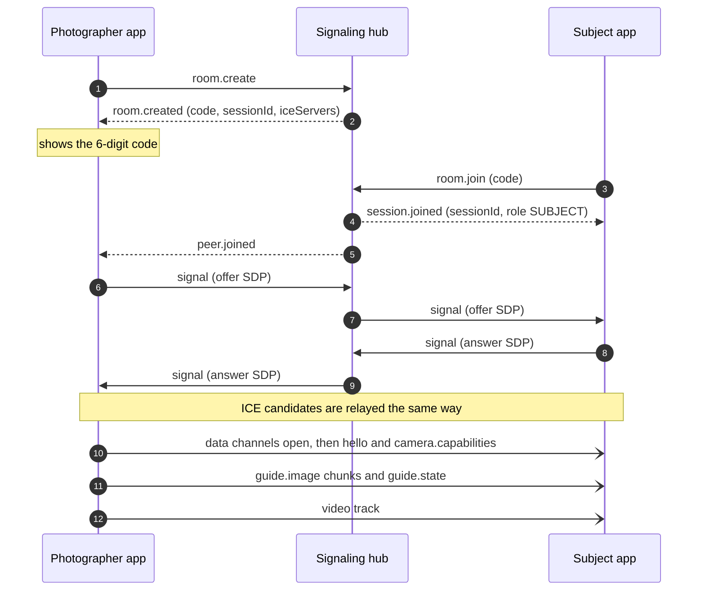

*Figure 2. Connecting two phones with a room code. The photographer always creates the offer.*

**Remote zoom**

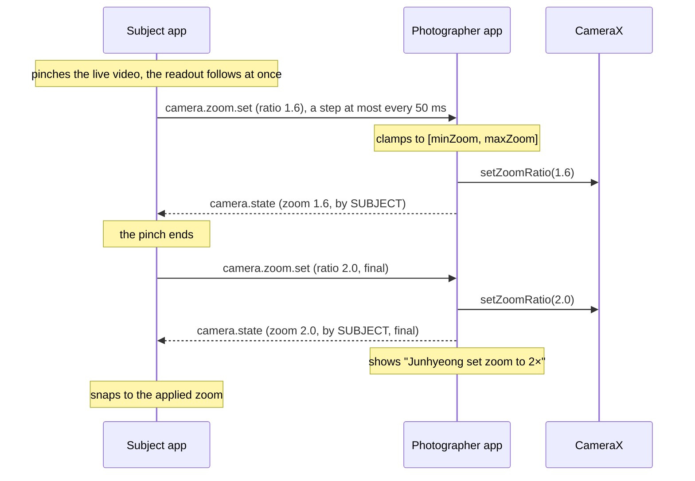

*Figure 3. The photographer's phone applies each request and echoes the value it applied, so both phones end on the same zoom. Only the photographer takes photos.*

**Invitation (Iteration 3)**

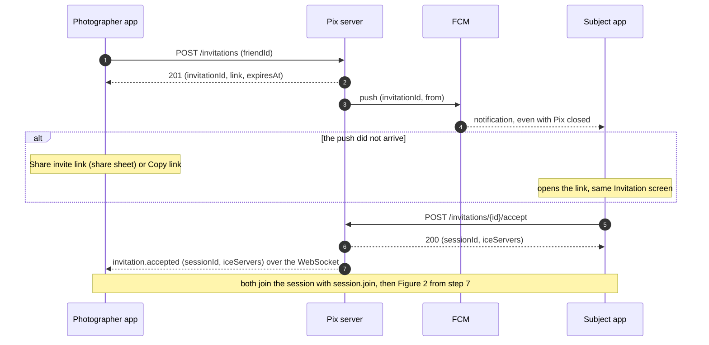

*Figure 3b. An accepted invitation yields a `sessionId`, so the session code is shared with room codes (AD-8). The server expires an invitation 30 s after it is created.*

**Reconnection (Iteration 3)**

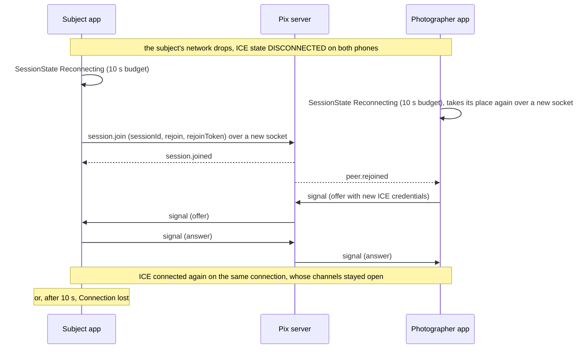

*Figure 3c. A short drop recovers without a new invitation (FR-6.12, NFR-11). The photographer always creates the offer, so it also starts the ICE restart.*

#### 1.1.5 Architectural patterns

- **System level: client-server plus peer-to-peer.** The server handles discovery and AI calls. Real-time media never passes through our application code on the server.
- **App level: MVVM with unidirectional data flow.** Fragments with XML layouts (ViewBinding) render immutable UI state from a ViewModel (`StateFlow`) and send user events back to it. ViewModels call repositories and managers, which wrap CameraX, ML Kit, WebRTC, and the network. This keeps camera and network code out of the UI, so each part can be tested and replaced on its own.
- **Single source of truth per session.** The photographer's phone owns the camera state and the guide state. The subject's phone keeps a mirror that is updated only by messages. Subject actions are *requests* that the photographer applies and then confirms.

### 1.2 External libraries and services

| Library / service | Used for | Where |
|----|----|----|
| Kotlin, Coroutines, Flow | Language; background work; streams of state and messages | App |
| AppCompat, Material Components, Fragment, Activity KTX, ConstraintLayout, Navigation component, ViewBinding, Lifecycle ViewModel, Lifecycle Process | XML screens, the navigation graph, state that survives rotation; whether Pix is in front, for presence (`ProcessLifecycleOwner`) | App |
| CameraX 1.6 (`core`, `camera2`, `lifecycle`, `view` for PreviewView) | Preview, ImageCapture, ImageAnalysis (frames for streaming), zoom | App |
| ML Kit Subject Segmentation (Google Play services) | On-device confidence mask of the person, smoothed into the guide mask and outline | App |
| WebRTC for Android (`io.github.webrtc-sdk:android` 137.7151.01, a maintained prebuilt) | Peer connection, H.264/VP8 video, two data channels, ICE | App |
| OkHttp (+ Retrofit for REST) | WebSocket signaling and HTTP requests | App |
| kotlinx.serialization (JSON) | Data channel, signaling, and REST payloads | App |
| Jetpack DataStore | Small preferences: consent given, the access and refresh tokens, the user's Pix ID, the last aspect ratio, and, from Iteration 3, the FCM token | App |
| Credential Manager with Google Identity (It 2) | Google sign-in on the phone; the ID token goes to the server once, and a second time only to add Google to an existing account after `NOT_REGISTERED` (FR-5.13) | App |
| Firebase Messaging SDK (It 3) | Receives invitation and friend-request pushes, including when Pix is closed; gives the device token | App |
| `google-auth` (Python) (It 2) | Verifies Google ID tokens on the server, against Google's published keys | Server |
| `argon2-cffi` (It 2) | Hashes passwords with argon2id (2.8, Accounts) | Server |
| `PyJWT` (It 2) | Signs and checks the access tokens (JWT, HS256; 2.5.3, 2.8) | Server |
| SQLAlchemy 2 (asyncio), Alembic, asyncpg, and aiosqlite (It 2) | Schema, migrations, and queries for users, sessions, devices, friends, and invitations, on PostgreSQL through asyncpg or on a SQLite file through aiosqlite (2.7) | Server |
| `firebase-admin` or FCM HTTP v1 through `httpx2` (It 3) | Sends push notifications | Server |
| Docker, Docker Compose, nginx, PostgreSQL 18 (It 2) | Running the server, the session store, and the database on the course servers; nginx is the reverse proxy on port 80 and switches between the two copies of the app during a deploy (2.8) | Host |
| Redis, with `redis-py` on the server (It 2) | Session store: sessions, room codes, presence, and rate-limit windows shared by every server process, and pub/sub for signals between them (AD-18, 2.7) | Host, Server |
| fakeredis, with `lupa` for its Lua (It 2) | An in-process Redis that runs the store's scripts: the server's tests, and a laptop that runs the server without Redis. A development dependency only (2.7) | Server |
| Cloudflare Realtime TURN (It 3) | Managed TURN relay; the server requests short-lived credentials for each session through its API (AD-14) | External |
| FastAPI, Uvicorn with `websockets`, pydantic-settings, python-multipart, httpx2, Pillow (Python) | The server app, which serves WebSocket signaling and the REST API from the same process, in one or more workers (AD-18); settings from environment variables; multipart uploads; calls to OpenRouter (the image and suggestion models) and to Google's published keys; checking the scene photo and converting candidates to JPEG | Server |
| OpenRouter Image API | Pose candidate generation with an image-editing model chosen by a server setting (2.6.3) | Server |
| OpenRouter chat completions (It 2) | Suggested poses and variations of a description, from a vision model chosen by a server setting (2.6.3) | Server |

### 1.3 Architectural decisions

| ID | Decision | Why | Rejected alternative |
|----|----|----|----|
| AD-1 | **Generate poses with an external image-editing API, called through our server** | On-device generative models have no supported Android path and are too heavy for the semester. Calling through the server keeps the API key out of the app and lets us switch vendors or rate-limit in one place. Cost: network dependency and per-request fees, so generation runs only on request. | On-device model (DreamLite); calling the API directly from the app |
| AD-2 | **Segment the reference on the device (ML Kit)** | Fast (≤ 2 s), free, works offline, and the reference photo never leaves the phone (FR-2.6). It runs once per reference. | Segmentation on the server or inside the image API |
| AD-3 | **Peer-to-peer media with WebRTC; the server only does signaling** | Lowest latency for the live view, no media-server cost, end-to-end encryption. WebRTC also provides congestion control and adaptive quality (NFR-6). | Media server (SFU); sending JPEG frames over WebSocket |
| AD-4 | **CameraX is the only camera owner and feeds frames to WebRTC** | Only one client can open the camera. CameraX gives us capture, zoom, focus, and exposure for remote control, and one viewport for preview, capture, and streaming, so all three show the same framing. | WebRTC's built-in camera capturer |
| AD-5 | **Two data channels: *realtime* (unordered, no retransmission) and *reliable* (ordered)** | Continuous values (guide position, zoom) need only the latest value, and retransmitting stale ones adds lag. Images, commands, and results must arrive exactly once. Both reuse the existing peer connection, so there is no server round trip. | One reliable channel; relaying messages through the server |
| AD-6 | **Each phone draws the guide itself; only the smoothed mask (once) and small state updates are sent** | The guide stays sharp on the subject's phone. It never enters the video or the saved photo. Updates are a few bytes. The photographer sends the smoothed mask, not the cutout, so both phones draw the same outline and the guide carries no reference pixels. Revised in Iteration 3 ([#132]): apart from the guide, a copy of the reference photo, at most 512 px on its long side, goes once per guide to the subject's phone, only for its corner thumbnail (FR-3.9), so the subject sees the pose to copy; it is never drawn as the guide, never saved, and never goes through the Pix server. | Burning the overlay into the video stream; mirroring the photographer's screen |
| AD-7 | **The photographer's phone is the single source of truth for camera and guide state** | Avoids conflicting edits: subject actions are requests; the photographer applies them in arrival order and echoes the applied value, so the later change wins and both phones agree (FR-7.6). The subject's requests cover zoom, brightness, flash, guide moves, and, since Iteration 3, a guide made on the subject's phone: the photographer adopts it as its own guide when it arrives, so of two guides chosen at once the later to arrive wins. | Shared editing on both phones |
| AD-8 | **One session abstraction with pluggable entry points (room code, invitation)** | The riskiest part, streaming and sync, works without accounts, and each way into a session is only an entry point: an accepted invitation yields a `sessionId`, just like a room code does, and the signaling, peer connection, and reconnection code is shared. | Building accounts and invitations first |
| AD-9 | **One app for both roles** | Friends swap roles between shots. One codebase and one install, with the role chosen per session. | A separate viewer app for the subject |
| AD-10 | **One frame in the chosen aspect ratio (4:3, 16:9, or 1:1), shown whole (fit) on both phones** | The user picks the ratio; 16:9 fits Instagram stories without cropping. Preview, capture, and stream share one CameraX `ViewPort`, so what you see is what is captured, and showing the whole frame on both phones keeps guide coordinates identical. The other ratios are cut from the middle of the sensor's 4:3: 16:9 keeps the full height and drops the sides, and 1:1 keeps the full width and drops the top and bottom (2.6.2). | Fixed 3:4; full-screen 9:16 with cropping |
| AD-11 | **The server runs on the course-provided servers with Docker and nginx, over HTTP and WS** | Sessions across networks need a server both phones can reach. The course servers are reachable only through the course's HTTP proxy on port 80: no other port is open and there is no TLS, so the server speaks HTTP and WS (NFR-14). Server A runs `main` as production and Server B runs `dev` as staging; the two cannot reach each other, so each has its own database and session store. Containers keep the setup portable to another host. GitHub hosting serves only static pages. Until the course servers can be reached from outside the campus network, a temporary server on AWS with the same containers is used (2.8, Hosting). | AWS as the lasting host (cost, and the course servers are enough once the relay is a managed service); a TLS front such as a Cloudflare Tunnel (needs a domain and the course's approval; to revisit if `ws://` proves unreliable on cellular networks); GitHub-hosted server; a laptop with port forwarding |
| AD-12 | **Sign-in with a Pix ID and a password or with Google; the server issues its own tokens** | A Pix ID and a password let anyone use Pix without a Google account, and Google is one tap on every Android phone. The Pix ID is the login name, with no email, and either kind of account can add the other way to sign in; a Google sign-in that no account uses offers to connect an existing account before it creates one. The server verifies a Google ID token once and keeps only the Google subject ID; the token is never stored, and is sent again only to add Google to an existing account after `NOT_REGISTERED` (FR-5.13). The password crosses plain HTTP to the course servers (AD-11, NFR-14) and is stored only as an argon2id hash. A sign-in gives a short access token (JWT) and a rotating refresh token (2.8, Accounts). | Email and password; Kakao sign-in (not on every test phone) |
| AD-13 | **Invitations by Firebase Cloud Messaging, with an invite link as the fallback** | A closed app cannot keep a WebSocket open, so a push is the only way to reach a friend who is not in Pix. Pushes are not guaranteed, so the photographer can share a link through any messenger instead; sending only through KakaoTalk would need it on every test phone. | WebSocket presence only; KakaoTalk-only invitations |
| AD-14 | **A managed TURN relay (Cloudflare Realtime TURN), with short-lived credentials from the server** | STUN alone often fails behind carrier NAT, so cellular sessions need a relay. The course servers cannot host one: a relay needs UDP or TCP 3478 and a UDP port range that the phones reach directly, and only HTTP on port 80 gets in. Cloudflare's relay needs no host of ours, its free monthly allowance is far above our use, and it also listens on TCP 80 and TLS 443 for networks that block UDP. The Pix server requests credentials per session with a key that stays on the server, so the relay cannot be used by others. Media stays SRTP-encrypted, so the relay cannot read it (NFR-14). | coturn on the server host (no open ports); coturn on AWS (cost and upkeep); a media server (SFU); no relay (Wi-Fi only) |
| AD-15 | **The guide is an outline only and never shows the reference photo's pixels** | Framing the person matters more than the reference's background, and reference pixels over the live scene are confusing. The reference stays visible as a small thumbnail instead, on the subject's phone too since Iteration 3 (AD-6). | Semi-transparent cutout; a faint background guide |
| AD-16 | **Saved guides live in the app's private storage** | Reuse without rebuilding, with nothing in the gallery and nothing on the server (FR-3.8, NFR-13). | Gallery album; server-side guides |
| AD-17 | **Pinch zoom with a guide-edit mode toggle on both phones** | A pinch is the natural zoom gesture, and one toggle makes the rule simple: edit mode on, gestures edit the guide; off, a pinch zooms the camera. The same toggle on Subject view, because the subject both moves the guide (FR-7.2) and zooms. | A zoom slider, in the main layout or in a detail settings panel; deciding by where the finger lands |
| AD-18 | **Session state lives in a Redis session store, not in the server process** | With shared state the server can run several workers when one process is no longer enough, and a new copy of the app can take over from the old one during a deploy without losing a waiting room (2.8). The state is small and short-lived (rooms, codes, presence, rate-limit windows), which fits Redis's atomic scripts and expiry, and pub/sub carries signals between workers (2.7). Cost: one more service to run, and room transitions become Redis scripts instead of plain Python. NFR-18 (50 sessions) fits in one worker, so this is for growth beyond the course, not for the demo load. | One process with in-memory state; routing each room to one process by its code; session state in the relational database |

### 1.4 Later iterations

Iterations 1 and 2 built the structure of Figure 1, whose design is in section 2. Later iterations are summarized below; their detailed design is added at the start of the iteration that builds them.

#### 1.4.1 Iteration 2 · 10/11 – 10/25 (midterm presentation 10/21)

The Iteration 2 design is in section 2: interfaces and models (2.1, 2.3), states (2.4), messages and APIs (2.5), algorithms (2.6), the database (2.7), and owners (2.9), with the architectural decisions AD-10 to AD-18. Its Must items were the smooth outlines (FR-2.9, Iter2-P7) and the zoom without stutter (NFR-19, Iter2-P5). Invitations with push and the link fallback (Iter3-P15, 2.6.6) and sessions across networks with the relay and reconnection (Iter3-P13, Iter3-P14, 2.6.7) are designed in section 2 and built in Iteration 3 (1.4.2); until then the room code is the only way into a session.

#### 1.4.2 Iteration 3 · 10/26 – 11/6 (user test 10/31–11/1, heuristic evaluation 11/4)

The plan from the kickoff of 2026-10-25 (Team Meetings); the tasks and owners are in 2.9, and the decisions still to make are under *Still open*.

| Feature | How the design changes |
|----|----|
| **Pose generation** (FR-4.3, FR-4.6, FR-4.8, FR-4.10, FR-4.11) | The server asks the image model for the scene photo's own ratio instead of 3:4 (2.6.3). *Pick a pose* shows one candidate at a time ([#108]). A tip for the chosen candidate from a vision model ([#110], 2.6.3), four prompt templates in place of the three variations, and a history of descriptions (*Still open*). |
| **Shared steps on both phones** (FR-6.14–6.16) | The subject's phone can start guide selection and pose generation, both phones show the same step, the first phone to go on moves both, and photos are saved on both phones: new data-channel messages and image transfers (*Still open*). |
| **Offline connection with a QR code** (F9) | The photographer's phone opens a local-only hotspot and runs the signaling itself, so neither the server nor a shared Wi-Fi is needed. The QR code carries the hotspot's connection details. The phone accepts only one connection per QR code, and the session starts only after both people tap *Resume*. This is another session entry point (AD-8). |
| **Selfie mode** (FR-1.14) | The front camera as another `CameraController` selection, mirrored preview, no ultrawide routing, only while no session runs. Whether the prompts suit a selfie is checked (*Still open*). |
| **Settings, language, and tutorial** (F10, FR-3.10) | A settings screen with the language (Korean strings behind the same resource keys, the phone's language by default), the guide's color and line thickness, a latency indicator for sessions (from the `ping` round trip, 2.5.1), and how-to-use help; a tutorial on first use that the settings screen can start again. |
| **Invitations and sessions across networks** (Iter3-P13–P15; [#117], [#118], [#119]) | Built as designed in 2.6.6 and 2.6.7: push notifications with the link fallback, the TURN relay, `SessionEntry.Invitation`, `session.join`, and reconnection with ICE restart; friend requests use the same push path. Phones on cellular data reach the temporary AWS server until the course servers are open to them (2.8, Hosting). The invite link format is decided by 10/30; the wrong-code message was decided on 10/26 (2.5.2). |
| **The Could items** (FR-7.5, FR-7.7, NFR-19) | Built only if time allows, in this order of preference: the remote-control switch (Iter2-P17), remote focus (Iter2-P17), and the shutter freeze fix (Iter2-P5); each follows its note in 2.6.5. |
| **Testing and evaluation** | The user test of 10/31–11/1 runs on the temporary AWS server with the tasks due 10/30 (2.9). The UAT user stories are fixed by the end of Iteration 3 (Testing Documentation 3, 4). |

#### 1.4.3 Iterations 4 and 5 · fixes, polish, and final release

Iteration 4: fixes from the user test and the heuristic evaluation, and the UAT on 11/16 and 11/18. Iteration 5: polish, stability, and performance work against the NFR targets based on UAT feedback, in-class testing on 11/30 and a test with real users on 12/2, and the design patterns in section 3.

## 2. Design Details

### 2.1 Android app structure

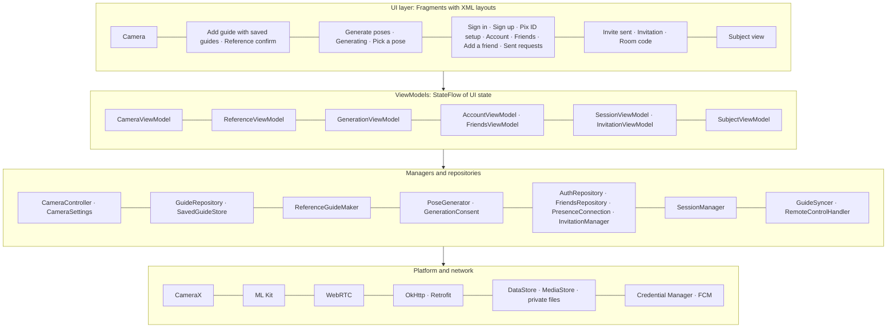

*Figure 5. Layers of the Android app. Each layer depends only on the layer below it, except that the UI hosts the camera preview (`PreviewView`) and the subject's video view (`SurfaceViewRenderer`) directly.*

**Package layout.** Files marked \* exist in `android/` as shared contracts (listed in `android/README.md`); the owners create the rest. The tree names the main files; `android/README.md` lists every module class.

```text
android/app/src/main/java/com/lastpenguin/pix/
├─ MainActivity*, PixApplication (creates the AppContainer)
├─ ui/          camera/, guide/, generation/, account/, session/: one Fragment per wireframe screen; the screens of one flow
│               share one activity-scoped ViewModel; PixViewModels builds every ViewModel from the AppContainer
├─ camera/      CameraController*, CameraXController, CameraSettings (aspect ratio in DataStore), PhotoSaver, CameraZoom,
│               CameraZoomPlan, CameraFrameCache
├─ guide/       GuideModels*, GuideRepository*, ReferenceGuideMaker*, SavedGuideStore* (It 2), InMemoryGuideRepository,
│               MlKitReferenceGuideMaker, FileSavedGuideStore (It 2), GuideGeometry, SubjectSegmenter,
│               MaskSmoothing (It 2, functions), OutlineExtractor, overlay view
├─ generation/  GenerationModels*, PoseGenerator*, RemotePoseGenerator, PoseImageCodec, GenerationConsent (DataStore)
├─ account/     AccountModels*, AuthRepository*, FriendsRepository*, AuthTokens, BearerTokens, AccountRules, ApiMapping,
│               RemoteAuthRepository, RemoteFriendsRepository, PresenceConnection, GoogleIdTokens,
│               InvitationManager and PushTokenRegistrar (It 3, Iter3-P15, not yet written)
├─ session/     SessionModels*, SessionManager*, RtcSessionManager, SignalingClient, OkHttpSignalingClient,
│               PeerConnectionClient, WebRtcPeerConnectionClient, CameraFrameSource, GuideImageCodec, GuideSyncer,
│               GuideReference (GuideReferenceCodec, MirrorReference), RemoteControlHandler
│  ├─ protocol/  SessionMessage*, message codec, channel routing
│  └─ signaling/ SignalMessage*
└─ core/        network/PixApi* (PixApi, PixAuthApi, PixAccountApi), network/ApiModels*, dependency wiring, timing logs
```

#### Module interfaces

These interfaces are the contracts between owners. Each owner starts with a fake implementation (for example, a `FakeSessionManager` that echoes messages), so that UI and sync work can begin before the real module is ready.

```kotlin
enum class CameraStatus { IDLE, STARTING, READY, UNAVAILABLE }   // READY: camera open, its first analysis frame received, and the
                                                                  // kept zoom and exposure applied again
enum class AspectRatio { R4_3, R16_9, R1_1 }                       // It 2 (FR-1.13); R4_3 is the default
enum class FlashMode { OFF, AUTO, ON }                              // It 2 (FR-1.12)
interface CameraController {
    val status: StateFlow<CameraStatus>                // IDLE until bound; a failed bind is UNAVAILABLE, and bind again retries
    val capabilities: StateFlow<CameraCapabilities?>
    val state: StateFlow<CameraState>                  // It 2: applied zoom, exposure, flash, aspect, in one value
    val zoom: StateFlow<Float>                        // applied ratio relative to the primary rear camera, the same value as state.zoom, for callers that need only it
    fun bind(owner: LifecycleOwner, surfaceProvider: Preview.SurfaceProvider)
    fun setZoom(ratio: Float, final: Boolean = true)   // primary-relative, clamped to [minZoom, maxZoom]; pinch and remote both call this; the newest value
                                                       // once per display frame, and final = false (a pinch's steps) holds the lens (It 2, 2.6.5)
    fun setFocusPoint(x: Float, y: Float)              // It 2: frame coordinates 0..1 (FR-1.4); also the remote focus request (Could)
    fun setExposure(index: Int)                        // It 2: exposure-compensation index within capabilities.exposureRange (FR-1.11)
    fun setFlash(mode: FlashMode)                      // It 2: ignored when capabilities.hasFlash is false (FR-1.12)
    fun setAspectRatio(ratio: AspectRatio)             // It 2: rebinds the use cases with a ViewPort of that ratio (FR-1.13, AD-10)
    suspend fun takePhoto(): Result<Uri>               // full resolution in the chosen ratio, Pictures/Pix, no overlay
    suspend fun grabFrame(): Result<Bitmap>            // latest frame, upright: the scene photo (FR-4.1)
    fun setFrameSink(sink: FrameSink?)                 // null stops streaming frames
}
fun interface FrameSink { fun onFrame(image: ImageProxy) }   // must copy the image and close it before returning

interface ReferenceGuideMaker {                         // fails with NoPersonFoundException (FR-2.4)
    suspend fun make(source: Uri): Result<ReferenceGuide>                        // gallery photo
    suspend fun make(bitmap: Bitmap, source: GuideSource): Result<ReferenceGuide> // pose candidate
}                                                        // It 2: the result carries the smoothed mask (It 3: alone, no cutout), the person's
                                                         // box (anchor), and a reference copy of at most 512 px (2.6.1)

interface GuideRepository {
    val guide: StateFlow<ReferenceGuide?>
    val state: StateFlow<GuideState>
    val changes: SharedFlow<GuideChange>               // every applied change, for GuideSyncer
    fun setGuide(guide: ReferenceGuide?)                 // null removes the guide; a new guide starts at guide.anchor (FR-3.1)
    fun update(final: Boolean, change: (GuideState) -> GuideState)   // final = gesture ended; also hide/show through visible
}

interface SavedGuideStore {                              // It 2 (FR-3.8, AD-16): app private storage only
    val saved: StateFlow<List<SavedGuide>>               // newest first; empty until the storage has been read once
    suspend fun save(guide: ReferenceGuide, state: GuideState): Result<SavedGuide>   // a guide already saved keeps its one copy
    suspend fun load(id: String): Result<Pair<ReferenceGuide, GuideState>>
    suspend fun delete(id: String)                       // an unknown id does nothing
    class InMemory : SavedGuideStore                     // for tests and screens that keep no guides
    companion object { const val MAX_SAVED = 20 }        // the oldest goes first
}

interface CameraSettings {                               // It 2 (Design 2.8): the last aspect ratio, in DataStore
    suspend fun aspectRatio(): AspectRatio?              // null when none is kept or it cannot be read, so the camera stays 4:3
    suspend fun saveAspectRatio(ratio: AspectRatio)
}

interface PoseGenerator {
    // POST /pose-suggestions first: suggested poses, or variations of a description, whose own POST /poses goes out at
    // once. Emits Planned with the four poses, then one CandidateEvent each.
    fun generate(scene: Bitmap, request: PoseRequest, seed: Long): Flow<GenerationEvent>
}

interface PoseTipper {                                   // It 3 (FR-4.10): POST /pose-tips; a failure means no tip
    suspend fun tip(scene: Bitmap, candidate: Bitmap, pose: String): Result<PoseTip>
}

interface AuthRepository {                               // It 2 (FR-5.1–5.3, FR-5.11–5.15, AD-12); failures are AccountException
    val state: StateFlow<AuthState>                      // Loading, SignedOut, or SignedIn(account); everything but friends works signed out
    val expired: SharedFlow<Unit>                        // the server refused the refresh token: ask to sign in again
    suspend fun signUp(pixId: String, password: String, displayName: String): Result<Account>  // PIX_ID_TAKEN, PIX_ID_INVALID, PASSWORD_INVALID
    suspend fun isPixIdAvailable(pixId: String): Result<Boolean>   // Check on Sign up and Pix ID setup, without a sign-in; PIX_ID_INVALID
    suspend fun logIn(pixId: String, password: String): Result<Account>   // INVALID_CREDENTIALS
    suspend fun signInWithGoogle(idToken: String): Result<GoogleSignIn>   // NotRegistered: ask about an existing Pix account
    suspend fun signUpWithGoogle(idToken: String): Result<Account>   // a new account; the Pix ID comes next
    suspend fun addGoogle(idToken: String): Result<Account>   // GOOGLE_IN_USE or GOOGLE_ALREADY_ADDED
    suspend fun addPassword(password: String): Result<Account>   // a Google account with a Pix ID; PASSWORD_INVALID
    suspend fun setPixId(pixId: String, password: String? = null): Result<Account>   // TAKEN or INVALID; a password account changing it sends its password
    suspend fun setDisplayName(displayName: String): Result<Account>   // 1–30 characters after trimming
    suspend fun refreshAccount(): Result<Unit>           // GET /me again: another phone signed in to the account may have changed it
    suspend fun freshAccessToken(): String?              // for the signaling socket, which sends it only when it opens
    suspend fun signOut()                                // on the server if it answers, on the phone always
}

interface FriendsRepository {                            // It 2 (FR-5.4–5.10, FR-5.16); failures are AccountException
    val friends: StateFlow<List<Friend>>
    val requests: StateFlow<List<FriendRequest>>         // received, pending
    val sentRequests: StateFlow<List<SentRequest>>       // sent, not answered yet (FR-5.16)
    suspend fun refresh(): Result<Unit>                  // the three lists; Friends and Sent requests call it every 10 s while shown
    suspend fun search(pixId: String): Result<UserLookup> // exact match only
    suspend fun request(userId: String): Result<RequestOutcome>   // Sent, or BecameFriends when they had asked
    suspend fun accept(requestId: String): Result<Friend>
    suspend fun cancel(requestId: String): Result<Unit>  // withdraws a request the user sent; it leaves sentRequests, on NOT_FOUND too
    suspend fun decline(requestId: String): Result<Unit>
    suspend fun remove(userId: String): Result<Unit>
}

interface InvitationManager {                            // It 3 (FR-6.1–6.4, AD-13); not yet written (Iter3-P15)
    val outgoing: StateFlow<Invitation?>                 // photographer: the invitation being waited on
    val incoming: Flow<Invitation>                       // subject: from a push or an opened link
    suspend fun invite(friendId: String): Result<Invitation>      // fails with BUSY when the friend is in a session
    suspend fun cancel(invitationId: String)
    suspend fun accept(invitationId: String): Result<SessionEntry.Invitation>
    suspend fun decline(invitationId: String)
    fun shareLink(invitation: Invitation): String        // the invite link for the share sheet or the clipboard
}

interface SessionManager {
    val state: StateFlow<SessionState>
    val incoming: Flow<SessionMessage>                  // not replayed: a late subscriber misses earlier messages
    val peerCapabilities: StateFlow<CameraCapabilities?> // subject: the last camera.capabilities, for a screen that opens late
    val peerCamera: StateFlow<CameraState?>             // subject: the last camera.state (zoom, exposure, flash, aspect), null until one arrives
    val path: StateFlow<IcePath?>                       // the selected candidate pair while connected, from the statistics every 2 s (2.6.7)
    suspend fun start(entry: SessionEntry, role: Role)   // entry: NewRoom, RoomCode, Rejoin, or Invitation (It 3)
    fun send(message: SessionMessage)                   // ChannelRouter picks realtime or reliable
    fun videoSink(): FrameSink                          // photographer: pass to CameraController
    suspend fun leave(reason: EndReason = EndReason.LEFT)
}
```

### 2.2 Class diagrams

The diagrams show the main classes and their responsibilities. They are not complete UML.

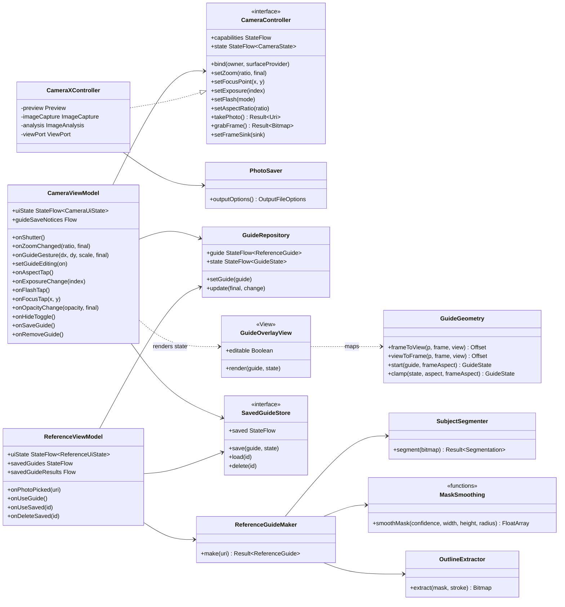

*Figure 6. Camera and guide classes, with the mask smoothing in `MaskSmoothing.kt` and `SavedGuideStore`, which `ReferenceViewModel` lists and opens on *Add a pose guide*.*

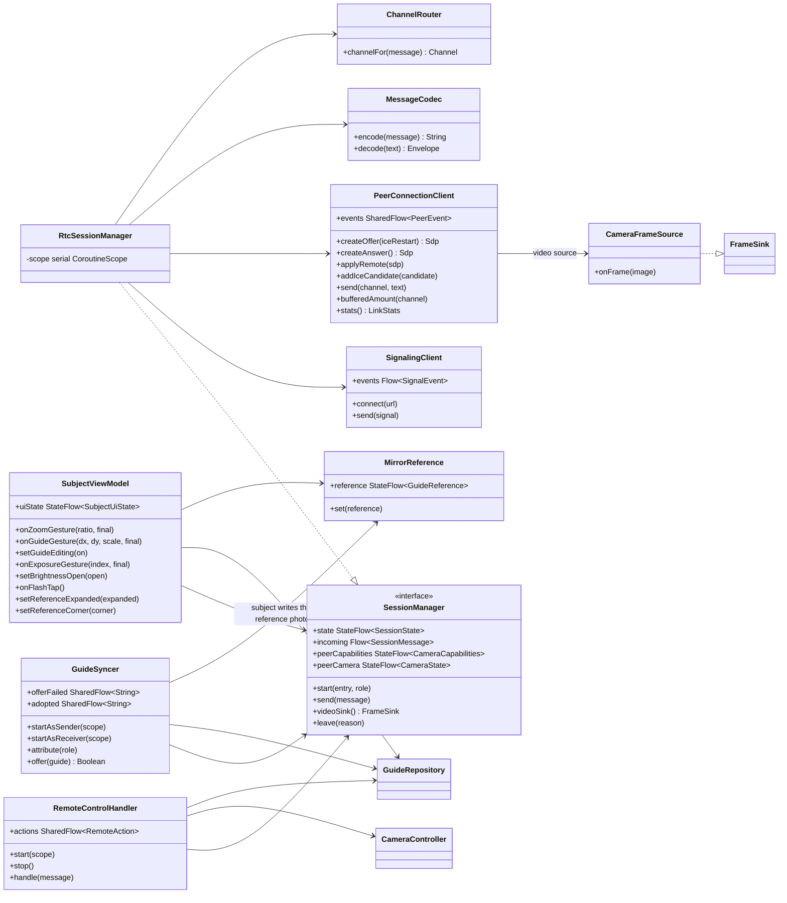

*Figure 7. Session, synchronization, and remote-control classes. The subject's pinch on the live video calls `onZoomGesture(ratio, final)`; its guide gestures and brightness and flash go through `RemoteControlHandler` the same way (2.6.5).*

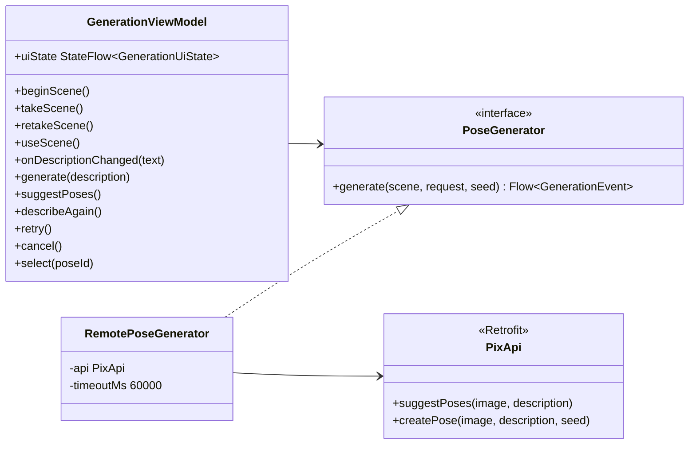

*Figure 8. Pose generation classes*

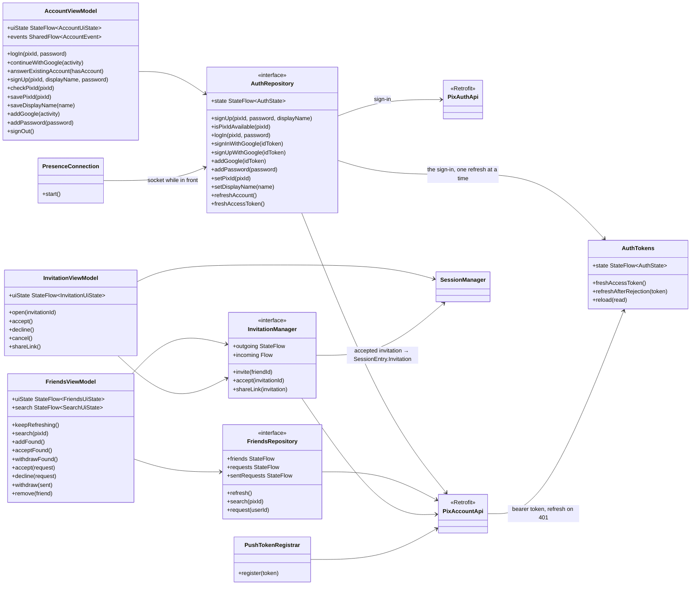

*Figure 8b. Account, friends, and invitation classes; the invitation classes come in Iteration 3. An accepted invitation becomes a `SessionEntry.Invitation` for the existing session code.*

**Server modules.** The server app has these modules (independent of the framework choice); every worker runs all of them:

| Module | Responsibility |
|----|----|
| `signaling` | WebSocket hub; relays `signal` messages. The room state is in the session store (`store/`); the registry keeps only this worker's sockets and their outgoing queues, and a signal for a socket on another worker travels through the store (AD-18, 2.7) |
| `store` (It 2) | The Redis connection, the scripts for room transitions, delivery of messages between workers, the sweeper for expiry and dead workers, and the rate-limit windows (2.7) |
| `poses` | The REST endpoints (scene photo validation, rate limiting, cancelling when the phone disconnects); `PoseGenerator`, the one client of OpenRouter's Image API, and `PoseSuggester`, which asks a vision model for four poses through OpenRouter's chat completions, each with its model as a setting; the prompts and the default poses (`prompts.toml`, read by `prompts.py`) |
| `accounts` (It 2) | Sign-up and sign-in with a Pix ID and a password (argon2id) or with Google (ID token verification), session tokens, Pix IDs, exact lookup, friend requests, friendships, device tokens; presence from the signaling hub's signed-in sockets, kept in the session store |
| `invitations` (It 3) | Create, accept, decline, cancel, 30 s expiry; FCM sends; invite links; hands the `sessionId` to `signaling` on accept |
| `turn` (It 3) | Requests short-lived credentials from Cloudflare's TURN API and returns the `iceServers` for one phone of a session, or Cloudflare's STUN server alone when it has no key or Cloudflare fails (`TurnRelay`, AD-14) |
| `db` (It 2) | SQLAlchemy models and Alembic migrations for 2.7; every worker brings the schema up to date when it starts |

### 2.3 Data models

```kotlin
// ---- Guide ----------------------------------------------------------------
data class ReferenceGuide(
    val id: String,               // UUID; the subject uses it to tell whether it already has the mask
    val mask: Bitmap,             // ALPHA_8, person = opaque, after smoothing (2.6.1); cropped to the person; this is what the subject receives
    val outline: Bitmap,          // ARGB_8888, same size as mask, drawn from it: a white anti-aliased line about 3 dp on screen, no fill
    val aspect: Float,            // mask width / height
    val source: GuideSource,      // GALLERY or GENERATED
    val anchor: NormalizedRect? = null,   // the mask's box in the reference photo (the person and its 2 % margin), where a new guide starts (FR-3.1); null on the subject
    val reference: Bitmap? = null,        // the photo itself, long side ≤ 512 px, for the corner thumbnail only (FR-3.9); never drawn as the guide; null in the subject's mirror, whose copy arrives in guide.reference.* and stays in MirrorReference
)

data class NormalizedRect(val left: Float, val top: Float, val right: Float, val bottom: Float)   // fractions of an image's width and height

data class GuideState(            // everything needed to place the guide, in frame coordinates
    val guideId: String? = null,  // null = no guide
    val cx: Float = 0.5f,         // guide center, 0..1 of the current frame (AD-10); the start comes from ReferenceGuide.anchor
    val cy: Float = 0.5f,
    val height: Float = 0.7f,     // guide height / frame height; 0.21..2.1 for every start (FR-3.3); a new guide's comes from ReferenceGuide.anchor
    val opacity: Float = 0.5f,    // 0.1..0.9, applied to the outline
    val visible: Boolean = true,  // false = hidden for a moment (FR-3.6); only the photographer changes it
)

data class SavedGuide(val id: String, val savedAt: Long, val thumbnail: Bitmap)   // It 2; the files are in the app's private storage (2.8)

// ---- Camera ---------------------------------------------------------------
data class CameraCapabilities(
    val minZoom: Float, val maxZoom: Float, // relative to the primary rear camera's 1x
    val zoomStops: List<Float>,   // kept for compatibility; not shown
    val exposureRange: IntRange,  // It 2: exposure-compensation index range; 0..0 when unsupported
    val exposureStep: Float,      // It 2: EV per index step
    val hasFlash: Boolean,        // It 2
    val aspectRatios: List<AspectRatio>,  // It 2: the ratios this phone can bind; always contains R4_3
    val supportsFocusPoint: Boolean,      // It 2
)
data class CameraState(           // It 2: the applied values, echoed to the subject in camera.state
    val zoom: Float,
    val exposure: Int = 0,
    val flash: FlashMode = FlashMode.OFF,
    val aspect: AspectRatio = AspectRatio.R4_3,
)

// ---- Session --------------------------------------------------------------
// The It 3 additions Invitation, Inviting, DECLINED, and BUSY come with Iter3-P15; SessionModels.kt does not have them yet.
enum class Role { PHOTOGRAPHER, SUBJECT }
sealed interface SessionEntry {
    data object NewRoom : SessionEntry                               // photographer asks for a code
    data class RoomCode(val code: String) : SessionEntry            // subject enters the code
    data class Rejoin(val code: String) : SessionEntry              // subject: Reconnect, by its rejoin token, or the code without one (2.6.7)
    data class Invitation(val invitationId: String, val sessionId: String) : SessionEntry   // It 3: both phones, after accept (AD-8)
}
sealed interface SessionState {
    data object Idle : SessionState
    data class Waiting(val code: String) : SessionState              // photographer: room code shown, waiting for the subject
    data class Inviting(val invitation: Invitation) : SessionState   // It 3: photographer, Invite sent
    data class Connecting(val sessionId: String?) : SessionState
    data class Connected(val sessionId: String, val peer: PeerInfo, val role: Role) : SessionState
    data class Reconnecting(val sessionId: String, val since: Long) : SessionState   // both phones: up to 10 s before Waiting or Ended(CONNECTION_LOST)
    data class Ended(val reason: EndReason) : SessionState
}
data class PeerInfo(
    val displayName: String,
    val haveGuideId: String? = null, // subject only: the guide mask it already has, from its hello
    val haveReferenceId: String? = null, // subject only: the guide whose reference photo it already has (It 3)
)
enum class EndReason { LEFT, PEER_LEFT, CONNECTION_LOST, NOT_FOUND, EXPIRED, CANCELLED, DECLINED, BUSY, ERROR, RATE_LIMITED }
// RATE_LIMITED: too many wrong codes from this phone's network (2.5.2); it ends a join on this phone and is never sent
data class IcePath(
    val local: String, val remote: String,   // each side's candidate type: host, srflx, prflx, or relay
    val network: String?,                    // this phone's network as WebRTC names it: wifi, cellular, …
    val relayProtocol: String?,              // on a relayed path, how this phone reaches the relay: udp, tcp, or tls
)

// ---- Account (It 2) --------------------------------------------------------
data class Account(
    val userId: String, val pixId: String?, val displayName: String,   // pixId null until chosen
    val hasPassword: Boolean, val hasGoogle: Boolean,   // the ways the account signs in; offer "Add Google" without it
)   // the tokens stay inside AuthTokens and DataStore, never in UI state
sealed interface AuthState {
    data object Loading : AuthState                    // the kept sign-in is being read at app start
    data object SignedOut : AuthState
    data class SignedIn(val account: Account) : AuthState
}
sealed interface GoogleSignIn {
    data class SignedIn(val account: Account) : GoogleSignIn
    data object NotRegistered : GoogleSignIn   // ask whether the person already has a Pix account (FR-5.13)
}
data class PixUser(val userId: String, val pixId: String, val displayName: String)   // a lookup result or a request's sender
data class Friend(val userId: String, val pixId: String, val displayName: String, val online: Boolean, val inSession: Boolean)
data class FriendRequest(val id: String, val from: PixUser, val createdAt: Long)
data class SentRequest(val id: String, val to: PixUser, val createdAt: Long)   // a request the user sent, not answered yet (FR-5.16)
sealed interface UserLookup {
    data class Found(val user: PixUser, val relation: Relation, val requestId: String?) : UserLookup   // relation decides the button (FR-5.8); requestId for REQUESTED and INCOMING
    data object NotFound : UserLookup
}
enum class Relation { NONE, SELF, FRIEND, REQUESTED, INCOMING }
sealed interface RequestOutcome {
    data class Sent(val requestId: String) : RequestOutcome
    data class BecameFriends(val friend: Friend) : RequestOutcome   // they had already asked, so their request is accepted
}
enum class AccountError {   // the server's code (2.5.3), or the phone's own reason
    PIX_ID_TAKEN, PIX_ID_INVALID, PASSWORD_INVALID, INVALID_CREDENTIALS, INVALID_GOOGLE_TOKEN, GOOGLE_IN_USE,
    GOOGLE_ALREADY_ADDED, PIX_ID_REQUIRED, PASSWORD_ALREADY_SET, NOT_FOUND, INVALID_REQUEST, UNAVAILABLE,
    SIGNED_OUT, OFFLINE, UNKNOWN,
}
class AccountException(val error: AccountError, val serverMessage: String = "")   // serverMessage names the broken rule (FR-5.3, FR-5.11)
data class Invitation(
    val id: String, val from: Friend, val to: Friend,
    val status: InvitationStatus, val expiresAt: Long,
    val sessionId: String? = null,   // set when accepted
    val link: String,                // the invite link (2.6.6)
)
enum class InvitationStatus { PENDING, ACCEPTED, DECLINED, CANCELLED, EXPIRED }

// ---- Generation -----------------------------------------------------------
// The prompt around the pose stays on the server (2.6.3). The idea chips are a string array in the app's resources.
sealed interface PoseRequest {                               // It 2 (FR-4.4, FR-4.8)
    data class Described(val text: String) : PoseRequest     // the user's description, 1..100 characters, Korean or English
    data object Suggested : PoseRequest                      // Skip, or Generate with an empty field: the server suggests four
}
data class PlannedPose(val id: String, val text: String)     // "pose-1" .. "pose-4", the app's own names for its four requests
sealed interface GenerationEvent {
    data class Planned(val poses: List<PlannedPose>) : GenerationEvent   // first, once the poses are known: the slots
}
sealed interface CandidateEvent : GenerationEvent {
    val poseId: String
    data class Ready(override val poseId: String, val image: Bitmap) : CandidateEvent
    data class Failed(override val poseId: String, val error: GenerationError) : CandidateEvent
}
enum class GenerationError { OFFLINE, TIMEOUT, RATE_LIMITED, REJECTED, SERVER }   // every pose of a description REJECTED: another description or photo (US-5)
```

### 2.4 State machines

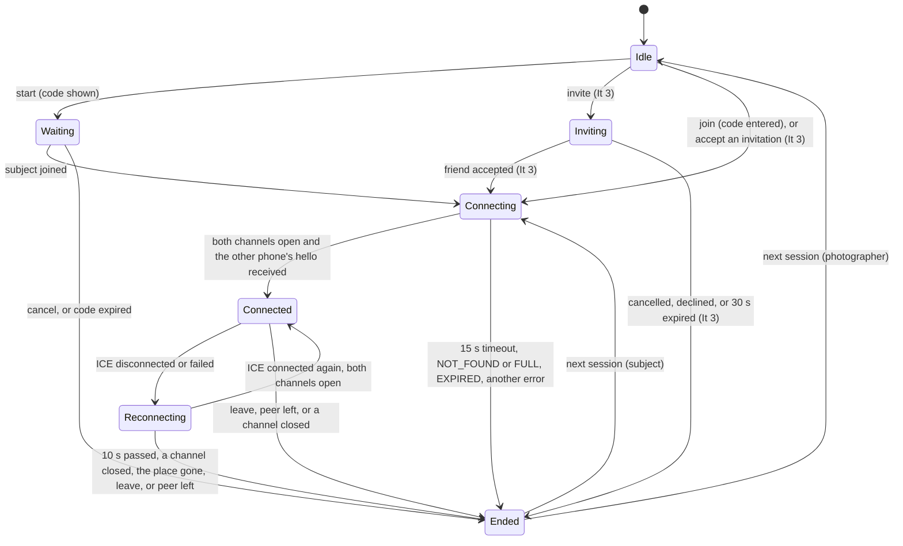

*Figure 9. `SessionState` on each phone. `Inviting` comes with invitations (Iter3-P15).*

As built: `Connected` needs both data channels open and the other phone's `hello`, which carries its name; the 15 s connecting timer starts when the peer connection opens (`session.joined` on the subject, `peer.joined` on the photographer). While connecting, a 15 s timeout ends the subject's session with `CONNECTION_LOST`, `NOT_FOUND` or `FULL` with `NOT_FOUND`, `EXPIRED` with `EXPIRED`, and any other server error, an SDP failure, or a `hello` with another protocol with `ERROR`. A link that ICE reports `DISCONNECTED` or `FAILED` while connected puts the phone in `Reconnecting` (2.6.7); a data channel that closes ends the session at once, because the channels outlast a drop and close only when the other phone closed its connection. A photographer whose app stays in the background for 60 s leaves the session. `Ended` stays until the next session starts; the screens return to the camera on their own.

On the photographer's phone, the room stays open when the subject leaves, the connection is lost, or connecting times out: the state goes back to `Waiting` with the same code instead of `Ended`, so the subject can join again with *Reconnect* (FR-6.10, FR-6.11). The subject's phone goes to `Ended`.

A link that drops while connected puts both phones in `Reconnecting`, so a short drop on either side is bridged by an ICE restart on the same connection (2.6.7). Meanwhile the server's `peer.left` with `CONNECTION_LOST` changes nothing, because it is often only the other phone's old socket going: the link decides. After 10 s the photographer says "&lt;name&gt; disconnected" and returns to `Waiting` (to `Idle` for an invitation session, Iter3-P15), and the subject goes to `Ended(CONNECTION_LOST)` with *Reconnect*, which takes its place again with its rejoin token while the photographer still holds the session (`SessionEntry.Rejoin`), and joins the code again only when it has no token.

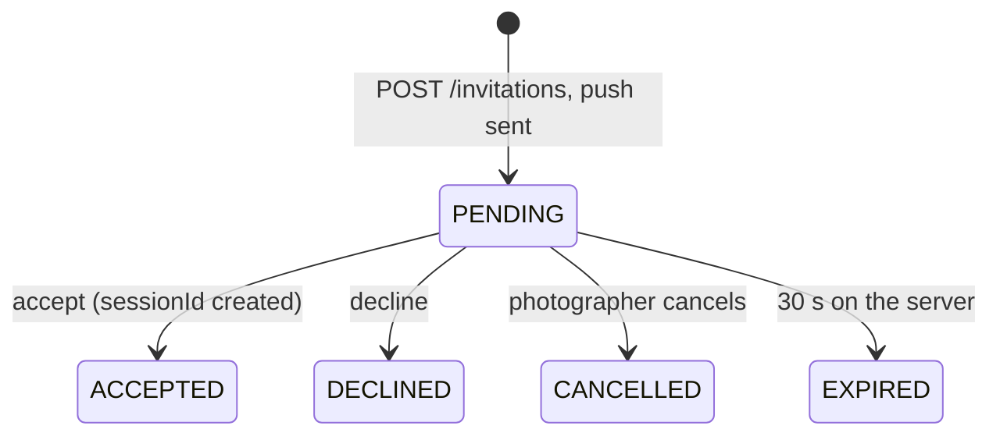

*Figure 9b. An invitation on the server (Iteration 3). Opening a link to an invitation that is not `PENDING` shows "This invitation is no longer available" (FR-6.4).*

### 2.5 Protocols and APIs

Each protocol has a summary table, followed by a JSON example for every message or endpoint. Open an item to see its example.

#### 2.5.1 Data channel protocol (phone ↔ phone)

The photographer opens two channels when it creates the offer: `realtime` (`ordered = false`, `maxRetransmits = 0`) and `reliable` (ordered, reliable). Every message uses one JSON envelope: `v` is the protocol version, 3 (`hello` ends the session with a phone that speaks another version), `t` the type, `seq` a counter per type, `ts` the send time in milliseconds, and `b` the body. In code, `SessionMessage` uses `t` as its class discriminator, so the codec keeps `t` at the top and moves the other fields into `b`. Receivers ignore unknown types and unknown fields, so older builds keep working, and drop a `guide.state`, `camera.state`, `camera.zoom.set`, `camera.exposure.set`, or `guide.move`, on either channel, whose `seq` is not newer than the last one applied for that type; other types are never dropped. Version 3 (Iteration 3) sends the guide image as the mask alone (`mask-png`), which a version-2 phone cannot draw; both phones update together. The guide image also goes S→P, for a guide made on the subject's phone, which the photographer adopts as its own (AD-7, 2.6.5); its new fields are optional, so the version stays 3. Only the photographer takes photos; the subject sends requests.

| Type | Channel | Dir. | Purpose |
|----|----|----|----|
| `hello` | reliable | both | First message; checks the protocol version |
| `camera.capabilities` | reliable | P→S | Zoom range, exposure range, flash, aspect ratios (It 2) |
| `guide.image.begin` | reliable | both (S→P It 3) | Starts sending the guide mask |
| `guide.image.chunk` | reliable | both (S→P It 3) | One piece of the mask |
| `guide.image.end` | reliable | both (S→P It 3) | Ends the mask; the receiver checks it |
| `guide.reference.begin` / `.chunk` / `.end` (It 3) | reliable | P→S | The reference photo for the subject's thumbnail (FR-3.9), after the guide's image and state |
| `guide.state` | realtime / reliable | P→S | Where the guide is drawn, its opacity, and whether it is visible |
| `guide.clear` | reliable | P→S | The guide was removed |
| `guide.move` (It 2) | realtime; `final` reliable | S→P | A step of the subject's guide drag or pinch, or its final value (FR-7.2) |
| `camera.zoom.set` | realtime; `final` reliable | S→P | A step of the subject's pinch on the live video, or its final value |
| `camera.exposure.set` (It 2) | realtime; `final` reliable | S→P | A step of the subject's brightness slider, or its final value (FR-7.3) |
| `camera.flash.set` (It 2) | reliable | S→P | The subject's flash choice (FR-7.3) |
| `camera.focus.set` (Could) | reliable | S→P | The subject's focus point (FR-7.7) |
| `camera.state` | realtime / reliable | P→S | The zoom, exposure, flash, and aspect ratio actually applied, and who changed it |
| `control.permission` (Could) | reliable | P→S | Whether remote control is allowed (FR-7.5) |
| `session.leave` | reliable | both | Leaving on purpose |
| `ping / pong` | realtime | both | Round-trip time for measurement |

<details>
<summary><code>hello</code> · reliable · both</summary>

```json
{
  "v": 3, "t": "hello", "seq": 1, "ts": 1759212345678,
  "b": {
    "protocol": 3,
    "appVersion": "0.3.0",
    "role": "PHOTOGRAPHER",
    "name": "Dongje",
    "haveGuideId": null,
    "haveReferenceId": null
  }
}
```

Sent by both phones as soon as the channels open. A different `protocol` ends the session with an error. `name` is the phone's device name from the system settings (its model when there is none), at most 40 characters, not the Pix display name. The subject puts the ID of the guide image it already has in `haveGuideId`, and the ID of the guide whose reference photo it already has in `haveReferenceId` (It 3).

</details>

<details>
<summary><code>camera.capabilities</code> · reliable · P→S</summary>

```json
{
  "v": 3, "t": "camera.capabilities", "seq": 2, "ts": 1759212345690,
  "b": {
    "capabilities": {
      "minZoom": 0.6, "maxZoom": 10.0, "zoomStops": [0.6, 1.0, 2.0, 3.0],
      "exposureRange": [-12, 12], "exposureStep": 0.1667, "hasFlash": true,
      "aspectRatios": ["R4_3", "R16_9", "R1_1"], "supportsFocusPoint": true
    }
  }
}
```

Sent once the session is connected, and again whenever the photographer's capabilities change, for example `hasFlash: false` while a separately exposed ultrawide without a flash is bound. The subject clamps its pinch-zoom requests to `minZoom`–`maxZoom` and shows them in its readout (2.6.5). The other fields size the brightness slider (`exposureRange`, `exposureStep`), hide the flash button (`hasFlash`), tell the subject which frame to expect, and enable remote focus (Could); `exposureRange` travels as `[min, max]`. A phone that leaves them out has none of these controls and binds 4:3 only. `zoomStops` is kept for compatibility and not shown.

</details>

<details>
<summary><code>guide.image.begin</code> · reliable · both</summary>

```json
{
  "v": 3, "t": "guide.image.begin", "seq": 3, "ts": 1759212345702,
  "b": {
    "guideId": "5f0c2b9e-7a41-4d3c-9b1e-2f6a8d0c4e17",
    "format": "mask-png", "width": 540, "height": 720, "bytes": 9120, "chunks": 1, "aspect": 0.75
  }
}
```

Skipped if the subject reported the same `haveGuideId`. The image is the **smoothed mask** only (`mask-png`: 8-bit single-channel PNG, height ≤ 720 px), never the reference's pixels (AD-6, AD-15). There is no `anchor`: the photographer sends `guide.state` after every image, also to a subject that joins late, and the subject places the guide from it (2.6.2). The PNG's gray value is the mask, written and read by `MaskPng` on both phones rather than by `Bitmap.compress`, and lossless, so the subject traces exactly the mask that was sent; a mask is a few KB, one or two chunks. The receiver takes the size from the PNG itself and refuses one taller than 720 px or wider than 1280 px, the widest a phone makes (its reference photo's long side, 2.6.1), at the header and before inflating it, so a flat mask that compresses to a few bytes cannot make the other phone allocate more than its own masks. Version 2 sent a `webp` cutout here, whose RGB held the reference's pixels.

From the subject (It 3), for a guide made on the subject's phone (2.6.5):

```json
{
  "v": 3, "t": "guide.image.begin", "seq": 2, "ts": 1759212360400,
  "b": {
    "guideId": "9d2e4f10-3b6a-4c21-8e7f-1a2b3c4d5e6f",
    "format": "mask-png", "width": 270, "height": 720, "bytes": 8560, "chunks": 1, "aspect": 0.375,
    "anchor": { "left": 0.31, "top": 0.21, "right": 0.69, "bottom": 0.95 },
    "source": "GALLERY"
  }
}
```

The same image, chunks, and checks, with two more fields that only the subject sends. `anchor` is the mask's box in its reference photo (`ReferenceGuide.anchor`, fractions of the photo, right and bottom exclusive), which the photographer cannot find from the mask alone, because the mask is cut to the person; `source` is `GALLERY` or `GENERATED`. The photographer adopts the guide with the same `guideId` as its own, in place of any other, starting at `anchor` like a guide it made (FR-3.1); a missing box, or one with a value that is not finite, outside 0..1, or without area, starts it centered, and a missing or unknown `source` counts as `GALLERY`. It then sends `guide.state` with `by: SUBJECT` and no image, because it counts the subject as having that guide, as with `haveGuideId`. No reference photo goes S→P, so the photographer's Camera screen shows no thumbnail for that guide (FR-3.9). An image the photographer refuses leaves its own guide as it was.

</details>

<details>
<summary><code>guide.image.chunk</code> · reliable · both</summary>

```json
{
  "v": 3, "t": "guide.image.chunk", "seq": 4, "ts": 1759212345705,
  "b": { "guideId": "5f0c2b9e-7a41-4d3c-9b1e-2f6a8d0c4e17", "index": 0, "data": "UklGRl68AABXRUJQVlA4WAoAAAAQAAAAHwIAzwIA..." }
}
```

`data` is Base64 of at most 12 KiB, so each message stays under 16 KiB. Chunks are sent only while the channel's `bufferedAmount` is below 256 KiB (2.8).

</details>

<details>
<summary><code>guide.image.end</code> · reliable · both</summary>

```json
{
  "v": 3, "t": "guide.image.end", "seq": 9, "ts": 1759212345760,
  "b": { "guideId": "5f0c2b9e-7a41-4d3c-9b1e-2f6a8d0c4e17", "crc32": 3735928559 }
}
```

The receiver checks the CRC, decodes the mask, and draws the outline from it with the same `OutlineExtractor` as the sender, without smoothing again (2.6.1 step 6).

</details>

<details>
<summary><code>guide.reference.begin</code> / <code>.chunk</code> / <code>.end</code> · reliable · P→S (It 3)</summary>

```json
{
  "v": 2, "t": "guide.reference.begin", "seq": 11, "ts": 1759212345780,
  "b": {
    "guideId": "5f0c2b9e-7a41-4d3c-9b1e-2f6a8d0c4e17",
    "format": "jpeg", "width": 384, "height": 512, "bytes": 41210, "chunks": 5
  }
}
```

The guide's reference photo, for the subject's corner thumbnail only (FR-3.9, AD-6): JPEG at quality 85, at most 512 px on its long side, sent once per guide right after the guide's image and its `guide.state`, so the subject draws the guide first. `guide.reference.chunk` (`guideId`, `index`, `data`) and `guide.reference.end` (`guideId`, `crc32`) split and check it exactly like the image. A guide without a reference photo sends none. Skipped when the subject's `hello` reported the same `haveReferenceId`. The subject keeps it in memory only (`MirrorReference`), never as the guide and never saved, shows it while it belongs to the guide on the video, and drops it when another guide's image arrives or on `guide.clear`. A phone without these types ignores them, so the protocol version stays 2.

</details>

<details>
<summary><code>guide.state</code> · realtime / reliable · P→S</summary>

```json
{
  "v": 3, "t": "guide.state", "seq": 412, "ts": 1759212349120,
  "b": {
    "state": {
      "guideId": "5f0c2b9e-7a41-4d3c-9b1e-2f6a8d0c4e17",
      "cx": 0.32, "cy": 0.55, "height": 0.7,
      "opacity": 0.5, "visible": true
    },
    "final": false
  }
}
```

Sent on `realtime` at most every 50 ms during a gesture, then once with `"final": true` on `reliable` when the gesture ends, so the final state always arrives. The fields are those of `GuideState` (2.3). `visible: false` hides the guide on both phones (FR-3.6). Every `guide.state` carries `by`, `PHOTOGRAPHER` unless it is the echo of an applied `guide.move`, which carries `"by": "SUBJECT"`; a message without `by` means the photographer. The subject's echo lets the subject's own gesture settle on the applied value like zoom does.

</details>

<details>
<summary><code>guide.clear</code> · reliable · P→S</summary>

```json
{ "v": 3, "t": "guide.clear", "seq": 413, "ts": 1759212351002, "b": {} }
```

</details>

<details>
<summary><code>guide.move</code> · realtime / reliable · S→P · It 2</summary>

```json
{ "v": 3, "t": "guide.move", "seq": 21, "ts": 1759212352100,
  "b": { "guideId": "5f0c2b9e-7a41-4d3c-9b1e-2f6a8d0c4e17", "cx": 0.41, "cy": 0.52, "height": 0.82, "final": false } }
```

The subject's drag or pinch on the guide `guideId`, in frame coordinates, at most every 50 ms on `realtime` and once with `"final": true` on `reliable`. The photographer clamps it with `GuideGeometry` (the same limits as its own gestures, FR-3.2, FR-3.3), applies it to `GuideRepository`, and echoes `guide.state` with `by: SUBJECT`. A move for a guide the photographer no longer shows, because it was replaced while the gesture was in flight, is dropped: a gesture never crosses guide identities (2.6.2). Opacity and `visible` are not in this message; only the photographer changes them.

</details>

<details>
<summary><code>camera.zoom.set</code> · realtime / reliable · S→P</summary>

```json
{ "v": 3, "t": "camera.zoom.set", "seq": 17, "ts": 1759212352310, "b": { "ratio": 2.0, "final": true } }
```

Sent on `realtime` at most every 50 ms during a pinch on the live video, then once with `"final": true` on `reliable` when the pinch ends, is cancelled, or the screen pauses. A tap on the readout (a quick step, 2.6.2) and its Zoom in / Zoom out accessibility actions send a single final request.

</details>

<details>
<summary><code>camera.state</code> · realtime / reliable · P→S</summary>

```json
{ "v": 3, "t": "camera.state", "seq": 58, "ts": 1759212352342,
  "b": { "zoom": 2.0, "exposure": 3, "flash": "AUTO", "aspect": "R16_9", "by": "SUBJECT", "final": true } }
```

Sent on every zoom the camera reports applied, as a step at once (the camera applies at most one request per display frame, 2.6.5), and once more with `"final": true` 100 ms after the last one; a step of the subject's brightness slider is echoed as a step. The message also carries `exposure`, `flash`, and `aspect`, so the subject always has the whole applied camera state and re-fits its video area when `aspect` changes (AD-10). A change of the exposure, the flash, or the ratio on the photographer's phone goes at once as a final state with `by: PHOTOGRAPHER`, and the first state after `hello` already carries them; a message without them means 0, `OFF`, and `R4_3`. The subject keeps the last one as `SessionManager.peerCamera`. `by` is PHOTOGRAPHER or SUBJECT; the subject logs `zoom.echo`, with the exposure and flash in its detail, for every final `camera.state` with `by: SUBJECT`, the echo of its zoom, brightness, or flash request (NFR-7).

</details>

<details>
<summary><code>camera.exposure.set</code> · realtime / reliable · S→P · It 2</summary>

```json
{ "v": 3, "t": "camera.exposure.set", "seq": 7, "ts": 1759212353000, "b": { "index": 3, "final": true } }
```

An exposure-compensation index within `exposureRange`, with the same step-then-final pattern as zoom. The photographer clamps it, calls `setExposure`, and echoes `camera.state`.

</details>

<details>
<summary><code>camera.flash.set</code> · reliable · S→P · It 2</summary>

```json
{ "v": 3, "t": "camera.flash.set", "seq": 2, "ts": 1759212354000, "b": { "mode": "AUTO" } }
```

Ignored, with an unchanged echo, when `hasFlash` is false.

</details>

<details>
<summary><code>camera.focus.set</code> · reliable · S→P · Could</summary>

```json
{ "v": 3, "t": "camera.focus.set", "seq": 1, "ts": 1759212355000, "b": { "x": 0.62, "y": 0.4 } }
```

A tap on the live video, in frame coordinates (2.6.2). The photographer calls `setFocusPoint` and shows the focus ring; there is no echo, because focus has no lasting state.

</details>

<details>
<summary><code>control.permission</code> · reliable · P→S · Could</summary>

```json
{ "v": 3, "t": "control.permission", "seq": 1, "ts": 1759212340000, "b": { "allowed": false } }
```

Sent after `hello` and whenever the photographer changes the switch (FR-7.5). While `allowed` is false the subject disables its controls and the photographer ignores `camera.*.set` and `guide.move`. Until the switch is built, the subject assumes `true`.

</details>

<details>

<summary><code>session.leave</code> · reliable · both</summary>

```json
{ "v": 3, "t": "session.leave", "seq": 60, "ts": 1759212399000, "b": { "reason": "LEFT" } }
```

Sent before closing, so the other phone shows "left" instead of "connection lost".

</details>

<details>
<summary><code>ping / pong</code> · realtime · both</summary>

```json
{ "v": 3, "t": "ping", "seq": 30, "ts": 1759212360000, "b": { "ts": 1759212360000 } }
{ "v": 3, "t": "pong", "seq": 30, "ts": 1759212360041, "b": { "ts": 1759212360000 } }
```

Every 2 s, from both phones. `pong` echoes the `ts` of the `ping`. The phone that receives a `ping` logs `ping.received ts=<ts>`, and the phone that sent it logs `rtt <ms> ms ts=<ts>` when the `pong` arrives. `Timings` times start at each phone's boot, so for one `ts` the receiver's clock minus the sender's is `t(ping.received) − t(rtt) + rtt/2`, within ±rtt/2. This offset aligns the two phones' logs for cross-phone latencies such as `guide.sent` → `guide.applied` (NFR-7).

</details>

#### 2.5.2 Signaling protocol (phone ↔ server, WebSocket)

JSON text frames over `ws://<host>/ws` (the course servers have no TLS, AD-11), each with a `type` field. A signed-in phone sends its access token in the `Authorization: Bearer` header of the WebSocket upgrade; it is required for invitation sessions and optional for room codes, and it marks the user online for the friend list (presence, FR-5.9). A missing, unknown, or expired token leaves the socket anonymous: room codes still work, and the user does not show as online. The token is checked once, when the socket opens, and without the database, so a socket stays signed in while the database does not answer. While someone is signed in and Pix is in front, the app holds one such socket that sends no messages, apart from any session's own (`PresenceConnection`; decided 2026-10-21); WebSocket pings every 15 s, as on a session's socket, keep the course's proxy from closing it as idle. It opens again 1 s after it closes, doubling up to 30 s while it keeps failing, and closes when the app goes to the background or the person signs out. This socket never joins a session, and the session's own socket opens without a token until invitations ([#119]), so no friend is `inSession` yet and *Friends* never shows *In a session*.

| Client → server | Server → client | Purpose |
|----|----|----|
| `room.create` | `room.created` | The photographer starts a session and gets a code |
| `room.join` | `session.joined` and `peer.joined`, or `error` | The subject joins with the code |
| `session.join` | `session.joined`, and `peer.rejoined` or `peer.joined` to the other phone | A phone takes its place again with its rejoin token after its socket dropped (2.6.7); invitation sessions join this way too (Iter3-P15) |
| — | `invitation.accepted` (It 3) | Tells the waiting photographer that the friend accepted, with the `sessionId` |
| `signal` | `signal` | Offer, answer, and ICE candidates, relayed unchanged; an ICE restart is an offer with new ICE credentials, so it needs no field of its own |
| `leave` | `peer.left` | Leaves the session |
| (unknown type) | `error` | Any message the server does not know |

An `error` leaves the socket usable. Besides the codes of each message below, the server answers `UNKNOWN_TYPE` for an unknown `type`; `INVALID_MESSAGE` for malformed JSON, a binary frame, unexpected or invalid fields, or a room code that is not six digits (not counted as a wrong code); `INVALID_STATE` for a `room.create` or `room.join` from a socket already in a room, a `session.join` from a socket in another session or holding the other place, a `signal` before creating or joining, or an SDP from the wrong role; and `PEER_UNAVAILABLE` for a `signal` while the other phone is not connected. `peer.left` carries `PEER_LEFT` after a `leave` and `CONNECTION_LOST` when the other phone's socket drops; the app ends nothing on `CONNECTION_LOST` while connected or reconnecting (2.6.7). The server closes a socket with 1009 for a text frame over 64 KiB, with 1013 when its outgoing queue (128 messages) fills, a send takes over 5 s, or the session store fails, and with 1001 when the server stops. `server/README.md` keeps the full list.

<details>
<summary><code>room.create</code></summary>

```jsonc
// photographer → server
{ "type": "room.create" }

// server → photographer
{ "type": "room.created", "code": "482915", "sessionId": "s_7f3a92c1",
  "iceServers": [
    { "urls": ["stun:stun.cloudflare.com:3478"] },
    { "urls": ["turn:turn.cloudflare.com:3478?transport=udp", "turn:turn.cloudflare.com:3478?transport=tcp",
               "turns:turn.cloudflare.com:5349?transport=tcp"],
      "username": "g03a7c...", "credential": "9c1f52..." }
  ],
  "rejoinToken": "Qm9xY2Fyb2xpbmVfX18" }
```

Room codes are 6 random digits, unique among active rooms and those expired in the last 10 minutes. A code expires 10 minutes after it was created if nobody has joined, or when the photographer leaves (FR-8.4); once a subject has joined, the code stays joinable while the photographer is connected, also after that subject leaves. When no free code is found, `room.create` answers `FULL` ("No room code available; try again"). `iceServers` holds Cloudflare's STUN and TURN entries for this phone, with a username and credential that expire after `PIX_TURN_TTL_SECONDS` (4 h, longer than any session; AD-14). Each phone gets credentials of its own from Cloudflare's TURN API when it takes its place: the photographer with `room.created`, the subject with `session.joined` once its join has succeeded, so a wrong code costs none; the server keeps none of them. The photographer gets `peer.joined` only once the subject's `session.joined` is on its way; if the photographer leaves or drops while the subject's credentials are being fetched, the subject gets only `peer.left`, and the photographer, even in a new room on the same socket, hears nothing of that subject. Each entry carries only `urls`, `username`, and `credential`, which is what the app's `IceServer` reads. `rejoinToken` (128 random bits, base64url) is this phone's proof for `session.join` (2.6.7): each place gets its own, the subject's with `session.joined`, and the server keeps only its SHA-256, so a subject that joins later makes the earlier subject's useless, and one that leaves on purpose cannot come back. Without a TURN key on the server, or when Cloudflare fails, answers in another shape, or takes longer than 3 s, the list is Cloudflare's STUN server alone, `[{"urls": ["stun:stun.cloudflare.com:3478"]}]`, and the room still opens: phones on one Wi-Fi connect as before, and phones on different networks connect only where a direct path exists.

</details>

<details>
<summary><code>room.join</code></summary>

```jsonc
// subject → server
{ "type": "room.join", "code": "482915" }

// server → subject
{ "type": "session.joined", "sessionId": "s_7f3a92c1", "role": "SUBJECT", "iceServers": [ /* as in room.created */ ],
  "rejoinToken": "Zm9yX3RoZV9zdWJqZWN0" }

// server → photographer
{ "type": "peer.joined" }

// or, server → subject, when the code is wrong
{ "type": "error", "code": "NOT_FOUND", "message": "No active room with this code" }
```

Error codes: `NOT_FOUND`, `FULL`, `EXPIRED`, and `RATE_LIMITED` (It 2), sent when the phone's network address has sent 100 wrong codes, unknown or expired, within 10 minutes; until the oldest of them leaves that window every `room.join` from the address gets it, the right code included, so a code cannot be guessed. The limit is high because the count is shared by phones on one Wi-Fi or carrier address, and because a room can be taken only in the seconds before the friend joins it: after that it answers `FULL`, which does not count (decided 2026-10-15). The app ends the join with `EndReason.RATE_LIMITED`, and *Join with code* says "Too many wrong codes from this network. Try again in a few minutes." (decided 2026-10-26); the count is per network address, so the message names the network, not the phone. The other phone's name arrives in `hello` on the data channel.

</details>

<details>
<summary><code>session.join</code></summary>

```jsonc
// a phone whose socket dropped → server, over a new socket
{ "type": "session.join", "sessionId": "s_7f3a92c1", "rejoin": true, "rejoinToken": "Zm9yX3RoZV9zdWJqZWN0" }

// server → that phone
{ "type": "session.joined", "sessionId": "s_7f3a92c1", "role": "SUBJECT", "iceServers": [] }

// server → the other phone
{ "type": "peer.rejoined" }   // rejoin: true, the phone kept its peer connection: the photographer restarts ICE;
                              // a subject still waiting for an offer sends its session.join again (2.6.7)
{ "type": "peer.joined" }     // rejoin: false, the subject's Reconnect after Connection lost: a new peer connection

// It 3, Iter3-P15: server → the photographer, when the friend accepts through REST
{ "type": "invitation.accepted", "invitationId": "inv_9c2e", "sessionId": "s_7f3a92c1", "iceServers": [ /* … */ ] }
```

The token decides the place and so the role. A socket that still holds the place is taken to be the phone's old one, which the server would notice only once Uvicorn's pings go unanswered (every 20 s, with 20 s to answer): the place moves to the new socket at once, and the old socket keeps no session, so its disconnect later sends no `peer.left`. The answer carries no `iceServers` and no new token: the phone keeps the credentials it got first (4 h, AD-14), so Cloudflare adds nothing to a reconnection. A place waits within the 60 s the session outlives its last socket. Errors: `NOT_FOUND` (the session ended: the photographer left, or nobody was there for 60 s), `FORBIDDEN` (the token has no place: the subject left on purpose, or another subject joined with the code since), and `INVALID_STATE`. With invitations (Iter3-P15) the session is created when the invitation is accepted (`POST /invitations/{id}/accept`), with the photographer's role fixed by who invited, and both phones take their places with `session.join` and `rejoin: false`.

</details>

<details>

<summary><code>signal</code></summary>

```jsonc
// photographer → server → subject
{ "type": "signal", "sdp": { "type": "offer", "sdp": "v=0\r\no=- 4611731400430051336 2 IN IP4 127.0.0.1\r\n..." } }

// either phone → server → the other phone
{ "type": "signal", "candidate": { "sdpMid": "0", "sdpMLineIndex": 0, "candidate": "candidate:1 1 udp 2122260223 192.168.0.12 50000 typ host" } }
```

The photographer always sends the offer, and the subject answers.

</details>

<details>
<summary><code>leave</code></summary>

```jsonc
// phone → server
{ "type": "leave" }

// server → the other phone
{ "type": "peer.left", "reason": "PEER_LEFT" }
```

A session is removed when the photographer leaves, or 60 s after its last phone disconnects.

</details>

<details>
<summary>Unknown type</summary>

```json
{ "type": "error", "code": "UNKNOWN_TYPE", "message": "Unknown message type: room.open" }
```

</details>

#### 2.5.3 REST API (phone ↔ server)

Base URL `http://<host>/api/v1` (the course servers have no TLS, AD-11), JSON responses. Errors use one shape: `{"error": {"code": "UNKNOWN_TEMPLATE", "message": "..."}}`. The exceptions are a request over 1 MiB, which is refused with a plain `413` before it is read, and answers that the framework gives before any endpoint runs: `{"detail": "Not Found"}` with `404` for an unknown path, `{"detail": "Method Not Allowed"}` with `405`, and a plain `500` for an unexpected failure. Endpoints marked *auth* need `Authorization: Bearer <access token>` from a sign-in or a refresh (`POST /auth/signup`, `/auth/login`, `/auth/google`, or `/auth/google/signup`) and answer `401 UNAUTHENTICATED` without it or with an expired one; `/pose-suggestions`, `/poses`, and `/pose-templates` work without an account (FR-5.1). `/users/lookup`, `/friend-requests`, and `/friends` also answer `403 PIX_ID_REQUIRED` until the caller has chosen a Pix ID.

| Endpoint | Purpose | Errors |
|----|----|----|
| `GET /pose-templates` | The default poses by id, for apps from before Iteration 2; the current app does not call it | — |
| `POST /pose-suggestions` (It 2) | Four poses for the scene, chosen by a vision model, or, with a `description`, the description and three variations of it; the app asks once per set | `400 INVALID_IMAGE`, `400 INVALID_REQUEST`, `413`, `429 RATE_LIMITED`, `503 UNAVAILABLE` |
| `POST /pose-tips` (It 3) | How to hold the phone for the chosen candidate (FR-4.10): multipart `scene`, `candidate` (long side 768 px), and `pose`; answers `{"text","framing","hold","height","angle"}`, of which the app shows `text` | `400 INVALID_IMAGE`, `400 INVALID_REQUEST`, `413`, `422 REJECTED`, `429 RATE_LIMITED`, `502 UPSTREAM_ERROR` (also an unusable answer), `503 UNAVAILABLE`, `504 UPSTREAM_TIMEOUT` |
| `POST /poses` | One pose candidate for a description, the user's or a suggested pose (It 2), or for a template id from an app before Iteration 2; the app sends four in parallel | `400 INVALID_IMAGE`, `400 UNKNOWN_TEMPLATE`, `400 INVALID_REQUEST`, `413`, `422 REJECTED`, `429 RATE_LIMITED`, `502 UPSTREAM_ERROR`, `503 UNAVAILABLE` (the session store, which counts the rate limit, does not answer), `504 UPSTREAM_TIMEOUT` |
| `POST /auth/signup` (It 2) | Create an account with a Pix ID, a display name, and a password; return its tokens (FR-5.2, FR-5.11) | `400 PIX_ID_INVALID`, `400 PASSWORD_INVALID`, `409 PIX_ID_TAKEN` |
| `POST /auth/check-pix-id` (It 2) | Whether a sign-up could take a Pix ID now, for *Check* on Sign up and Pix ID setup (FR-5.15) | `400 PIX_ID_INVALID` |
| `POST /auth/login` (It 2) | Sign in with a Pix ID and a password; return an access and a refresh token | `401 INVALID_CREDENTIALS` |
| `POST /auth/refresh` (It 2) | Exchange a refresh token for a new access token and a new refresh token | `401 INVALID_REFRESH_TOKEN` |
| `POST /auth/google` (It 2) | Verify a Google ID token and sign in the account that uses it; return an access and a refresh token | `401 INVALID_TOKEN`, `404 NOT_REGISTERED`, `503 UNAVAILABLE` |
| `POST /auth/google/signup` (It 2) | Create an account for a Google account that no account uses, without a Pix ID yet (FR-5.13) | `401 INVALID_TOKEN`, `409 GOOGLE_IN_USE`, `503 UNAVAILABLE` |
| `DELETE /auth/session` (It 2, auth) | Sign this phone out: its refresh token stops working and its device token is deleted; the access token works until it expires, at most 15 minutes later, and the app deletes both | — |
| `GET /me`, `PUT /me` (It 2, auth) | The user's own account, with the ways it signs in; `PUT` sets the Pix ID, the display name, or both | `409 PIX_ID_TAKEN`, `400 PIX_ID_INVALID`, `401 INVALID_CREDENTIALS` |
| `PUT /me/google` (It 2, auth) | Add a Google account, so the account signs in with either (FR-5.12, FR-5.13) | `401 INVALID_TOKEN`, `409 GOOGLE_IN_USE`, `409 GOOGLE_ALREADY_ADDED`, `503 UNAVAILABLE` |
| `PUT /me/password` (It 2, auth) | Add a password to an account made with Google, so it signs in with its Pix ID too (FR-5.14) | `400 PASSWORD_INVALID`, `403 PIX_ID_REQUIRED`, `409 PASSWORD_ALREADY_SET` |
| `POST /devices` (It 2, auth) | Register or refresh the FCM device token | `400 INVALID_REQUEST`; `401 UNAUTHENTICATED` once the phone signed out, even with an access token that has not expired |
| `POST /users/lookup` (It 2, auth) | Exact-match lookup with the relation to the caller (FR-5.5, FR-5.8) | `404 NOT_FOUND` |
| `GET /friend-requests` (It 2, auth) | Pending requests, received and sent (FR-5.7) | — |
| `POST /friend-requests`, `POST /friend-requests/{id}/accept`, `POST /friend-requests/{id}/decline`, `DELETE /friend-requests/{id}` (It 2, auth) | Send, accept, decline, withdraw (FR-5.6, FR-5.7) | `409 ALREADY_FRIENDS`, `409 ALREADY_REQUESTED`, `404 NOT_FOUND` |
| `GET /friends`, `DELETE /friends/{userId}` (It 2, auth) | Friend list with online status; remove a friend (FR-5.9, FR-5.10) | — |
| `POST /invitations`, `GET /invitations/{id}`, `POST /invitations/{id}/accept`, `/decline`, `/cancel` (It 3, auth except `GET`) | Invite a friend; open an invitation from a push or a link; answer it (FR-6.1–6.4, FR-6.9) | `403 NOT_FRIENDS`, `409 BUSY`, `410 INVITATION_GONE` |

<details>
<summary><code>GET /pose-templates</code></summary>

```jsonc
// response 200
[
  { "id": "hands_on_hips", "label": "Hands on hips" },
  { "id": "wave", "label": "Wave" },
  { "id": "walking", "label": "Walking" },
  { "id": "arms_crossed", "label": "Arms crossed" }
]
```

</details>

<details>
<summary><code>POST /pose-suggestions</code> (It 2)</summary>

```jsonc
// request: multipart/form-data, at most 1 MiB in total
//   image        scene.jpg (JPEG, long side ≤ 1024 px, no EXIF), the same photo the four POST /poses send
//   description  "벽에 기대서 카메라 보며 살짝 웃기"   (optional; 1..100 characters after trimming, as in POST /poses)

// response 200 without a description: four different poses in English, each 1..100 characters, in the order of the
// slots
{ "poses": [
  "Lean your back against the black door, cross one ankle, and look at the camera.",
  "Walk slowly past the flower cart while looking off to the side with a smile.",
  "Stand near the cart and gently touch the flower display while looking down.",
  "Stand straight facing front with hands in your pockets and a relaxed smile."
] }

// response 200 with a description: the description as the server folded it, then three variations in English
{ "poses": [
  "벽에 기대서 카메라 보며 살짝 웃기",
  "Lean against the door, face the camera, and smile slightly with hands in pockets.",
  "Lean against the door, face the camera, smile slightly, and cross your ankles.",
  "Lean against the door, face the camera, smile slightly, and tilt your head to one side."
] }
```

The server sends the photo and the suggestion prompt to the suggestion model (2.6.3) and checks its answer: it keeps the first four different poses of 1–100 characters, each on one line, and fills the rest with the default poses in their order. A model that fails, answers after `PIX_SUGGESTION_TIMEOUT_SECONDS` (8 s), or answers nothing usable gives the four default poses, so this endpoint fails only for the photo, the rate limit, or the session store, never for the model. With a `description`, the server checks it like `POST /poses` (`400 INVALID_REQUEST` when it is blank or longer than 100 characters, before any call and without counting it), sends the variation prompt instead, and keeps the first three usable variations that are not the description itself; the description fills in for any it cannot use, so a failing model gives the description four times. An empty `description` is read as left out. The answer is not cached: every call, *Try other poses* included, asks the model again. The poses, the description, and the variations describe the person in the photo, so they are never written to a log.

</details>

<details>
<summary><code>POST /poses</code></summary>

```jsonc
// request: multipart/form-data, at most 1 MiB in total
//   image       scene.jpg (JPEG, long side ≤ 1024 px, no EXIF)
//   description "벽에 기대서 한 손은 주머니에"   (It 2; 1..100 characters after trimming; the user's text or a suggested pose)
//   templateId  "wave"                      (instead of description, from apps before Iteration 2; exactly one of the two)
//   seed        "1829304756" (an integer)

// response 200 to a description
{ "templateId": null, "image": "/9j/4AAQSkZJRgABAQAAAQABAAD...", "elapsedMs": 13210 }

// response 200 to a template
{ "templateId": "wave", "image": "/9j/4AAQSkZJRgABAQAAAQABAAD...", "elapsedMs": 11840 }

// response 504
{ "error": { "code": "UPSTREAM_TIMEOUT", "message": "The image service did not answer within 60 s" } }
```

`image` in the response is a Base64 JPEG. The server keeps neither the scene photo nor the result (FR-4.9). With a `description`, the response's `templateId` is `null`: the app tells its four requests apart by itself and names them `pose-1` … `pose-4` (2.3). A refusal answers `422 REJECTED` with the same message for a description as for a template: the image service does not say whether it refused the photo or the text, and the app's suggested poses and variations are sent as descriptions too (US-5). A `templateId` names a default pose (`GET /pose-templates`), which goes into the same prompt as a description.

**The description.** The server trims it and turns each run of whitespace, line breaks included, into one space; it then has to be 1–100 characters. Characters are Unicode code points, which are never more than what the app's field counts, so whatever the field accepts passes; the app sends it as a `text/plain; charset=utf-8` part. An empty `description` is the same as none, so one next to a `templateId` asks for the template. The description is passed in Korean or English as written, inside the pose prompt (2.6.3), and is never written to a log (NFR-13).

The server checks the photo and does not repair it: one that is not a readable JPEG, is over 1024 px on its long side, or has EXIF gets `INVALID_IMAGE`. `INVALID_REQUEST` means that a part is missing, that `seed` is not an integer, that both or neither of `templateId` and `description` were sent, or that the description is blank or longer than 100 characters. Nothing is sent to the image service or counted by the rate limit in any of these cases. The server reduces `seed` to 0…2³¹−1, the range the image models accept.

</details>

<details>
<summary><code>POST /auth/signup</code> and <code>POST /auth/login</code> · It 2</summary>

```jsonc
// POST /auth/signup
{ "pixId": "dongje.p", "password": "sunset2026", "displayName": "Dongje" }

// response 201; POST /auth/login { "pixId": "dongje.p", "password": "sunset2026" } answers the same with 200
{ "accessToken": "eyJhbGciOiJIUzI1NiIsInR5cCI6IkpXVCJ9.eyJpc3MiOiJwaXgiLCJzdWIiOiJ1XzAxSFoi...", "refreshToken": "kq3V9x0Rz8...", "expiresIn": 900,
  "user": { "id": "u_01HZ", "pixId": "dongje.p", "displayName": "Dongje", "hasPassword": true, "hasGoogle": false } }

// response 400
{ "error": { "code": "PASSWORD_INVALID", "message": "A password needs at least one letter and one digit" } }

// POST /auth/login with a wrong password or an unknown Pix ID → 401
{ "error": { "code": "INVALID_CREDENTIALS", "message": "The Pix ID or the password is wrong" } }
```

The Pix ID is the login name; `POST /auth/login` ignores capitals and spaces around it. A password has 8–64 characters, at least one letter and one digit, and is not the Pix ID (FR-5.11); `PASSWORD_INVALID` names the broken rule, as `PIX_ID_INVALID` does. A display name has 1–30 characters after trimming, otherwise `400 INVALID_REQUEST`. The server keeps only an argon2id hash of the password (2.8, Accounts). An unknown Pix ID and a wrong password get the same answer, and the server checks a stand-in hash for an unknown Pix ID, so both take as long. Login attempts are not limited for now (decided 2026-10-15). Each sign-in issues a new token for that phone, valid for 30 days.

**Checking a Pix ID (FR-5.15).** `POST /auth/check-pix-id` `{ "pixId": "test5" }` answers `200 { "available": true }`, or `false` when an account has that Pix ID, and `400 PIX_ID_INVALID`, naming the rule, for one that breaks the rules as at sign-up (no capitals or spaces are taken off). It needs no token, so *Check* on Sign up and on the Pix ID setup of a Google account use it alike; whether a Pix ID exists is not secret (2.8, Accounts), and, like log-in and the lookup, it is not limited for now. The answer can change before the form is sent, so sign-up and `PUT /me` still answer `409 PIX_ID_TAKEN`. The Pix ID travels in the body, as in the lookup, so no log prints it.

**Session tokens.** A sign-in starts a session for that phone and answers with two tokens.

- `accessToken` is a JWT signed with HS256 and the server's `PIX_JWT_SECRET`. Its claims are `iss` (`"pix"`), `sub` (the user's ID), `sid` (the session), `iat`, and `exp`, 15 minutes later (`expiresIn`, in seconds). The app sends it as `Authorization: Bearer <accessToken>` on every *auth* endpoint and on the signaling upgrade. The server checks the signature, the issuer, the expiry, and that the user exists, without looking up the session, and stores no copy.
- `refreshToken` is 32 random bytes, which the server keeps only as a SHA-256 hash in `sessions` (2.7). It lasts 30 days from its last use, so a phone in use stays signed in. `POST /auth/refresh` `{ "refreshToken": "kq3V9x0Rz8..." }` answers `{ "accessToken", "refreshToken", "expiresIn" }`, and the old refresh token stops working. A refresh token that was already exchanged and comes back, from a copy or after an answer the phone never got, ends the session, so every holder has to sign in again; an unknown or expired one answers `401 INVALID_REFRESH_TOKEN` too.
- The app refreshes when an *auth* endpoint answers `401 UNAUTHENTICATED`, or within a minute of `expiresIn`, and retries once; if the refresh is refused (`401`) it signs out and asks the person to sign in, and a refresh without an answer keeps the tokens. As built (Iter2-P13): `AuthTokens` runs one refresh at a time for every caller, and a caller that waited for one takes its new token instead of refreshing again, because a spent refresh token would end the session; `BearerTokens` adds the token and answers the `401` on the account client. The sign-in endpoints (`PixAuthApi`) have a client of their own, so the refresh never queues behind the account calls that wait for it or behind pose requests. A signaling socket keeps the user online after its access token expires, because the token is checked only when the socket opens.
- Sign-out (`DELETE /auth/session`) deletes the session: its refresh token stops working at once, its device token goes with it, and its access token works until it expires.
- An account may be signed in on several phones, each with a session of its own, so refreshing or signing out on one never affects another. Each phone keeps the account with its tokens, and a change made on one phone reaches the others only through the server: *Friends* and *Sent requests* read it again with `GET /me` every 10 s while they are shown (`AuthRepository.refreshAccount`, 2.8, *Push*). `AuthTokens.reload` drops a read that a change on this phone overtook, even one that left the account as it was, because that change's answer is the newer one, and does not write an account that has not changed.

</details>

<details>
<summary><code>POST /auth/google</code>, <code>POST /auth/google/signup</code>, and <code>PUT /me/google</code> · It 2</summary>

```jsonc
// POST /auth/google; also the body of POST /auth/google/signup and PUT /me/google
{ "idToken": "eyJhbGciOiJSUzI1NiIs..." }

// response 200: the account that uses this Google account
{ "accessToken": "eyJhbGciOiJIUzI1NiIsInR5cCI6IkpXVCJ9.eyJpc3MiOiJwaXgiLCJzdWIiOiJ1XzAxSFoi...", "refreshToken": "kq3V9x0Rz8...", "expiresIn": 900,
  "user": { "id": "u_01HZ", "pixId": "dongje.p", "displayName": "Dongje", "hasPassword": true, "hasGoogle": true } }

// response 404: no account uses this Google account yet
{ "error": { "code": "NOT_REGISTERED", "message": "No Pix account uses this Google account" } }

// POST /auth/google/signup → 201: a new account named after the Google account, without a Pix ID yet
{ "accessToken": "eyJhbGciOiJIUzI1NiIsInR5cCI6IkpXVCJ9.eyJpc3MiOiJwaXgiLCJzdWIiOiJ1XzAyQUIi...", "refreshToken": "Pz71bQd0Lw...", "expiresIn": 900,
  "user": { "id": "u_02AB", "pixId": null, "displayName": "Junhyeong Han", "hasPassword": false, "hasGoogle": true } }

// PUT /me/google (auth) → 200: the caller's account, now with "hasGoogle": true
// 409 GOOGLE_IN_USE: another account uses this Google account · 409 GOOGLE_ALREADY_ADDED: this account has another one
```

The server checks the ID token's signature against Google's published keys, which it keeps for as long as Google's `Cache-Control` allows, and checks that the audience is our web client ID (`PIX_GOOGLE_CLIENT_ID`, the server client ID the app passes to Credential Manager) and the issuer is Google. It keeps only the Google `sub` (AD-12); the token itself is never stored. While the client ID is unset, or Google's keys cannot be fetched, these endpoints answer `503 UNAVAILABLE`. An account from `POST /auth/google/signup` has a `null` Pix ID until `PUT /me` sets it, and is named after the Google account (up to 30 characters, or "Pix user" if Google gives no name).

**Signing up with Google (FR-5.13).** The app calls `POST /auth/google` first. On `NOT_REGISTERED` it asks "Do you already have a Pix account?" *Yes:* the person signs in with their Pix ID and password (`POST /auth/login`), and the app sends the same ID token to `PUT /me/google`; from then on the account signs in either way. *No:* `POST /auth/google/signup` creates the account, and the Pix ID setup follows. A password account can also add Google later with `PUT /me/google` (FR-5.12).

**Adding a password (FR-5.14).** An account made with Google can add a password with `PUT /me/password` `{ "password": "sunset2026" }`, which answers `200` with the account and `"hasPassword": true`; from then on its Pix ID and the password sign it in too. The Pix ID is the login name, so an account without one gets `403 PIX_ID_REQUIRED`; the password rules are those of sign-up (`400 PASSWORD_INVALID`); and an account that has a password gets `409 PASSWORD_ALREADY_SET`, because changing a password is not offered. There is no email, so a forgotten password cannot be reset.

</details>

<details>
<summary><code>PUT /me</code> · It 2 · auth</summary>

```jsonc
// request; either field may be left out, and "password" is needed only to change a password account's Pix ID
{ "pixId": "dongje.p", "displayName": "Dongje", "password": "sunset2026" }

// response 200; GET /me answers the same
{ "id": "u_01HZ", "pixId": "dongje.p", "displayName": "Dongje", "hasPassword": true, "hasGoogle": false }

// response 409
{ "error": { "code": "PIX_ID_TAKEN", "message": "This Pix ID is taken" } }
```

The rule is 4–20 characters of `a–z`, `0–9`, `.`, `_` (FR-5.2); `PIX_ID_INVALID` names the broken rule (FR-5.3), and a rejected Pix ID leaves the old one. A password account signs in with its Pix ID, so changing it takes the current `password`: without it, or with a wrong one, the answer is `401 INVALID_CREDENTIALS`, and a new Pix ID that is the password, in any case, is `400 PIX_ID_INVALID` (FR-5.11). Setting the first Pix ID of a Google account, sending the same Pix ID again, and changing only the display name need no password. `PUT /me`, `PUT /me/password`, and `PUT /me/google` lock the user row before they check (`SELECT … FOR UPDATE`), so two of them sent at the same moment from two phones run one after the other, and the second sees the first: a Pix ID and a password can never end up the same, and a second Google account is refused instead of replacing the first.

</details>

<details>
<summary><code>POST /devices</code> · It 2 · auth</summary>

```jsonc
// request
{ "fcmToken": "dXk3...:APA91b...", "platform": "android" }

// response 204
```

Sent after sign-in and whenever Firebase rotates the token. One row per device (2.7): a session keeps one device, so a rotated token replaces the old one, and the token of a phone that signs in to another account moves to that account. Sign-out deletes it, and an access token that outlives its sign-out cannot register a device again (`401 UNAUTHENTICATED`). `platform` must be `"android"` and `fcmToken` 1–4096 characters, or the answer is `400 INVALID_REQUEST`.

</details>

<details>
<summary><code>POST /users/lookup</code> · It 2 · auth</summary>

```jsonc
// request
{ "pixId": "junhyeong.h" }

// response 200
{ "user": { "id": "u_02AB", "pixId": "junhyeong.h", "displayName": "Junhyeong" }, "relation": "INCOMING", "requestId": "fr_77" }
// relation: NONE | SELF | FRIEND | REQUESTED | INCOMING  (decides Add / "This is you" / "Friends" / "Requested" / Accept)
// requestId: the pending request between the two when relation is REQUESTED or INCOMING, otherwise null

// response 404
{ "error": { "code": "NOT_FOUND", "message": "No user with this Pix ID" } }
```

Exact match only; no partial search or listing (FR-5.5, NFR-15). Capitals and spaces around the Pix ID are ignored, because a Pix ID has none. A user without a Pix ID cannot be found. The Pix ID travels in the body and never in the URL, because nginx's error log prints a failed request's whole request line and cannot leave the query out (2.8, Privacy).

</details>

<details>
<summary><code>POST /friend-requests</code> and answers · It 2 · auth</summary>

```jsonc
// request
{ "userId": "u_02AB" }

// response 201
{ "id": "fr_77", "to": { "id": "u_02AB", "pixId": "junhyeong.h", "displayName": "Junhyeong" }, "createdAt": 1760281200000 }

// response 200 instead, when u_02AB had already sent the caller a request: that request is accepted
{ "friend": { "id": "u_02AB", "pixId": "junhyeong.h", "displayName": "Junhyeong", "online": true, "inSession": false } }

// GET /friend-requests → 200, newest first
{ "incoming": [ { "id": "fr_80", "from": { "id": "u_03CD", "pixId": "seongmin.c", "displayName": "Seongmin" }, "createdAt": 1760281300000 } ],
  "outgoing": [ { "id": "fr_77", "to": { "id": "u_02AB", "pixId": "junhyeong.h", "displayName": "Junhyeong" }, "createdAt": 1760281200000 } ] }

// POST /friend-requests/fr_77/accept  → 200 { "friend": { "id": "u_01HZ", "pixId": "dongje.p", "displayName": "Dongje", "online": true, "inSession": false } }
// POST /friend-requests/fr_77/decline → 204   (the receiver)
// DELETE /friend-requests/fr_77       → 204   (the sender withdraws it)
```

The receiver gets an FCM push `friend.request` and sees it under received requests (FR-5.7), and the sender sees it on *Sent requests* until it is answered or withdrawn (FR-5.16); **TODO** Iter3-P15: the push is sent once the server has its FCM sender. A declined or withdrawn request is deleted and can be sent again later (US-8). Only the receiver can accept or decline, and only the sender can withdraw; anyone else, and a request already answered, get `404 NOT_FOUND`. Each of these, and a request that accepts the other user's, takes the request with one `DELETE … RETURNING`, so of two at the same moment only one succeeds: an accept and a withdrawal at once never leave the two as friends after the request was withdrawn. Sending and accepting between the same two users also lock both user rows (`SELECT … FOR UPDATE`) and run one after the other, so a request sent while the reverse one is accepted finds the friendship instead of being saved next to it. An accept reads the new friend's presence before it commits, so if the session store fails it answers `503 UNAVAILABLE` and saves nothing, and the same call can be repeated. Sending a request to oneself is `400 INVALID_REQUEST`. `createdAt` is in milliseconds since the epoch.

</details>

<details>
<summary><code>GET /friends</code> · It 2 · auth</summary>

```jsonc
// response 200
{ "friends": [ { "id": "u_02AB", "pixId": "junhyeong.h", "displayName": "Junhyeong", "online": true, "inSession": false } ] }
```

`online` is true while the friend's phone holds an authenticated signaling socket; `inSession` is true while that socket is in a session, a waiting room included (FR-6.9); until a session's socket carries the token ([#119]) it is always false (2.5.2). Friends are ordered by display name. `DELETE /friends/u_02AB` answers `204`, removes both directions and any pending request between the two (FR-5.10), and answers `204` for someone who is not a friend as well.

</details>

<details>
<summary><code>POST /invitations</code> and answers · It 3</summary>

```jsonc
// request (auth)
{ "friendId": "u_02AB" }

// response 201
{ "id": "inv_9c2e", "to": { "id": "u_02AB", "pixId": "junhyeong.h", "displayName": "Junhyeong" },
  "status": "PENDING", "expiresAt": 1760281230000, "link": "http://pix.example.org/i/inv_9c2e" }

// response 409
{ "error": { "code": "BUSY", "message": "Junhyeong is in another session" } }

// GET /invitations/inv_9c2e (no auth needed to open a link)
{ "id": "inv_9c2e", "from": { "id": "u_01HZ", "pixId": "dongje.p", "displayName": "Dongje" }, "status": "PENDING", "expiresAt": 1760281230000 }

// POST /invitations/inv_9c2e/accept (auth) → 200
{ "sessionId": "s_7f3a92c1", "iceServers": [ /* as in room.created */ ] }

// POST /invitations/inv_9c2e/decline → 204 · POST /invitations/inv_9c2e/cancel → 204
// any answer to a non-PENDING invitation → 410 INVITATION_GONE
```

The server sends the FCM push `invitation` with the `id` and the inviter's name on creation, expires the invitation 30 s later (FR-6.3), and on accept creates the session and notifies the photographer over its signaling socket (`invitation.accepted`, 2.5.2). Only friends can invite each other (`403 NOT_FRIENDS`, NFR-15).

</details>


### 2.6 Algorithms and AI components

#### 2.6.1 Reference guide: segmentation and outline

1.  **Load.** Decode the picked image, applying its EXIF rotation, and downscale so the long side is at most 1280 px (a smaller photo is not scaled up).
2.  **Segment.** Run the ML Kit subject segmenter with only the foreground confidence mask enabled. The segmenter's model is delivered by Google Play services, so the first use checks that the module is installed and waits for its download, for at most 60 s; a model that is not ready by then, like a photo that cannot be read, shows "Couldn't use this photo. Try another one." and returns to the camera.
3.  **Check for a person.** If fewer than 2% of the pixels have confidence ≥ 0.5, the step fails with `NoPersonFound` (FR-2.4). All detected subjects are kept (FR-2.5).
4.  **Smooth the mask (It 2, FR-2.9).** Blur the confidence mask with three box blurs whose radius is 0.8 % of the person's height (close to a Gaussian; 9 px for a person 1100 px tall), so its 0.5 level becomes a smooth curve. The person is the largest region of the mask, so a stray blob far above or below does not stretch the height. Then drop separate regions smaller than 1 % of the foreground, such as a stray blob beside a hand, and fill holes smaller than 0.2 %; the gap between an arm and the body stays, and background that reaches the photo's edge is never a hole. People of similar size, such as a couple, are all kept (FR-2.5); a figure that small, far in the background, is dropped with the specks. Crop the mask to its bounding box plus a 2 % margin, store the aspect ratio, and keep the box's position in the photo as `anchor` (FR-3.1).
5.  **Outline.** Trace the smoothed mask's 0.5 level with marching squares, placing each crossing between two pixels by interpolation, so the line follows the blurred curve instead of pixel steps; a person cut off by the photo's edge stays open there. Round the line with two passes of corner cutting (Chaikin) and draw it as a white anti-aliased line with round joins, about 3 dp on screen and scaled to the mask size, with no fill. The width assumes the default start of 70 % of the frame height; a guide that starts larger or smaller from its `anchor` gets a proportionally thicker or thinner line, the same on both phones, because the subject has no `anchor` (2.6.2). No pixel of the reference is used (AD-15).
6.  **Hand over.** Put the `ReferenceGuide` into `GuideRepository`, which places it at `anchor` (2.6.2). The subject receives only the **smoothed mask** (single-channel PNG, height ≤ 720 px) and runs step 5 on it, never step 4, so both phones draw the same shape. `ReferenceGuide.mask` is that mask as an `ALPHA_8` bitmap; the guide keeps none of the photo's pixels, and `MaskGuideImageCodec` sends it as `mask-png` (2.5.1). A guide made on the subject's phone (It 3) is handed over the other way in the same form, with its `anchor`, and the photographer adopts it (2.5.1, 2.6.5). The reference photo itself stays on the photographer's phone, downscaled to 512 px for the corner thumbnail (FR-3.9); since Iteration 3 a JPEG copy of it also goes once to the subject's phone for its own thumbnail (`guide.reference.*`, 2.5.1), never as the guide.

All steps run on `Dispatchers.Default`. Target: ≤ 2 s from selection to *Reference confirm* including the smoothing (NFR-3); `Timings` marks `smooth.start` and `smooth.end` inside `seg.start`–`seg.end` show how much of it the smoothing takes. On the emulator the whole step took 0.25–0.35 s per photo once the model was loaded.

**Out of scope: arms and legs in front of the body.** Folded arms or crossed legs disappear inside the silhouette, and the outline does not draw them.

#### 2.6.2 Guide geometry (shared coordinates)

Both phones use the same frame: the photographer's chosen aspect ratio, 4:3 by default, 16:9 or 1:1 as selected (AD-10, FR-1.13). CameraX binds Preview, ImageCapture, and ImageAnalysis in one `UseCaseGroup` with a `ViewPort` of that ratio, so the preview, the saved photo, and the streamed frame cover the same field of view; changing the ratio rebinds the group once no photo is being saved, and the Camera screen holds the preview's last frame until the new binding streams (2.6.5). The viewport (`FILL_CENTER`) cuts each ratio from the middle of the sensor's 4:3: 9:16 keeps the full height and 1:1 the full width. `ImageCapture` saves the JPEG already cropped to that rectangle, so `PhotoSaver` does not crop. `PreviewView` fits the crop but still draws the camera image around it, so the Camera screen clips it to the frame. The subject learns the ratio from `camera.state.aspect` and fits its video area to it. Each phone shows the whole frame, fitted and centered:

```text
frame  W × H   (e.g. 720 × 960)          view  w × h   (the preview or the remote video area on screen)
scale  s  = min(w / W, h / H)            offset  ox = (w − W·s) / 2,   oy = (h − H·s) / 2

frame → view:   x = ox + cx · W · s          y = oy + cy · H · s
view  → frame:  cx = (x − ox) / (W · s)      cy = (y − oy) / (H · s)
guide size on screen:   hPx = height · H · s,   wPx = hPx · aspect
```

**Photographer composition aids (FR-1.9–1.10).** `CameraCompositionView` uses this same fit-centered image rectangle to draw lines at one-third and two-thirds in each direction. A short horizon bar is centered in the middle cell, with fixed horizontal end markers and a middle segment that counter-rotates with device roll. `CameraLevelMonitor` reads the gravity sensor, falling back to the accelerometer, while the view is resumed. It smooths gravity vectors before computing the screen-relative angle; level enters within ±2° and exits beyond ±3°. When level, the bar aligns horizontally and turns dark yellow (`#D4AC24`). Invalid sensor readings or an almost face-up/down phone hide the bar. These are non-interactive local View overlays and do not enter photos, analysis frames, or the WebRTC stream.

**Camera zoom and the guide-edit mode (AD-17).** On Camera, a pinch on the preview zooms the camera while **guide-edit mode** is off; the readout shows the observed, applied ratio and keeps its Zoom in / Zoom out accessibility actions, which step the zoom without a gesture. The guide-edit mode toggle sits beside the zoom readout over the bottom of the image, on both screens, so it stays as the guide's own panel changes; while it is on, every drag and pinch edits the guide and the camera zoom does not change. The mode turns on when a guide is added, so that it can be placed at once, and off when the shutter is pressed or the guide is removed or hidden; on Subject view it starts off, because the subject mostly zooms. On Subject view the same toggle decides whether a pinch on the live video sends `camera.zoom.set` or a drag and pinch sends `guide.move` (2.6.5); its readout follows the requested ratio optimistically during a pinch and settles on the applied echo. The brightness slider opens from its own button beside the zoom readout, and its value shows in EV; the flash and aspect-ratio buttons are in the top bar. A tap on the readout moves to the next quick step (It 3, FR-1.3): `quickZoomSteps` takes the camera's widest, `CameraCapabilities.minZoom` itself, when it is below 1× (no stop names a minimum such as 0.55× or 0.7×), then 1× and 2× where the camera has them, and `nextZoomStep` the first above the current zoom (within 2 %), or the first again; on Subject view the step goes to the photographer as a final `camera.zoom.set` and stays on the readout until its echo: a late echo of an earlier step is ignored, while the photographer's own change shows. The readout takes the tap across the zoom row's height and at least 48 dp wide, while its pill, an inset background, stays 28 dp tall. A tap before the camera applies the previous step goes on from that step, which `CameraViewModel` keeps until the applied zoom reaches it or another zoom request comes; the readout still shows the applied zoom. `TrackedSliderController` serves the guide opacity and brightness sliders. Lens switching keeps the pinch's latest target through `STARTING`.

**Screen layout (It 3, Iter3-A2).** `previewArea` places the preview at the screen's full width right below the top bar: for 4:3, for 1:1, which shows in the 4:3 area (`AspectRatio.previewAspect`) with the camera outside the frame dimmed by `CameraCompositionView` instead of clipped (the frame `PreviewHold` keeps during a ratio change is dimmed the same way, by `heldFrame`, because the overlay goes with the old ratio; it is drawn at its own size from the area's top left, and the area keeps the held frame's ratio until the new ratio streams, so nothing of it moves or is cut; during a lens switch in 1:1 the grid over it does not dim again), and for 16:9, which reaches down under the controls. The controls below (Guide, the shutter, the last photo) keep one size and place whatever the ratio, high enough that on the Galaxy S22 they end above a 16:9 image's bottom edge, with a dark gradient while the image reaches under them. The zoom row and the panels right above the shutter (a remote notice, brightness, the pose tip, the guide's controls) lie above the preview: the panels sit in the space below a 4:3 or 1:1 image and over a 16:9 one, and `placeZoomRow` keeps the zoom row 8 dp above whichever comes first, the image's visible bottom or the panels. Subject view places its video, zoom row, and brightness slider the same way; below its video, its *Guide* button (It 3, the Camera screen's icon and label, 2.6.5) sits above the caption. Every control on both screens takes taps on at least 48 × 48 dp (NFR-16) while it draws the smaller shapes above: transparent insets around the shapes, a 48 dp top bar whose buttons reach 4 dp over the image's top edge (`TOP_BAR_OVERHANG_DP`; the bar lies above the preview), a 48 dp zoom row 6 dp above the image (`ZOOM_ROW_MARGIN_DP`, its controls still drawn 8 dp above it), and the gallery thumbnail in a 48 dp button. While a session streams, `LiveDotView` blinks a red light at the frame's top right on both phones, its content description naming the other person (FR-6.6, FR-6.8): on the photographer's phone while the session is connected and no camera message shows (a rebind keeps it), on the subject's while video arrives.

**Gestures.** In guide-edit mode, the photographer's pan and zoom deltas are converted with *view → frame* and applied to `GuideState`. `height` is limited to 0.21–2.1, and `cx`, `cy` are limited so that at least 20 % of the guide's width and height stay inside the frame (FR-3.2, FR-3.3). Because only frame coordinates are stored and sent, the guide lands on the same part of the scene on both phones (NFR-8). The subject's gestures go through the same conversion and the same limits on the photographer's phone (`guide.move`, FR-7.2).

With guide-edit mode on, the overlay owns every touch sequence on the preview, so the guide is easy to grab even by its transparent parts, and the camera never zooms by mistake. With the mode off, the overlay passes touches through: a pinch zooms the camera and a tap focuses (FR-1.4). `PinchZoomController` owns the preview's touches, so it reports a single tap; the Camera screen converts it to frame coordinates for `setFocusPoint` and shows a ring there. `splitMotionEvents` stays disabled on the preview container, so one sequence stays one gesture as fingers join or leave. Read-only overlays always pass touches through.

The guide's normalized width is `height × aspect × (H / W)` of the current frame (4/3 for 4:3 portrait, 16/9 for 16:9, 1 for 1:1). For either normalized dimension `d`, the center is limited to `[v − d/2, 1 − v + d/2]`, where `v = min(0.2 × d, 1)`. Centers may therefore lie outside 0–1. If an unusually wide guide exceeds five frame widths, showing 20% is impossible at that scale; keep the whole frame width covered instead, preserving the 30–300% scale range. Geometry also clamps opacity to 0.1–0.9. Non-finite state values reset to their defaults. Coordinate conversion requires finite points and positive, finite frame and view sizes, so callers wait for layout before converting touches.

**Starting position (FR-3.1).** A new guide starts where the person stands in the reference. `setGuide` places it with `GuideGeometry.start`: `height` = the height of `anchor`, the box of the guide image's crop (the person and its 2 % margin), as a fraction of the photo's height, and `cx`, `cy` = the box's center as fractions of the photo; then the 20 % rule above clamps it. The same fractions are used whatever the photo's ratio, so the person keeps their height and center, and a photo wider than the frame reaches past the frame's sides (in 16:9, for instance); a person smaller than the minimum starts at 0.21 around the same center. A replacement starts at its own reference's place, not where the previous guide was moved. The limits 0.21–2.1 stay fractions of the frame height for every start, so the subject's mirror, which has no `anchor`, clamps alike, and the subject takes the start from the `guide.state` that follows every image, also when it joins late. When the aspect ratio changes during a session, the stored `cx`, `cy`, `height` are kept and re-clamped for the new frame; the person's size relative to the frame height therefore stays the same.

**Hide, show, and replace (FR-3.6, Iter2-P11).** *Hide*, at the start of the guide's panel, sets `visible = false` with a final update, which `guide.state` carries to the subject; *Show* brings the guide back at the same place. While the guide is hidden, guide-edit mode is off and its toggle disabled, the opacity slider is disabled and dimmed, and the hint reads "Guide hidden". With a guide on the camera, *Guide* opens *Add a pose guide* titled "Replace the pose guide?", whose *Cancel* reads *Keep the current guide*, and a confirmed reference replaces the guide through `setGuide`.

**Save guide (FR-3.8, Iter2-P18).** The guide's panel holds, in order, *Hide*, the opacity slider with its percentage, *Save guide*, and *Remove*, all icon buttons. *Save guide* keeps the guide on the camera with `SavedGuideStore.save`; its bookmark fills once the guide on the camera is a saved one, which the app knows because a guide keeps its ID when it is saved and loaded. A tap shows one notice for 3 s: "Guide saved. Use it again from Guide.", "Guide saved. The oldest saved guide was removed to keep 20.", "This guide is already saved. Find it under Guide.", or "Couldn't save the guide. Check the phone's storage." *Add a pose guide* lists the saved guides newest first as a row of thumbnails, hidden while there are none; a tap on one puts it on the camera at its reference's place (*Starting position*), and its ✕ deletes it after asking. A guide on the camera stays when its saved copy is deleted.

**Overlay rendering.** `GuideOverlayView` caches the guide and state, then recalculates its drawing bounds when either changes or the View is resized. The outline bitmap is drawn into the destination rectangle with `opacity` applied through `Paint.alpha`; with `visible == false` nothing is drawn. Canvas clipping keeps the guide inside the image rectangle. The reference thumbnail (FR-3.9) is a separate `ShapeableImageView` over the preview; it is not part of the overlay, not streamed in the video, and not in photos. It starts in the top-left corner with its long side 72 dp. A tap enlarges it to half the preview's width, or narrower if it would be taller than its area, and hides the hint chip, which stays above it with the other chips; another tap makes it small again. A drag moves it with the finger and, on release, drops it into the nearest of the four corners (`ReferenceDragController`, `placeReference`); the bottom corners sit above the first panel at the preview's bottom, so it moves up when brightness or a notice opens. TalkBack reads the tap as *Enlarge* or *Make smaller* and offers the other corners as actions. The corner stays for the next guide, and a new guide starts small; the scene photo step hides the thumbnail. Subject view shows the same thumbnail (It 3, [#132]) from the copy in `MirrorReference`, inside the video's margins and above its zoom row: the same size, tap, drag, and TalkBack actions (`showReference` and `setReferenceActions` in `ReferenceThumbnailView.kt`, shared by both screens), a corner of its own that is never sent, so each phone keeps its own, and the thumbnail stays while the photographer hides the guide, as on their phone; it goes when the guide is removed or replaced.

#### 2.6.3 Pose generation

1.  **Scene photo, taken by the user and prepared on the phone.** After *Generate poses here*, the Camera screen takes the scene photo. It is a state of that screen (`GenerationUiState.phase`), so the camera keeps running with zoom and the composition aids, and the shutter copies the latest analysis frame instead of saving a photo. Nothing is sent before *Use this photo*. The app resizes the photo to a long side of at most 1024 px and encodes it as JPEG (quality 85), which leaves out location and other metadata; the server checks this and rejects any other photo, but never resizes it (2.5.3). Preparing the photo on the phone keeps the four uploads small and the location data on the phone.
2.  **What to pose (It 2, FR-4.8).** *Generate poses* shows the scene thumbnail, a field for a description of up to 100 characters in Korean or English with a counter, six idea chips, *Generate 4 poses*, and *Skip, suggest poses for me*. The chips are short English poses in the app's string resources, so they need no request; a chip fills the field, which can then be edited. A blank field counts as *Skip*.
3.  **Requests.** Without a description, the app sends the photo to `POST /pose-suggestions`, which answers with four poses chosen for the scene (*Suggested poses* below), and then one `POST /poses` per pose. With a description, it sends the description's own `POST /poses` at once and asks `POST /pose-suggestions` for three variations of it (*Pose variations* below), then sends one `POST /poses` per variation. The description's request goes first so that the first candidate does not wait, and variations that do not come within 10 s, or at all, are replaced by the description. The four requests (`pose-1` … `pose-4`) each get a `seed` drawn from one seed for the set; a model without seed support ignores it. *Try again* sends the same request again; *Try other poses* goes back to *Generate poses* with the photo and the description kept, so the next set can ask for something else.
4.  **Progressive results.** The screen shows its four slots once the poses are known ("Choosing poses…" for suggested poses, "Creating…" for a description, until then), fills them as candidates arrive, and moves to *Pick a pose* when all four are done, or at 60 s if at least one is ready (*Time limit* below). Requests still open at the limit are cancelled. Zero candidates means *Couldn't create poses* (FR-4.7). When the service refused every pose of a description, that screen says it would not create poses for that description with this photo, and offers *Edit description* in place of *Try again*; *Back to camera* leads to another photo. The service does not say which of the two it refused (US-5). *Pick a pose* shows the ready candidates one per page of a `ViewPager2` (`PosePageAdapter`), with the neighbors showing at the sides and the position below; the page on screen is the selected candidate, which *Use this pose* takes ([#108]). After *Use this pose*, the app discards the other candidates, and the scene photo once its tip has been asked for.
5.  **Cancellation.** *Cancel* cancels the coroutine scope, which cancels the HTTP calls. The server notices the closed connection and cancels its own call to the image API, which then does not bill that image. On the course servers the course's proxy does not pass the phone's cancel on (measured 2026-10-13; 2.8, Hosting), so there a cancelled request runs to the end and is billed; the rate limit bounds that cost.

**Pose prompt.** Every candidate uses one prompt, `pose_prompt` in `server/src/pix_server/poses/prompts.toml`, with the pose in place of `{pose}`: the user's description as written (Korean included, which the image model follows), a suggested pose, a variation, or a default pose. The prompt changes the pose and the expression and lets the model act as a photographer in three ways only: move the person within the scene, frame them closer (knee-up or waist-up), and raise, lower, or tilt the camera a little. It never shows more than the scene photo does, and its rules come after the pose so that they win over it: the same person, clothing, place, and light, and nothing added to lean or sit on. *Why:* with a fixed framing, a person photographed from afar stays small in every candidate. With this prompt, 13 of 16 descriptions were followed in all eight test photos with the same person and place. A candidate can be tighter than the live view; the photographer then zooms in or steps closer to match the guide. *Known limits:* a description can still add a prop, clothing, or a second person it asks for (a cup, a suit, a friend); walking toward the camera is mostly cut at the knees; and the image service, not Pix, decides what to refuse (a violent description was not refused in testing).

**Suggested poses.** Without a description, the server sends the photo with `suggestion_prompt` to a vision model through OpenRouter's chat completions, with the same key as the image model: `PIX_SUGGESTION_MODEL`, by default `google/gemini-3.1-flash-lite`, with the least reasoning it allows and a JSON schema. The prompt's rules match the pose prompt's (only what is in the photo; no props, other people, or other clothes), so a suggestion does not ask for what the image model must leave out. The server keeps the first four different poses of 1–100 characters and fills the rest with the four default poses (hands on hips, wave, walking, arms crossed): all four when the model fails or takes longer than 8 s, so the endpoint never fails because of the model. Apps from before Iteration 2 still ask for the default poses by id. *Why suggestions:* they use the place, such as leaning on a door or sitting on a step, which the four fixed standing poses cannot. *Why this model:* of ten vision models tried on 2026-10-21, it gave usable poses in all 24 calls, 1.7 s median and 2.8 s at most, at about $0.0005 a call, and its poses fit each place best; `z-ai/glm-5.3-flash` did nearly as well and is the alternative. *Known limit:* the first suggested pose is often the same relaxed standing one; asking the model to avoid the previous set's poses is left for later.

**Pose variations.** With a description, the same model gets `variation_prompt` with the description in place of `{description}` and writes three variations that keep everything the description says and change what it leaves open: the arms and hands, the stance, the turn of the body, the head, or the spot. The server leaves out the description if the model repeats it, and puts the description in place of any variation it cannot use. *Why:* four requests with one description give four nearly identical images, because the image model reads one text the same way every time and ignores the seed. In 24 sets on three photos (2026-10-21), the description with three variations held 3.4 different poses of 4 against 2.0 for the description four times, while 90 of 96 images against 94 still followed the description; the first candidate keeps the user's own words in front of the image model. *Known limit:* a variation can add something in the place that competes with the request, such as touching a door while walking toward the camera.

**Prompts as data.** The three prompts and the default poses are data in `prompts.toml`. The server checks the file when it starts: a prompt without its placeholder or with it twice, an empty prompt, or anything but four default poses of at most 100 characters stops it, so a mistake fails the tests and the image build instead of pose requests. `server/scripts/compare_image_edit_apis.py` (pose prompt) and `compare_suggestion_models.py` (suggestion and variation prompts, with `--description`) read the same file, so a change can be tried before it ships.

**Image model.** Poses are generated through OpenRouter's Image API (`POST https://openrouter.ai/api/v1/images`), which gives one request format, one key, and one bill for every vendor's models. The model is the server setting `PIX_POSE_MODEL`, by default `openai/gpt-image-2.5-flare@low`, GPT Image 2.5 Flare at low quality. *Why:* on eight photos with four poses each (2026-10-03 and 2026-10-04), it, Seedream 5.0 Flash, and Gemini 3.1 Flash kept faces and backgrounds with similar latency; GPT gave the most natural poses and is the cheapest ($0.012 per image, about $0.05 a set, against $0.018 and $0.068), and with the pose prompt it frames closer most naturally (2026-10-21). Gemini 3.1 Flash Lite, the fastest, changed faces and scenes. Seedream 5.0 Flash and Gemini 3.1 Flash are the alternatives. Every request asks for a 3:4 image at the `1K` resolution (`aspect_ratio`, `resolution`), whatever the ratio of the scene photo, so a 16:9 or 1:1 scene comes back as a 3:4 candidate; asking for the scene's own ratio comes in Iteration 3 (1.4.2, AD-10).

**Pose tips (It 3, FR-4.10).** Once Reference confirm has found the person in the chosen candidate, `PoseTips` calls `POST /pose-tips` with the scene, the candidate, and the pose. The server asks `PIX_TIP_MODEL` (the suggestion model, `low` reasoning) with `tip_prompt`, whose fixed JSON schema has the model judge the shot, the pose, how much closer to get, and the phone's height before writing one sentence, by photographers' rules (full body from the waist, tilted up; waist up from the chest, level; close-up from eye level, tilted down; seated from a crouch). It derives the height move and refuses a sentence with a number (in digits or words), a unit, or a degree. A newer guide, another photo, or Back on Reference confirm drops the request, and the server then cancels its model call, as for candidates. The tip follows its guide onto Camera and names that guide, so Camera never shows it with another; a saved guide has none, even one loaded in place of the same guide. *Why:* one request instead of four, hidden by Reference confirm (2–3.5 s).

**Time limit.** 60 s for a whole run on the phone, counted from the tap on *Generate 4 poses* or *Skip* with the suggestions or variations included, and 60 s for each call from the server to the image API (`PIX_POSE_UPSTREAM_TIMEOUT_SECONDS`); the phone's HTTP client waits 65 s, so the run's limit decides. *Why:* GPT Image 2.5 Flare usually finishes a set within NFR-4's 20 s and 30 s, but on a slow day single requests took up to 46 s, and a late candidate is better than none. nginx waits 75 s for an answer, and a deploy lets requests in flight finish.

#### 2.6.4 Video pipeline

- **Capture.** `ImageAnalysis` delivers a 4:3 YUV_420_888 buffer, 960×720 (1280×960 for 16:9, so the crop keeps 720 lines), or the nearest size the camera offers, with `STRATEGY_KEEP_ONLY_LATEST` on a dedicated single-thread executor. While streaming, `CameraFrameSource` packs each frame into NV21 (`NV21Buffer`, from a small pool of arrays), crops it to the viewport of the chosen ratio, so the stream is 960×720, 1280×720, or 720×720, passes it to the video source with its rotation, and closes the `ImageProxy` immediately. A ratio change rebinds the analysis use case; WebRTC accepts the new frame size without renegotiation. The video source keeps the frame's shape and scales down only beyond 1280×720 pixels, so the three sizes go as they are. The subject's renderer fits itself to the stream, and its grid and guide follow `camera.state.aspect`.
- **Encoding.** Hardware H.264 is preferred, with VP8 as the fallback. The target is the frame's size at 30 fps and a maximum bitrate of 2.5 Mbps for every ratio (NFR-12). The degradation preference is *maintain framerate*, so poor networks lower resolution before frame rate (NFR-6). Over a TURN relay the same cap applies; the relay adds its own latency, budgeted in NFR-5 (0.8 s).
- **Rendering.** The subject renders the remote track in a `SurfaceViewRenderer` with aspect-fit scaling, sized `wrap_content` and centered in the video area, so it measures itself to the video's shape: the frame in the photographer's ratio, with margins around it. At `match_parent` the renderer would crop every frame to the view's shape whatever its scaling, and the video would not line up with the overlays ([#86]). The guide is drawn by `GuideOverlayView` and the grid by `CameraCompositionView`, Views on top that fit the same rectangle from `camera.state`'s ratio (2.6.2). The pinch is taken by the whole video area, so a pinch in the margins zooms too.
- **Later optimization.** If CPU use or battery use misses NFR-12, switch to a GPU path: a CameraX Preview surface backed by WebRTC's `SurfaceTextureHelper` avoids the YUV copy.

#### 2.6.5 Remote control

- **Zoom.** The subject pinches the live video (AD-17) while guide-edit mode is off. `SubjectViewModel.onZoomGesture(ratio, final)` receives the pinch: each step updates the subject's readout immediately (optimistic) and is sent as a non-final `camera.zoom.set` on the realtime channel at most every 50 ms, the newest value winning; the pinch's end, cancellation, or the screen pausing sends one final request on the reliable channel. The photographer clamps every request to `[minZoom, maxZoom]`, applies it through `CameraController.setZoom` with the request's `final`, so the subject's pinch holds the lens like the photographer's own, and echoes the applied value in `camera.state`; the subject's readout settles on that echo (AD-7). A final zoom, brightness, or flash request that the camera has not reported applied within 500 ms (waiting longer while the camera is `STARTING`) is confirmed if the camera already holds the value, and otherwise answered with the current state, `by: PHOTOGRAPHER`, so the subject's control snaps back; a request applied later, within 5 s, still counts as the subject's and still gets its one notice.
- **Brightness and flash (It 2, FR-7.3).** Subject view's brightness button opens the Camera screen's slider on the photographer's exposure range (`camera.capabilities`), and its flash button sits in the top bar; both are hidden when the photographer's camera has no range or no flash. The slider sends `camera.exposure.set` with the same step-then-final pattern as zoom (`StepSender`), and the flash button sends `camera.flash.set` and shows the tapped mode until the echo confirms or reverts it. The photographer clamps the index to the range and applies it through `setExposure`, and applies the flash through `setFlash` when it has one; a request the camera cannot take (no range, no flash) is answered with the unchanged `camera.state`. A change of exposure, flash, or ratio on the camera, from either phone, goes out as `camera.state` as soon as the camera reports it, `by: SUBJECT` when it matches the subject's pending request, and a step of the subject's slider is echoed as a step. The photographer's own brightness slider and flash button (FR-1.11, FR-1.12) call the same controller methods, so a change from either side ends in the same echoed state.
- **Guide moves (It 2, FR-7.2).** Subject view shows the guide-edit mode toggle while a guide is on the video (off by default, 2.6.2). With the mode on, the subject's drag and pinch on the guide are applied on the subject's phone first, clamped with `GuideGeometry` for the photographer's frame (`camera.state.aspect`) so the finger never leaves the photographer's limits, and sent as `guide.move` with the resulting center and height in frame coordinates, steps at most every 50 ms and the final value at once. `RemoteControlHandler` drops a move while the photographer has no guide or has hidden it, or for a guide it has since replaced (the move names its guide), and otherwise applies it to the photographer's `GuideRepository`, which clamps again like the photographer's own gestures and emits a `GuideChange`; `GuideSyncer` sends the resulting `guide.state` with `by: SUBJECT` (`attribute`), and the final move makes one notice. While the subject's gesture runs, its screen keeps its own guide and takes only the photographer's `visible` and `opacity` from the mirror; the first `guide.state` after the final value settles the guide. If both people move the guide at once, the photographer applies the requests in arrival order, so the later change wins and both phones agree (FR-7.6).
- **Guide from the subject (It 3, FR-6.15, FR-6.16, [#113]).** Subject view's *Guide* button opens *Add a pose guide* with *Upload a photo* and the subject's saved guides; *Generate poses here* comes with the shared steps (Iter3-P16). Reference confirm runs on the subject's phone as on the photographer's, and *Use this guide* or a saved guide returns to Subject view. `ReferenceViewModel` hands the guide to `GuideSyncer.offer` instead of the phone's own `GuideRepository`. `offer` draws it on the subject's mirror at once, at its `anchor` clamped for the narrowest frame, keeps the guide's own reference photo for Subject view's thumbnail, and sends `guide.image.*` with `anchor` and `source` (2.5.1); it returns false, sending nothing, unless the session is connected. The photographer's `GuideSyncer` assembles and checks the image like the subject's, marks the subject as having it, so the change that follows sends no image back, and sets it with `attribute(SUBJECT)`, so its first `guide.state` says `by: SUBJECT`; the Camera screen shows "Junhyeong set a pose guide". From then on the guide is the photographer's own: the photographer can move, hide, save, or remove it, and the subject moves it with `guide.move`. The subject keeps the guide once a `guide.state` names it. A state for another guide, `guide.clear`, or a session that ends first drops it: the mirror follows the photographer again (after a reconnect, the guide the mirror kept, whose image the photographer did not send again), and Subject view says "Couldn't send the guide". It is not sent again; the subject chooses again. Of two guides chosen at once, the one that reaches the photographer later wins (AD-7). The subject shows a reference photo only for the guide on its video, so a late reference of a guide since replaced keeps out of the corner, and the photographer sends a guide's state and reference only while that guide is still its own. *Reference confirm* and *No person found* cover Subject view, so while opened from it they follow the session themselves: when it ends they go back to Subject view, which shows *Connection lost* or returns to the camera.
- **Remote focus (Could, FR-7.7).** A tap on the live video sends `camera.focus.set`; the photographer calls `setFocusPoint`. No echo. **TODO** Iteration 3 (Iter2-P17): the message is in the protocol; the subject's tap and the handler are not built.
- **Permission (Could, FR-7.5).** `control.permission` from the photographer disables the subject's controls and makes the photographer drop every request while `allowed` is false. Until it is built, remote control is always allowed. **TODO** Iteration 3 (Iter2-P17): the message is in the protocol; the switch and the subject's disabled state are not built.
- **Ultrawide routing.** Prefer the primary logical camera's native sub-1× zoom when available. Otherwise, a separately exposed rear ultrawide can extend the range only if its primary-relative range overlaps the primary camera's range. The controller converts primary-relative requests to the selected camera's native `CameraControl.setZoomRatio` and converts observed `ZoomState` back before publishing, so every ratio on both phones is in primary-relative units.
- **Zoom without stutter (It 2, Must, NFR-19).** On the Galaxy S21 the preview stuttered on every zoom change and paused to load below 1×, so these rules cover each possible cause. One request per display frame: `CameraXController.setZoom` keeps only the newest request and applies it from a `Choreographer` frame callback, and skips a native ratio it already asked for. This is a precaution, because touch events can come faster than the display and each `setZoomRatio` replaces the camera's repeating request; on the S23 Ultra no stutter was measured with or without it, and its 30 fps preview (the most it offers apps) changed zoom on almost every frame. The lens is held during a pinch: `setZoom(ratio, final)` is non-final for the steps of a pinch on Camera and of the subject's pinch (`camera.zoom.set` carries `final`). While a pinch runs, the bound lens stays until the ratio is 5 % past the primary's minimum (`CameraZoomPlan.lensFor(ratio, current, final)`, `HOLD_BAND`): the primary shows its minimum down to 0.95×, and the ultrawide crops up to 1.05× where it can. A pinch that wavers around 1× rebinds at most once, and its last value settles on the lens of its ratio; a last value that differs from the shown zoom by more than 0.001 is not confirmed until the camera shows it, because a held lens shows its edge, not the pinch's value. When the subject's last value never comes (the link drops mid-pinch), `RemoteControlHandler.stop` ends the pinch where the camera is, so no lens stays held. The applied zoom that is kept across rebinds is what the lens shows, and a new binding publishes its zoom only once the kept one is restored, so the readout and the subject's echo never show the new lens's own 1× (0.5× on a 0.5 ultrawide). The last frame stays through a switch: a lens switch rebinds the camera, and the Camera screen keeps the preview's last frame on screen, without the spinner, from the moment the camera leaves `READY` for `STARTING` until it is `READY` again with the preview streaming (`PreviewHold`, the view of the aspect-ratio rebind of 2.6.2, at most 2 s); the camera reports `STARTING` before it unbinds, so the frame is the old lens's. Streaming alone is not enough, because the new lens streams at its own 1× until its zoom is restored, which `READY` reports. The grid and the guide stay over a held frame of the same ratio. The pending request completes when the new lens is `READY`. The subject's video keeps its last frame on its own. Measurement: `Timings` marks `camera.status`, `preview.stream`, and `preview.still` in every build, and, in debug builds only, `zoom.request`, `zoom.apply`, and `zoom.lens`, and for 1.5 s after each zoom request, lens switch, or shutter press every camera frame as `zoom.frame` with its sensor time and applied zoom (a `Camera2Interop` capture callback). `android/scripts/zoom_timings.py` turns the log into frame intervals, dropped frames, frozen frames (the same zoom again although a new ratio was asked for), new-ratio-to-frame latency, and the time of each lens switch (Testing Documentation IT-10). Measured on the S23 Ultra on 2026-10-22 ([#93]): no stutter before or after, 30 fps, no lens switch (it zooms to 0.6× natively), so the rules above are a precaution there. **TODO** Iter2-P5: the before and after numbers on the S21, where a lens switch happens (NFR-19, IT-10); whether `PreviewView` in `PERFORMANCE` mode is needed (Still open). The shutter freeze (Could, `CAPTURE_MODE_MINIMIZE_LATENCY`, no preview freeze effect) comes in Iteration 3.
- **Photos.** Only the photographer takes photos, with the camera screen's own shutter. The subject adjusts the shot, and the photographer decides when to take the photo.
- **Notices.** For each final remote action it applies, `RemoteControlHandler` reports it, and the photographer's Camera screen shows a notice for 3 s: "Junhyeong set zoom to 2×", "Junhyeong moved the guide", "Junhyeong set brightness to +1.0", "Junhyeong turned the flash on", "Junhyeong turned the flash off", "Junhyeong set the flash to auto", and "Junhyeong set a pose guide" for a guide from the subject's phone (FR-7.4). The name is the one the other phone sent in `hello` (2.5.1).

#### 2.6.6 Invitations and push (Iteration 3)

1.  **Device token.** After sign-in, `PushTokenRegistrar` sends the FCM token with `POST /devices`, and again whenever Firebase rotates it.
2.  **Create.** *Invite* calls `POST /invitations`. The server refuses with `BUSY` if the friend is in a session, otherwise stores the invitation with a 30 s expiry, sends an FCM **data message** (`type: invitation`, `invitationId`, `from`) to the friend's devices, and returns the invitation with its link. The photographer's `SessionState` becomes `Inviting`.
3.  **Deliver.** The app's `FirebaseMessagingService` turns the data message into a notification "Dongje invites you to shoot together" that opens the *Invitation* screen with the `invitationId`; with Pix in the foreground it opens the screen directly. A data message, not a notification message, so the app controls the text and the tap action in every app state.
4.  **Link fallback (AD-13).** *Share invite link* hands `invitation.link` to the Android share sheet; *Copy link* copies it. The link opens a small page from nginx that hands over to Pix on the same screen through a custom scheme; on a phone without Pix the page says to install Pix. A verified App Link, which would open Pix without the page, needs HTTPS, and the course servers have none (AD-11) (**TODO** Iter3-P15: the final format, Still open).
5.  **Answer.** *Accept* calls `POST /invitations/{id}/accept`; the server creates the session, answers with `sessionId` and `iceServers`, and sends `invitation.accepted` to the photographer's signaling socket. Both phones call `session.join` and continue as in Figure 2. *Decline* and *Cancel* delete the invitation; the other side sees *Invite not accepted* or "no longer available" (FR-6.3, FR-6.4). The server's expiry timer does the same at 30 s.
6.  **Friend requests** use the same push path (`type: friend.request`) and open the *Friends* screen's requests list (FR-5.7).

#### 2.6.7 Reconnection and sessions across networks (Iteration 3)

- **ICE.** Each phone of a session gets Cloudflare's STUN and TURN entries with credentials of its own from the server's `turn` module, valid for 4 h (AD-14, 2.5.2); without a TURN key, or when Cloudflare fails, the phone gets the STUN server alone. WebRTC tries a direct path first and falls back to the relay; nothing in the app changes between the two. A debug build with `pix.relayOnly=true` uses the relay alone (`IceTransportsType.RELAY`), so the relay can be tried and measured on one Wi-Fi.
- **Drop detection.** `PeerConnection` state `DISCONNECTED` or `FAILED` while connected moves `SessionState` to `Reconnecting` and starts a 10 s budget (NFR-11); both phones see it, since both stop receiving. The subject's video view keeps the last frame with "Reconnecting…", and its controls wait; the photographer's live light goes out, *End session* stays, and its camera keeps sending frames, so the video comes back with the link. The server's `peer.left` with `CONNECTION_LOST` changes nothing then: it is often the other phone's old socket going. The reliable channel closing ends the session at once (the photographer back to `Waiting`, the subject to *Connection lost*), because the channels outlast a drop and the reliable one closes when the other phone closed its connection, after giving up or leaving. The realtime channel can also close alone, on one phone (WebRTC closes a channel whose send failed; seen once in the first run on two phones): the session goes on, and its steps and pings go on the reliable channel from then on (`realtimeLost`); `Reconnecting` then ends with the reliable channel alone.
- **Restart.** Each phone opens a new signaling socket at once, even if the old one looks open, since one on a network without internet would take OkHttp's 15 s pings longer than the budget to fail, and sends `session.join` with `rejoin: true` and its rejoin token (2.5.2). The server moves the place to the new socket, also from an old socket it still thinks open, and tells the other phone `peer.rejoined`. The photographer, which always creates the offer, sends an offer with new ICE credentials (`restartIce`) when its own place is back and again on every `peer.rejoined`, also while its own link looks fine, since the subject may have seen a drop it did not; on a working link a restart does not interrupt the video. Both phones taking their places back can ask for two restarts at once, and the subject answers every offer that reaches its socket, so a restart asked for while the last offer may still be answered waits for that answer, or for 2 s when none comes (an offer sent to the subject's old socket): an answer always meets the offer it answers, and one that comes with no offer pending is dropped. Local candidates wait until their description has gone out, and the photographer holds the subject's candidates until the new answer is applied, so none meets the wrong ICE credentials; signals go only over a socket that holds the place. The connection, its two data channels, and the video track stay, and so does what was queued on the reliable channel; `Reconnecting` ends when ICE connects again with both channels open. The photographer's `Connected` work starts again then, so the subject gets `camera.capabilities`, `camera.state`, the guide image (unless the subject's first `hello` named it), and the final `guide.state` again. While the session runs or the room waits, a socket that drops is opened again after 1 s, doubling to 30 s; while reconnecting, every second, and those tries do not count toward the doubling, so a session that is back or given up starts again at 1 s instead of keeping its place off the server for up to 30 s after the network returned. Without a token (a server from before reconnection) a phone cannot take its place again: the photographer restarts over the socket as it is, and otherwise only WebRTC's own recovery remains.
- **Give up.** After 10 s the photographer says "&lt;name&gt; disconnected" and returns to `Waiting` (room code) or `Idle` (invitation), and the subject shows *Connection lost* with *Reconnect*. *Reconnect* (`SessionEntry.Rejoin`) sends `session.join` with `rejoin: false` and the token, so the photographer starts a new connection on `peer.joined`, using the credentials of the first join; it works while the photographer still holds the session (60 s after its last socket), also while the server still holds the subject's dead socket, and joins the code again only without a token. A *Reconnect* that fails before the server answers, such as one tapped before the network is back, keeps that token for the next try; a refusal drops it. A photographer that is itself off the server then (its own drop) misses that `peer.joined`; when it takes its place back, the subject, still waiting for an offer, gets `peer.rejoined` and sends its `session.join` once more on the same socket, so the photographer gets `peer.joined` after all. A rejoin the server refuses (`NOT_FOUND`, `FORBIDDEN`) ends a reconnecting session at once: the subject sees "The session has ended"; a running session goes on phone to phone.
- **Server deploys and restarts.** To a phone these look like a dropped signaling socket. A connected session continues, because the media goes phone to phone, and the phone takes its place again over a new socket; so does a photographer waiting with a room code, whose code keeps working. The session is still there because it lives in the session store, not in the server process that was replaced (AD-18, 2.7; 2.8, Deployment). Coming back makes the photographer restart ICE once (`peer.rejoined`), which a working link does not notice.
- **Cellular notice (FR-6.13).** The first time a session's selected candidate pair uses a cellular interface (`SessionManager.path`, whose `network` is `cellular`), the app shows "The live view uses mobile data" once: as a notice on the Camera screen, and as a toast on Subject view. The notice waits in `SessionViewModel.mobileDataPending` until one of those screens shows it and confirms (`mobileDataNoticeShown`); only then is the flag set in DataStore (`MobileDataNotice`), so a notice the app was in the background for is shown on return, never lost. A session that ends first drops it, and the next session on cellular data says it.
- **Measurement.** `Timings` marks `ice.connected`, `ice.disconnected`, `ice.restarted` (a restart offer sent, or answered), and the candidate pair type (`host`, `srflx`, `relay`) give NFR-5 and NFR-10 per network pair; `session.reconnecting`, `signaling.rejoined`, and `session.reconnected <ms>`, counted from `session.reconnecting`, give NFR-11. `ice.pair` is logged with the first statistics after `Connected` and again whenever the pair changes, for example `ice.pair local=relay/tcp remote=srflx network=cellular`: each side's candidate type, how this phone reaches the relay, and this phone's network (`LinkStatsParser`).

### 2.7 Database

The server keeps accounts, friends, and invitations in a relational database: PostgreSQL 18 in a container on the course servers, and a SQLite file on a laptop and in the tests (decided 2026-10-15). The schema below works with both through SQLAlchemy, with Alembic migrations. Sessions, room codes, and online presence need no table: they are short-lived and live in the Redis session store described at the end of this section (AD-18). The app keeps small preferences in DataStore and saved guides in its private files (2.8).

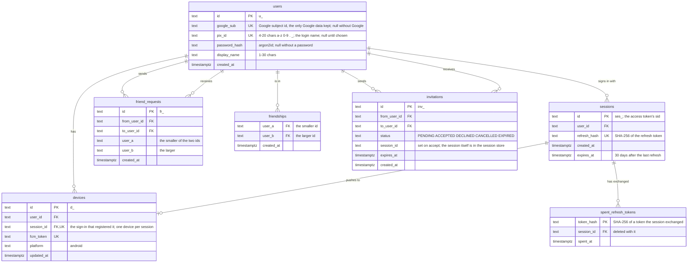

*Figure 10. Database schema. The `invitations` table comes with invitations (Iteration 3).*

- `friendships` holds one row per pair with `user_a < user_b` (the server orders them) and the pair as its primary key; a friend request is deleted when it is accepted (the friendship is created), declined, or either user removes the other.
- `friend_requests` holds at most one request between two users, in either direction: (`user_a`, `user_b`), the pair with the smaller id first, is unique. A request in the opposite direction is accepted instead of duplicated, also when both are sent at the same moment: sending locks both users first, so the second waits, finds the first's request, and accepts it; the unique pair is the database's own guard.
- Expired and answered invitations are deleted by a job after 24 h; nothing in the schema stores photos, guides, or session content (NFR-13).
- Each sign-in on a phone is a row in `sessions`, which keeps only the hash of its current refresh token (2.5.3, *Session tokens*); access tokens are not stored. Every refresh token the session has exchanged goes to `spent_refresh_tokens`, so any of them that comes back ends the session; one spent longer ago than a session lasts is ignored, because it would have expired anyway, and is dropped at the session's next refresh. A sign-in removes the user's expired sessions, and a refresh moves `expires_at` forward. A device row belongs to the session that registered it, and `session_id` is unique, so a session has one device: `POST /devices` is one upsert on `session_id`, so a rotated FCM token replaces the old one in place, even when two registrations arrive at once. A token that two sessions register at the same moment ends up in one of them: the second meets the first's row, rolls back, and moves the token on its retry. Ending the session deletes it (`ON DELETE CASCADE`). A session that expired without a sign-out keeps its device row until the user signs in again, so the push sender (Iter3-P15, [#119]) must send only to devices whose session has not expired.
- **Storage.** On the course servers PostgreSQL's files are in `/opt/pix/postgres`, a directory on the server's own disk mounted into the container, not a Docker volume. They outlive a crash of PostgreSQL (its write-ahead log replays what was committed), a restart of any container, a deploy, a reboot, and `docker compose down -v`. Deleting that directory deletes every account, and nothing backs it up yet.
- **Failure.** An account request that cannot reach PostgreSQL, loses its connection, or finds no free connection in the pool answers `503 UNAVAILABLE`; signaling and pose generation do not use the database and keep working. An `OSError` counts as a database failure only when the database driver raised it; any other is a bug and answers 500. Requests end their transaction before slow work, a password check waiting for its turn or Google's token check, so neither holds a connection, or SQLite's write lock, meanwhile.
- Every user can sign in somehow: a check constraint requires a Google subject, a password hash, or both. `pix_id` and `google_sub` are unique, and many users may have neither yet.
- **Migrations.** Every worker runs Alembic's `upgrade head` when it starts, before it takes requests (`pix_server.db.migrate`). On PostgreSQL it holds an advisory lock while it does, so with two workers in each of two copies one migrates and the others find the schema current. The old copy keeps serving during a deploy, so a revision must not break the release before it: add a column before the code needs it, and drop one a release after the code stops using it. On a SQLite file every transaction takes the write lock when it starts (`BEGIN IMMEDIATE`), so migrations, and requests, run one at a time; it is for one process on a laptop and for the tests. New revisions are written with `uv run alembic revision --autogenerate` from `server/`, and a test checks that the migrations build exactly the models' schema.
- No table stores a Google ID token, a scene photo, a guide, or anything from the live view. Logs never contain tokens or Pix IDs with request bodies (2.8, Privacy).

**Session store (Redis, AD-18).** Sessions, room codes, presence, the rate limits of poses and pose suggestions, and the wrong room codes per address are in Redis, so every worker, and both copies of the app during a deploy, see the same state. Nothing in it has to survive a Redis restart, so persistence is off; a deploy does not restart Redis. The code is the server's `store` module (2.2).

| Key | Holds | Removed |
|----|----|----|
| `session:<sessionId>` (hash) | The room code, the photographer's and the subject's connection IDs (empty while absent), the SHA-256 of each place's rejoin token (never the token; the subject's is emptied when it leaves on purpose), the expiry time of an unjoined room, and the time its last socket left; Iter3-P15 adds the invitation ID | When the photographer leaves; otherwise by the sweeper, 10 min after creation if nobody joined (FR-8.4) or 60 s after its last socket (2.6.7) |
| `code:<code>` | The `sessionId` of an active room code | With its session |
| `expired` (sorted set) | Codes that expired in the last 10 min, scored by the time to forget them, so a late `room.join` answers `EXPIRED` and the code is not handed out again | By the sweeper when that time comes |
| `deadlines` (sorted set) | Each session with an expiry ahead, scored by the earlier of its two deadlines, so the sweeper reads only the sessions that are due | With its session |
| `sessions` (set) | Every session ID, counted by `/internal/stats` | With its session |
| `conn:<connectionId>` (hash) | The worker that holds the socket, the session it is in, and the signed-in user, if any | On disconnect |
| `workers` (set), `worker:<workerId>`, and `conns:<workerId>` (set) | The registered workers: a worker adds itself when it starts, or after it lost its state, and every other script refuses to run for a worker that is not here; each worker's heartbeat, with a 15 s expiry kept by Redis itself; and the IDs of that worker's connections | The heartbeat by its expiry, the rest by the sweeper once the heartbeat is gone; all at once when the worker stops |
| `presence:<userId>` (set, Iter2-P8) | The user's open connection IDs; the user is online while one of them exists, and in a session while one of them is (FR-5.9, FR-6.9) | With the connections, also those of a worker the sweeper finds dead |
| `rate:pose:<address>` (sorted set) | The times of that address's pose requests inside the window (2.8, Privacy) | As the window moves, and the key an hour after its last request |
| `rate:pose:all` (sorted set) | The times of every pose request inside the global window, 24 hours by default; a request is counted in both pose windows or in neither (2.8, Privacy) | As the window moves |
| `rate:suggest:<address>`, `rate:suggest:all` (sorted sets) | The same two windows for `POST /pose-suggestions`, with the same lengths and their own limits (2.8, Privacy) | As the window moves, and each key one window after its last request |
| `rate:tip:<address>`, `rate:tip:all` (sorted sets) | The same two windows for `POST /pose-tips`, with their own limits (2.8, Privacy) | As the window moves, and each key one window after its last request |
| `rate:join:<address>` (sorted set) | The times of that address's wrong room codes inside the window, 10 minutes by default (2.5.2) | As the window moves, and the key once the window has passed |
| `sweeper` | The worker that sweeps during this interval | After one interval |
| Channel `worker:<workerId>` | Messages for sockets that worker holds | Not stored |

- **Atomic transitions.** Create, join, rejoin (`session.join`), leave, disconnect, and expire each run as one Lua script inside Redis. A script checks and changes the session and returns the messages to deliver as plain rows (connection, its worker, message kind), which the worker turns into JSON. So two joins cannot interleave, even on two workers. The caller passes the current time in, so tests still move a fake clock; only the heartbeat uses Redis's own expiry, because it is about whether a process is alive.
- **Delivery.** A worker puts a message for one of its own sockets straight into that socket's bounded queue, and publishes the others on the target worker's channel; every worker subscribes to its own channel before it takes sockets. Messages from one worker to another keep their order, so `peer.joined` still reaches the photographer before the subject's first `signal`. Pub/sub does not store messages: one lost while a worker reconnects to Redis shows up as a session that does not connect, which the 15 s connecting timeout and reconnection (2.6.7) already handle.
- **Sweeper.** Every worker renews its heartbeat each second (`PIX_CLEANUP_INTERVAL_SECONDS`), and the one worker that gets the `sweeper` lock for that second also sweeps: it forgets old expired codes, expires unjoined rooms and tells the photographer `EXPIRED`, removes empty sessions, and treats every connection of a worker without a heartbeat as disconnected, so the other phone gets `peer.left` with `CONNECTION_LOST`. Every transition sweeps first as well, so a join enforces an expiry the sweeper has not reached yet.
- **A worker that stops** gives up its connections at once. Their sessions stay for the usual 60 s, in which a phone that reconnects takes its place again (2.6.7).
- **Failure.** `/health` checks Redis, so a copy of the app that cannot reach it never receives traffic (2.8, Deployment). When a call to Redis fails, or a worker finds that it is no longer in `workers` (Redis restarted empty, or the sweeper took it for dead), messages for its sockets may have been lost, so it closes all of them with 1013 (try again later) and registers again. A live session goes on phone to phone, and a waiting room ends on the phone with an error instead of stalling with a code that no longer works. Until Redis answers, new sockets are closed with 1013, and pose requests and pose suggestions answer `503 UNAVAILABLE`, because they cannot be counted against the rate limit, as do `GET /friends` and accepting a friend request, which read presence; a disconnect the worker could not write is written later. If Redis itself restarts, open rooms are lost.
- **Tests and laptops.** Without `PIX_REDIS_URL` the server keeps its state in fakeredis inside the process, which runs the same scripts; this is for one worker on a laptop, and the deployed image does not contain it. The tests use fakeredis too, which can also switch the store off, and CI runs them a second time on a real Redis. Likewise, without `PIX_DATABASE_URL` the accounts are in `pix.db` in the working directory; the tests use a new SQLite file each, and CI's second run uses PostgreSQL.

### 2.8 Implementation decisions

| Topic | Decision |
|----|----|
| **UI structure** | One activity with a Navigation graph; each wireframe screen is one destination. The screens of one flow share one activity-scoped ViewModel (generation, account, friends, reference, session); Camera and Subject view have their own. A ViewModel exposes its UI state as `StateFlow`, plus one-shot results and notices as flows read from buffered `Channel`s, so a result waits while the screen is stopped, and it receives user events. Modules are created in one place, so a fake can stand in for a module that is not ready yet. |
| **Concurrency** | Segmentation, outline, and image encoding run on `Dispatchers.Default`; network and file work on `Dispatchers.IO`. The saved-guide store encodes and scales its images on `Dispatchers.IO` with its file work, one call at a time, and traces a loaded guide's outline on `Dispatchers.Default`. CameraX analysis uses its own single-thread executor. All WebRTC and WebSocket callbacks hop onto one serial session scope (`limitedParallelism(1)`), so session state changes never race. WebRTC's own threads are never blocked. |
| **Message rate** | `guide.state` is throttled to 20 Hz during gestures, and the final value goes on the reliable channel (2.5.1). `camera.state` follows the camera: one step for each zoom it reports applied, at most one per display frame, and a final value 100 ms after the last (2.6.5). The subject's requests go at most every 50 ms, with the final value at once. Receivers drop stale `seq`. |
| **Backpressure** | Reliable messages, image chunks and control messages alike, wait in one ordered queue until `hello` has gone out and while the reliable channel's `bufferedAmount` is 256 KiB or more; realtime messages never wait. A guide image of tens of KB stays well under the limit, so control messages are not held up in practice. |
| **Caching** | The current guide and the last candidate set are kept in memory for the app process only; no gallery or generated images are written to disk, except a guide the user saves (*Guide store*), whose mask and 512 px reference copy go to the app's private files. The subject keeps the last received guide image by `guideId`, so a reconnect does not resend it. |
| **Guide store** | Each phone uses `InMemoryGuideRepository`, with separate instances for the photographer's guide, clamped with the chosen ratio's frame, and the subject's mirror, clamped with the narrowest frame (9:16). `setGuide` resets the display state to the guide's `anchor` (or clears it for null); `update` is ignored without an image, keeps the stored image's ID, and clamps through `GuideGeometry`. Writes are serialized. Every applied operation emits a `GuideChange`, including the hidden flag. **Saved guides (It 2, AD-16)** are written by `FileSavedGuideStore`, the `SavedGuideStore` of the app, under `filesDir/guides/<id>/` as `mask.png`, `reference.webp` (the 512 px thumbnail source), and `meta.json` (`GuideState`, `anchor`, `aspect`, `savedAt`); at most 20, oldest deleted first; nothing is written to MediaStore. `mask.png` is encoded as the subject receives it (`mask-png`, 2.5.1). A guide saved before Iteration 3 has `cutout.webp`, whose alpha is the mask: the first read writes `mask.png` from it and deletes the cutout, and a cutout that cannot be read makes the folder unreadable. `meta.json` also keeps the guide's source and an increasing `order` that sorts the list, so a clock set back does not reorder it. A guide is written to a hidden `.<id>` folder and renamed into place; when the folder is read, a half-written folder, a folder that cannot be read back, and any beyond 20 are deleted. The thumbnail is the middle of the reference (or of the outline without one), cut to 3:4 and at most 252 × 336 px; a loaded guide's outline is traced again from the stored mask. `guides/` is left out of cloud backups and device transfers (`data_extraction_rules.xml`, NFR-13). A saved guide that is used starts at its `anchor`, like a new guide (FR-3.1): the `GuideState` in `meta.json` is kept but not applied. |
| **Lifecycle** | The camera binds to the lifecycle of the camera screen; ViewModels keep UI state across rotation. If the photographer's app goes to the background, the camera is released and the video pauses. The session stays open for 60 s, and the subject sees that the camera is paused: Subject view shows "Connecting…" until the session's first frame arrives and "The photographer's camera is paused" when no frame has come for 2 s after that. No foreground service is used. With reconnection (Iteration 3) a drop moves both phones to `Reconnecting` for up to 10 s before the session ends (2.6.7); the 60 s count also while it reconnects, and their deadline holds when the link comes back. The aspect ratio, brightness, and flash are restored when the camera rebinds; the last ratio is kept in DataStore. |
| **Error handling** | Module interfaces return `Result` with typed errors (`NoPersonFound`, `GenerationError`, `EndReason`). ViewModels map them to the failure screens in the wireframe, and each maps to exactly one screen, with one exception: a reference photo that cannot be read, or a segmentation model that is not ready within 60 s, shows the toast "Couldn't use this photo. Try another one." and returns to Camera. |
| **Timeouts** | Pose generation: 60 s on the client for a whole run, and 60 s from server to API for each request (2.6.3, *Time limit*). Because the phone's limit starts first, it usually ends a request that reaches the limit before the server's `504` arrives. Session connecting: 15 s. A link that drops while connected: 10 s of reconnecting before it counts as lost (2.4, 2.6.7). A signaling socket that drops during a session or while a room waits: opened again after 1 s, every second while reconnecting, and otherwise doubling to 30 s, counted only outside reconnecting. The photographer's app in the background: 60 s before it leaves the session. Remote requests: 500 ms before an unanswered final request is answered, and 5 s in which a late one is still the subject's (2.6.5). Room code: 10 min. Invitation: 30 s on the server (It 3). TURN credentials: the session's lifetime plus 10 min (It 3). |
| **Configuration and secrets** | The server URL is set per build type in `BuildConfig`: Server A for release; for debug the temporary AWS server, `http://3.105.185.251/`, which runs `dev` and which every network reaches, cellular data included (2.8, Hosting), or a laptop on the test Wi-Fi through `pix.serverUrl`. A debug build's `pix.relayOnly=true` makes WebRTC use the relay alone (2.6.7). The Google web client ID is one constant in `app/build.gradle.kts` (`BuildConfig.GOOGLE_SERVER_CLIENT_ID`), the same as the servers' `PIX_GOOGLE_CLIENT_ID`; Google accepts sign-in only from an APK whose signing key is registered as an Android OAuth client in the same project (decided 2026-10-21). The course servers have no TLS (AD-11), so release builds allow plain HTTP and WebSocket traffic to the two course hostnames only, through the network security config; debug builds allow it to any host. The image-editing API key is the server environment variable `OPENROUTER_API_KEY` and is never committed; `PIX_POSE_MODEL` chooses the model. The server also reads `PIX_DATABASE_URL` (on the course servers the Compose file sets it, with a password that `deploy.sh` makes once and keeps in `/opt/pix/db-password`), `PIX_JWT_SECRET` (made by `deploy.sh` in `/opt/pix/jwt-secret` on the course servers), `PIX_ACCESS_TOKEN_MINUTES` (15), `PIX_SESSION_TTL_DAYS` (30), `PIX_REDIS_URL` (AD-18), and `PIX_GOOGLE_CLIENT_ID`. The relay adds `PIX_TURN_KEY_ID` and `PIX_TURN_API_TOKEN`, the id and API token of Cloudflare's TURN key (AD-14), which each server must set, with `PIX_TURN_TTL_SECONDS` (14400) and `PIX_TURN_TIMEOUT_SECONDS` (3); the server logs only Cloudflare's status, never the token or a credential. Invitations will add `PIX_FCM_CREDENTIALS` (path to the Firebase service-account file) and `PIX_PUBLIC_URL` for invite links (Iter3-P15; not in `config.py` yet). `.env.example` lists every name, which a test keeps in step with the settings in code: a name with no value must be set on each server, and every other name is commented, showing the default the app already has. The Firebase file and the secrets live only in a `.env` file on each server. Each deploy and restart compares that file with the example and warns, in its log, in `pix status`, and at an operator's login, about a required name without a value and about a name the example does not list, which the app would ignore; it never writes the file, so a default changed in code is not pinned on a server (decided 2026-10-15). |
| **Privacy** | The server does not log request bodies, images, or the image API's response bodies. It holds a scene photo in memory only and discards it after responding (NFR-13); a request over 1 MiB is refused before it is read, so no upload is written to disk. `POST /poses` is rate-limited per client IP address, 20 per hour by default, and over all clients together, 500 in 24 hours by default (`PIX_POSE_GLOBAL_LIMIT`, `PIX_POSE_GLOBAL_WINDOW_SECONDS`), counting only requests sent to the image API, to control cost; `POST /pose-suggestions` has windows of its own of the same lengths, 10 per address and 500 over all (`PIX_SUGGESTION_RATE_LIMIT`, `PIX_SUGGESTION_GLOBAL_LIMIT`). All answer `429 RATE_LIMITED`, with a message that says which. Neither a description, a suggested pose, nor a variation is written to a log, because all of them describe the person in the photo. The global limit bounds what the image API can cost in a day however many addresses send requests; the OpenRouter key's own spending limit, set in OpenRouter's dashboard, is the last bound. A `room.join` with a wrong code counts against the address too, 100 in 10 minutes (`PIX_JOIN_FAILURE_LIMIT`, `PIX_JOIN_FAILURE_WINDOW_SECONDS`; 2.5.2); on the course servers the address is the last `X-Forwarded-For` value, which the course's proxy adds. Requests to the course servers travel over plain HTTP (AD-11), so a scene photo, a password at sign-in, and the access and refresh tokens are not encrypted between the phone and the server; the live view is, because it goes phone to phone (NFR-14). No endpoint takes a Pix ID or other personal data in its URL, because nginx's error log prints a failed request's whole request line; the lookup is `POST /users/lookup`. The access logs of nginx and Uvicorn also leave out query strings, and the server never logs a password, a token, or a request body. Password hashes run two at a time per worker, so a burst of sign-ins, which needs no account, queues instead of using a 64 MiB argon2id buffer per thread of the pool. |
| **Measurement hooks** | `Timings` logs named timestamps with a shared tag, so NFR latencies can be read from logcat without extra tools. Examples: `seg.start`/`seg.end`, `pose.first`, `guide.sent`/`guide.applied`, and `rtt` from ping. Times are each phone's own clock; the `ping.received` and `rtt` lines align two phones' logs (2.5.1). With every ping, the session logs a `stats` line from WebRTC's statistics (codec, size, frame rate, bitrate, and round-trip time), the source for NFR-5, NFR-6, and NFR-12. The zoom marks and the frames after each zoom request feed `android/scripts/zoom_timings.py` (2.6.5). |
| **Hosting (It 2, AD-11)** | Two course-provided servers, each behind the course's HTTP proxy and reachable only on port 80: Server A, `http://swpp26t10.147-46-242-169.sslip.io`, runs `main` as production, and Server B, `http://swpp26t10.147-46-242-174.sslip.io`, runs `dev` as staging. They cannot reach each other, so each has its own database and session store. `server/deploy/` holds a `docker-compose.yml` with `nginx` on port 80 (`/api/v1`, `/ws`, `/health`, and `/version`, and with invitations the `/i/<id>` page; anything else answers `404`, so FastAPI's `/docs` is not public), two copies of the app (`app-blue` and `app-green`; Uvicorn with two workers, a count set explicitly because the servers report 38 CPUs for the 8 cores we get), `redis`, and `postgres` with its files in `/opt/pix/postgres` on the server's disk (not a Docker volume, so no Docker cleanup can delete them), plus the nginx configuration. The course's proxy, measured on 2026-10-13: WebSockets pass and stay open (300 s with pings, 200 s idle), although the course cuts a plain HTTP response after 120 s; the proxy adds the phone's address as the last `X-Forwarded-For` value and passes on any value the client sent, so nginx trusts only the proxy and takes the last value; and it does not pass a client's cancel on to the server (2.6.3). The course servers can be reached only from the campus network, so a temporary server on AWS with the same Compose setup serves the user test and sessions across networks until they are open to other networks. |
| **Deployment (It 2)** | GitHub cannot push to the course servers: SSH goes through a campus-only relay with personal keys, and a self-hosted runner needs repository admin rights the team does not have and is advised against on a public repository. So each course server pulls. A systemd timer runs `server/deploy/deploy.sh` every minute, which compares its branch with the deployed commit. A merge that does not change `server/` only records the commit. Otherwise the script builds the image on the server, with the tests as a build stage, starts it as the idle copy (blue or green), and waits for its `/health`. It then waits until the old copy has no open room, for at most 10 min, then switches nginx, checks `/health` through it, and stops the old copy with a grace period long enough for a pose request in flight. Last it records the commit in `/version`. A failure at any step leaves the running copy serving, and that commit is not tried again; `deploy.sh rollback` switches back to the previous image. The two copies share their rooms through the session store (AD-18), and a phone takes its place again after its socket drops (2.6.7), but the wait stays for phones with an app from before reconnection (Iter3-P14): stopping a copy closes their sockets, and in a room that spans both copies the phone on the new copy would be told that its peer was lost, which ends such an app's live session on the subject's phone. A workflow on GitHub's own runners builds the image on every pull request and, after a merge, waits until `/version` shows the commit, so a failed deploy is visible on the commit. GitHub can reach the temporary AWS server, so it has no timer: after each push to `dev` a workflow runs the same `deploy.sh deploy` there through AWS Systems Manager and then checks `/version` at the server's public address. The workflow signs in with the access key of an IAM user that may run only that deploy, as the `PixDeploy` command document, on that one instance. The key is a secret of a GitHub environment that only `dev` may use, and the workflow needs no open SSH port. |
| **Accounts (It 2, AD-12)** | The app sends the access token as a bearer header on REST calls and the signaling upgrade. A person signs up with a Pix ID, a display name, and a password, or with Google; either kind of account can add the other way to sign in (`PUT /me/google`, `PUT /me/password`; 2.5.3). Passwords are hashed with argon2id (`argon2-cffi`'s defaults: 3 passes over 64 MiB) on a worker thread, so a hash does not hold up the sockets of the same worker; only the hash is stored. They cross plain HTTP to the course servers (AD-11, NFR-14), and login attempts are not limited for now (decided 2026-10-15). Whether a Pix ID exists is not secret: the lookup tells any signed-in user and `POST /auth/check-pix-id` anyone, each for an exact Pix ID only (NFR-15), and neither is limited for now; a failed log-in still gives one answer for an unknown Pix ID and a wrong password (decided 2026-10-22). There is no email, so a forgotten password cannot be reset. The server verifies Google ID tokens with `google-auth` against Google's published keys and our web client ID, and stores only the Google subject. Each sign-in gives a 15-minute access token, a JWT signed with HS256 (`PyJWT`) and `PIX_JWT_SECRET` (`PIX_ACCESS_TOKEN_MINUTES`), and a refresh token that lasts 30 days from its last use (`PIX_SESSION_TTL_DAYS`); the app keeps both in DataStore (decided 2026-10-15; 2.5.3, *Session tokens*), in its private files without Keystore encryption, and `data_extraction_rules.xml` keeps them out of backups and transfers to a new phone (decided 2026-10-21). Checking an access token needs no database, so the signaling upgrade marks a user online from the token alone; REST endpoints still load the user. A refresh is one `UPDATE … WHERE refresh_hash = … RETURNING`, so two refreshes with one token cannot both succeed: the second finds the token spent and ends the session, as any later use of a spent token does. Sign-out ends the session at once for refreshes and within 15 minutes for the access token. Changing `PIX_JWT_SECRET` ends every access token, and the app refreshes. Without it a server process makes its own secret at start, which suits one worker on a laptop; on the course servers `deploy.sh` makes one once in `/opt/pix/jwt-secret` and Compose passes it to both copies. Everything but friends and invitations works without a token (FR-5.1). |
| **Push (It 3, AD-13)** | Until push is built (Iter3-P15), *Friends* and *Sent requests* call `FriendsRepository.refresh()` (`GET /friends` and `GET /friend-requests`) every 10 s while they are shown, after `AuthRepository.refreshAccount()` (`GET /me`), which they call for an account without a Pix ID too, so a Pix ID chosen on another phone is found and brings the lists at once. FCM data messages only, so the app renders every notification itself. A message for an invitation that is no longer `PENDING` when the app handles it opens the "no longer available" screen. The server deletes a device row when FCM reports the token unregistered. |
| **Aspect ratio and camera controls (It 2)** | `setAspectRatio` rebinds the `UseCaseGroup` with a `ViewPort` of the new ratio once no photo is being saved; the default is 4:3, and the last choice is restored from DataStore (`camera_settings`). CameraX starts every binding without the exposure index and the flash mode, so `CameraXController` keeps them, as it keeps the zoom, and applies them again after a rebind, a lens switch, or the screen coming back; the camera stays `STARTING` until the exposure index is back, so no photo is taken at 0 EV. While a separately exposed ultrawide without a flash is bound, the capabilities report no flash and the state reports it off, so the flash button is hidden; the chosen mode returns with the primary camera. The capabilities come from the primary rear camera. A tap focuses, meters, and sets the white balance at that point and returns to continuous focus after 5 s (`FocusMeteringAction`); the point is mapped from the frame to the preview buffer through its crop and rotation. |
| **Guide-edit mode (It 2, AD-17)** | A boolean in the screen's UI state, not in `GuideState`, so it is never synchronized; each phone has its own. It switches the overlay's `editable` flag and whether the preview's pinch detector is active. |
| **Language (It 3, FR-10.2)** | English in `res/values/`, Korean in `res/values-ko/` behind the same keys. Android takes the first of the two in the phone's language list, and English for any other. The build declares both (`generateLocaleConfig`, with English as the default in `res/resources.properties`), so Android 13+ offers them in the phone's per-app language setting. Strings without words (ratios, counters) are not translated, and Android Lint fails any other string without its Korean. Korean is drawn in Pretendard, which the app bundles (SIL OFL 1.1), because the UI's font, Manrope, has no Hangul, and on Android 13 and later its lines break between words (`lineBreakWordStyle` phrase). |
| **SDK vs in-house** | **Use SDKs** for segmentation (ML Kit) and real-time media (WebRTC). These are hard problems with mature solutions. **Build in-house** the parts that make Pix different: guide geometry and sync, the message protocol, remote control, and the pose prompt pipeline. |

### 2.9 Module ownership and build order

| Module | Owner (role) | Built in Iteration 1 | Built in Iteration 2 (issue) | Provides to |
|----|----|----|----|----|
| **App shell, design, and integration** | 한준형 (PM) | Activity, navigation graph, permission flow, `AppContainer` | Iteration 2 design and the shared contracts (Iter2-P3, [#45]); integration (Iter2-P22, [#60]); integration tests (Iter2-P21, [#59]); demo README (Iter2-P23, [#61]); schedule and issues | All screens |
| **Camera** | 박동제 | Preview, capture to MediaStore, zoom, the viewport, `setFrameSink` | Tap to focus, brightness, flash, aspect ratios; `CameraController` and `CameraCapabilities` additions (Iter2-P10, [#51]) | Session, remote control |
| **Reference guide** | 박동제 | Picker, segmentation, cutout, outline, *No person found* | Smooth outlines (Iter2-P7, [#49]); the `anchor` and the thumbnail copy of the reference (Iter2-P11, [#52]). Lines for arms and legs in front of the body are out of scope (2.6.1) | Guide overlay |
| **Guide overlay and controls** | 박동제 | `GuideRepository`, `GuideGeometry`, overlay gestures, opacity | Hide and replace, reference thumbnail, starting position, guide-edit mode on Camera (Iter2-P11, [#52]); saved guides (Iter2-P18, [#58]); the reference thumbnail on Subject view (Iter3-A1, [#132]) | Guide sync, Subject view |
| **Server deployment** | 박재완 | Running on the laptop on the test Wi-Fi | The course servers with Docker, nginx, and blue-green deploys (Iter2-P4, [#46]); the Redis session store (AD-18; Iter2-A2, [#73]) | Everything |
| **Accounts and friends** | 박재완 | — | Database, sign-in with a Pix ID and a password or with Google, Pix IDs, friend requests, friend list, presence (Iter2-P8, [#50]); Sign-in, Pix ID, and Friends screens (Iter2-P13, [#54]) | Invitations |
| **Pose generation** | 박재완 | API choice, `POST /poses`, the default poses, `PoseGenerator` | Pose description and idea chips, *Generate poses* screen, one prompt, suggested poses (Iter2-P12, [#53]) | Reference guide |
| **Real-time session** | 조성민 | `SignalingClient`, `PeerConnectionClient`, `CameraFrameSource`, codec, router | `ws://` to the course server. Iteration 3: TURN through Cloudflare, `SessionEntry.Invitation`, `session.join`, reconnection with ICE restart (Iter3-P13, [#117]; Iter3-P14, [#118]); invitations with push and link (Iter3-P15, [#119]) | Guide sync, remote control |
| **Remote control** | 조성민 | `RemoteControlHandler` (zoom) | Brightness, flash, guide moves, and notices (Iter2-P17, [#57]); pinch zoom and the guide-edit mode toggle on Subject view (Iter2-P6, [#48]); zoom without stutter (Iter2-P5, [#47]; measured on the S23 Ultra, the S21 numbers with IT-10). Iteration 3: remote focus and the permission switch (Iter2-P17, Could) | UI |
| **Guide sync** | 조성민 | `GuideSyncer`, the guide on Subject view | `visible` through `guide.state`; no `anchor` is sent P→S, and a guide from the subject carries its own (2.5.1). Iteration 3: the mask-only transfer in `GuideImageCodec` and the syncer, in either direction (한준형; Iter3-P9, [#113]); the reference photo for Subject view's thumbnail, `guide.reference.*` (박동제; Iter3-A1, [#132]) | UI |

Invitations need both the accounts server (박재완) and the session entry point (조성민), and the two owners agree the order of the invitation work.

**Shared contracts in code.** The contract files marked \* in 2.1 were written first in `android/` ([#13]), so each owner could build against them.

- The contracts are the module interfaces (2.1), data models (2.3), data channel and signaling messages (2.5.1, 2.5.2), and the REST API (2.5.3). The Iteration 2 additions were added with their features and reviewed there: the account and friends contracts with the Sign-in, Pix ID, and Friends screens ([#92]), and `SavedGuideStore` with saved guides ([#96]). `InvitationManager` comes with invitations (Iter3-P15, [#119]).
- Everything else is built by the owners in their tasks: screens, implementations, fakes, and the server.
- A contract changes only through a pull request that the affected owners review, together with this document.

**Iteration 3 tasks** (from the kickoff of 2026-10-25; the tasks due 10/30 are for the user test of 10/31–11/1):

| Owner | Task | Due | Design |
|----|----|----|----|
| 박재완 | A temporary server on AWS for the user test (Iter3-P2, done) | 10/26 | 2.8 |
| 박재완 | The documents (PM; Iter3-P3–P5) | 10/26 | — |
| 박재완 | The Korean translation (Iter3-P7, [#111]) | 10/26 | 1.4.2 |
| 박재완 | Candidates in the scene photo's ratio (Iter3-P8, [#112]) | 10/30 | 2.6.3 |
| 한준형 | The mask-only guide transfer, in either direction (Iter3-P9, [#113]) | 10/30 | 2.5.1, 2.6.1, *Still open* |
| 박동제 | *Pick a pose* one candidate at a time (Iter3-P10, [#114]; PR [#108]) | 10/30 | 2.6.3 |
| 박동제 | Pose tips (Iter3-P11, [#115]; PR [#110]) | 10/30 | 2.6.3 |
| 박동제 | Selfie mode, and whether the prompts suit it (Iter3-P12, [#116]) | 10/30 | 1.4.2, *Still open* |
| 박동제 | The reference thumbnail on Subject view (Iter3-A1, [#132]) | 10/30 | AD-6, 2.5.1, 2.6.2 |
| 조성민 | Sessions on different networks (Iter3-P13, [#117]) | 10/30 | 2.6.7 |
| 조성민 | Reconnection after a short drop (Iter3-P14, [#118]) | 10/30 | 2.6.7 |
| 조성민 | Invitations and friend requests with push notifications (Iter3-P15, [#119]) | 10/30 | 2.6.6 |
| 한준형 | Shared steps: the subject's phone opens guide selection and pose generation, both phones show the same step, and guides can be saved on either phone (Iter3-P16, [#120]) | 10/30 | *Still open* |
| 한준형 | Photos taken in a session saved on both phones (Iter3-P17, [#121]) | 10/30 | *Still open* |
| 조성민 | The offline QR connection (Iter3-P22, [#122]) | 11/5 | 1.4.2, *Still open* |
| 한준형 | The settings screen and the first-use tutorial (Iter3-P23, [#123]) | 11/5 | 1.4.2 |
| 박동제 | Prompt history on *Generate poses* (Iter3-P24, [#124]) | 11/5 | *Still open* |
| 박재완 | Four prompt templates and an improved default prompt (Iter3-P25, [#125]) | 11/5 | *Still open* |
| 박재완 | Integrate the Iteration 3 features (Iter3-P28, [#128]) | 11/5 | — |

**Iteration 2 build order** (follows the schedule of 2026-10-11; dates are the issues' due dates):

1.  **By 10/12.** This design (v1.0) and the shared contracts for the new interfaces, models, and messages, merged to `dev` with fakes (Iter2-P3).
2.  **By 10/14–10/16.** In parallel: the course servers with Docker, nginx, and blue-green deploys (Iter2-P4); the zoom stutter (Iter2-P5, Must) and pinch zoom with guide-edit mode (Iter2-P6); smooth outlines and the mask-only transfer (Iter2-P7, Must); the accounts server (Iter2-P8).
3.  **By 10/17–10/18.** Camera controls (Iter2-P10); guide controls, thumbnail, and starting position (Iter2-P11); pose descriptions (Iter2-P12); Sign-in, Pix ID, and Friends screens (Iter2-P13).
4.  **By 10/20.** Invitations with push and link (Iter2-P15); sessions across networks and reconnection (Iter2-P16); remote brightness, flash, and guide moves (Iter2-P17); saved guides (Iter2-P18).
5.  **By 10/22–10/23.** Integration tests (Iter2-P21), integration on the test phones (Iter2-P22), latency and connection-rate measurement per network pair, and the demo README (Iter2-P23). The midterm presentation is on 10/21 with what is merged by then.

### 2.10 Repository and branches

```text
swpp-2026-project-team-10/
├─ android/        Android app (Gradle project with the shared contracts; open this folder in Android Studio)
├─ server/         FastAPI app with its Alembic migrations and Dockerfile; .env.example for secrets; scripts/ (model comparisons) and
│                  tools/ (fake phones for testing); deploy/ with docker-compose, the nginx configuration, the deploy script, and the
│                  systemd timer that deploys a new image (It 2)
├─ wiki/           source of the GitHub wiki, with its images in wiki/images/ and their drawings in wiki/design/ (the
│                  architecture figure, the wireframes one file per flow, and render.py, which renders them); the wiki-sync
│                  workflow mirrors it on every push to dev
└─ .github/        pull-request template; CI (Android lint and tests, server lint and tests, the server image), the deploy watcher, the
                   AWS server's deploy, and the wiki-sync workflow
```

- **main**: stable; updated from **dev** with a merge commit at the end of each iteration. `iteration-N-demo` is created from main for the demo (`iteration-2-demo` for the midterm).
- **dev**: integration branch. Each task gets its own branch from dev (for example `feat/12-guide-overlay`, with the issue number when the task has one) and returns through a pull request that is **squash-merged**, so dev has one commit per task.
- **Commit messages and PR titles** follow [Conventional Commits](https://www.conventionalcommits.org) (for example `feat: add guide overlay`), and branch names start with the same type.

## 3. Design Patterns (Iteration 5)

To be written in Iteration 5, with at least two patterns documented in detail. Each will list its location, the problem it solves, why it was chosen, its benefit, a short snippet, and the component roles. These are the candidates that the current design already uses:

| Pattern | Where | Problem it addresses |
|----|----|----|
| **State** | `SessionState`, `RtcSessionManager` | Different allowed actions and UI in each connection phase (Figure 9) |
| **Observer** | `StateFlow` in repositories and ViewModels | Many screens and the syncer react to one guide or session state |
| **Adapter** | `CameraFrameSource` | CameraX frames to the WebRTC video source |
| **Strategy** | `SessionEntry` (room code, invitation; QR later); mask smoothing variants (today one set of functions in `MaskSmoothing.kt`) | Switch how a session starts, or how the mask is cleaned, without changing callers |
| **Command** | `camera.*` and `guide.move` messages handled by `RemoteControlHandler` | Remote actions as objects that can be validated, queued, cancelled, and logged |
| **Repository / Facade** | `GuideRepository`, `SessionManager` | A simple interface over CameraX, ML Kit, WebRTC, and the network, which also makes fakes possible |

[#13]: https://github.com/snuhcs-course/swpp-2026-project-team-10/pull/13
[#45]: https://github.com/snuhcs-course/swpp-2026-project-team-10/issues/45
[#46]: https://github.com/snuhcs-course/swpp-2026-project-team-10/issues/46
[#47]: https://github.com/snuhcs-course/swpp-2026-project-team-10/issues/47
[#48]: https://github.com/snuhcs-course/swpp-2026-project-team-10/issues/48
[#49]: https://github.com/snuhcs-course/swpp-2026-project-team-10/issues/49
[#50]: https://github.com/snuhcs-course/swpp-2026-project-team-10/issues/50
[#51]: https://github.com/snuhcs-course/swpp-2026-project-team-10/issues/51
[#52]: https://github.com/snuhcs-course/swpp-2026-project-team-10/issues/52
[#53]: https://github.com/snuhcs-course/swpp-2026-project-team-10/issues/53
[#54]: https://github.com/snuhcs-course/swpp-2026-project-team-10/issues/54
[#57]: https://github.com/snuhcs-course/swpp-2026-project-team-10/issues/57
[#58]: https://github.com/snuhcs-course/swpp-2026-project-team-10/issues/58
[#59]: https://github.com/snuhcs-course/swpp-2026-project-team-10/issues/59
[#60]: https://github.com/snuhcs-course/swpp-2026-project-team-10/issues/60
[#61]: https://github.com/snuhcs-course/swpp-2026-project-team-10/issues/61
[#73]: https://github.com/snuhcs-course/swpp-2026-project-team-10/issues/73
[#86]: https://github.com/snuhcs-course/swpp-2026-project-team-10/issues/86
[#92]: https://github.com/snuhcs-course/swpp-2026-project-team-10/pull/92
[#93]: https://github.com/snuhcs-course/swpp-2026-project-team-10/pull/93
[#96]: https://github.com/snuhcs-course/swpp-2026-project-team-10/pull/96
[#99]: https://github.com/snuhcs-course/swpp-2026-project-team-10/pull/99
[#108]: https://github.com/snuhcs-course/swpp-2026-project-team-10/pull/108
[#110]: https://github.com/snuhcs-course/swpp-2026-project-team-10/pull/110
[#111]: https://github.com/snuhcs-course/swpp-2026-project-team-10/issues/111
[#112]: https://github.com/snuhcs-course/swpp-2026-project-team-10/issues/112
[#113]: https://github.com/snuhcs-course/swpp-2026-project-team-10/issues/113
[#114]: https://github.com/snuhcs-course/swpp-2026-project-team-10/issues/114
[#115]: https://github.com/snuhcs-course/swpp-2026-project-team-10/issues/115
[#116]: https://github.com/snuhcs-course/swpp-2026-project-team-10/issues/116
[#117]: https://github.com/snuhcs-course/swpp-2026-project-team-10/issues/117
[#118]: https://github.com/snuhcs-course/swpp-2026-project-team-10/issues/118
[#119]: https://github.com/snuhcs-course/swpp-2026-project-team-10/issues/119
[#132]: https://github.com/snuhcs-course/swpp-2026-project-team-10/issues/132
[#136]: https://github.com/snuhcs-course/swpp-2026-project-team-10/issues/136
[#120]: https://github.com/snuhcs-course/swpp-2026-project-team-10/issues/120
[#121]: https://github.com/snuhcs-course/swpp-2026-project-team-10/issues/121
[#122]: https://github.com/snuhcs-course/swpp-2026-project-team-10/issues/122
[#123]: https://github.com/snuhcs-course/swpp-2026-project-team-10/issues/123
[#124]: https://github.com/snuhcs-course/swpp-2026-project-team-10/issues/124
[#125]: https://github.com/snuhcs-course/swpp-2026-project-team-10/issues/125
[#128]: https://github.com/snuhcs-course/swpp-2026-project-team-10/issues/128
