## Document Revision History

| Version | Date | Key changes |
|----|----|----|
| 0.1 | 2026-09-30 | Initial draft: system architecture, external libraries, architectural decisions, Android app structure and module interfaces, class diagrams, data models, state machines, protocols and APIs, algorithms, database schema, implementation decisions, module ownership, and the Iteration 1 build order. The shared contracts (interfaces, models, messages, API) are also in `android/`. |
| 0.2 | 2026-09-30 | Iteration 1 design developed: a JSON example for every data channel message, signaling message, and REST endpoint (2.5); the Iteration 1 test setup, with both phones and the server (a laptop) on the same Wi-Fi (Figure 1); the remote zoom flow (Figure 3); guide sync and remote control as separate modules (2.9). Added the plan for Iterations 2–5 with the target architecture (1.4): friends and invitations, cellular connections, more remote controls, saved guides, an offline connection with a QR code, and guides that keep the background. The photographer takes every photo. |
| 0.3 | 2026-10-04 | Pose generation as built: the image-editing API is OpenRouter's Image API with the model as a server setting, and the selection result is recorded (2.6.3); a prompt that lets the model re-place the person (2.6.3); the server validates the scene photo and does not resize it (1.1.2, 2.2); `400 INVALID_REQUEST` and a 1 MiB request limit (2.5.3); a 30 s upstream timeout, and the server cancels the image API call when the phone disconnects (2.6.3, 2.8); rate limiting per client address (2.8). |
| 0.4 | 2026-10-05 | Remote zoom as built: the subject pinches the live view instead of tapping zoom chips (Figure 3, Figure 7, 2.6.5), and `CameraCapabilities.zoomStops` stays in the contract for later subject controls (2.3, 2.5.1, 2.6.2); `camera.zoom.set` carries `final`, with pinch steps on the realtime channel at most every 50 ms and the last value on the reliable channel (2.5.1); every applied zoom is echoed as `camera.state`, only a final request shows the remote-action notice, and the subject ignores echoes while its pinch is in progress (2.6.5); `SessionManager` keeps the last `camera.capabilities` and the last echoed zoom for a Subject view that opens late (2.1); *Remote control* owns pinch zoom on Subject view (2.9). |
| 0.5 | 2026-10-06 | Camera and Subject view use single-value zoom sliders with hardware endpoint labels and keyboard/accessibility support. Preview and live-video pinches no longer zoom the camera; guide drag/pinch remains. Dragging keeps the thumb under the user's control despite asynchronous observations, supports lens switching, and finishes on release, cancellation, or pause; the existing remote step/final protocol is unchanged (Figure 3, 2.5.1, 2.6.2, 2.6.5). |
| 0.6 | 2026-10-06 | Pose generation: the user takes the scene photo with the Camera screen's shutter and confirms it before anything is sent (1.1.3, 2.2, 2.6.3). One 30 s limit covers a whole generation run, and the app discards the scene photo and the other candidates after *Use this pose* (2.6.3, 2.8). |
| 0.7 | 2026-10-07 | Measurement as built: both phones ping every 2 s, the phone that receives a `ping` logs `ping.received` with its `ts`, and the sender's `rtt` line carries the same `ts`. Matching the two lines gives the difference between the phones' `Timings` clocks, `t(ping.received) − t(rtt) + rtt/2`, so cross-phone latencies such as guide sync can be read from the two logs (2.5.1, 2.8). |
| 0.8 | 2026-10-09 | Final version for Iteration 1, synced with the current build and the team's decisions. The WebRTC build is decided: `io.github.webrtc-sdk:android` 137.7151.01 (header, 1.2). DataStore keeps only the generation consent (1.2). `CameraController.status` (2.1) and `PeerInfo.haveGuideId` (2.3) are added. When the subject leaves or drops, the photographer's phone goes back to `Waiting` with the same code (2.4). The remote zoom notice shows for 3 s on the Camera screen instead of as a toast (2.6.5), and the use of `camera.state`'s `by` field is corrected (2.5.1). The owners of the app shell and guide sync are corrected (2.9), and the repository tree shows `wiki/` (2.10). This entry also records the composition grid and horizon bar (2.6.2) and ultrawide zoom routing (2.6.5), added on 2026-10-05. |
| 1.0 | 2026-10-13 | First version for Iteration 2; Iteration 2 versions start at 1.0 and count up by one minor step per change: 1.1, 1.2, …, 1.9, 1.10, 1.11, and so on. Iteration 2 design, from the kickoff on 2026-10-09 (Team Meetings) and the schedule of 2026-10-11, written before feature work (#45, Iter2-P3). Task IDs use the issue numbering `Iter2-Pn` (the schedule's P21–P44 minus 20). Architecture: the server on a public host with HTTPS and WSS, a database, Firebase Cloud Messaging for invitations, and a TURN relay on the same host (1.1, 1.2, AD-11–AD-14, 1.4). Camera: brightness, flash, and aspect ratios 4:3, 16:9, and 1:1; the zoom slider is replaced by pinch zoom with a guide-edit mode toggle (AD-10, AD-17, 2.1, 2.3, 2.6.2, 2.6.5). Guide: outline only, never the reference's pixels; the photographer smooths the mask once and sends only that mask; the guide starts where the person stands in the reference; a reference thumbnail; saved guides in private storage (AD-6, AD-15, AD-16, 2.1, 2.3, 2.5.1, 2.6.1, 2.6.2, 2.8). New module interfaces and models for accounts, friends, invitations, camera controls, and saved guides (2.1, 2.3); session states for invitations and reconnection (2.4); new data channel messages, signaling, and REST endpoints with a JSON example each (2.5); pose descriptions and idea chips (2.6.3); invitations and push, reconnection (2.6.6, 2.6.7); the database schema (2.7); Iteration 2 owners and build order (2.9). The details each owner settles while building are listed under *Still open* and as **TODO** in their sections, and come back in later versions. |
| 1.1 | 2026-10-13 | Hosting decided (Iter2-P4, #46). The server runs on the two course-provided servers, which are reachable only through the course's HTTP proxy on port 80, so it speaks HTTP and WS instead of HTTPS and WSS (AD-11, 1.1, 2.5.2, 2.5.3, 2.8). The TURN relay is Cloudflare's managed service instead of coturn on the server host, which cannot open the ports (AD-14, 1.1.2, 1.2, 2.2, 2.5.2). Session state moves from the server process to a Redis session store, so the server can run several workers and a deploy loses no room (AD-18, 1.1.2, 2.2, 2.7). Deploys are blue-green behind nginx and pulled by each server (2.8, Hosting and Deployment). The invite link cannot be a verified App Link without HTTPS (2.6.6, Still open). Figure 4 is redrawn for these decisions. |
| 1.2 | 2026-10-14 | Smooth outlines as built (Iter2-P7, #49). The mask is blurred by 0.8 % of the person's height, regions under 1 % of the foreground are dropped, and holes under 0.2 % are filled; the outline is the mask's 0.5 level traced between pixels, rounded, and drawn as a white anti-aliased line about 3 dp wide with no fill (header, 2.3, 2.6.1). The segmenter returns only the confidence mask, and until the mask-only transfer the cutout carries the smoothed mask as its alpha (2.6.1). Lines for arms and legs in front of the body are out of scope, with what Iter2-P7 tried, and ML Kit Pose Detection leaves the library list (1.2, 2.6.1, 2.9). |
| 1.3 | 2026-10-14 | Session store built (Iter2-A2, #73). Sessions, room codes, and the pose rate limit are in Redis, and each copy of the app runs two workers (2.7; 2.8, Hosting). The key layout, the sweeper, failure handling, and the test setup as built (2.7). fakeredis runs the same Lua scripts in tests and on a laptop without Redis (1.2, 2.7). A pose request that the store cannot count answers `503 UNAVAILABLE` (2.5.3). A deploy still waits for open rooms until phones can rejoin a room (2.8, Deployment). The *Session store rollout* row of Still open is closed. |
| 1.4 | 2026-10-14 | Guide-edit mode defaults decided and pinch zoom as built (Iter2-P6, #48): the mode turns on when a guide is added and off on the shutter or when the guide is hidden or removed; Subject view starts with it off and shows its toggle with guide moves (Iter2-P17); with the mode on, the overlay takes every touch inside the camera image; the toggle sits beside the zoom readout (Decided, 2.6.2). |
| 1.5 | 2026-10-15 | Accounts and friends server built (Iter2-P8, #50). Sign-up and sign-in with a Pix ID and a password are added next to Google (decided 2026-10-15): a password account can add Google, an account made with Google can add a password once it has a Pix ID, and a Google sign-in that no account uses answers `NOT_REGISTERED`, so the app can offer to connect an existing Pix account first (AD-12 revised; 1.1, 1.2, 2.1, 2.3, 2.5.3). Passwords are argon2id hashes and need 8–64 characters with a letter and a digit; login attempts are not limited for now (2.8, Accounts). New endpoints `POST /auth/signup`, `POST /auth/login`, `POST /auth/google/signup`, `DELETE /auth/session`, `PUT /me/google`, `PUT /me/password`, `GET /friend-requests`, and `DELETE /friend-requests/{id}`; the sign-in requests no longer carry `deviceName`, which nothing used; a lookup returns the pending request's ID; the friend endpoints need a Pix ID (2.5.3). The database is PostgreSQL in the Compose file with its password made by `deploy.sh`, and a SQLite file on a laptop and in tests; every worker migrates at start (2.7; 2.8, Hosting, Configuration). Presence as built: a signed-in socket records its user (2.5.2, 2.7). No URL carries a Pix ID: the lookup is `POST /users/lookup`, and the access logs leave out query strings (2.8, Privacy). A sign-in gives an access token, a JWT that lasts 15 minutes and is checked without the database, and a refresh token that lasts 30 days from its last use, is stored only as a hash, and is replaced on every refresh; a refresh token used twice ends the sign-in, and sign-out ends it at once (decided 2026-10-15; `POST /auth/refresh`; 2.5.3, 2.7, 2.8, Accounts). PostgreSQL keeps its files in `/opt/pix/postgres` on the server's disk, and an account request that cannot reach it answers `503 UNAVAILABLE` (2.7, 2.8). The endpoints that need no account get abuse limits: a global pose window, 500 requests in 24 hours over all clients, next to the per-address one, and at most 100 wrong room codes per address in 10 minutes, after which joins answer `RATE_LIMITED` (2.5.2, 2.7; 2.8, Privacy). The *Database engine* and *Session token lifetime* rows of Still open are closed: PostgreSQL, and 30 days. Still open gains the decisions the app side leaves: the sign-in screens, the account actions, the Google sign-in setup, and the tokens on the phone (Iter2-P13), and the wrong-code message on *Join* (Iter2-P16). |
| 1.6 | 2026-10-15 | Camera controls as built (Iter2-P10, #51). The flash and aspect-ratio buttons are in the Camera screen's top bar, a brightness button beside the zoom readout opens the brightness slider, and a tap on the preview focuses there; there is no *detail settings* panel (Decided, 2.6.2). Each ratio is cut from the middle of the sensor's 4:3, the saved JPEG already has that crop, and the preview is clipped to the frame (AD-10, 2.6.2). `CameraXController` keeps the exposure, the flash, and the ratio across rebinds and lens switches, and the ratio across app starts (2.8). The ratio can change during a session: `camera.state` carries the exposure, the flash, and the ratio and is sent whenever one changes, `camera.capabilities` sends the new fields, `SessionManager.peerZoom` becomes `peerCamera`, and Subject view fits its grid and guide to the ratio; the stream keeps the frame's shape up to 1280×720 pixels (2.1, 2.5.1, 2.6.4). The *Aspect-ratio cropping* and *Zoom slider in a detail panel* rows of Still open are closed. |
| 1.7 | 2026-10-16 | Remote brightness, flash, and guide moves as built (Iter2-P17, #57): the subject's requests of 2.5.1 as messages (`guide.move`, `camera.exposure.set`, `camera.flash.set`; `camera.focus.set` and `control.permission` defined but not yet handled), `guide.state` with `by`, the subject's own guide clamped for the photographer's frame with echoes held until the gesture ends, unchanged echoes for a camera without a range or a flash, and the notices (2.6.5, 2.9); the protocol version is 2 from this change (2.5.1). |

Audience: the development team. This page describes the design of Iterations 1 and 2 in detail; each later iteration adds the design for the features it builds (1.4). **TBD** and **TODO** mark open decisions: *Still open* below lists them with an owner, and each owner updates this page in the PR that settles one. Requirement IDs (FR-, NFR-) refer to the Requirements and Specifications page (v1.4). Testing plans will be in the Testing Documentation.

**Decided (2026-09-30):** XML Views with ViewBinding and the Navigation component · FastAPI (Python) server · package `com.lastpenguin.pix` · minSdk 29 (Android 10), target and compile SDK 36 · Iteration 1 test setup: both phones and the server, which runs on a laptop, on the same Wi-Fi network.

**Decided (2026-10-04):** the image-editing API is OpenRouter's Image API, with the model as a server setting; the default is GPT Image 2.5 Flare at low quality (2.6.3) · the WebRTC build for Android is `io.github.webrtc-sdk:android` 137.7151.01, a maintained prebuilt of libwebrtc that keeps the `org.webrtc` package, because Google no longer publishes an official Android artifact (1.2).

**Decided (2026-10-09, Iteration 2 kickoff):** the server moves to a public host with Docker and nginx, the course-provided server first and AWS otherwise, with a TURN relay on the same host; GitHub hosting is out, because it serves only static pages (AD-11, AD-14) · sign-in with Google; the server verifies it and issues Pix's own session token (AD-12) · invitations arrive as Firebase Cloud Messaging push notifications, with an invite link the photographer can share when a push does not arrive (AD-13) · the guide never shows the reference photo's pixels or background: it is an outline only, with a small thumbnail of the reference in a corner of the Camera screen; the guide that keeps the background is dropped (AD-6, AD-15) · the guide starts where the person stands in the reference photo (2.6.2) · both people can move and resize the guide (AD-7) · saved guides stay in the app's private storage, not in the gallery and not on the server (AD-16) · aspect ratios 4:3, 16:9, and 1:1 replace the fixed 3:4 frame (AD-10) · pose ideas as chips, with free text as the alternative (2.6.3) · the UI stays in English.

**Decided (2026-10-12):** pinch zoom replaces the zoom slider on Camera and Subject view, and a **guide-edit mode toggle** decides what a pinch or drag does: with the mode on, gestures edit the guide; with it off, a pinch zooms the camera; the toggle is on both phones (AD-17, 2.6.2) · the zoom slider leaves the main layouts; whether it returns inside a *detail settings* panel is still open · the photographer smooths the segmentation mask once and sends the subject **only that smoothed mask**; the subject draws the outline from it, so both phones show the same shape (2.5.1, 2.6.1) · the Could items of Iteration 2 are the remote-control switch (FR-7.5), remote focus (FR-7.7), the guide color (FR-3.10), and the shutter freeze fix (NFR-19).

**Decided (2026-10-13, hosting, Iter2-P4):** the server runs on the two course-provided servers, Server A for `main` (production) and Server B for `dev` (staging); AWS is not used (AD-11) · the course servers are reachable only through the course's HTTP proxy on port 80, so the server speaks HTTP and WS, without HTTPS or WSS (AD-11, NFR-14) · the TURN relay is Cloudflare's managed TURN service, because the course servers cannot open the TURN ports (AD-14) · sessions, room codes, presence, and the rate limit move from the server process to a Redis session store, so the server can run several workers and a deploy loses no room (AD-18, 2.7) · deploys are blue-green behind nginx, pulled by a timer on each server, because GitHub cannot push to the servers (2.8).

**Decided (2026-10-13):** guide-edit mode defaults (Iter2-P6, Iter2-P11): on the Camera screen the mode turns on when a guide is added, and off when the shutter is pressed or the guide is removed or hidden; on Subject view it starts off. The toggle changes it at any time, and each phone keeps its own (2.6.2).

**Decided (2026-10-14, Iter2-P7):** the outline stays a white line about 3 dp wide, with no fill · the mask is smoothed with a blur of 0.8 % of the person's height, and specks under 1 % and holes under 0.2 % of the foreground are removed (2.6.1) · lines for arms and legs in front of the body are out of scope (2.6.1).

**Decided (2026-10-14, session store, Iter2-A2):** the Redis session store replaces the in-memory registry now, before invitations and reconnection build on it (AD-18, 2.7) · room transitions are Lua scripts that return the messages to deliver, and the worker builds the JSON · tests run on fakeredis, an in-process Redis that runs the same scripts, and CI runs them again on a real Redis · without `PIX_REDIS_URL` a laptop keeps the rooms in the process with fakeredis; the deployed image does not contain it and requires the URL · a deploy keeps waiting for open rooms until phones can rejoin (2.8, Deployment).

**Decided (2026-10-15, accounts, Iter2-P8):** besides Google, a user can sign up and sign in with a Pix ID and a password; the Pix ID is the login name, and there is no email address, so a forgotten password cannot be reset (AD-12) · a password account can add its Google account, and an account made with Google can add a password once it has chosen its Pix ID · a Google sign-in that no Pix account uses first asks whether the person already has one and connects it · passwords are stored as argon2id hashes and need 8–64 characters with at least one letter and one digit · login attempts are not limited for now · the database is PostgreSQL in a container, with its files in `/opt/pix/postgres` on the server's own disk, and a SQLite file on a laptop and in the tests (2.7) · a sign-in gives a 15-minute access token (a JWT, HS256) and a refresh token that lasts 30 days from its last use, is stored as a hash, and is rotated on every refresh; a refresh token used a second time ends the sign-in (2.8, Accounts) · pose generation and room codes stay open without an account (FR-5.1), with a global limit on poses that bounds a day's cost and a limit on wrong room codes per address (2.8, Privacy).

**Decided (2026-10-15, camera controls, Iter2-P10):** the flash and aspect-ratio buttons sit in the Camera screen's top bar, and each tap moves to the next choice; a brightness button beside the zoom readout opens the brightness slider over the preview; there is no *detail settings* panel, and the zoom slider does not return (2.6.2) · the aspect ratio can change during a session; `camera.state` announces it, and the subject's video, grid, and guide follow (2.5.1, 2.6.2) · each ratio is cut from the middle of the sensor's 4:3 by the CameraX viewport, and the saved JPEG has the same crop (AD-10, 2.6.2).

**Still open**

| Decision | Current proposal | Owner | Decide by |
|----|----|----|----|
| Starting position mapping | How the person's box in a reference photo of a different ratio maps to the camera frame. Proposal: match the height, then clamp the center to the 20 % rule (2.6.2) | 박동제 (Iter2-P11) | 10/18 |
| Reference confirm background | Neutral single color behind the outline (proposal, as in R&S 6.2), or the blurred photo | 박동제 (Iter2-P11) | 10/18 |
| Zoom stutter cause | Lens rebinding, the rate of `setZoomRatio` calls, or the stream during zoom; measured first on the Galaxy S21 (2.6.5) | 조성민 (Iter2-P5) | 10/15 |
| Invite link format | A verified Android App Link needs HTTPS, which the course servers do not have (AD-11). Proposal: `http://<host>/i/<invitationId>` opens a small page from nginx that hands over to Pix through a custom scheme (`pix://i/<invitationId>`) and otherwise says to install Pix (2.6.6) | 박재완 with 조성민 (Iter2-P15) | 10/20 |
| Pose ideas | The chip texts and whether they come from `GET /pose-ideas` or ship in the app (2.6.3); the preset images still to collect | 박재완 (Iter2-P12) | 10/18 |
| Sign-in screens | One *Sign in* screen from *Shoot together* with Pix ID and password, *Sign up*, and *Continue with Google*; after Google's `NOT_REGISTERED`, the step "Do you already have a Pix account?" (log in, then `PUT /me/google`; or `POST /auth/google/signup`); then *Pix ID setup* for a new Google account (2.5.3; R&S 6.8, FR-5.2, FR-5.13). Wireframes still to be drawn | 박재완 (Iter2-P13) | 10/17 |
| Account actions | No settings screen until Iterations 3–4 (R&S 6.8), but Iteration 2 needs a place to change the display name, *Add Google* or *Add a password* (FR-5.12, FR-5.14), and *Sign out*. Proposal: tapping one's own name and Pix ID on *Friends* opens an account sheet with them, while a plain tap on the Pix ID still copies it (FR-5.4) | 박재완 (Iter2-P13) | 10/17 |
| Google sign-in setup | A Google Cloud project with a web OAuth client, whose ID is `PIX_GOOGLE_CLIENT_ID` on both servers and the app's server client ID for Credential Manager, set per build like the server URL (2.8, Configuration); and Android OAuth clients for `com.lastpenguin.pix` with the SHA-1 of every signing key: each developer's debug key and the release key. Who owns the project, and how a new debug key is added | 박재완 (Iter2-P13) | 10/17 |
| Tokens on the phone | The access and refresh tokens in DataStore (1.2, 2.8). The refresh token is a credential for 30 days, so whether to encrypt it with an Android Keystore key; one refresh at a time shared by REST calls and the signaling socket, which needs a fresh access token when it opens (2.5.3, *Session tokens*) | 박재완 (Iter2-P13) | 10/17 |
| Wrong-code message on *Join* | The server answers `room.join` with `RATE_LIMITED` after 100 wrong codes from one address in 10 minutes (2.5.2); the app shows "Couldn't connect…" for any code it does not know. The count is per network address, so phones on one Wi-Fi or behind one carrier address share it. Proposal: "Too many wrong codes from this network. Try again in a few minutes." on *Join with code* | 조성민 (Iter2-P16) | 10/20 |
**Contents**

- [1. System Design](#1-system-design)
  - [1.1 System Architecture](#11-system-architecture)
  - [1.2 External libraries and services](#12-external-libraries-and-services)
  - [1.3 Architectural decisions](#13-architectural-decisions)
  - [1.4 Later iterations](#14-later-iterations)
- [2. Design Details](#2-design-details)
  - [2.1 Android app structure](#21-android-app-structure)
  - [2.2 Class diagrams](#22-class-diagrams)
  - [2.3 Data models](#23-data-models)
  - [2.4 State machines](#24-state-machines)
  - [2.5 Protocols and APIs](#25-protocols-and-apis)
  - [2.6 Algorithms and AI components](#26-algorithms-and-ai-components)
  - [2.7 Database](#27-database)
  - [2.8 Implementation decisions](#28-implementation-decisions)
  - [2.9 Module ownership and build order](#29-module-ownership-and-build-order)
  - [2.10 Repository and branches](#210-repository-and-branches)
- [3. Design Patterns (Iteration 5)](#3-design-patterns-iteration-5)

## 1. System Design

### 1.1 System Architecture

#### 1.1.1 High-level architecture

Pix is one Android app that runs in two roles, **photographer** and **subject**, plus a small **Pix server**. The system separates a **control plane** from a **media plane**:

- **Control plane (client-server).** The server connects the two phones (signaling), keeps accounts, friends, and invitations, sends push notifications, and forwards pose-generation requests to the external API. In Iteration 1 it ran on a laptop on the same Wi-Fi as both phones; from Iteration 2 it runs on the course-provided servers, which every network can reach over HTTP and WS (AD-11).
- **Media plane (peer-to-peer).** The live video and all control messages go directly between the two phones over WebRTC. When no direct path exists, for example on cellular data, the packets go through a managed TURN relay, still encrypted end to end (AD-14).

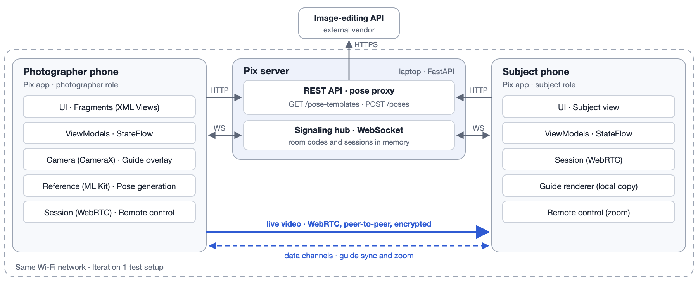

*Figure 1. High-level architecture in Iteration 1. Both phones and the Pix server, which runs on a laptop, are on the same Wi-Fi network; only the image-editing API is outside it. Figure 4 in 1.4 shows the Iteration 2 architecture with the course server, database, session store, push notifications, and relay.*

#### 1.1.2 Components and interfaces

| Component | Runs on | Responsibility | Interfaces |
|----|----|----|----|
| **Pix app, photographer role** | Android | Owns the camera: zoom, focus, exposure, flash, and aspect ratio. Builds, smooths, and edits the guide, captures photos, requests pose generation, streams video, and applies remote commands. Signs in with a Pix ID and a password or with Google, keeps friends, and sends invitations. | CameraX; ML Kit; WebRTC (sends video); data channels; REST; signaling; FCM token |
| **Pix app, subject role** | Android | Shows the live video with a locally drawn copy of the guide, and sends zoom, brightness, flash, and guide-move requests. Receives invitations as push notifications or links. | WebRTC (receives video); data channels; signaling; FCM |
| **Signaling hub** | Pix server | Creates room-code sessions and relays SDP offers, answers, and ICE candidates. It never sees media. | WebSocket, JSON (2.5.2) |
| **Pose proxy** | Pix server | Holds the API key, validates the scene photo, calls the image-editing API with a template prompt, enforces the 30 s upstream timeout and rate limits, and cancels the upstream call when the phone drops the request. | REST `POST /api/v1/poses` (2.5.3) |
| **Account and friends API** (It 2) | Pix server | Signs users up and in with a Pix ID and a password or with Google, and issues session tokens; Pix IDs; exact-match lookup; friend requests, friendships, online presence; device tokens for push. | REST `/auth`, `/me`, `/users`, `/friend-requests`, `/friends`, `/devices` (2.5.3); database (2.7) |
| **Invitation service** (It 2) | Pix server | Creates, accepts, declines, cancels, and expires invitations (30 s); sends the push through FCM; mints the invite link; hands an accepted invitation a `sessionId` in the signaling hub (AD-8). | REST `/invitations` (2.5.3); FCM; signaling hub |
| **TURN relay** (It 2) | External (Cloudflare) | Forwards encrypted media when the phones cannot connect directly. Credentials are short-lived; the Pix server requests them from Cloudflare for each session. | Cloudflare Realtime TURN; its `iceServers` passed on in signaling (2.5.2) |
| **Database** (It 2) | Server host | PostgreSQL: users, sessions, devices, friend requests, friendships, invitations (2.7). | SQL through the server only |
| **Session store** (It 2) | Server host | Sessions, room codes, presence, and the pose rate limit, shared by every server process, and the channel that carries signals between them (AD-18, 2.7). | Redis, through the server only |
| **Firebase Cloud Messaging** | External | Delivers invitation and friend-request notifications to a phone even when Pix is closed. | FCM HTTP v1 API from the server; Firebase SDK in the app |
| **Google sign-in** | External | Identifies a user who signs in with Google; the server verifies the ID token and never stores it. | Credential Manager in the app; token verification on the server |
| **Image-editing API** | External | Generates the same person in the same scene with a different pose. | OpenRouter's Image API (`POST https://openrouter.ai/api/v1/images`); the model is a server setting, `openai/gpt-image-2.5-flare@low` by default (2.6.3) |

#### 1.1.3 Key data flows

| Flow | Path | Transport | Latency budget |
|----|----|----|----|
| **Reference photo → guide** | Photo picker → downscale → ML Kit segmentation → mask smoothing → person box and outline → guide store | On device only | ≤ 2 s (NFR-3) |
| **Pose generation** | Scene photo the user takes and confirms → JPEG (resized on the phone, EXIF removed) → 4 parallel requests → pose proxy → image API → candidates → reference flow | HTTP to the Pix server, HTTPS from it to the image API | First ≤ 20 s, all ≤ 30 s (NFR-4) |
| **Session setup** | Room code → signaling → SDP and ICE exchange → peer connection | WebSocket, then WebRTC | ≤ 10 s after Join (US-13) |
| **Live view** | CameraX frames → I420 → WebRTC encoder → peer → subject renderer | SRTP, peer-to-peer | ≤ 0.5 s on Wi-Fi (NFR-5) |
| **Guide sync** | Guide store (photographer) → `guide.state` → subject's guide store → overlay | Data channel | ≤ 0.3 s (NFR-7) |
| **Remote zoom** | Subject → `camera.zoom.set` → clamp → CameraX → echo of the applied zoom | Data channel | ≤ 0.5 s (NFR-7) |
| **Remote brightness, flash, guide move** (It 2) | Subject → `camera.exposure.set` / `camera.flash.set` / `guide.move` → apply → echo in `camera.state` / `guide.state` | Data channel | ≤ 0.5 s (NFR-7) |
| **Sign-in** (It 2) | Pix ID and password → `POST /auth/login` (or `/auth/signup`), or Credential Manager → Google ID token → `POST /auth/google` → access and refresh tokens kept in DataStore | HTTP | — |
| **Invitation** (It 2) | *Invite* → `POST /invitations` → database → FCM push (or a shared link) → `POST /invitations/{id}/accept` → `sessionId` to both phones → session setup as with a room code | HTTP, FCM, then WebSocket and WebRTC | Push ≤ 5 s, live view ≤ 10 s after Accept (NFR-9) |
| **Reconnection** (It 2) | ICE disconnected → ICE restart through signaling → connected, or *Connection lost* after 10 s | WebSocket, WebRTC | ≤ 10 s (NFR-11) |
| **Saved guide** (It 2) | Guide store → app private storage → guide store | On device only | — |

#### 1.1.4 Main sequences

**Session setup with a room code**

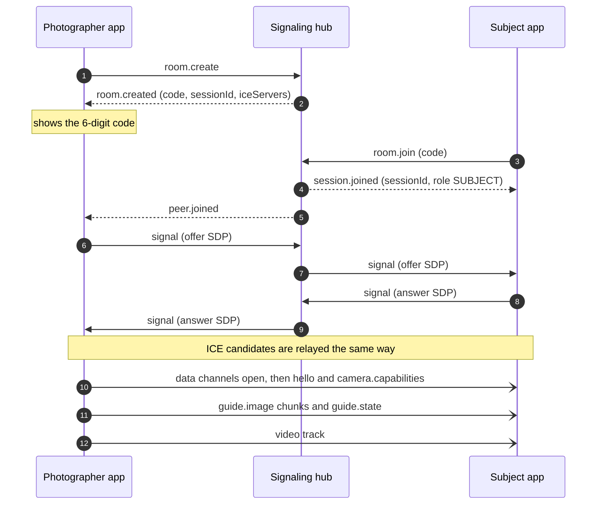

*Figure 2. Connecting two phones with a room code. The photographer always creates the offer.*

**Remote zoom**

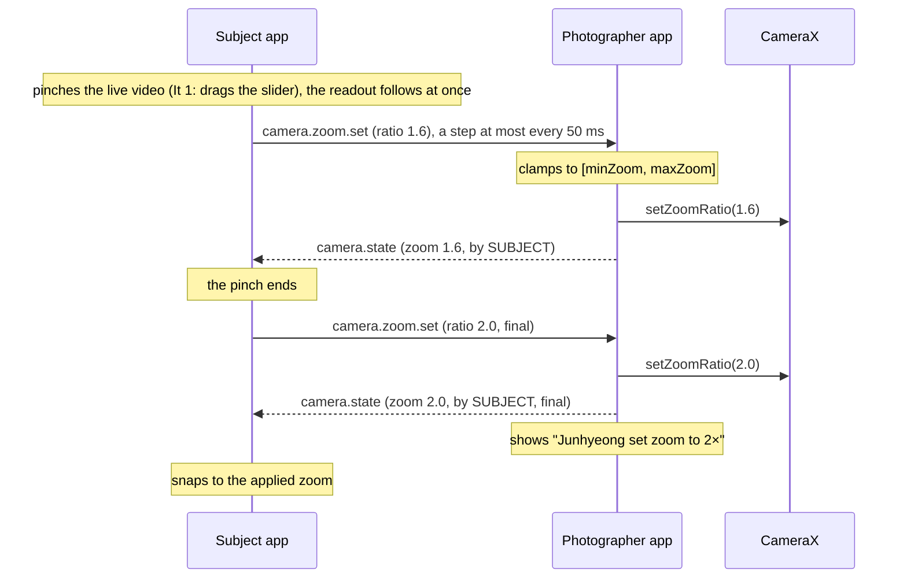

*Figure 3. The photographer's phone applies each request and echoes the value it applied, so both phones end on the same zoom. Only the photographer takes photos.*

**Invitation (Iteration 2)**

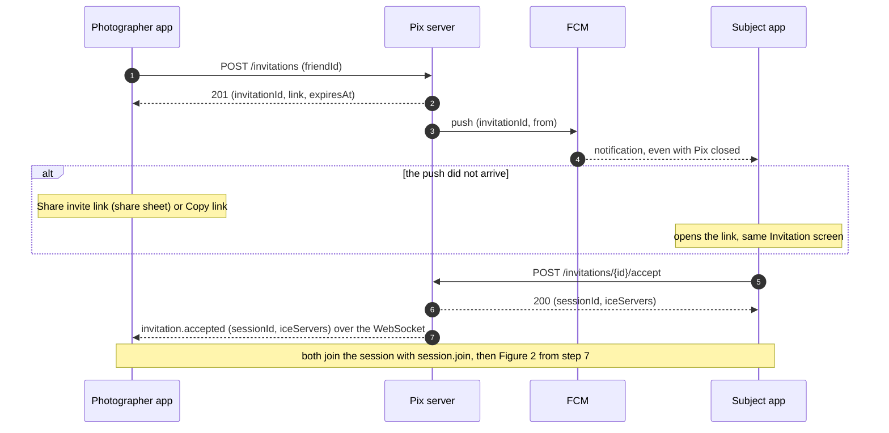

*Figure 3b. An accepted invitation yields a `sessionId`, so the session code is shared with room codes (AD-8). The server expires an invitation 30 s after it is created.*

**Reconnection (Iteration 2)**

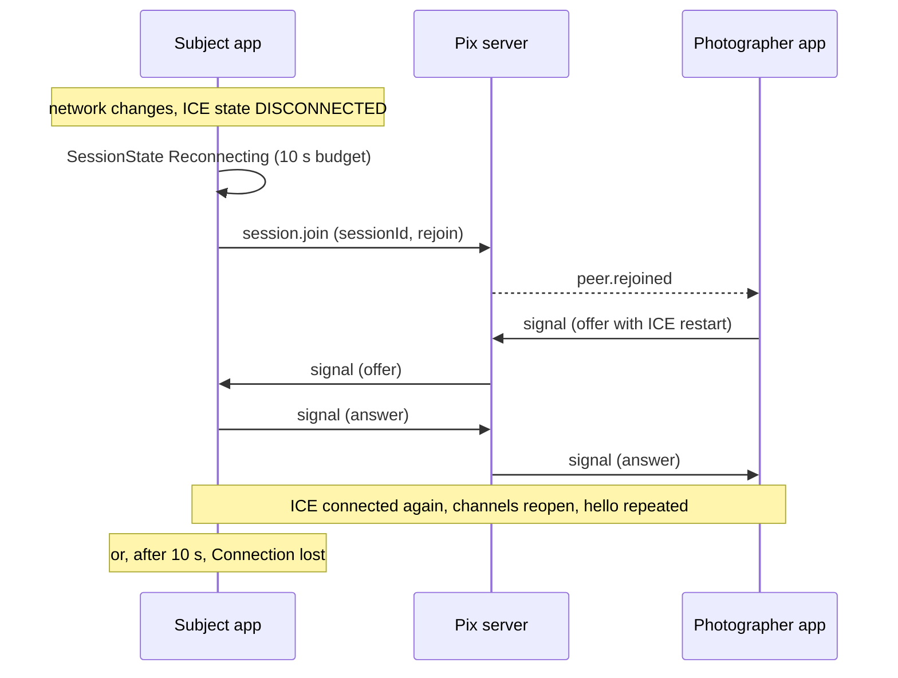

*Figure 3c. A short drop recovers without a new invitation (FR-6.12, NFR-11). The photographer always creates the offer, so it also starts the ICE restart.*

#### 1.1.5 Architectural patterns

- **System level: client-server plus peer-to-peer.** The server handles discovery and AI calls. Real-time media never passes through our application code on the server.
- **App level: MVVM with unidirectional data flow.** Fragments with XML layouts (ViewBinding) render immutable UI state from a ViewModel (`StateFlow`) and send user events back to it. ViewModels call repositories and managers, which wrap CameraX, ML Kit, WebRTC, and the network. This keeps camera and network code out of the UI, so each part can be tested and replaced on its own.
- **Single source of truth per session.** The photographer's phone owns the camera state and the guide state. The subject's phone keeps a mirror that is updated only by messages. Subject actions are *requests* that the photographer applies and then confirms.

### 1.2 External libraries and services

| Library / service | Used for | Where |
|----|----|----|
| Kotlin, Coroutines, Flow | Language; background work; streams of state and messages | App |
| AppCompat, Material Components, Fragment, Navigation component, ViewBinding, Lifecycle ViewModel | XML screens, the navigation graph, state that survives rotation | App |
| CameraX 1.6 (`core`, `camera2`, `lifecycle`, `view` for PreviewView) | Preview, ImageCapture, ImageAnalysis (frames for streaming), zoom | App |
| ML Kit Subject Segmentation (Google Play services) | On-device confidence mask of the person, smoothed into the guide mask and outline | App |
| WebRTC for Android (`io.github.webrtc-sdk:android` 137.7151.01, a maintained prebuilt) | Peer connection, H.264/VP8 video, two data channels, ICE | App |
| OkHttp (+ Retrofit for REST) | WebSocket signaling and HTTP requests | App |
| kotlinx.serialization (JSON) | Data channel, signaling, and REST payloads | App |
| Jetpack DataStore | Small preferences: consent given; from Iteration 2 the access and refresh tokens, the user's Pix ID, the FCM token, and the last aspect ratio | App |
| Credential Manager with Google Identity (It 2) | Google sign-in on the phone; the ID token goes to the server once | App |
| Firebase Messaging SDK (It 2) | Receives invitation and friend-request pushes, including when Pix is closed; gives the device token | App |
| `google-auth` (Python) (It 2) | Verifies Google ID tokens on the server, against Google's published keys | Server |
| `argon2-cffi` (It 2) | Hashes passwords with argon2id (2.8, Accounts) | Server |
| `PyJWT` (It 2) | Signs and checks the access tokens (JWT, HS256; 2.5.3, 2.8) | Server |
| SQLAlchemy 2 (asyncio), Alembic, asyncpg, and aiosqlite (It 2) | Schema, migrations, and queries for users, sessions, devices, friends, and invitations, on PostgreSQL through asyncpg or on a SQLite file through aiosqlite (2.7) | Server |
| `firebase-admin` or FCM HTTP v1 through `httpx` (It 2) | Sends push notifications | Server |
| Docker, Docker Compose, nginx, PostgreSQL 18 (It 2) | Running the server, the session store, and the database on the course servers; nginx is the reverse proxy on port 80 and switches between the two copies of the app during a deploy (2.8) | Host |
| Redis, with `redis-py` on the server (It 2) | Session store: sessions, room codes, presence, and rate-limit windows shared by every server process, and pub/sub for signals between them (AD-18, 2.7) | Host, Server |
| fakeredis, with `lupa` for its Lua (It 2) | An in-process Redis that runs the store's scripts: the server's tests, and a laptop that runs the server without Redis. A development dependency only (2.7) | Server |
| Cloudflare Realtime TURN (It 2) | Managed TURN relay; the server requests short-lived credentials for each session through its API (AD-14) | External |
| FastAPI, Uvicorn, pydantic-settings, python-multipart, httpx2, Pillow (Python) | The server app, which serves WebSocket signaling and the REST API from the same process, in one or more workers (AD-18); settings from environment variables; multipart uploads; calls to the image API; checking the scene photo and converting candidates to JPEG | Server |
| OpenRouter Image API | Pose candidate generation with an image-editing model chosen by a server setting (2.6.3) | Server |

### 1.3 Architectural decisions

| ID | Decision | Why | Rejected alternative |
|----|----|----|----|
| AD-1 | **Generate poses with an external image-editing API, called through our server** | On-device generative models have no supported Android path and are too heavy for the semester. Calling through the server keeps the API key out of the app and lets us switch vendors or rate-limit in one place. Cost: network dependency and per-request fees, so generation runs only on request. | On-device model (DreamLite); calling the API directly from the app |
| AD-2 | **Segment the reference on the device (ML Kit)** | Fast (≤ 2 s), free, works offline, and the reference photo never leaves the phone (FR-2.6). It runs once per reference. | Segmentation on the server or inside the image API |
| AD-3 | **Peer-to-peer media with WebRTC; the server only does signaling** | Lowest latency for the live view, no media-server cost, end-to-end encryption. WebRTC also provides congestion control and adaptive quality (NFR-6). | Media server (SFU); sending JPEG frames over WebSocket |
| AD-4 | **CameraX is the only camera owner and feeds frames to WebRTC** | Only one client can open the camera. CameraX gives us capture, zoom, focus, and exposure for remote control, and one viewport for preview, capture, and streaming, so all three show the same framing. | WebRTC's built-in camera capturer |
| AD-5 | **Two data channels: *realtime* (unordered, no retransmission) and *reliable* (ordered)** | Continuous values (guide position, zoom) need only the latest value, and retransmitting stale ones adds lag. Images, commands, and results must arrive exactly once. Both reuse the existing peer connection, so there is no server round trip. | One reliable channel; relaying messages through the server |
| AD-6 | **Each phone draws the guide itself; only the smoothed mask (once) and small state updates are sent** | The guide stays sharp on the subject's phone. It never enters the video or the saved photo. Updates are a few bytes. From Iteration 2 the photographer sends the smoothed mask, not the cutout, so both phones draw the same outline and no reference pixels travel (2026-10-12). | Burning the overlay into the video stream; mirroring the photographer's screen |
| AD-7 | **The photographer's phone is the single source of truth for camera and guide state** | Avoids conflicting edits: subject actions are requests; the photographer applies them in arrival order and echoes the applied value, so the later change wins and both phones agree (FR-7.6). From Iteration 2 the subject's requests cover brightness, flash, and guide moves as well as zoom, with the same pattern. | Shared editing on both phones |
| AD-8 | **One session abstraction with pluggable entry points (room code, invitation)** | Iteration 1 tested the riskiest part (streaming and sync) without accounts. In Iteration 2 only the entry point is added: an accepted invitation yields a `sessionId`, just like a room code does, and the signaling, peer connection, and reconnection code is shared. | Building accounts and invitations first |
| AD-9 | **One app for both roles** | Friends swap roles between shots. One codebase and one install, with the role chosen per session. | A separate viewer app for the subject |
| AD-10 | **One frame in the chosen aspect ratio (4:3, 16:9, or 1:1), shown whole (fit) on both phones** | Revised 2026-10-09; Iteration 1 used a fixed 3:4. The user picks the ratio; 16:9 fits Instagram stories without cropping. Preview, capture, and stream share one CameraX `ViewPort`, so what you see is what is captured, and showing the whole frame on both phones keeps guide coordinates identical. The other ratios are cut from the middle of the sensor's 4:3: 16:9 keeps the full height and drops the sides, and 1:1 keeps the full width and drops the top and bottom (2.6.2). | Fixed 3:4; full-screen 9:16 with cropping |
| AD-11 | **The server runs on the course-provided servers with Docker and nginx, over HTTP and WS** | Revised 2026-10-13. Sessions across networks need a server both phones can reach. The course servers are reachable only through the course's HTTP proxy on port 80: no other port is open and there is no TLS, so the server speaks HTTP and WS and NFR-14 is revised with it. Server A runs `main` as production and Server B runs `dev` as staging; the two cannot reach each other, so each has its own database and session store. Containers keep the setup portable to another host. GitHub hosting serves only static pages. | AWS (cost, and the course servers are enough once the relay is a managed service); a TLS front such as a Cloudflare Tunnel (needs a domain and the course's approval; to revisit if `ws://` proves unreliable on cellular networks); GitHub-hosted server; a laptop with port forwarding |
| AD-12 | **Sign-in with Google; the server issues its own session token.** Revised 2026-10-15: **also a Pix ID and a password** | One tap on every Android phone, no password to store, and the team already decided on it (2026-10-09). The server verifies the ID token once and keeps only the Google subject ID; the app keeps a Pix session token, so a Google token is never stored or sent again. *Revised 2026-10-15 (Iter2-P8):* the team also wants an ordinary sign-up, so a person can use Pix without a Google account. The Pix ID is the login name, with no email, and either kind of account can add the other way to sign in; a Google sign-in that no account uses offers to connect an existing account before it creates one. The password crosses plain HTTP to the course servers (AD-11, NFR-14) and is stored only as an argon2id hash; the Google ID token is still checked once and never stored. The Pix session token became a short access token (JWT) with a rotating refresh token (decided 2026-10-15, 2.8, Accounts). | Email and password (since 2026-10-15 a Pix ID and a password, without email); Kakao sign-in (not on every test phone) |
| AD-13 | **Invitations by Firebase Cloud Messaging, with an invite link as the fallback** | A closed app cannot keep a WebSocket open, so a push is the only way to reach a friend who is not in Pix. Pushes are not guaranteed, so the photographer can share a link through any messenger instead; sending only through KakaoTalk would need it on every test phone. | WebSocket presence only; KakaoTalk-only invitations |
| AD-14 | **A managed TURN relay (Cloudflare Realtime TURN), with short-lived credentials from the server** | Revised 2026-10-13. STUN alone often fails behind carrier NAT, so cellular sessions need a relay. The course servers cannot host one: a relay needs UDP or TCP 3478 and a UDP port range that the phones reach directly, and only HTTP on port 80 gets in. Cloudflare's relay needs no host of ours, its free monthly allowance is far above our use, and it also listens on TCP 80 and TLS 443 for networks that block UDP. The Pix server requests credentials per session with a key that stays on the server, so the relay cannot be used by others. Media stays SRTP-encrypted, so the relay cannot read it (NFR-14). | coturn on the server host (no open ports); coturn on AWS (cost and upkeep); a media server (SFU); no relay (Wi-Fi only) |
| AD-15 | **The guide is an outline only and never shows the reference photo's pixels** | Framing the person matters more than the reference's background, and reference pixels over the live scene are confusing. The reference stays visible as a small thumbnail instead. Dropped with it: the guide that keeps the background. | Semi-transparent cutout (Iteration 1); a faint background guide |
| AD-16 | **Saved guides live in the app's private storage** | Reuse without rebuilding, with nothing in the gallery and nothing on the server (FR-3.8, NFR-13). | Gallery album; server-side guides |
| AD-17 | **Pinch zoom with a guide-edit mode toggle on both phones; the zoom slider leaves the main layouts** | A pinch is the natural zoom gesture, and one toggle makes the rule simple: edit mode on, gestures edit the guide; off, a pinch zooms the camera. The same toggle on Subject view, because the subject both moves the guide (FR-7.2) and zooms. Decided 2026-10-12. Whether the slider survives inside a *detail settings* panel for fine steps is still open. | Keeping the slider in the main layout; deciding by where the finger lands |
| AD-18 | **Session state lives in a Redis session store, not in the server process** | Decided 2026-10-13; revises Iteration 1's in-memory registry and its one-worker rule. With shared state the server can run several workers when one process is no longer enough, and a new copy of the app can take over from the old one during a deploy without losing a waiting room (2.8). The state is small and short-lived (rooms, codes, presence, rate-limit windows), which fits Redis's atomic scripts and expiry, and pub/sub carries signals between workers (2.7). Cost: one more service to run, and room transitions become Redis scripts instead of plain Python. NFR-18 (50 sessions) fits in one worker, so this is for growth beyond the course, not for the demo load. | One process with in-memory state (Iteration 1); routing each room to one process by its code; session state in the relational database |

### 1.4 Later iterations

Iteration 1 built the core on one Wi-Fi network. Iteration 2 adds accounts, invitations, sessions across networks, more camera and guide controls, and pose descriptions on the same structure; its design is in section 2, and 1.4.1 keeps only the list of Could items. Later iterations are summarized below; their detailed design is added at the start of the iteration that builds them.

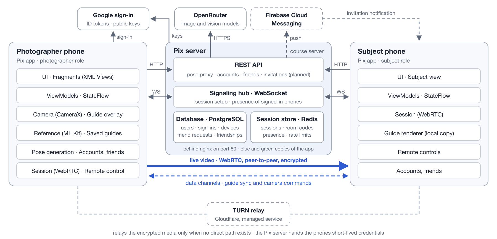

*Figure 4. Target architecture from Iteration 2. The dashed parts are added in Iteration 2: a database, a session store, push notifications for invitations, and a managed relay for cellular connections. The server moves from the laptop to a course-provided server behind nginx. The phones reach it only over HTTP and WS on port 80, and the relay is Cloudflare's service, not a process on the Pix server (AD-11, AD-14, AD-18).*

#### 1.4.1 Iteration 2 · 10/11 – 10/25 (midterm presentation 10/21)

The Iteration 2 design is in section 2: interfaces and models (2.1, 2.3), states (2.4), messages and APIs (2.5), algorithms (2.6), the database (2.7), and owners and build order (2.9). The architectural changes are AD-10 to AD-18. The Must items are the smooth outlines (FR-2.9, Iter2-P7) and the zoom without stutter (NFR-19, Iter2-P5).

**Could items**, built only if time allows, in this order of preference: the remote-control switch (FR-7.5, Iter2-P17), remote focus (FR-7.7, Iter2-P17), the guide color switch (FR-3.10, Iter2-P11), and the shutter freeze fix (NFR-19, Iter2-P5). Each has a design note in its section, so a Could item that slips to Iteration 3 needs no design change.


#### 1.4.2 Iterations 3–4 · heuristic evaluation 11/2, user acceptance test 11/6

| Feature | How the design changes |
|----|----|
| **Offline connection with a QR code** (F9) | The photographer's phone opens a local-only hotspot and runs the signaling itself, so neither the server nor a shared Wi-Fi is needed. The QR code carries the hotspot's connection details. The phone accepts only one connection per QR code, and the session starts only after both people tap *Resume*. This is another session entry point (AD-8). |
| **Selfie mode and settings** | The front camera as another `CameraController` selection, mirrored preview, no ultrawide routing. A settings screen with the guide color, a frame-delay indicator for remote sessions (from the `ping` round trip, 2.5.1), and the language (Korean strings behind the same resource keys). |
| **Sharing photos, and Could items left from Iteration 2** (FR-6.14, FR-7.5, FR-7.7, FR-3.10) | The photographer can send a photo to the subject over the reliable data channel in chunks, like the guide image. Remote focus, the remote-control switch, and the guide color follow the notes in 2.6.5 and 2.6.2 if they slipped. |
| **Evaluation and UAT** | Fixes from the heuristic evaluation. The UAT user stories are fixed by the end of Iteration 3 and tested in Iteration 4. |

#### 1.4.3 Iteration 5 · polish and final release

Polish, stability, and performance work against the NFR targets based on UAT feedback, and the design patterns in section 3.

## 2. Design Details

### 2.1 Android app structure

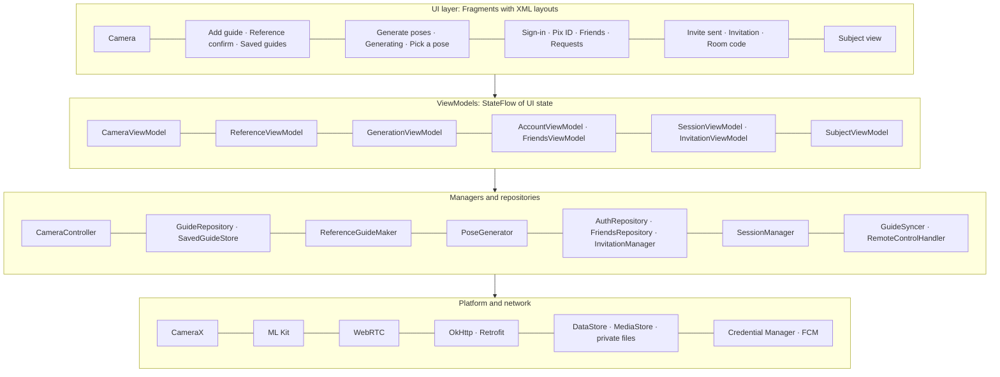

*Figure 5. Layers of the Android app. Each layer depends only on the layer below it.*

**Package layout.** Files marked \* already exist in `android/` as shared contracts; the owners create the rest.

```text
android/app/src/main/java/com/lastpenguin/pix/
├─ MainActivity*
├─ ui/          camera/, guide/, generation/, account/, session/: one Fragment and ViewModel per wireframe screen
├─ camera/      CameraController*, CameraXController, PhotoSaver, CameraZoom, CameraZoomPlan
├─ guide/       GuideModels*, GuideRepository*, ReferenceGuideMaker*, SavedGuideStore* (It 2),
│               GuideGeometry, SubjectSegmenter, MaskSmoother (It 2), OutlineExtractor, overlay view
├─ generation/  GenerationModels*, PoseGenerator*, RemotePoseGenerator
├─ account/     AccountModels*, AuthRepository*, FriendsRepository*, InvitationManager*, PushTokenRegistrar (It 2)
├─ session/     SessionModels*, SessionManager*, RtcSessionManager, SignalingClient,
│               GuideSyncer, RemoteControlHandler
│  ├─ protocol/  SessionMessage*, message codec, channel routing
│  └─ signaling/ SignalMessage*
└─ core/        network/PixApi*, network/ApiModels*, dependency wiring, timing logs
```

#### Module interfaces

These interfaces are the contracts between owners. Each owner starts with a fake implementation (for example, a `FakeSessionManager` that echoes messages), so that UI and sync work can begin before the real module is ready.

```kotlin
enum class CameraStatus { IDLE, STARTING, READY, UNAVAILABLE }   // READY: camera open and its first frame received
enum class AspectRatio { R4_3, R16_9, R1_1 }                       // It 2 (FR-1.13); R4_3 is the default
enum class FlashMode { OFF, AUTO, ON }                              // It 2 (FR-1.12)
interface CameraController {
    val status: StateFlow<CameraStatus>                // IDLE until bound; a failed bind is UNAVAILABLE, and bind again retries
    val capabilities: StateFlow<CameraCapabilities?>
    val state: StateFlow<CameraState>                  // It 2: applied zoom, exposure, flash, aspect, in one value
    val zoom: StateFlow<Float>                        // applied ratio relative to primary rear camera (kept for Iteration 1 callers)
    fun bind(owner: LifecycleOwner, surface: Preview.SurfaceProvider)
    fun setZoom(ratio: Float)                          // primary-relative, clamped to [minZoom, maxZoom]; pinch and remote both call this
    fun setFocusPoint(x: Float, y: Float)              // It 2: frame coordinates 0..1 (FR-1.4); also the remote focus request (Could)
    fun setExposure(index: Int)                        // It 2: exposure-compensation index within capabilities.exposureRange (FR-1.11)
    fun setFlash(mode: FlashMode)                      // It 2: ignored when capabilities.hasFlash is false (FR-1.12)
    fun setAspectRatio(ratio: AspectRatio)             // It 2: rebinds the use cases with a ViewPort of that ratio (FR-1.13, AD-10)
    suspend fun takePhoto(): Result<Uri>               // full resolution in the chosen ratio, Pictures/Pix, no overlay
    suspend fun grabFrame(): Result<Bitmap>            // latest frame, upright: the scene photo (FR-4.1)
    fun setFrameSink(sink: FrameSink?)                 // null stops streaming frames
}
fun interface FrameSink { fun onFrame(image: ImageProxy) }   // must copy the image and close it before returning

interface ReferenceGuideMaker {                         // fails with NoPersonFoundException (FR-2.4)
    suspend fun make(source: Uri): Result<ReferenceGuide>                        // gallery photo
    suspend fun make(bitmap: Bitmap, source: GuideSource): Result<ReferenceGuide> // pose candidate
}                                                        // It 2: the result carries the smoothed mask and the person's box (2.6.1)

interface GuideRepository {
    val guide: StateFlow<ReferenceGuide?>
    val state: StateFlow<GuideState>
    val changes: SharedFlow<GuideChange>               // every applied change, for GuideSyncer
    fun setGuide(guide: ReferenceGuide?)                 // null removes the guide; a new guide starts at guide.anchor (FR-3.1)
    fun update(final: Boolean, change: (GuideState) -> GuideState)   // final = gesture ended; also hide/show through visible
}

interface SavedGuideStore {                              // It 2 (FR-3.8, AD-16): app private storage only
    val saved: StateFlow<List<SavedGuide>>
    suspend fun save(guide: ReferenceGuide, state: GuideState): Result<SavedGuide>
    suspend fun load(id: String): Result<Pair<ReferenceGuide, GuideState>>
    suspend fun delete(id: String)
}

interface PoseGenerator {
    suspend fun templates(): List<PoseTemplate>                     // GET /pose-templates
    suspend fun ideas(): List<PoseIdea>                             // It 2: GET /pose-ideas, the chip texts (TODO Iter2-P12: or shipped in the app)
    fun generate(scene: Bitmap, request: GenerationRequest, seed: Long): Flow<CandidateEvent>   // one event per candidate
}

interface AuthRepository {                               // It 2 (FR-5.1–5.3, FR-5.11–5.13, AD-12)
    val session: StateFlow<AccountSession?>              // null = not signed in; everything but friends works without it
    suspend fun signUp(pixId: String, password: String, displayName: String): Result<AccountSession>  // PixIdError, PasswordError
    suspend fun logIn(pixId: String, password: String): Result<AccountSession>   // fails with INVALID_CREDENTIALS
    suspend fun signInWithGoogle(idToken: String): Result<GoogleSignIn>   // NotRegistered: ask about an existing Pix account
    suspend fun signUpWithGoogle(idToken: String): Result<AccountSession>   // a new account; the Pix ID comes next
    suspend fun addGoogle(idToken: String): Result<AccountSession>   // fails with GOOGLE_IN_USE or GOOGLE_ALREADY_ADDED
    suspend fun addPassword(password: String): Result<AccountSession>   // a Google account with a Pix ID; PasswordError
    suspend fun setPixId(pixId: String, password: String? = null): Result<AccountSession>   // TAKEN or INVALID; a password account changing it sends its password
    suspend fun signOut()
}

interface FriendsRepository {                            // It 2 (FR-5.4–5.10)
    val friends: StateFlow<List<Friend>>
    val requests: StateFlow<List<FriendRequest>>         // received, pending
    suspend fun search(pixId: String): Result<UserLookup> // exact match only
    suspend fun request(userId: String): Result<Unit>
    suspend fun accept(requestId: String): Result<Unit>
    suspend fun cancel(requestId: String): Result<Unit>  // withdraws a request the user sent
    suspend fun decline(requestId: String): Result<Unit>
    suspend fun remove(userId: String): Result<Unit>
}

interface InvitationManager {                            // It 2 (FR-6.1–6.4, AD-13)
    val outgoing: StateFlow<Invitation?>                 // photographer: the invitation being waited on
    val incoming: Flow<Invitation>                       // subject: from a push or an opened link
    suspend fun invite(friendId: String): Result<Invitation>      // fails with BUSY when the friend is in a session
    suspend fun cancel(invitationId: String)
    suspend fun accept(invitationId: String): Result<SessionEntry.Invitation>
    suspend fun decline(invitationId: String)
    fun shareLink(invitation: Invitation): String        // the invite link for the share sheet or the clipboard
}

interface SessionManager {
    val state: StateFlow<SessionState>
    val incoming: Flow<SessionMessage>                  // not replayed: a late subscriber misses earlier messages
    val peerCapabilities: StateFlow<CameraCapabilities?> // subject: the last camera.capabilities, for a screen that opens late
    val peerCamera: StateFlow<CameraState?>             // subject: the last camera.state (zoom, exposure, flash, aspect), null until one arrives
    suspend fun start(entry: SessionEntry, role: Role)   // entry: NewRoom, RoomCode, or Invitation (It 2)
    fun send(message: SessionMessage)                   // ChannelRouter picks realtime or reliable
    fun videoSink(): FrameSink                          // photographer: pass to CameraController
    suspend fun leave(reason: EndReason = EndReason.LEFT)
}
```

### 2.2 Class diagrams

The diagrams show the main classes and their responsibilities. They are not complete UML.

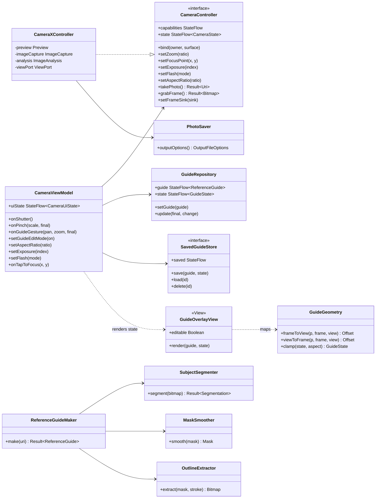

*Figure 6. Camera and guide classes. Iteration 2 adds the camera controls, `MaskSmoother`, and `SavedGuideStore`.*

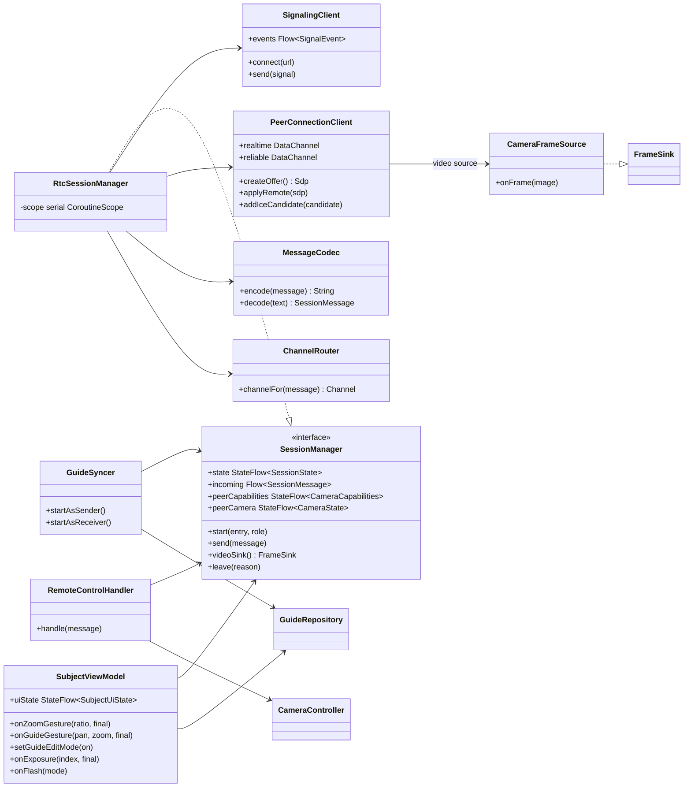

*Figure 7. Session, synchronization, and remote-control classes. The subject's pinch on the live video calls the existing `onZoomGesture(ratio, final)` API; its guide gestures and brightness and flash go through `RemoteControlHandler` the same way (2.6.5).*

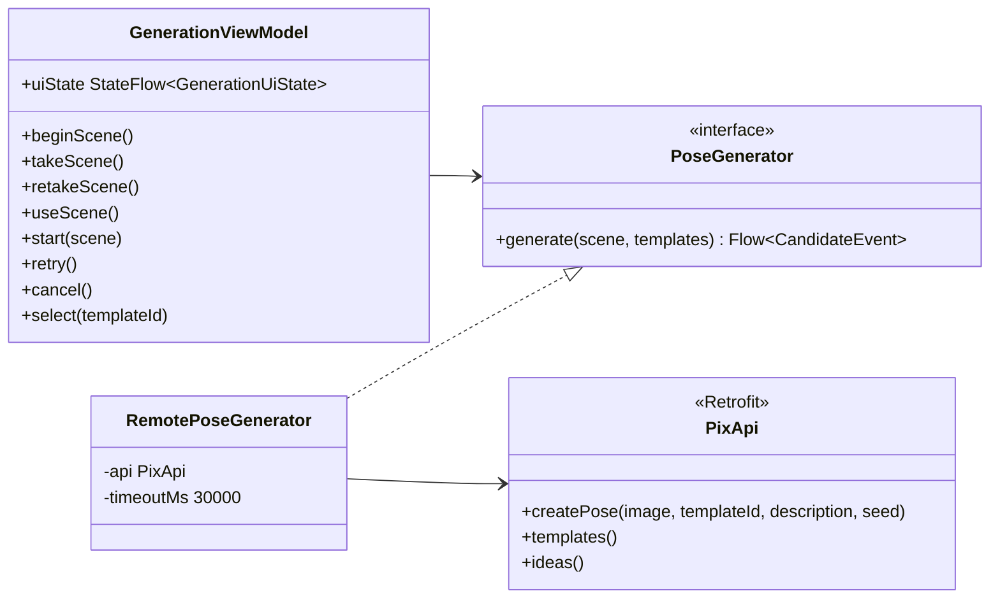

*Figure 8. Pose generation classes*

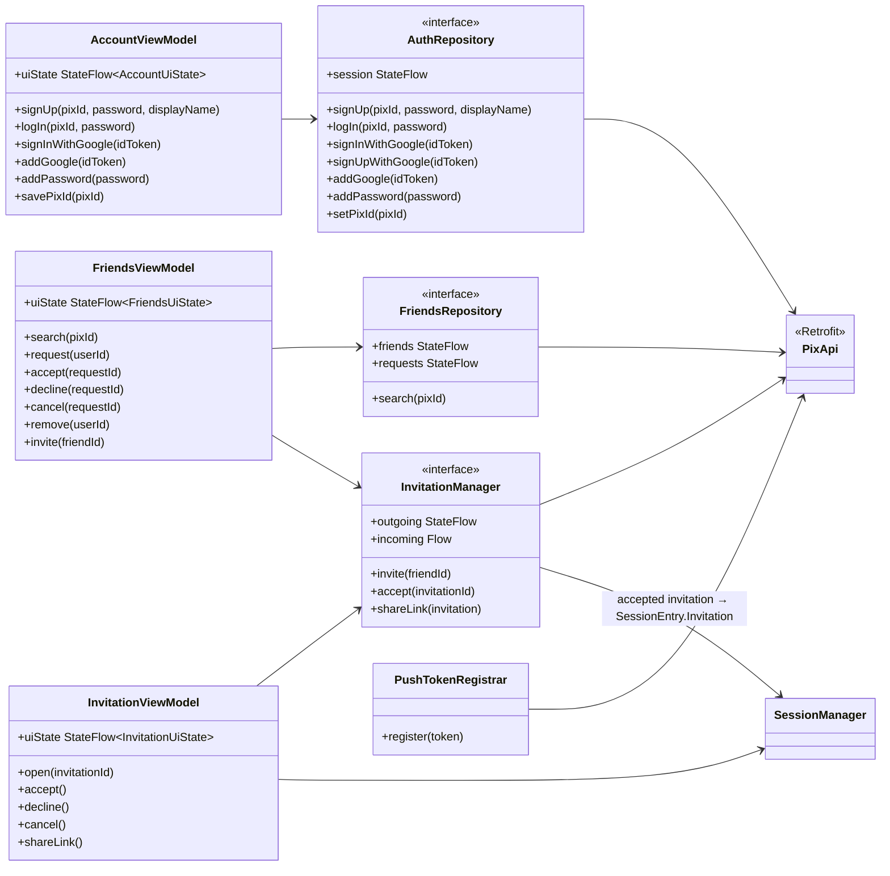

*Figure 8b. Account, friends, and invitation classes (Iteration 2). An accepted invitation becomes a `SessionEntry.Invitation` for the existing session code.*

**Server modules.** The server app has these modules (independent of the framework choice); every worker runs all of them:

| Module | Responsibility |
|----|----|
| `signaling` | WebSocket hub; `SessionRegistry` (sessionId → up to two peers, room codes, and TTLs); relays `signal` messages. Iteration 1 keeps the registry as an in-memory map in one process; from Iteration 2 it is backed by the session store, and a signal for a socket on another worker travels through it (AD-18, 2.7) |
| `store` (It 2) | The Redis connection, the scripts for room transitions, delivery of messages between workers, the sweeper for expiry and dead workers, and the rate-limit windows (2.7) |
| `poses` | The REST endpoints (scene photo validation, rate limiting, cancelling when the phone disconnects); `PoseGenerator`, the one client of OpenRouter's Image API, with the model as a setting; the template catalog and prompt |
| `accounts` (It 2) | Sign-up and sign-in with a Pix ID and a password (argon2id) or with Google (ID token verification), session tokens, Pix IDs, exact lookup, friend requests, friendships, device tokens; presence from the signaling hub's signed-in sockets, kept in the session store |
| `invitations` (It 2) | Create, accept, decline, cancel, 30 s expiry; FCM sends; invite links; hands the `sessionId` to `signaling` on accept |
| `turn` (It 2) | Requests short-lived credentials from Cloudflare's TURN API and returns its `iceServers` for a session (AD-14) |
| `db` (It 2) | SQLAlchemy models and Alembic migrations for 2.7; every worker brings the schema up to date when it starts |

### 2.3 Data models

```kotlin
// ---- Guide ----------------------------------------------------------------
data class ReferenceGuide(
    val id: String,               // UUID; the subject uses it to tell whether it already has the mask
    val mask: Bitmap,             // ALPHA_8, person = opaque, after smoothing (2.6.1); cropped to the person; this is what the subject receives
    val outline: Bitmap,          // ARGB_8888, same size as mask, drawn from it: a white anti-aliased line about 3 dp on screen, no fill
    val aspect: Float,            // mask width / height
    val anchor: RectF,            // the person's box in the reference photo, 0..1 of that photo's width and height (FR-3.1)
    val reference: Bitmap?,       // the photo itself, long side ≤ 512 px, for the corner thumbnail only (FR-3.9); never sent, never drawn as the guide
    val source: GuideSource,      // GALLERY or GENERATED
)
// GuideStyle is removed in Iteration 2: the guide is an outline only (AD-15).

data class GuideState(            // everything needed to place the guide, in frame coordinates
    val guideId: String? = null,  // null = no guide
    val cx: Float = 0.5f,         // guide center, 0..1 of the current frame (AD-10); the start comes from ReferenceGuide.anchor
    val cy: Float = 0.5f,
    val height: Float = 0.7f,     // guide height / frame height; 0.21..2.1 (30–300 % of the start)
    val opacity: Float = 0.5f,    // 0.1..0.9, applied to the stroke and the fill
    val visible: Boolean = true,  // false = hidden for a moment (FR-3.6); only the photographer changes it
)

data class SavedGuide(val id: String, val savedAt: Long, val thumbnail: Bitmap)   // It 2; the files are in the app's private storage (2.8)

// ---- Camera ---------------------------------------------------------------
data class CameraCapabilities(
    val minZoom: Float, val maxZoom: Float, // relative to the primary rear camera's 1x
    val zoomStops: List<Float>,   // kept for compatibility; not shown anywhere since Iteration 2
    val exposureRange: IntRange,  // It 2: exposure-compensation index range; 0..0 when unsupported
    val exposureStep: Float,      // It 2: EV per index step
    val hasFlash: Boolean,        // It 2
    val aspectRatios: List<AspectRatio>,  // It 2: the ratios this phone can bind; always contains R4_3
    val supportsFocusPoint: Boolean,      // It 2
)
data class CameraState(           // It 2: the applied values, echoed to the subject in camera.state
    val zoom: Float,
    val exposure: Int = 0,
    val flash: FlashMode = FlashMode.OFF,
    val aspect: AspectRatio = AspectRatio.R4_3,
)

// ---- Session --------------------------------------------------------------
enum class Role { PHOTOGRAPHER, SUBJECT }
sealed interface SessionEntry {
    data object NewRoom : SessionEntry                               // photographer asks for a code
    data class RoomCode(val code: String) : SessionEntry            // subject enters the code
    data class Invitation(val invitationId: String, val sessionId: String) : SessionEntry   // It 2: both phones, after accept (AD-8)
}
sealed interface SessionState {
    data object Idle : SessionState
    data class Waiting(val code: String) : SessionState              // photographer: room code shown, waiting for the subject
    data class Inviting(val invitation: Invitation) : SessionState   // It 2: photographer, Invite sent
    data class Connecting(val sessionId: String?) : SessionState
    data class Connected(val sessionId: String, val peer: PeerInfo, val role: Role) : SessionState
    data class Reconnecting(val sessionId: String, val since: Long) : SessionState   // It 2: up to 10 s before Ended(CONNECTION_LOST)
    data class Ended(val reason: EndReason) : SessionState
}
data class PeerInfo(
    val displayName: String,
    val haveGuideId: String? = null, // subject only: the guide mask it already has, from its hello
)
enum class EndReason { LEFT, PEER_LEFT, CONNECTION_LOST, NOT_FOUND, EXPIRED, CANCELLED, DECLINED, BUSY, ERROR }

// ---- Account (It 2) --------------------------------------------------------
data class AccountSession(
    val userId: String, val pixId: String?, val displayName: String,   // pixId null until chosen
    val accessToken: String, val refreshToken: String,   // the app refreshes on 401 and signs out if that fails
    val hasPassword: Boolean, val hasGoogle: Boolean,   // the ways the account signs in; offer "Add Google" without it
)
sealed interface GoogleSignIn {
    data class SignedIn(val session: AccountSession) : GoogleSignIn
    data object NotRegistered : GoogleSignIn   // ask whether the person already has a Pix account (FR-5.13)
}
data class Friend(val userId: String, val pixId: String, val displayName: String, val online: Boolean)
data class FriendRequest(val id: String, val from: Friend, val createdAt: Long)
sealed interface UserLookup {
    data class Found(val user: Friend, val relation: Relation, val requestId: String?) : UserLookup   // relation decides the button (FR-5.8); requestId for REQUESTED and INCOMING
    data object NotFound : UserLookup
}
enum class Relation { NONE, SELF, FRIEND, REQUESTED, INCOMING }
enum class PixIdError { TAKEN, INVALID }
data class PasswordError(val rule: String)   // the broken rule, as the server names it (FR-5.11)
data class Invitation(
    val id: String, val from: Friend, val to: Friend,
    val status: InvitationStatus, val expiresAt: Long,
    val sessionId: String? = null,   // set when accepted
    val link: String,                // the invite link (2.6.6)
)
enum class InvitationStatus { PENDING, ACCEPTED, DECLINED, CANCELLED, EXPIRED }

// ---- Generation -----------------------------------------------------------
data class PoseTemplate(val id: String, val label: String)   // the prompt text stays on the server
data class PoseIdea(val id: String, val text: String)        // It 2: an idea chip; tapping it fills the description field
data class GenerationRequest(                                // It 2
    val templates: List<PoseTemplate>,                       // the four presets, used when description is null (Skip)
    val description: String? = null,                         // 1..100 characters, Korean or English (FR-4.8)
)
sealed interface CandidateEvent {
    val templateId: String       // with a description: "custom-1" .. "custom-4"
    data class Ready(override val templateId: String, val image: Bitmap) : CandidateEvent
    data class Failed(override val templateId: String, val error: GenerationError) : CandidateEvent
}
enum class GenerationError { OFFLINE, TIMEOUT, RATE_LIMITED, REJECTED, SERVER }   // REJECTED with a description: "Try a different description" 
```

### 2.4 State machines

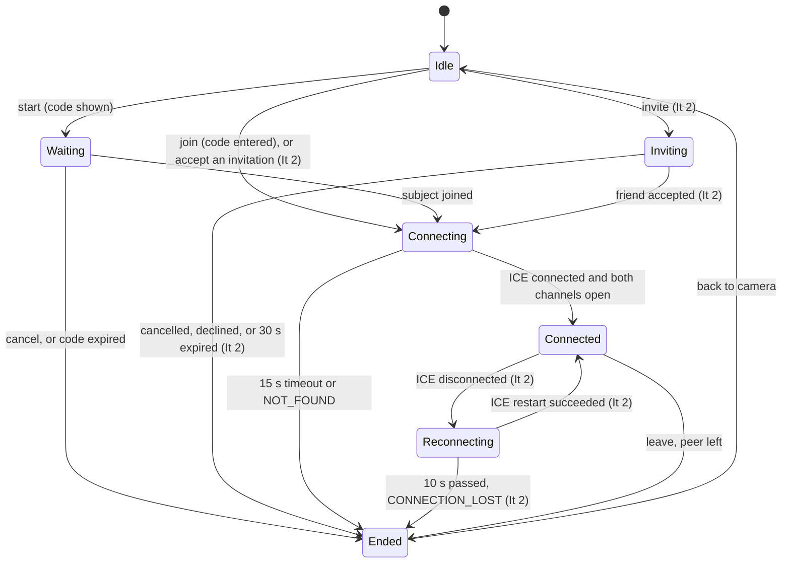

*Figure 9. `SessionState` on each phone. `Inviting` and `Reconnecting` are added in Iteration 2.*

On the photographer's phone, the room stays open when the subject leaves, the connection drops, or connecting times out: the state goes back to `Waiting` with the same code instead of `Ended`, so the subject can join again with *Reconnect* (FR-6.10, FR-6.11). The subject's phone goes to `Ended`.

In Iteration 2 the photographer goes to `Reconnecting` too, instead of straight back to `Waiting`, so a short drop on either side is bridged by an ICE restart (2.6.7); after 10 s the photographer returns to `Waiting` for a room-code session and to `Idle` for an invitation session, and the subject goes to `Ended(CONNECTION_LOST)` with *Reconnect*, which rejoins by `sessionId` while the photographer still holds it.

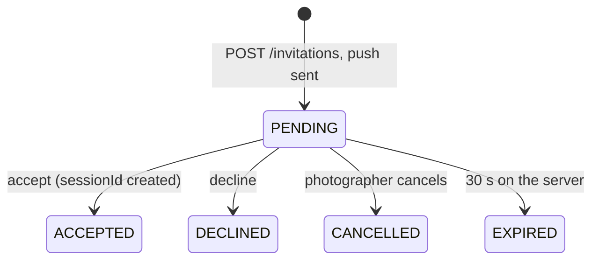

*Figure 9b. An invitation on the server (Iteration 2). Opening a link to an invitation that is not `PENDING` shows "This invitation is no longer available" (FR-6.4).*

### 2.5 Protocols and APIs

Each protocol has a summary table, followed by a JSON example for every message or endpoint. Open an item to see its example.

#### 2.5.1 Data channel protocol (phone ↔ phone)

The photographer opens two channels when it creates the offer: `realtime` (`ordered = false`, `maxRetransmits = 0`) and `reliable` (ordered, reliable). Every message uses one JSON envelope: `v` is the protocol version (2 since the subject's requests of Iter2-P17 were added on 2026-10-16; `hello` ends the session with a phone that speaks another version, because a version-1 phone would advertise the capabilities for brightness and flash yet drop those requests without an answer), `t` the type, `seq` a counter per type, `ts` the send time in milliseconds, and `b` the body. In code, `SessionMessage` uses `t` as its class discriminator, so the codec keeps `t` at the top and moves the other fields into `b`. Receivers ignore unknown types and unknown fields, so older builds keep working, and drop a `realtime` message whose `seq` is not newer than the last one applied for that type. Iteration 2 raises `protocol` in `hello` to 2, because `guide.state` loses `style` and the guide image becomes a mask; both phones update together. Only the photographer takes photos; the subject sends requests.

| Type | Channel | Dir. | Purpose |
|----|----|----|----|
| `hello` | reliable | both | First message; checks the protocol version |
| `camera.capabilities` | reliable | P→S | Zoom range, exposure range, flash, aspect ratios (It 2) |
| `guide.image.begin` | reliable | P→S | Starts sending the guide mask |
| `guide.image.chunk` | reliable | P→S | One piece of the mask |
| `guide.image.end` | reliable | P→S | Ends the mask; the subject checks it |
| `guide.state` | realtime / reliable | P→S | Where the guide is drawn, its opacity, and whether it is visible |
| `guide.clear` | reliable | P→S | The guide was removed |
| `guide.move` (It 2) | realtime; `final` reliable | S→P | A step of the subject's guide drag or pinch, or its final value (FR-7.2) |
| `camera.zoom.set` | realtime; `final` reliable | S→P | A step of the subject's pinch on the live video, or its final value |
| `camera.exposure.set` (It 2) | realtime; `final` reliable | S→P | A step of the subject's brightness slider, or its final value (FR-7.3) |
| `camera.flash.set` (It 2) | reliable | S→P | The subject's flash choice (FR-7.3) |
| `camera.focus.set` (It 2, Could) | reliable | S→P | The subject's focus point (FR-7.7) |
| `camera.state` | realtime / reliable | P→S | The zoom, exposure, flash, and aspect ratio actually applied, and who changed it |
| `control.permission` (It 2, Could) | reliable | P→S | Whether remote control is allowed (FR-7.5) |
| `session.leave` | reliable | both | Leaving on purpose |
| `ping / pong` | realtime | both | Round-trip time for measurement |

<details>
<summary><code>hello</code> · reliable · both</summary>

```json
{
  "v": 2, "t": "hello", "seq": 1, "ts": 1759212345678,
  "b": {
    "protocol": 2,
    "appVersion": "0.2.0",
    "role": "PHOTOGRAPHER",
    "name": "Dongje",
    "haveGuideId": null
  }
}
```

Sent by both phones as soon as the channels open. A different `protocol` ends the session with an error. The subject puts the ID of the guide image it already has in `haveGuideId`.

</details>

<details>
<summary><code>camera.capabilities</code> · reliable · P→S</summary>

```json
{
  "v": 2, "t": "camera.capabilities", "seq": 2, "ts": 1759212345690,
  "b": {
    "capabilities": {
      "minZoom": 0.6, "maxZoom": 10.0, "zoomStops": [0.6, 1.0, 2.0, 3.0],
      "exposureRange": [-12, 12], "exposureStep": 0.1667, "hasFlash": true,
      "aspectRatios": ["R4_3", "R16_9", "R1_1"], "supportsFocusPoint": true
    }
  }
}
```

Sent after `hello`. The subject clamps its pinch-zoom requests to `minZoom`–`maxZoom` and shows them in its readout (2.6.5). The Iteration 2 fields size the brightness slider (`exposureRange`, `exposureStep`), hide the flash button (`hasFlash`), tell the subject which frame to expect, and enable remote focus (Could); `exposureRange` travels as `[min, max]`. A phone that leaves them out has none of these controls and binds 4:3 only. `zoomStops` is kept for compatibility and no longer shown.

</details>

<details>
<summary><code>guide.image.begin</code> · reliable · P→S</summary>

```json
{
  "v": 2, "t": "guide.image.begin", "seq": 3, "ts": 1759212345702,
  "b": {
    "guideId": "5f0c2b9e-7a41-4d3c-9b1e-2f6a8d0c4e17",
    "format": "mask-png", "width": 540, "height": 720, "bytes": 9120, "chunks": 1,
    "anchor": { "left": 0.31, "top": 0.22, "right": 0.58, "bottom": 0.95 }, "aspect": 0.75
  }
}
```

Skipped if the subject reported the same `haveGuideId`. From Iteration 2 the image is the **smoothed mask** only (`mask-png`: 8-bit single-channel PNG, height ≤ 720 px), never the reference's pixels (AD-6, AD-15); `anchor` carries the person's box in the reference so a late-joining subject can place the guide the same way (2.6.2). Iteration 1 sent a `webp` cutout with alpha.

</details>

<details>
<summary><code>guide.image.chunk</code> · reliable · P→S</summary>

```json
{
  "v": 2, "t": "guide.image.chunk", "seq": 4, "ts": 1759212345705,
  "b": { "guideId": "5f0c2b9e-7a41-4d3c-9b1e-2f6a8d0c4e17", "index": 0, "data": "UklGRl68AABXRUJQVlA4WAoAAAAQAAAAHwIAzwIA..." }
}
```

`data` is Base64 of at most 12 KiB, so each message stays under 16 KiB. Chunks are sent only while the channel's `bufferedAmount` is below 256 KiB (2.8).

</details>

<details>
<summary><code>guide.image.end</code> · reliable · P→S</summary>

```json
{
  "v": 2, "t": "guide.image.end", "seq": 9, "ts": 1759212345760,
  "b": { "guideId": "5f0c2b9e-7a41-4d3c-9b1e-2f6a8d0c4e17", "crc32": 3735928559 }
}
```

The subject checks the CRC, decodes the mask, and draws the outline from it with the same `OutlineExtractor` as the photographer, without smoothing again (2.6.1 step 6).

</details>

<details>
<summary><code>guide.state</code> · realtime / reliable · P→S</summary>

```json
{
  "v": 2, "t": "guide.state", "seq": 412, "ts": 1759212349120,
  "b": {
    "state": {
      "guideId": "5f0c2b9e-7a41-4d3c-9b1e-2f6a8d0c4e17",
      "cx": 0.32, "cy": 0.55, "height": 0.7,
      "opacity": 0.5, "visible": true
    },
    "final": false
  }
}
```

Sent on `realtime` at most every 50 ms during a gesture, then once with `"final": true` on `reliable` when the gesture ends, so the final state always arrives. The fields are those of `GuideState` (2.3); `style` is gone since protocol 2. `visible: false` hides the guide on both phones (FR-3.6). The photographer also sends it as the echo of an applied `guide.move`, with `"by": "SUBJECT"` added, so the subject's own gesture settles on the applied value like zoom does.

</details>

<details>
<summary><code>guide.clear</code> · reliable · P→S</summary>

```json
{ "v": 2, "t": "guide.clear", "seq": 413, "ts": 1759212351002, "b": {} }
```

</details>

<details>
<summary><code>guide.move</code> · realtime / reliable · S→P · It 2</summary>

```json
{ "v": 2, "t": "guide.move", "seq": 21, "ts": 1759212352100,
  "b": { "guideId": "5f0c2b9e-7a41-4d3c-9b1e-2f6a8d0c4e17", "cx": 0.41, "cy": 0.52, "height": 0.82, "final": false } }
```

The subject's drag or pinch on the guide `guideId`, in frame coordinates, at most every 50 ms on `realtime` and once with `"final": true` on `reliable`. The photographer clamps it with `GuideGeometry` (the same limits as its own gestures, FR-3.2, FR-3.3), applies it to `GuideRepository`, and echoes `guide.state` with `by: SUBJECT`. A move for a guide the photographer no longer shows, because it was replaced while the gesture was in flight, is dropped: a gesture never crosses guide identities (2.6.2). Opacity and `visible` are not in this message; only the photographer changes them.

</details>

<details>
<summary><code>camera.zoom.set</code> · realtime / reliable · S→P</summary>

```json
{ "v": 2, "t": "camera.zoom.set", "seq": 17, "ts": 1759212352310, "b": { "ratio": 2.0, "final": true } }
```

Sent on `realtime` at most every 50 ms during a pinch on the live video, then once with `"final": true` on `reliable` when the pinch ends, is cancelled, or the screen pauses. The readout's Zoom in / Zoom out accessibility actions send a single final request. Unchanged from Iteration 1 except for the gesture (AD-17).

</details>

<details>
<summary><code>camera.state</code> · realtime / reliable · P→S</summary>

```json
{ "v": 2, "t": "camera.state", "seq": 58, "ts": 1759212352342,
  "b": { "zoom": 2.0, "exposure": 3, "flash": "AUTO", "aspect": "R16_9", "by": "SUBJECT", "final": true } }
```

Same realtime-then-final pattern as `guide.state`. Iteration 2 adds `exposure`, `flash`, and `aspect` to the same message, so the subject always has the whole applied camera state and re-fits its video area when `aspect` changes (AD-10). A change of the exposure, the flash, or the ratio on the photographer's phone goes at once as a final state with `by: PHOTOGRAPHER`, and the first state after `hello` already carries them; a message without them means 0, `OFF`, and `R4_3`. The subject keeps the last one as `SessionManager.peerCamera`. `by` is PHOTOGRAPHER or SUBJECT; the subject logs `zoom.echo` (and `exposure.echo`) when the final echo of its own request arrives (NFR-7).

</details>

<details>
<summary><code>camera.exposure.set</code> · realtime / reliable · S→P · It 2</summary>

```json
{ "v": 2, "t": "camera.exposure.set", "seq": 7, "ts": 1759212353000, "b": { "index": 3, "final": true } }
```

An exposure-compensation index within `exposureRange`, with the same step-then-final pattern as zoom. The photographer clamps it, calls `setExposure`, and echoes `camera.state`.

</details>

<details>
<summary><code>camera.flash.set</code> · reliable · S→P · It 2</summary>

```json
{ "v": 2, "t": "camera.flash.set", "seq": 2, "ts": 1759212354000, "b": { "mode": "AUTO" } }
```

Ignored, with an unchanged echo, when `hasFlash` is false.

</details>

<details>
<summary><code>camera.focus.set</code> · reliable · S→P · It 2, Could</summary>

```json
{ "v": 2, "t": "camera.focus.set", "seq": 1, "ts": 1759212355000, "b": { "x": 0.62, "y": 0.4 } }
```

A tap on the live video, in frame coordinates (2.6.2). The photographer calls `setFocusPoint` and shows the focus ring; there is no echo, because focus has no lasting state.

</details>

<details>
<summary><code>control.permission</code> · reliable · P→S · It 2, Could</summary>

```json
{ "v": 2, "t": "control.permission", "seq": 1, "ts": 1759212340000, "b": { "allowed": false } }
```

Sent after `hello` and whenever the photographer changes the switch (FR-7.5). While `allowed` is false the subject disables its controls and the photographer ignores `camera.*.set` and `guide.move`. Until the switch is built, the subject assumes `true`.

</details>

<details>

<summary><code>session.leave</code> · reliable · both</summary>

```json
{ "v": 2, "t": "session.leave", "seq": 60, "ts": 1759212399000, "b": { "reason": "LEFT" } }
```

Sent before closing, so the other phone shows "left" instead of "connection lost".

</details>

<details>
<summary><code>ping / pong</code> · realtime · both</summary>

```json
{ "v": 2, "t": "ping", "seq": 30, "ts": 1759212360000, "b": { "ts": 1759212360000 } }
{ "v": 2, "t": "pong", "seq": 30, "ts": 1759212360041, "b": { "ts": 1759212360000 } }
```

Every 2 s, from both phones. `pong` echoes the `ts` of the `ping`. The phone that receives a `ping` logs `ping.received ts=<ts>`, and the phone that sent it logs `rtt <ms> ms ts=<ts>` when the `pong` arrives. `Timings` times start at each phone's boot, so for one `ts` the receiver's clock minus the sender's is `t(ping.received) − t(rtt) + rtt/2`, within ±rtt/2. This offset aligns the two phones' logs for cross-phone latencies such as `guide.sent` → `guide.applied` (NFR-7).

</details>

#### 2.5.2 Signaling protocol (phone ↔ server, WebSocket)

JSON text frames over `ws://<host>/ws` (the course servers have no TLS, AD-11; Iteration 1: `ws://<laptop address>:8000/ws` on the test Wi-Fi), each with a `type` field. A signed-in phone sends its access token in the `Authorization: Bearer` header of the WebSocket upgrade; it is required for invitation sessions and optional for room codes, and it marks the user online for the friend list (presence, FR-5.9). A missing, unknown, or expired token, or an account database that does not answer, leaves the socket anonymous: room codes still work, and the user does not show as online.

| Client → server | Server → client | Purpose |
|----|----|----|
| `room.create` | `room.created` | The photographer starts a session and gets a code |
| `room.join` | `session.joined` and `peer.joined`, or `error` | The subject joins with the code |
| `session.join` (It 2) | `session.joined` and `peer.joined`, or `peer.rejoined` | Both phones join an invitation session by `sessionId`; with `rejoin` after a drop (2.6.7) |
| — | `invitation.accepted` (It 2) | Tells the waiting photographer that the friend accepted, with the `sessionId` |
| `signal` | `signal` | Offer, answer, and ICE candidates, relayed unchanged; an offer may carry `iceRestart: true` |
| `leave` | `peer.left` | Leaves the session |
| (unknown type) | `error` | Any message the server does not know |

<details>
<summary><code>room.create</code></summary>

```jsonc
// photographer → server
{ "type": "room.create" }

// server → photographer
{ "type": "room.created", "code": "482915", "sessionId": "s_7f3a92c1",
  "iceServers": [
    { "urls": ["stun:stun.cloudflare.com:3478"] },
    { "urls": ["turn:turn.cloudflare.com:3478?transport=udp", "turn:turn.cloudflare.com:3478?transport=tcp",
               "turns:turn.cloudflare.com:5349?transport=tcp"],
      "username": "g03a7c...", "credential": "9c1f52..." }
  ] }
```

Room codes are 6 random digits, unique among active rooms, and expire after 10 minutes without a subject (FR-8.4). From Iteration 2 `iceServers` is the list Cloudflare's TURN API returns for this session, passed on unchanged: its STUN and TURN entries with a username and credential that expire with the session (AD-14); in Iteration 1 it was empty on the same Wi-Fi. The same `iceServers` go to the subject in `session.joined`.

</details>

<details>
<summary><code>room.join</code></summary>

```jsonc
// subject → server
{ "type": "room.join", "code": "482915" }

// server → subject
{ "type": "session.joined", "sessionId": "s_7f3a92c1", "role": "SUBJECT", "iceServers": [] }

// server → photographer
{ "type": "peer.joined" }

// or, server → subject, when the code is wrong
{ "type": "error", "code": "NOT_FOUND", "message": "No active room with this code" }
```

Error codes: `NOT_FOUND`, `FULL`, `EXPIRED`, and `RATE_LIMITED` (It 2), sent when the phone's network address has sent 100 wrong codes, unknown or expired, within 10 minutes; until the oldest of them leaves that window every `room.join` from the address gets it, the right code included, so a code cannot be guessed. The limit is high because the count is shared by phones on one Wi-Fi or carrier address, and because a room can be taken only in the seconds before the friend joins it: after that it answers `FULL`, which does not count (decided 2026-10-15). The other phone's name arrives in `hello` on the data channel.

</details>

<details>
<summary><code>session.join</code> · It 2</summary>

```jsonc
// either phone → server, after an accepted invitation (or to rejoin after a drop)
{ "type": "session.join", "sessionId": "s_7f3a92c1", "rejoin": false }

// server → the joining phone
{ "type": "session.joined", "sessionId": "s_7f3a92c1", "role": "SUBJECT", "iceServers": [ /* as in room.created */ ] }

// server → the other phone
{ "type": "peer.joined" }          // first join
{ "type": "peer.rejoined" }        // rejoin: the photographer sends an offer with an ICE restart

// server → the photographer, when the friend accepts through REST
{ "type": "invitation.accepted", "invitationId": "inv_9c2e", "sessionId": "s_7f3a92c1", "iceServers": [ /* … */ ] }
```

The session is created when the invitation is accepted (`POST /invitations/{id}/accept`), with the photographer's role fixed by who invited. `rejoin` keeps the peer's slot for the `sessionId` within the 60 s the session outlives its last socket. Errors: `NOT_FOUND`, `FORBIDDEN` (not a member of the session), `FULL`.

</details>

<details>

<summary><code>signal</code></summary>

```jsonc
// photographer → server → subject
{ "type": "signal", "sdp": { "type": "offer", "sdp": "v=0\r\no=- 4611731400430051336 2 IN IP4 127.0.0.1\r\n..." } }

// either phone → server → the other phone
{ "type": "signal", "candidate": { "sdpMid": "0", "sdpMLineIndex": 0, "candidate": "candidate:1 1 udp 2122260223 192.168.0.12 50000 typ host" } }
```

The photographer always sends the offer, and the subject answers.

</details>

<details>
<summary><code>leave</code></summary>

```jsonc
// phone → server
{ "type": "leave" }

// server → the other phone
{ "type": "peer.left", "reason": "PEER_LEFT" }
```

A session is removed when the photographer leaves, or 60 s after its last phone disconnects.

</details>

<details>
<summary>Unknown type</summary>

```json
{ "type": "error", "code": "UNKNOWN_TYPE", "message": "Unknown message type: room.open" }
```

</details>

#### 2.5.3 REST API (phone ↔ server)

Base URL `http://<host>/api/v1` (the course servers have no TLS, AD-11; Iteration 1: `http://<laptop address>:8000/api/v1`), JSON responses. Errors use one shape: `{"error": {"code": "UNKNOWN_TEMPLATE", "message": "..."}}`. The one exception is a request over 1 MiB, which is refused with a plain `413` before it is read. Endpoints marked *auth* need `Authorization: Bearer <access token>` from a sign-in or a refresh (`POST /auth/signup`, `/auth/login`, `/auth/google`, or `/auth/google/signup`) and answer `401 UNAUTHENTICATED` without it or with an expired one; `/poses` and `/pose-templates` work without an account (FR-5.1). `/users/lookup`, `/friend-requests`, and `/friends` also answer `403 PIX_ID_REQUIRED` until the caller has chosen a Pix ID.

| Endpoint | Purpose | Errors |
|----|----|----|
| `GET /pose-templates` | The pose templates, so they can change without an app update | — |
| `GET /pose-ideas` (It 2) | The idea chips for *Generate poses* (**TODO** Iter2-P12: or shipped in the app) | — |
| `POST /poses` | One pose candidate for one template, or for a description (It 2); the app sends four in parallel | `400 INVALID_IMAGE`, `400 UNKNOWN_TEMPLATE`, `400 INVALID_REQUEST`, `413`, `422 REJECTED`, `429 RATE_LIMITED`, `502 UPSTREAM_ERROR`, `503 UNAVAILABLE` (the session store, which counts the rate limit, does not answer), `504 UPSTREAM_TIMEOUT` |
| `POST /auth/signup` (It 2) | Create an account with a Pix ID, a display name, and a password; return its tokens (FR-5.2, FR-5.11) | `400 PIX_ID_INVALID`, `400 PASSWORD_INVALID`, `409 PIX_ID_TAKEN` |
| `POST /auth/login` (It 2) | Sign in with a Pix ID and a password; return an access and a refresh token | `401 INVALID_CREDENTIALS` |
| `POST /auth/refresh` (It 2) | Exchange a refresh token for a new access token and a new refresh token | `401 INVALID_REFRESH_TOKEN` |
| `POST /auth/google` (It 2) | Verify a Google ID token and sign in the account that uses it; return an access and a refresh token | `401 INVALID_TOKEN`, `404 NOT_REGISTERED`, `503 UNAVAILABLE` |
| `POST /auth/google/signup` (It 2) | Create an account for a Google account that no account uses, without a Pix ID yet (FR-5.13) | `401 INVALID_TOKEN`, `409 GOOGLE_IN_USE`, `503 UNAVAILABLE` |
| `DELETE /auth/session` (It 2, auth) | Sign this phone out: its refresh token stops working and its device token is deleted; the access token works until it expires, at most 15 minutes later, and the app deletes both | — |
| `GET /me`, `PUT /me` (It 2, auth) | The user's own account, with the ways it signs in; `PUT` sets the Pix ID, the display name, or both | `409 PIX_ID_TAKEN`, `400 PIX_ID_INVALID`, `401 INVALID_CREDENTIALS` |
| `PUT /me/google` (It 2, auth) | Add a Google account, so the account signs in with either (FR-5.12, FR-5.13) | `401 INVALID_TOKEN`, `409 GOOGLE_IN_USE`, `409 GOOGLE_ALREADY_ADDED`, `503 UNAVAILABLE` |
| `PUT /me/password` (It 2, auth) | Add a password to an account made with Google, so it signs in with its Pix ID too (FR-5.14) | `400 PASSWORD_INVALID`, `403 PIX_ID_REQUIRED`, `409 PASSWORD_ALREADY_SET` |
| `POST /devices` (It 2, auth) | Register or refresh the FCM device token | — |
| `POST /users/lookup` (It 2, auth) | Exact-match lookup with the relation to the caller (FR-5.5, FR-5.8) | `404 NOT_FOUND` |
| `GET /friend-requests` (It 2, auth) | Pending requests, received and sent (FR-5.7) | — |
| `POST /friend-requests`, `POST /friend-requests/{id}/accept`, `POST /friend-requests/{id}/decline`, `DELETE /friend-requests/{id}` (It 2, auth) | Send, accept, decline, withdraw (FR-5.6, FR-5.7) | `409 ALREADY_FRIENDS`, `409 ALREADY_REQUESTED`, `404 NOT_FOUND` |
| `GET /friends`, `DELETE /friends/{userId}` (It 2, auth) | Friend list with online status; remove a friend (FR-5.9, FR-5.10) | — |
| `POST /invitations`, `GET /invitations/{id}`, `POST /invitations/{id}/accept`, `/decline`, `/cancel` (It 2, auth except `GET`) | Invite a friend; open an invitation from a push or a link; answer it (FR-6.1–6.4, FR-6.9) | `403 NOT_FRIENDS`, `409 BUSY`, `410 INVITATION_GONE` |

<details>
<summary><code>GET /pose-templates</code></summary>

```jsonc
// response 200
[
  { "id": "hands_on_hips", "label": "Hands on hips" },
  { "id": "wave", "label": "Wave" },
  { "id": "walking", "label": "Walking" },
  { "id": "arms_crossed", "label": "Arms crossed" }
]
```

</details>

<details>
<summary><code>POST /poses</code></summary>

```jsonc
// request: multipart/form-data, at most 1 MiB in total
//   image       scene.jpg (JPEG, long side ≤ 1024 px, no EXIF)
//   templateId  "wave"                      (omit when description is sent)
//   description "벽에 기대서 한 손은 주머니에"   (It 2, optional, 1..100 characters; exactly one of templateId or description)
//   seed        "1829304756" (an integer)

// response 200
{ "templateId": "wave", "image": "/9j/4AAQSkZJRgABAQAAAQABAAD...", "elapsedMs": 11840 }

// response 504
{ "error": { "code": "UPSTREAM_TIMEOUT", "message": "The image service did not answer within 30 s" } }
```

`image` in the response is a Base64 JPEG. The server keeps neither the scene photo nor the result (FR-4.9). With a `description`, the response's `templateId` echoes the request's `candidateId` (`custom-1` … `custom-4`), and a description the image service refuses answers `422 REJECTED` with the message "Try a different description" (US-5).

The server checks the photo and does not repair it: one that is not a readable JPEG, is over 1024 px on its long side, or has EXIF gets `INVALID_IMAGE`. `INVALID_REQUEST` means that a part is missing or that `seed` is not an integer. The server reduces `seed` to 0…2³¹−1, the range the image models accept.

</details>

<details>
<summary><code>GET /pose-ideas</code> · It 2</summary>

```jsonc
// response 200
[
  { "id": "lean_wall", "text": "Leaning on the wall, one hand in a pocket" },
  { "id": "look_back", "text": "Looking back over the shoulder" },
  { "id": "sit_steps", "text": "Sitting on the steps, elbows on knees" }
]
```

Cached in the app like the templates. Tapping a chip puts its `text` into the description field (FR-4.8).

</details>

<details>
<summary><code>POST /auth/signup</code> and <code>POST /auth/login</code> · It 2</summary>

```jsonc
// POST /auth/signup
{ "pixId": "dongje.p", "password": "sunset2026", "displayName": "Dongje" }

// response 201; POST /auth/login { "pixId": "dongje.p", "password": "sunset2026" } answers the same with 200
{ "accessToken": "eyJhbGciOiJIUzI1NiIsInR5cCI6IkpXVCJ9.eyJpc3MiOiJwaXgiLCJzdWIiOiJ1XzAxSFoi...", "refreshToken": "kq3V9x0Rz8...", "expiresIn": 900,
  "user": { "id": "u_01HZ", "pixId": "dongje.p", "displayName": "Dongje", "hasPassword": true, "hasGoogle": false } }

// response 400
{ "error": { "code": "PASSWORD_INVALID", "message": "A password needs at least one letter and one digit" } }

// POST /auth/login with a wrong password or an unknown Pix ID → 401
{ "error": { "code": "INVALID_CREDENTIALS", "message": "The Pix ID or the password is wrong" } }
```

The Pix ID is the login name; `POST /auth/login` ignores capitals and spaces around it. A password has 8–64 characters, at least one letter and one digit, and is not the Pix ID (FR-5.11); `PASSWORD_INVALID` names the broken rule, as `PIX_ID_INVALID` does. A display name has 1–30 characters after trimming, otherwise `400 INVALID_REQUEST`. The server keeps only an argon2id hash of the password (2.8, Accounts). An unknown Pix ID and a wrong password get the same answer, and the server checks a stand-in hash for an unknown Pix ID, so both take as long. Login attempts are not limited for now (decided 2026-10-15). Each sign-in issues a new token for that phone, valid for 30 days.

**Session tokens.** A sign-in starts a session for that phone and answers with two tokens.

- `accessToken` is a JWT signed with HS256 and the server's `PIX_JWT_SECRET`. Its claims are `iss` (`"pix"`), `sub` (the user's ID), `sid` (the session), `iat`, and `exp`, 15 minutes later (`expiresIn`, in seconds). The app sends it as `Authorization: Bearer <accessToken>` on every *auth* endpoint and on the signaling upgrade. The server checks the signature, the issuer, the expiry, and that the user exists, without looking up the session, and stores no copy.
- `refreshToken` is 32 random bytes, which the server keeps only as a SHA-256 hash in `sessions` (2.7). It lasts 30 days from its last use, so a phone in use stays signed in. `POST /auth/refresh` `{ "refreshToken": "kq3V9x0Rz8..." }` answers `{ "accessToken", "refreshToken", "expiresIn" }`, and the old refresh token stops working. A refresh token that was already exchanged and comes back, from a copy or after an answer the phone never got, ends the session, so every holder has to sign in again; an unknown or expired one answers `401 INVALID_REFRESH_TOKEN` too.
- The app refreshes when an *auth* endpoint answers `401 UNAUTHENTICATED`, or just before `expiresIn` runs out, and retries once; if the refresh fails it signs out and asks the person to sign in. A signaling socket keeps the user online after its access token expires, because the token is checked only when the socket opens.
- Sign-out (`DELETE /auth/session`) deletes the session: its refresh token stops working at once, its device token goes with it, and its access token works until it expires.

</details>

<details>
<summary><code>POST /auth/google</code>, <code>POST /auth/google/signup</code>, and <code>PUT /me/google</code> · It 2</summary>

```jsonc
// POST /auth/google; also the body of POST /auth/google/signup and PUT /me/google
{ "idToken": "eyJhbGciOiJSUzI1NiIs..." }

// response 200: the account that uses this Google account
{ "accessToken": "eyJhbGciOiJIUzI1NiIsInR5cCI6IkpXVCJ9.eyJpc3MiOiJwaXgiLCJzdWIiOiJ1XzAxSFoi...", "refreshToken": "kq3V9x0Rz8...", "expiresIn": 900,
  "user": { "id": "u_01HZ", "pixId": "dongje.p", "displayName": "Dongje", "hasPassword": true, "hasGoogle": true } }

// response 404: no account uses this Google account yet
{ "error": { "code": "NOT_REGISTERED", "message": "No Pix account uses this Google account" } }

// POST /auth/google/signup → 201: a new account named after the Google account, without a Pix ID yet
{ "accessToken": "eyJhbGciOiJIUzI1NiIsInR5cCI6IkpXVCJ9.eyJpc3MiOiJwaXgiLCJzdWIiOiJ1XzAyQUIi...", "refreshToken": "Pz71bQd0Lw...", "expiresIn": 900,
  "user": { "id": "u_02AB", "pixId": null, "displayName": "Junhyeong Han", "hasPassword": false, "hasGoogle": true } }

// PUT /me/google (auth) → 200: the caller's account, now with "hasGoogle": true
// 409 GOOGLE_IN_USE: another account uses this Google account · 409 GOOGLE_ALREADY_ADDED: this account has another one
```

The server checks the ID token's signature against Google's published keys, which it keeps for as long as Google's `Cache-Control` allows, and checks that the audience is our web client ID (`PIX_GOOGLE_CLIENT_ID`, the server client ID the app passes to Credential Manager) and the issuer is Google. It keeps only the Google `sub` (AD-12); the token itself is never stored. While the client ID is unset, or Google's keys cannot be fetched, these endpoints answer `503 UNAVAILABLE`. An account from `POST /auth/google/signup` has a `null` Pix ID until `PUT /me` sets it, and is named after the Google account (up to 30 characters, or "Pix user" if Google gives no name).

**Signing up with Google (FR-5.13).** The app calls `POST /auth/google` first. On `NOT_REGISTERED` it asks "Do you already have a Pix account?" *Yes:* the person signs in with their Pix ID and password (`POST /auth/login`), and the app sends the same ID token to `PUT /me/google`; from then on the account signs in either way. *No:* `POST /auth/google/signup` creates the account, and the Pix ID setup follows. A password account can also add Google later with `PUT /me/google` (FR-5.12).

**Adding a password (FR-5.14).** An account made with Google can add a password with `PUT /me/password` `{ "password": "sunset2026" }`, which answers `200` with the account and `"hasPassword": true`; from then on its Pix ID and the password sign it in too. The Pix ID is the login name, so an account without one gets `403 PIX_ID_REQUIRED`; the password rules are those of sign-up (`400 PASSWORD_INVALID`); and an account that has a password gets `409 PASSWORD_ALREADY_SET`, because changing a password is not offered. There is no email, so a forgotten password cannot be reset.

</details>

<details>
<summary><code>PUT /me</code> · It 2 · auth</summary>

```jsonc
// request; either field may be left out, and "password" is needed only to change a password account's Pix ID
{ "pixId": "dongje.p", "displayName": "Dongje", "password": "sunset2026" }

// response 200; GET /me answers the same
{ "id": "u_01HZ", "pixId": "dongje.p", "displayName": "Dongje", "hasPassword": true, "hasGoogle": false }

// response 409
{ "error": { "code": "PIX_ID_TAKEN", "message": "This Pix ID is taken" } }
```

The rule is 4–20 characters of `a–z`, `0–9`, `.`, `_` (FR-5.2); `PIX_ID_INVALID` names the broken rule (FR-5.3), and a rejected Pix ID leaves the old one. A password account signs in with its Pix ID, so changing it takes the current `password`: without it, or with a wrong one, the answer is `401 INVALID_CREDENTIALS`, and a new Pix ID that is the password, in any case, is `400 PIX_ID_INVALID` (FR-5.11; added in review of #78). Setting the first Pix ID of a Google account, sending the same Pix ID again, and changing only the display name need no password. `PUT /me`, `PUT /me/password`, and `PUT /me/google` lock the user row before they check (`SELECT … FOR UPDATE`), so two of them sent at the same moment from two phones run one after the other, and the second sees the first: a Pix ID and a password can never end up the same, and a second Google account is refused instead of replacing the first.

</details>

<details>
<summary><code>POST /devices</code> · It 2 · auth</summary>

```jsonc
// request
{ "fcmToken": "dXk3...:APA91b...", "platform": "android" }

// response 204
```

Sent after sign-in and whenever Firebase rotates the token. One row per device (2.7): a session keeps one device, so a rotated token replaces the old one, and the token of a phone that signs in to another account moves to that account. Sign-out deletes it.

</details>

<details>
<summary><code>POST /users/lookup</code> · It 2 · auth</summary>

```jsonc
// request
{ "pixId": "junhyeong.h" }

// response 200
{ "user": { "id": "u_02AB", "pixId": "junhyeong.h", "displayName": "Junhyeong" }, "relation": "INCOMING", "requestId": "fr_77" }
// relation: NONE | SELF | FRIEND | REQUESTED | INCOMING  (decides Add / "This is you" / "Friends" / "Requested" / Accept)
// requestId: the pending request between the two when relation is REQUESTED or INCOMING, otherwise null

// response 404
{ "error": { "code": "NOT_FOUND", "message": "No user with this Pix ID" } }
```

Exact match only; no partial search or listing (FR-5.5, NFR-15). Capitals and spaces around the Pix ID are ignored, because a Pix ID has none. A user without a Pix ID cannot be found. The Pix ID travels in the body and never in the URL, because nginx's error log prints a failed request's whole request line and cannot leave the query out (2.8, Privacy; changed from `GET /users?pixId=` in review of #78).

</details>

<details>
<summary><code>POST /friend-requests</code> and answers · It 2 · auth</summary>

```jsonc
// request
{ "userId": "u_02AB" }

// response 201
{ "id": "fr_77", "to": { "id": "u_02AB", "pixId": "junhyeong.h", "displayName": "Junhyeong" }, "createdAt": 1760281200000 }

// response 200 instead, when u_02AB had already sent the caller a request: that request is accepted
{ "friend": { "id": "u_02AB", "pixId": "junhyeong.h", "displayName": "Junhyeong", "online": true, "inSession": false } }

// GET /friend-requests → 200, newest first
{ "incoming": [ { "id": "fr_80", "from": { "id": "u_03CD", "pixId": "seongmin.c", "displayName": "Seongmin" }, "createdAt": 1760281300000 } ],
  "outgoing": [ { "id": "fr_77", "to": { "id": "u_02AB", "pixId": "junhyeong.h", "displayName": "Junhyeong" }, "createdAt": 1760281200000 } ] }

// POST /friend-requests/fr_77/accept  → 200 { "friend": { "id": "u_01HZ", "pixId": "dongje.p", "displayName": "Dongje", "online": true, "inSession": false } }
// POST /friend-requests/fr_77/decline → 204   (the receiver)
// DELETE /friend-requests/fr_77       → 204   (the sender withdraws it)
```

The receiver gets an FCM push `friend.request` and sees it under received requests (FR-5.7); **TODO** Iter2-P15: the push is sent once the server has its FCM sender. A declined or withdrawn request is deleted and can be sent again later (US-8). Only the receiver can accept or decline, and only the sender can withdraw; anyone else, and a request already answered, get `404 NOT_FOUND`. Each of these, and a request that accepts the other user's, takes the request with one `DELETE … RETURNING`, so of two at the same moment only one succeeds: an accept and a withdrawal at once never leave the two as friends after the request was withdrawn. Sending and accepting between the same two users also lock both user rows (`SELECT … FOR UPDATE`) and run one after the other, so a request sent while the reverse one is accepted finds the friendship instead of being saved next to it. An accept reads the new friend's presence before it commits, so if the session store fails it answers `503 UNAVAILABLE` and saves nothing, and the same call can be repeated. Sending a request to oneself is `400 INVALID_REQUEST`. `createdAt` is in milliseconds since the epoch.

</details>

<details>
<summary><code>GET /friends</code> · It 2 · auth</summary>

```jsonc
// response 200
{ "friends": [ { "id": "u_02AB", "pixId": "junhyeong.h", "displayName": "Junhyeong", "online": true, "inSession": false } ] }
```

`online` is true while the friend's phone holds an authenticated signaling socket; `inSession` is true while that socket is in a session, a waiting room included (FR-6.9). Friends are ordered by display name. `DELETE /friends/u_02AB` answers `204`, removes both directions and any pending request between the two (FR-5.10), and answers `204` for someone who is not a friend as well.

</details>

<details>
<summary><code>POST /invitations</code> and answers · It 2</summary>

```jsonc
// request (auth)
{ "friendId": "u_02AB" }

// response 201
{ "id": "inv_9c2e", "to": { "id": "u_02AB", "pixId": "junhyeong.h", "displayName": "Junhyeong" },
  "status": "PENDING", "expiresAt": 1760281230000, "link": "http://pix.example.org/i/inv_9c2e" }

// response 409
{ "error": { "code": "BUSY", "message": "Junhyeong is in another session" } }

// GET /invitations/inv_9c2e (no auth needed to open a link)
{ "id": "inv_9c2e", "from": { "id": "u_01HZ", "pixId": "dongje.p", "displayName": "Dongje" }, "status": "PENDING", "expiresAt": 1760281230000 }

// POST /invitations/inv_9c2e/accept (auth) → 200
{ "sessionId": "s_7f3a92c1", "iceServers": [ /* as in room.created */ ] }

// POST /invitations/inv_9c2e/decline → 204 · POST /invitations/inv_9c2e/cancel → 204
// any answer to a non-PENDING invitation → 410 INVITATION_GONE
```

The server sends the FCM push `invitation` with the `id` and the inviter's name on creation, expires the invitation 30 s later (FR-6.3), and on accept creates the session and notifies the photographer over its signaling socket (`invitation.accepted`, 2.5.2). Only friends can invite each other (`403 NOT_FRIENDS`, NFR-15).

</details>


### 2.6 Algorithms and AI components

#### 2.6.1 Reference guide: segmentation and outline

1.  **Load.** Decode the picked image, applying its EXIF rotation, and downscale so the long side is 1280 px.
2.  **Segment.** Run the ML Kit subject segmenter with only the foreground confidence mask enabled. The segmenter's model is delivered by Google Play services, so the first use checks that the module is installed and waits for its download.
3.  **Check for a person.** If fewer than 2% of the pixels have confidence ≥ 0.5, the step fails with `NoPersonFound` (FR-2.4). All detected subjects are kept (FR-2.5).
4.  **Smooth the mask (It 2, FR-2.9).** Blur the confidence mask with three box blurs whose radius is 0.8 % of the person's height (close to a Gaussian; 9 px for a person 1100 px tall), so its 0.5 level becomes a smooth curve. The person is the largest region of the mask, so a stray blob far above or below does not stretch the height. Then drop separate regions smaller than 1 % of the foreground, such as a stray blob beside a hand, and fill holes smaller than 0.2 %; the gap between an arm and the body stays, and background that reaches the photo's edge is never a hole. People of similar size, such as a couple, are all kept (FR-2.5); a figure that small, far in the background, is dropped with the specks. Crop the mask to its bounding box plus a 2 % margin, store the aspect ratio, and keep the box's position in the photo as `anchor` (FR-3.1).
5.  **Outline.** Trace the smoothed mask's 0.5 level with marching squares, placing each crossing between two pixels by interpolation, so the line follows the blurred curve instead of pixel steps; a person cut off by the photo's edge stays open there. Round the line with two passes of corner cutting (Chaikin) and draw it as a white anti-aliased line with round joins, about 3 dp on screen and scaled to the mask size, with no fill. No pixel of the reference is used (AD-15).
6.  **Hand over.** Put the `ReferenceGuide` into `GuideRepository`, which places it at `anchor` (2.6.2). The subject receives only the **smoothed mask** (single-channel PNG, height ≤ 720 px) and runs step 5 on it, never step 4, so both phones draw the same shape (decided 2026-10-12). Until the Iteration 2 contracts carry the mask (`mask-png`, 2.5.1), the cutout travels as in Iteration 1 with the smoothed mask as its alpha, so the subject already draws the same line. The reference photo itself stays on the photographer's phone, downscaled to 512 px for the corner thumbnail (FR-3.9).

All steps run on `Dispatchers.Default`. Target: ≤ 2 s from selection to *Reference confirm* including the smoothing (NFR-3); `Timings` marks `smooth.start` and `smooth.end` inside `seg.start`–`seg.end` show how much of it the smoothing takes. On the emulator the whole step took 0.25–0.35 s per photo once the model was loaded.

**Out of scope: arms and legs in front of the body.** Folded arms or crossed legs disappear inside the silhouette, and the outline does not draw them (decided 2026-10-14). Iter2-P7 tried drawing them from ML Kit Pose Detection landmarks: a capsule or a band along each limb, the photo's edges near the limb, the skin's color, and the landmarks' depth to tell which arm is in front. None read clearly as arms: edges break up on patterned clothes, skin color misses sleeves, the depth cannot tell the two arms apart, and the joints are tens of pixels off.

#### 2.6.2 Guide geometry (shared coordinates)

Both phones use the same frame: the photographer's chosen aspect ratio, 4:3 by default, 16:9 or 1:1 as selected (AD-10, FR-1.13). CameraX binds Preview, ImageCapture, and ImageAnalysis in one `UseCaseGroup` with a `ViewPort` of that ratio, so the preview, the saved photo, and the streamed frame cover the same field of view; changing the ratio rebinds the group once no photo is being saved, and the Camera screen holds the preview's last frame until the new binding streams (2.6.5). The viewport (`FILL_CENTER`) cuts each ratio from the middle of the sensor's 4:3: 9:16 keeps the full height and 1:1 the full width. `ImageCapture` saves the JPEG already cropped to that rectangle, so `PhotoSaver` does not crop. `PreviewView` fits the crop but still draws the camera image around it, so the Camera screen clips it to the frame. The subject learns the ratio from `camera.state.aspect` and fits its video area to it. Each phone shows the whole frame, fitted and centered:

```text
frame  W × H   (e.g. 720 × 960)          view  w × h   (the preview or the remote video area on screen)
scale  s  = min(w / W, h / H)            offset  ox = (w − W·s) / 2,   oy = (h − H·s) / 2

frame → view:   x = ox + cx · W · s          y = oy + cy · H · s
view  → frame:  cx = (x − ox) / (W · s)      cy = (y − oy) / (H · s)
guide size on screen:   hPx = height · H · s,   wPx = hPx · aspect
```

**Photographer composition aids (FR-1.9–1.10).** `CameraCompositionView` uses this same fit-centered image rectangle to draw lines at one-third and two-thirds in each direction. A short horizon bar is centered in the middle cell, with fixed horizontal end markers and a middle segment that counter-rotates with device roll. `CameraLevelMonitor` reads the gravity sensor, falling back to the accelerometer, while the view is resumed. It smooths gravity vectors before computing the screen-relative angle; level enters within ±2° and exits beyond ±3°. When level, the bar aligns horizontally and turns dark yellow (`#D4AC24`). Invalid sensor readings or an almost face-up/down phone hide the bar. These are non-interactive local View overlays and do not enter photos, analysis frames, or the WebRTC stream.

**Camera zoom and the guide-edit mode (AD-17, decided 2026-10-12).** The zoom slider of Iteration 1 is removed. On Camera, a pinch on the preview zooms the camera while **guide-edit mode** is off; the readout shows the observed, applied ratio and keeps its Zoom in / Zoom out accessibility actions, which step the zoom without a gesture. The guide-edit mode toggle sits beside the zoom readout under the preview, on both screens, so it stays as the guide's own panel changes; while it is on, every drag and pinch edits the guide and the camera zoom does not change. The mode turns on when a guide is added, so that it can be placed at once, and off when the shutter is pressed or the guide is removed or hidden (decided 2026-10-13); on Subject view it starts off, because the subject mostly zooms. On Subject view the same toggle (its state and overlay wiring from Iter2-P6, shown with guide moves in Iter2-P17) decides whether a pinch on the live video sends `camera.zoom.set` or a drag and pinch sends `guide.move` (2.6.5); its readout follows the requested ratio optimistically during a pinch and settles on the applied echo. There is no *detail settings* panel (decided 2026-10-15): the brightness slider opens from its own button beside the zoom readout, and its value shows in EV; the flash and aspect-ratio buttons are in the top bar. `TrackedSliderController` serves the guide opacity and brightness sliders. Lens switching keeps the pinch's latest target through `STARTING`, as the slider did.

**Gestures.** In guide-edit mode, the photographer's pan and zoom deltas are converted with *view → frame* and applied to `GuideState`. `height` is limited to 0.21–2.1, and `cx`, `cy` are limited so that at least 20 % of the guide's width and height stay inside the frame (FR-3.2, FR-3.3). Because only frame coordinates are stored and sent, the guide lands on the same part of the scene on both phones (NFR-8). The subject's gestures go through the same conversion and the same limits on the photographer's phone (`guide.move`, FR-7.2).

With guide-edit mode on, the overlay owns every touch sequence on the preview, so the guide is easy to grab even by its transparent parts, and the camera never zooms by mistake. With the mode off, the overlay passes touches through: a pinch zooms the camera and a tap focuses (FR-1.4). `PinchZoomController` owns the preview's touches, so it reports a single tap; the Camera screen converts it to frame coordinates for `setFocusPoint` and shows a ring there. `splitMotionEvents` stays disabled on the preview container, so one sequence stays one gesture as fingers join or leave. Read-only overlays always pass touches through.

The guide's normalized width is `height × aspect × (H / W)` of the current frame (4/3 for 4:3 portrait, 16/9 for 16:9, 1 for 1:1). For either normalized dimension `d`, the center is limited to `[v − d/2, 1 − v + d/2]`, where `v = min(0.2 × d, 1)`. Centers may therefore lie outside 0–1. If an unusually wide guide exceeds five frame widths, showing 20% is impossible at that scale; keep the whole frame width covered instead, preserving the 30–300% scale range. Geometry also clamps opacity to 0.1–0.9. Non-finite state values reset to their defaults. Coordinate conversion requires finite points and positive, finite frame and view sizes, so callers wait for layout before converting touches.

**Starting position (FR-3.1, decided 2026-10-09).** A new guide does not start centered. `setGuide` maps the person's box `anchor` from the reference photo to the frame: `height` = the box height as a fraction of the photo height, `cx`, `cy` = the box center, then clamped by the 20 % rule above. **TODO** Iter2-P11: the mapping when the reference photo's ratio differs from the frame (proposal: keep the height fraction and clamp the center). The same `anchor` travels in `guide.image.begin`, so a subject that joins late places the guide identically. When the aspect ratio changes during a session, the stored `cx`, `cy`, `height` are kept and re-clamped for the new frame; the person's size relative to the frame height therefore stays the same.

**Overlay rendering.** `GuideOverlayView` caches the guide and state, then recalculates its drawing bounds when either changes or the View is resized. The outline bitmap is drawn into the destination rectangle with `opacity` applied through `Paint.alpha`; with `visible == false` nothing is drawn. Canvas clipping keeps the guide inside the image rectangle. The reference thumbnail (FR-3.9) is a separate small `ImageView` in a corner of the Camera screen on the photographer's phone only; it is not part of the overlay, not streamed, and not in photos.

#### 2.6.3 Pose generation

1.  **Scene photo, taken by the user and prepared on the phone.** After *Generate poses here*, the Camera screen takes the scene photo. It is a state of that screen (`GenerationUiState.phase`), not a screen of its own, so the camera keeps running and zoom and the composition aids stay available. The shutter then copies the latest analysis frame, already upright, instead of saving a photo, and the user confirms it with *Use this photo* or takes another with *Shoot again*; nothing is sent before that. The app then resizes the photo so the long side is at most 1024 px and encodes it as JPEG (quality 85), which leaves out location and other metadata. This preparation is the app's job: the server checks the photo but does not resize or repair it, and rejects one that is not prepared this way (2.5.3). Doing it on the phone keeps the four uploads small and keeps location data on the phone.
2.  **Requests.** Without a description, send one `POST /poses` per template (4 in parallel), each with a new random `seed`; with a description (It 2), send four requests with the same description and different seeds, `candidateId` `custom-1` … `custom-4`. *Try other poses* repeats the same request with new seeds. A model without seed support ignores the seed, and its results still differ from one request to the next.
3.  **Server prompt.** Each template holds a pose description. The server wraps it in a fixed prompt, which lets the model move the person to a better spot while the camera framing stays fixed: *"Keep the same person (face, hair, clothing). Keep the background, camera position, framing, and lighting exactly as they are: do not zoom, crop, or shift the scene. Recompose the shot like a skilled photographer would: judge whether the person is too far, too close, or poorly placed, and if so move them to a better spot and distance in this scene. Change the person's pose to: {pose}. Show the full body, standing on the ground at a natural scale. Photorealistic."*
4.  **Progressive results.** The app maps each response to a `CandidateEvent`. The screen fills its slots as events arrive and moves to *Pick a pose* when all are done, or at 30 s if at least one is ready. The 30 s are one limit for the whole run, counted from *Use this photo* and including the request for the templates; the requests still open at the limit are cancelled. Zero candidates means *Couldn't create poses* (FR-4.7). After *Use this pose*, the app discards the scene photo and the other candidates.
5.  **Cancellation.** *Cancel* cancels the coroutine scope, which cancels the HTTP calls. The server notices that the phone closed its connection and cancels its own call to the image API, which then does not bill that image. The server also stops waiting for the image API after 30 s. On the course servers the course's proxy does not pass the phone's cancel on to the server (measured 2026-10-13; 2.8, Hosting), so there a cancelled request runs to the end and is billed; the rate limit bounds that cost.

**Pose description and idea chips (It 2, FR-4.8).** After *Use this photo*, the *Generate poses* screen shows the scene thumbnail, the idea chips from `GET /pose-ideas`, a 100-character field with a counter, *Generate 4 poses*, and *Skip, use the preset poses*. A chip fills the field and can be edited. *Skip*, or *Generate* with an empty field, uses the four templates. The server wraps the description in the same fixed prompt as a template, which keeps the person, background, and framing, and adds *"Pose: <description>"*; a description in Korean is passed as written, because the selected model follows Korean prompts (2.6.3, selection). The server also keeps a short default instruction for framing (*"the whole person stays in the frame at about the same size"*) so a description like "closer" does not crop the person (decided 2026-10-09). **TODO** Iter2-P12: the exact prompt after trying descriptions with `compare_image_edit_apis.py`, the chip texts, and the preset images. A description the service refuses answers `422 REJECTED`, shown as "Try a different description" with the text kept.

**API selection.** Poses are generated through OpenRouter's Image API (`POST https://openrouter.ai/api/v1/images`), which gives one request format, one key, and one bill for every vendor's models. The model is the server setting `PIX_POSE_MODEL`, so it changes without a code change. The default is `openai/gpt-image-2.5-flare@low`, GPT Image 2.5 Flare at low quality.

**Why this model.** GPT Image 2.5 Flare at low quality, Seedream 5.0 Flash, and Gemini 3.1 Flash have similar latency, and all three gave decent results. Among them cost decided: GPT Image 2.5 Flare is the cheapest, at $0.012 per image against $0.018 for Seedream and $0.068 for Gemini.

The models were compared on 2026-10-03 and 2026-10-04 with `server/scripts/compare_image_edit_apis.py`, on eight real photos with all four pose templates (32 images per model):

| Model | Median | Slowest | Within 25 s | Cost per image |
|----|----|----|----|----|
| `openai/gpt-image-2.5-flare` at low quality (default) | 14.8 s | 25.1 s | 31/32 | $0.012 |
| `bytedance-seed/seedream-5-0-flash` | 11.4 s | 21.0 s | 32/32 | $0.018 |
| `google/gemini-3.1-flash-image` | 11.5 s | 13.0 s | 32/32 | $0.068 |
| `google/gemini-3.1-flash-lite-image` | 6.2 s | 8.3 s | 32/32 | $0.034 |

Results against the selection criteria:

- **Identity and background preservation.** Judged on eight real photos and three generated ones. All kept faces close to the original. Gemini kept the camera framing most consistently, and GPT moved the person farther back in a few candidates. Gemini 3.1 Flash Lite changed faces and re-framed scenes.
- **Pose quality.** All four produced well-posed candidates, while GPT Image 2.5 Flare at low quality in general gave the most natural and appealing results. Gemini 3.1 Flash Lite produced some candidates with unnatural poses.
- **Latency (median ≤ 15 s).** All four meet the median requirement. GPT Image 2.5 Flare at low quality was the slowest on one photo, but still under 30 s.
- **Cost per image and free quota.** GPT Image 2.5 Flare at low quality is the cheapest, about $0.05 for a set of four.
- **Rate limits.** OpenRouter sets no request cap for paid models; 16 simultaneous requests ran without a rate-limit error.
- **Support for Korean prompts.** The one free-text Korean pose that was tried was followed by all four models.

Ten other model configurations were screened with one image each and left out, among them FLUX.3, Qwen Image 3, and GPT Image 2 at medium quality, which took over 30 s. Seedream 5.0 Flash and Gemini 3.1 Flash are the alternatives.

#### 2.6.4 Video pipeline

- **Capture.** `ImageAnalysis` runs at the frame's resolution for the chosen ratio (960×720 for 4:3, 1280×720 for 16:9, 720×720 for 1:1) in YUV_420_888 with `STRATEGY_KEEP_ONLY_LATEST` on a dedicated single-thread executor. While streaming, `CameraFrameSource` copies each frame into a WebRTC I420 buffer with the rotation, passes it to the video source, and closes the `ImageProxy` immediately. A ratio change rebinds the analysis use case; WebRTC accepts the new frame size without renegotiation. The video source keeps the frame's shape and scales down only beyond 1280×720 pixels, so the three sizes go as they are. The subject's renderer fits itself to the stream, and its grid and guide follow `camera.state.aspect`.
- **Encoding.** Hardware H.264 is preferred, with VP8 as the fallback. The target is the frame's size at 30 fps and a maximum bitrate of 2.5 Mbps for every ratio (NFR-12). The degradation preference is *maintain framerate*, so poor networks lower resolution before frame rate (NFR-6). Over a TURN relay the same cap applies; the relay adds its own latency, budgeted in NFR-5 (0.8 s).
- **Rendering.** The subject renders the remote track in a `SurfaceViewRenderer` with aspect-fit scaling. The guide is drawn by `GuideOverlayView`, a custom View on top that uses the same fitted rectangle (2.6.2).
- **Later optimization.** If CPU use or battery use misses NFR-12, switch to a GPU path: a CameraX Preview surface backed by WebRTC's `SurfaceTextureHelper` avoids the YUV copy.

#### 2.6.5 Remote control

- **Zoom.** The subject pinches the live video (AD-17) while guide-edit mode is off. `SubjectViewModel.onZoomGesture(ratio, final)` receives the pinch, as it received the slider: each step updates the subject's readout immediately (optimistic) and is sent as a non-final `camera.zoom.set` on the realtime channel at most every 50 ms, the newest value winning; the pinch's end, cancellation, or the screen pausing sends one final request on the reliable channel. The photographer clamps every request to `[minZoom, maxZoom]`, applies it through `CameraController.setZoom`, and echoes the applied value in `camera.state`; the subject's readout settles on that echo (AD-7).
- **Brightness and flash (It 2, FR-7.3; built 2026-10-16, Iter2-P17).** Subject view's brightness button opens the Camera screen's slider on the photographer's exposure range (`camera.capabilities`), and its flash button sits in the top bar; both are hidden when the photographer's camera has no range or no flash. The slider sends `camera.exposure.set` with the same step-then-final pattern as zoom (`StepSender`), and the flash button sends `camera.flash.set` and shows the tapped mode until the echo confirms or reverts it. The photographer clamps the index to the range and applies it through `setExposure`, and applies the flash through `setFlash` when it has one; a request the camera cannot take (no range, no flash) is answered with the unchanged `camera.state`. A change of exposure, flash, or ratio on the camera, from either phone, goes out as `camera.state` as soon as the camera reports it, `by: SUBJECT` when it matches the subject's pending request, and a step of the subject's slider is echoed as a step. The photographer's own brightness slider and flash button (FR-1.11, FR-1.12) call the same controller methods, so a change from either side ends in the same echoed state.
- **Guide moves (It 2, FR-7.2; built 2026-10-16, Iter2-P17).** Subject view shows the guide-edit mode toggle while a guide is on the video (off by default, 2.6.2). With the mode on, the subject's drag and pinch on the guide are applied on the subject's phone first, clamped with `GuideGeometry` for the photographer's frame (`camera.state.aspect`) so the finger never leaves the photographer's limits, and sent as `guide.move` with the resulting center and height in frame coordinates, steps at most every 50 ms and the final value at once. `RemoteControlHandler` drops a move while the photographer has no guide or has hidden it, or for a guide it has since replaced (the move names its guide), and otherwise applies it to the photographer's `GuideRepository`, which clamps again like the photographer's own gestures and emits a `GuideChange`; `GuideSyncer` sends the resulting `guide.state` with `by: SUBJECT` (`attribute`), and the final move makes one notice. While the subject's gesture runs, its screen keeps its own guide and takes only the photographer's `visible` and `opacity` from the mirror; the first `guide.state` after the final value settles the guide. If both people move the guide at once, the photographer applies the requests in arrival order, so the later change wins and both phones agree (FR-7.6).
- **Remote focus (It 2, Could, FR-7.7).** A tap on the live video sends `camera.focus.set`; the photographer calls `setFocusPoint`. No echo. **TODO** Iter2-P17 (Could): the message is in the protocol since 2026-10-16; the subject's tap and the handler are not built.
- **Permission (It 2, Could, FR-7.5).** `control.permission` from the photographer disables the subject's controls and makes the photographer drop every request while `allowed` is false. Until it is built, remote control is always allowed. **TODO** Iter2-P17 (Could): the message is in the protocol since 2026-10-16; the switch and the subject's disabled state are not built.
- **Ultrawide routing.** Prefer the primary logical camera's native sub-1× zoom when available. Otherwise, a separately exposed rear ultrawide can extend the range only if its primary-relative range overlaps the primary camera's range. The controller converts primary-relative requests to the selected camera's native `CameraControl.setZoomRatio` and converts observed `ZoomState` back before publishing, so every ratio on both phones is in primary-relative units.
- **Zoom without stutter (It 2, Must, NFR-19).** On the Galaxy S21 the preview stutters on every zoom change and pauses to load below 1×. **TODO** Iter2-P5: measure first, then fix the cause among lens rebinding, the rate of `setZoomRatio` calls, and the analysis stream during zoom. Rules that hold whatever the cause: zoom requests are coalesced to the newest value per frame; a lens switch, when it cannot be avoided, keeps the last frame on screen instead of a blank preview and completes the pending request when the new lens is `READY`; the same applies to an aspect-ratio rebind. The shutter freeze is handled the same way if time allows (`CAPTURE_MODE_MINIMIZE_LATENCY`, no preview freeze effect).
- **Photos.** Only the photographer takes photos, with the camera screen's own shutter. The subject adjusts the shot, and the photographer decides when to take the photo.
- **Notices.** For each final remote action it applies, `RemoteControlHandler` reports it, and the photographer's Camera screen shows a notice for 3 s: "Junhyeong set zoom to 2×", "Junhyeong moved the guide", "Junhyeong set brightness to +1", "Junhyeong turned the flash on" (FR-7.4).

#### 2.6.6 Invitations and push (Iteration 2)

1.  **Device token.** After sign-in, `PushTokenRegistrar` sends the FCM token with `POST /devices`, and again whenever Firebase rotates it.
2.  **Create.** *Invite* calls `POST /invitations`. The server refuses with `BUSY` if the friend is in a session, otherwise stores the invitation with a 30 s expiry, sends an FCM **data message** (`type: invitation`, `invitationId`, `from`) to the friend's devices, and returns the invitation with its link. The photographer's `SessionState` becomes `Inviting`.
3.  **Deliver.** The app's `FirebaseMessagingService` turns the data message into a notification "Dongje invites you to shoot together" that opens the *Invitation* screen with the `invitationId`; with Pix in the foreground it opens the screen directly. A data message, not a notification message, so the app controls the text and the tap action in every app state.
4.  **Link fallback (AD-13).** *Share invite link* hands `invitation.link` to the Android share sheet; *Copy link* copies it. The link opens a small page from nginx that hands over to Pix on the same screen through a custom scheme; on a phone without Pix the page says to install Pix. A verified App Link, which would open Pix without the page, needs HTTPS, and the course servers have none (AD-11) (**TODO** Iter2-P15: the final format, Still open).
5.  **Answer.** *Accept* calls `POST /invitations/{id}/accept`; the server creates the session, answers with `sessionId` and `iceServers`, and sends `invitation.accepted` to the photographer's signaling socket. Both phones call `session.join` and continue as in Figure 2. *Decline* and *Cancel* delete the invitation; the other side sees *Invite not accepted* or "no longer available" (FR-6.3, FR-6.4). The server's expiry timer does the same at 30 s.
6.  **Friend requests** use the same push path (`type: friend.request`) and open the *Friends* screen's requests list (FR-5.7).

#### 2.6.7 Reconnection and sessions across networks (Iteration 2)

- **ICE.** Every session's `iceServers` holds Cloudflare's STUN and TURN entries with credentials that expire with the session (AD-14, 2.5.2). WebRTC tries a direct path first and falls back to the relay; nothing in the app changes between the two.
- **Drop detection.** `PeerConnection` state `DISCONNECTED` or `FAILED`, or a closed data channel, moves `SessionState` to `Reconnecting` on both phones and starts a 10 s budget (NFR-11). The subject's video view keeps the last frame with "Reconnecting…".
- **Restart.** The signaling socket is reopened if it dropped, and the phone sends `session.join` with `rejoin: true`. The photographer, which always creates the offer, sends an offer with `iceRestart: true`; the answer and new candidates are relayed as before. When ICE connects and both channels are open again, both phones send `hello` again (the subject with its `haveGuideId`, so the mask is not resent), and the photographer resends `camera.capabilities`, `camera.state`, and the final `guide.state`.
- **Give up.** After 10 s the subject shows *Connection lost* with *Reconnect*, which repeats the restart while the photographer still holds the session (60 s after its last socket), and the photographer returns to `Waiting` (room code) or `Idle` (invitation).
- **Server deploys and restarts.** To a phone these look like a dropped signaling socket. A connected session continues, because the media goes phone to phone; the phone reopens the socket and rejoins when it next needs signaling, and the session is still there because it lives in the session store, not in the server process that was replaced (AD-18, 2.7; 2.8, Deployment).
- **Cellular notice (FR-6.13).** The first time a session's selected candidate pair uses a cellular interface, the app shows "The live view uses mobile data" once; the flag lives in DataStore.
- **Measurement.** `Timings` marks `ice.connected`, `ice.disconnected`, `ice.restarted`, and the candidate pair type (`host`, `srflx`, `relay`) give NFR-5 and NFR-10 per network pair.


### 2.7 Database

Iteration 1 had no database. From Iteration 2 the server keeps accounts, friends, and invitations in a relational database: PostgreSQL 18 in a container on the course servers, and a SQLite file on a laptop and in the tests (decided 2026-10-15). The schema below works with both through SQLAlchemy, with Alembic migrations. Sessions, room codes, and online presence need no table: they are short-lived and live in the Redis session store described at the end of this section (AD-18). The app keeps small preferences in DataStore and saved guides in its private files (2.8).


*Figure 10. Database schema (Iteration 2).*

- `friendships` holds one row per pair with `user_a < user_b` and a unique constraint on the pair; a friend request is deleted when it is accepted (the friendship is created), declined, or either user removes the other.
- `friend_requests` holds at most one request between two users, in either direction: (`user_a`, `user_b`), the pair with the smaller id first, is unique. A request in the opposite direction is accepted instead of duplicated, also when both are sent at the same moment: sending locks both users first, so the second waits, finds the first's request, and accepts it; the unique pair is the database's own guard.
- Expired and answered invitations are deleted by a job after 24 h; nothing in the schema stores photos, guides, or session content (NFR-13).
- Each sign-in on a phone is a row in `sessions`, which keeps only the hash of its current refresh token (2.5.3, *Session tokens*); access tokens are not stored. Every refresh token the session has exchanged goes to `spent_refresh_tokens`, so any of them that comes back ends the session; one spent longer ago than a session lasts is ignored, because it would have expired anyway, and is dropped at the session's next refresh. A sign-in removes the user's expired sessions, and a refresh moves `expires_at` forward. A device row belongs to the session that registered it, and `session_id` is unique, so a session has one device: `POST /devices` is one upsert on `session_id`, so a rotated FCM token replaces the old one in place, even when two registrations arrive at once. A token that two sessions register at the same moment ends up in one of them: the second meets the first's row, rolls back, and moves the token on its retry. Ending the session deletes it (`ON DELETE CASCADE`). A session that expired without a sign-out keeps its device row until the user signs in again, so the push sender (Iter2-P15, #55) must send only to devices whose session has not expired.
- **Storage.** On the course servers PostgreSQL's files are in `/opt/pix/postgres`, a directory on the server's own disk mounted into the container, not a Docker volume. They outlive a crash of PostgreSQL (its write-ahead log replays what was committed), a restart of any container, a deploy, a reboot, and `docker compose down -v`. Deleting that directory deletes every account, and nothing backs it up yet.
- **Failure.** An account request that cannot reach PostgreSQL, loses its connection, or finds no free connection in the pool answers `503 UNAVAILABLE`; signaling and pose generation do not use the database and keep working. An `OSError` counts as a database failure only when the database driver raised it; any other is a bug and answers 500. Requests end their transaction before slow work, a password check waiting for its turn or Google's token check, so neither holds a connection, or SQLite's write lock, meanwhile.
- Every user can sign in somehow: a check constraint requires a Google subject, a password hash, or both. `pix_id` and `google_sub` are unique, and many users may have neither yet.
- **Migrations.** Every worker runs Alembic's `upgrade head` when it starts, before it takes requests (`pix_server.db.migrate`). On PostgreSQL it holds an advisory lock while it does, so with two workers in each of two copies one migrates and the others find the schema current. The old copy keeps serving during a deploy, so a revision must not break the release before it: add a column before the code needs it, and drop one a release after the code stops using it. On a SQLite file every transaction takes the write lock when it starts (`BEGIN IMMEDIATE`), so migrations, and requests, run one at a time; it is for one process on a laptop and for the tests. New revisions are written with `uv run alembic revision --autogenerate` from `server/`, and a test checks that the migrations build exactly the models' schema.
- No table stores a Google ID token, a scene photo, a guide, or anything from the live view. Logs never contain tokens or Pix IDs with request bodies (2.8, Privacy).

**Session store (Redis, AD-18).** Sessions, room codes, presence, and the pose rate limit are in Redis, so every worker, and both copies of the app during a deploy, see the same state. Nothing in it has to survive a Redis restart, so persistence is off; a deploy does not restart Redis. The code is the server's `store` module (2.2).

| Key | Holds | Removed |
|----|----|----|
| `session:<sessionId>` (hash) | The room code, the photographer's and the subject's connection IDs (empty while absent), the expiry time of an unjoined room, and the time its last socket left; Iter2-P15 adds the invitation ID | When the photographer leaves; otherwise by the sweeper, 10 min after creation if nobody joined (FR-8.4) or 60 s after its last socket (2.6.7) |
| `code:<code>` | The `sessionId` of an active room code | With its session |
| `expired` (sorted set) | Codes that expired in the last 10 min, scored by the time to forget them, so a late `room.join` answers `EXPIRED` and the code is not handed out again | By the sweeper when that time comes |
| `deadlines` (sorted set) | Each session with an expiry ahead, scored by the earlier of its two deadlines, so the sweeper reads only the sessions that are due | With its session |
| `sessions` (set) | Every session ID, counted by `/internal/stats` | With its session |
| `conn:<connectionId>` (hash) | The worker that holds the socket, the session it is in, and the signed-in user, if any | On disconnect |
| `workers` (set), `worker:<workerId>`, and `conns:<workerId>` (set) | The registered workers: a worker adds itself when it starts, or after it lost its state, and every other script refuses to run for a worker that is not here; each worker's heartbeat, with a 15 s expiry kept by Redis itself; and the IDs of that worker's connections | The heartbeat by its expiry, the rest by the sweeper once the heartbeat is gone; all at once when the worker stops |
| `presence:<userId>` (set, Iter2-P8) | The user's open connection IDs; the user is online while one of them exists, and in a session while one of them is (FR-5.9, FR-6.9) | With the connections, also those of a worker the sweeper finds dead |
| `rate:pose:<address>` (sorted set) | The times of that address's pose requests inside the window (2.8, Privacy) | As the window moves, and the key an hour after its last request |
| `rate:pose:all` (sorted set) | The times of every pose request inside the global window, 24 hours by default; a request is counted in both pose windows or in neither (2.8, Privacy) | As the window moves |
| `rate:join:<address>` (sorted set) | The times of that address's wrong room codes inside the window, 10 minutes by default (2.5.2) | As the window moves, and the key once the window has passed |
| `sweeper` | The worker that sweeps during this interval | After one interval |
| Channel `worker:<workerId>` | Messages for sockets that worker holds | Not stored |

- **Atomic transitions.** Create, join, leave, disconnect, and expire each run as one Lua script inside Redis; rejoin (`session.join`) is added the same way with reconnection (Iter2-P16). A script checks and changes the session and returns the messages to deliver as plain rows (connection, its worker, message kind), which the worker turns into JSON. This keeps Iteration 1's guarantee that two joins cannot interleave, now across workers. The caller passes the current time in, so tests still move a fake clock; only the heartbeat uses Redis's own expiry, because it is about whether a process is alive.
- **Delivery.** A worker puts a message for one of its own sockets straight into that socket's bounded queue, as in Iteration 1, and publishes the others on the target worker's channel; every worker subscribes to its own channel before it takes sockets. Messages from one worker to another keep their order, so `peer.joined` still reaches the photographer before the subject's first `signal`. Pub/sub does not store messages: one lost while a worker reconnects to Redis shows up as a session that does not connect, which the 15 s connecting timeout and reconnection (2.6.7) already handle.
- **Sweeper.** Every worker renews its heartbeat each second (`PIX_CLEANUP_INTERVAL_SECONDS`), and the one worker that gets the `sweeper` lock for that second also sweeps: it forgets old expired codes, expires unjoined rooms and tells the photographer `EXPIRED`, removes empty sessions, and treats every connection of a worker without a heartbeat as disconnected, so the other phone gets `peer.left` with `CONNECTION_LOST`. Every transition sweeps first as well, so a join enforces an expiry the sweeper has not reached yet.
- **A worker that stops** gives up its connections at once. Their sessions stay for the usual 60 s, which is what a phone that reconnects comes back to once it can rejoin (2.6.7).
- **Failure.** `/health` checks Redis, so a copy of the app that cannot reach it never receives traffic (2.8, Deployment). When a call to Redis fails, or a worker finds that it is no longer in `workers` (Redis restarted empty, or the sweeper took it for dead), messages for its sockets may have been lost, so it closes all of them with 1013 (try again later) and registers again. A live session goes on phone to phone, and a waiting room ends on the phone with an error instead of stalling with a code that no longer works. Until Redis answers, new sockets are closed with 1013 and pose requests answer `503 UNAVAILABLE`, because they cannot be counted against the rate limit; a disconnect the worker could not write is written later. If Redis itself restarts, open rooms are lost, as they were on a server restart in Iteration 1.
- **Tests and laptops.** Without `PIX_REDIS_URL` the server keeps its state in fakeredis inside the process, which runs the same scripts; this is for one worker on a laptop, and the deployed image does not contain it. The tests use fakeredis too, which can also switch the store off, and CI runs them a second time on a real Redis. Likewise, without `PIX_DATABASE_URL` the accounts are in `pix.db` in the working directory; the tests use a new SQLite file each, and CI's second run uses PostgreSQL.

### 2.8 Implementation decisions

| Topic | Decision |
|----|----|
| **UI structure** | One activity with a Navigation graph; each wireframe screen is one destination. Each screen's ViewModel exposes a single UI state (`StateFlow`) and receives user events. Modules are created in one place, so a fake can stand in for a module that is not ready yet. |
| **Concurrency** | Segmentation, outline, and image encoding run on `Dispatchers.Default`; network and file work on `Dispatchers.IO`. CameraX analysis uses its own single-thread executor. All WebRTC and WebSocket callbacks hop onto one serial session scope (`limitedParallelism(1)`), so session state changes never race. WebRTC's own threads are never blocked. |
| **Message rate** | `guide.state` and `camera.state` are throttled to 20 Hz during gestures, and the final value goes on the reliable channel (2.5.1). Receivers drop stale `seq`. |
| **Backpressure** | Image chunks are sent only while the reliable channel's `bufferedAmount` is below 256 KiB, so large transfers never delay control messages. |
| **Caching** | The current guide and the last candidate set are kept in memory for the app process only; no gallery or generated images are written to disk. The template list is cached in memory after the first call. The subject keeps the last received guide image by `guideId`, so a reconnect does not resend it. |
| **Guide store** | Each phone uses `InMemoryGuideRepository`, with separate instances for the photographer's guide and the subject's mirror. `setGuide` resets the display state to the guide's `anchor` (or clears it for null); `update` is ignored without an image, keeps the stored image's ID, and clamps through `GuideGeometry`. Writes are serialized. Every applied operation emits a `GuideChange`, including the hidden flag. **Saved guides (It 2, AD-16)** are written by `SavedGuideStore` under `filesDir/guides/<id>/` as `mask.png`, `reference.webp` (the 512 px thumbnail source), and `meta.json` (`GuideState`, `anchor`, `aspect`, `savedAt`); at most 20, oldest deleted first; nothing is written to MediaStore. |
| **Lifecycle** | The camera binds to the lifecycle of the camera screen; ViewModels keep UI state across rotation. If the photographer's app goes to the background, the camera is released and the video pauses. The session stays open for 60 s, and the subject sees that the camera is paused. No foreground service is used. From Iteration 2 a drop moves both phones to `Reconnecting` for up to 10 s before the session ends (2.6.7). The aspect ratio, brightness, and flash are restored when the camera rebinds; the last ratio is kept in DataStore. |
| **Error handling** | Module interfaces return `Result` with typed errors (`NoPersonFound`, `GenerationError`, `EndReason`). ViewModels map them to the failure screens in the wireframe, and each maps to exactly one screen. |
| **Timeouts** | Pose generation: 30 s on the client for a whole run, and 30 s from server to API for each request. Because the phone's limit starts first, it usually ends a request that reaches the limit before the server's `504` arrives. Session connecting: 15 s. Room code: 10 min. Invitation: 30 s on the server (It 2). Reconnection: 10 s (It 2). TURN credentials: the session's lifetime plus 10 min (It 2). |
| **Configuration and secrets** | The server URL is set per build type in `BuildConfig`: Server A for release, and for debug Server B or a laptop on the test Wi-Fi (`pix.serverUrl`). The course servers have no TLS (AD-11), so release builds allow plain HTTP and WebSocket traffic to the two course hostnames only, through the network security config; debug builds allow it to any host. The image-editing API key is the server environment variable `OPENROUTER_API_KEY` and is never committed; `PIX_POSE_MODEL` chooses the model. Iteration 2 adds `PIX_DATABASE_URL` (on the course servers the Compose file sets it, with a password that `deploy.sh` makes once and keeps in `/opt/pix/db-password`), `PIX_JWT_SECRET` (made by `deploy.sh` in `/opt/pix/jwt-secret` on the course servers), `PIX_ACCESS_TOKEN_MINUTES` (15), `PIX_SESSION_TTL_DAYS` (30), `PIX_REDIS_URL` (AD-18), `PIX_GOOGLE_CLIENT_ID`, `PIX_FCM_CREDENTIALS` (path to the Firebase service-account file), `PIX_TURN_KEY_ID` and `PIX_TURN_API_TOKEN` (Cloudflare's TURN key, AD-14), and `PIX_PUBLIC_URL` for invite links. `.env.example` lists every name, which a test keeps in step with the settings in code: a name with no value must be set on each server, and every other name is commented, showing the default the app already has. The Firebase file and the secrets live only in a `.env` file on each server. Each deploy and restart compares that file with the example and warns, in its log, in `pix status`, and at an operator's login, about a required name without a value and about a name the example does not list, which the app would ignore; it never writes the file, so a default changed in code is not pinned on a server (decided 2026-10-15). |
| **Privacy** | The server does not log request bodies, images, or the image API's response bodies. It holds a scene photo in memory only and discards it after responding (NFR-13); a request over 1 MiB is refused before it is read, so no upload is written to disk. `POST /poses` is rate-limited per client IP address, 20 per hour by default, and over all clients together, 500 in 24 hours by default (`PIX_POSE_GLOBAL_LIMIT`, `PIX_POSE_GLOBAL_WINDOW_SECONDS`), counting only requests sent to the image API, to control cost; both answer `429 RATE_LIMITED`, with a message that says which. The global limit bounds what the image API can cost in a day however many addresses send requests; the OpenRouter key's own spending limit, set in OpenRouter's dashboard, is the last bound. A `room.join` with a wrong code counts against the address too, 100 in 10 minutes (`PIX_JOIN_FAILURE_LIMIT`, `PIX_JOIN_FAILURE_WINDOW_SECONDS`; 2.5.2); on the course servers the address is the last `X-Forwarded-For` value, which the course's proxy adds. Requests to the course servers travel over plain HTTP (AD-11), so a scene photo, a password at sign-in, and the access and refresh tokens are not encrypted between the phone and the server; the live view is, because it goes phone to phone (NFR-14). No endpoint takes a Pix ID or other personal data in its URL, because nginx's error log prints a failed request's whole request line; the lookup is `POST /users/lookup`. The access logs of nginx and Uvicorn also leave out query strings, and the server never logs a password, a token, or a request body. Password hashes run two at a time per worker, so a burst of sign-ins, which needs no account, queues instead of using a 64 MiB argon2id buffer per thread of the pool. |
| **Measurement hooks** | `Timings` logs named timestamps with a shared tag, so NFR latencies can be read from logcat without extra tools. Examples: `seg.start`/`seg.end`, `pose.first`, `guide.sent`/`guide.applied`, and `rtt` from ping. Times are each phone's own clock; the `ping.received` and `rtt` lines align two phones' logs (2.5.1). |
| **Hosting (It 2, AD-11)** | Two course-provided servers, each behind the course's HTTP proxy and reachable only on port 80: Server A, `http://swpp26t10.147-46-242-169.sslip.io`, runs `main` as production, and Server B, `http://swpp26t10.147-46-242-174.sslip.io`, runs `dev` as staging. They cannot reach each other, so each has its own database and session store. `server/deploy/` holds a `docker-compose.yml` with `nginx` on port 80 (`/api/v1`, `/ws`, `/health`, `/version`, and the `/i/<id>` page; anything else answers `404`, so FastAPI's `/docs` is not public), two copies of the app (`app-blue` and `app-green`; Uvicorn with two workers, a count set explicitly because the servers report 38 CPUs for the 8 cores we get), `redis`, and `postgres` with its files in `/opt/pix/postgres` on the server's disk (not a Docker volume, so no Docker cleanup can delete them), plus the nginx configuration. The course's proxy, measured on 2026-10-13: WebSockets pass and stay open (300 s with pings, 200 s idle), although the course cuts a plain HTTP response after 120 s; the proxy adds the phone's address as the last `X-Forwarded-For` value and passes on any value the client sent, so nginx trusts only the proxy and takes the last value; and it does not pass a client's cancel on to the server (2.6.3). |
| **Deployment (It 2)** | GitHub cannot push to the servers: SSH goes through a campus-only relay with personal keys, and a self-hosted runner needs repository admin rights the team does not have and is advised against on a public repository. So each server pulls. A systemd timer runs `server/deploy/deploy.sh` every minute, which compares its branch with the deployed commit. A merge that does not change `server/` only records the commit. Otherwise the script builds the image on the server, with the tests as a build stage, starts it as the idle copy (blue or green), and waits for its `/health`. It then waits until the old copy has no open room, for at most 10 min, then switches nginx, checks `/health` through it, and stops the old copy with a grace period long enough for a pose request in flight. Last it records the commit in `/version`. A failure at any step leaves the running copy serving, and that commit is not tried again; `deploy.sh rollback` switches back to the previous image. The two copies share their rooms through the session store (AD-18), but the wait stays until phones can rejoin a room after their socket drops (2.6.7, Iter2-P16): stopping a copy closes its sockets, and in a room that spans both copies the phone on the new copy would be told that its peer was lost, which ends a live session on the subject's phone. A workflow on GitHub's own runners builds the image on every pull request and, after a merge, waits until `/version` shows the commit, so a failed deploy is visible on the commit. |
| **Accounts (It 2, AD-12)** | The app sends the access token as a bearer header on REST calls and the signaling upgrade. A person signs up with a Pix ID, a display name, and a password, or with Google; either kind of account can add the other way to sign in (`PUT /me/google`, `PUT /me/password`; 2.5.3). Passwords are hashed with argon2id (`argon2-cffi`'s defaults: 3 passes over 64 MiB) on a worker thread, so a hash does not hold up the sockets of the same worker; only the hash is stored. They cross plain HTTP to the course servers (AD-11, NFR-14), and login attempts are not limited for now (decided 2026-10-15). There is no email, so a forgotten password cannot be reset. The server verifies Google ID tokens with `google-auth` against Google's published keys and our web client ID, and stores only the Google subject. Each sign-in gives a 15-minute access token, a JWT signed with HS256 (`PyJWT`) and `PIX_JWT_SECRET` (`PIX_ACCESS_TOKEN_MINUTES`), and a refresh token that lasts 30 days from its last use (`PIX_SESSION_TTL_DAYS`); the app keeps both in DataStore (decided 2026-10-15; 2.5.3, *Session tokens*). Checking an access token needs no database, so the signaling upgrade marks a user online from the token alone; REST endpoints still load the user. A refresh is one `UPDATE … WHERE refresh_hash = … RETURNING`, so two refreshes with one token cannot both succeed: the second finds the token spent and ends the session, as any later use of a spent token does. Sign-out ends the session at once for refreshes and within 15 minutes for the access token. Changing `PIX_JWT_SECRET` ends every access token, and the app refreshes. Without it a server process makes its own secret at start, which suits one worker on a laptop; on the course servers `deploy.sh` makes one once in `/opt/pix/jwt-secret` and Compose passes it to both copies. Everything but friends and invitations works without a token (FR-5.1). |
| **Push (It 2, AD-13)** | FCM data messages only, so the app renders every notification itself. A message for an invitation that is no longer `PENDING` when the app handles it opens the "no longer available" screen. The server deletes a device row when FCM reports the token unregistered. |
| **Aspect ratio and camera controls (It 2)** | `setAspectRatio` rebinds the `UseCaseGroup` with a `ViewPort` of the new ratio once no photo is being saved; the default is 4:3, and the last choice is restored from DataStore (`camera_settings`). CameraX starts every binding without the exposure index and the flash mode, so `CameraXController` keeps them, as it keeps the zoom, and applies them again after a rebind, a lens switch, or the screen coming back; the camera stays `STARTING` until the exposure index is back, so no photo is taken at 0 EV. While a separately exposed ultrawide without a flash is bound, the capabilities report no flash and the state reports it off, so the flash button is hidden; the chosen mode returns with the primary camera. The capabilities come from the primary rear camera. A tap focuses, meters, and sets the white balance at that point and returns to continuous focus after 5 s (`FocusMeteringAction`); the point is mapped from the frame to the preview buffer through its crop and rotation. |
| **Guide-edit mode (It 2, AD-17)** | A boolean in the screen's UI state, not in `GuideState`, so it is never synchronized; each phone has its own. It switches the overlay's `editable` flag and whether the preview's pinch detector is active. |
| **SDK vs in-house** | **Use SDKs** for segmentation (ML Kit) and real-time media (WebRTC). These are hard problems with mature solutions. **Build in-house** the parts that make Pix different: guide geometry and sync, the message protocol, remote control, and the pose prompt pipeline. |

### 2.9 Module ownership and build order

| Module | Owner (role) | Built in Iteration 1 | Builds in Iteration 2 (issue) | Provides to |
|----|----|----|----|----|
| **App shell, design, and integration** | 한준형 (PM) | Activity, navigation graph, permission flow, `AppContainer` | Iteration 2 design and the shared contracts (Iter2-P3, #45); integration (Iter2-P22, #60); integration tests (Iter2-P21, #59); demo README (Iter2-P23, #61); schedule and issues | All screens |
| **Camera** | 박동제 | Preview, capture to MediaStore, zoom, 3:4 viewport, `setFrameSink` | Tap to focus, brightness, flash, aspect ratios; `CameraController` and `CameraCapabilities` additions (Iter2-P10, #51) | Session, remote control |
| **Reference guide** | 박동제 | Picker, segmentation, cutout, outline, *No person found* | Smooth outlines (Iter2-P7, #49); mask-only transfer once the contracts are in code. Lines for arms and legs in front of the body are out of scope (2.6.1) | Guide overlay |
| **Guide overlay and controls** | 박동제 | `GuideRepository`, `GuideGeometry`, overlay gestures, opacity | Hide and replace, reference thumbnail, starting position, guide-edit mode on Camera (Iter2-P11, #52); saved guides (Iter2-P18, #58) | Guide sync, Subject view |
| **Server deployment** | 박재완 | Running on the laptop on the test Wi-Fi | The course servers with Docker, nginx, and blue-green deploys (Iter2-P4, #46); the Redis session store (AD-18; issue to be filed, Still open) | Everything |
| **Accounts and friends** | 박재완 | — | Database, sign-in with a Pix ID and a password or with Google, Pix IDs, friend requests, friend list, presence (Iter2-P8, #50); Sign-in, Pix ID, and Friends screens (Iter2-P13, #54) | Invitations |
| **Pose generation** | 박재완 | API choice, `POST /poses`, templates, `PoseGenerator` | Pose description and idea chips, *Generate poses* screen, prompt (Iter2-P12, #53) | Reference guide |
| **Real-time session** | 조성민 | `SignalingClient`, `PeerConnectionClient`, `CameraFrameSource`, codec, router | TURN through Cloudflare, `ws://` to the course server, `SessionEntry.Invitation`, `session.join`, reconnection with ICE restart (Iter2-P16, #56); invitations with push and link (Iter2-P15, #55) | Guide sync, remote control |
| **Remote control** | 조성민 | `RemoteControlHandler` (zoom), pinch zoom on Subject view | Brightness, flash, guide moves, and notices (Iter2-P17, #57, built); remote focus and the permission switch if time allows (Iter2-P17, Could); pinch zoom and the guide-edit mode toggle on Subject view, replacing its slider (Iter2-P6, #48, built); zoom stutter (Iter2-P5, #47) | UI |
| **Guide sync** | 조성민 | `GuideSyncer`, the guide on Subject view | `visible`, `anchor`, and mask-only transfer in the syncer (with Iter2-P7 and Iter2-P11) | UI |

The friends feature needs both the accounts server (박재완) and the session entry point (조성민); Iter2-P8 lands before Iter2-P15 and Iter2-P16, and the two owners agree the order of the invitation work (Team Meetings 2026-10-09).

**Shared contracts in code.** The contract files marked \* in 2.1 were written first in `android/` (#13), so each owner could build against them.

- The contracts are the module interfaces (2.1), data models (2.3), data channel and signaling messages (2.5.1, 2.5.2), and the REST API (2.5.3). The Iteration 2 additions are written to `android/` in `feat/1-iteration-2-contracts` right after this design (Iter2-P3), with fakes, so the owners build against them from 10/13.
- Everything else is built by the owners in their tasks: screens, implementations, fakes, and the server.
- A contract changes only through a pull request that the affected owners review, together with this document.

**Iteration 1 build order** (follows the task schedule):

1.  **By 10/2.** The app shell with a working camera, fakes for the module interfaces in 2.1, and the server skeleton with `room.*` and `/poses` stubs.
2.  **By 10/3–10/5.** These three can proceed in parallel against the fakes:
    - reference guide (segmentation) and guide overlay
    - pose generation against the real API
    - peer connection with video on the same Wi-Fi
3.  **By 10/6–10/7.** Replace the fakes: the real session carries `guide.*` and `camera.*` messages, and remote zoom works end to end.
4.  **By 10/8.** Integration on two test phones, then latency measurement with the `Timings` logs.

**Iteration 2 build order** (follows the schedule of 2026-10-11; dates are the issues' due dates):

1.  **By 10/12.** This design (v1.0) and the shared contracts for the new interfaces, models, and messages, merged to `dev` with fakes (Iter2-P3).
2.  **By 10/14–10/16.** In parallel: the course servers with Docker, nginx, and blue-green deploys (Iter2-P4); the zoom stutter (Iter2-P5, Must) and pinch zoom with guide-edit mode (Iter2-P6); smooth outlines and the mask-only transfer (Iter2-P7, Must); the accounts server (Iter2-P8).
3.  **By 10/17–10/18.** Camera controls (Iter2-P10); guide controls, thumbnail, and starting position (Iter2-P11); pose descriptions (Iter2-P12); Sign-in, Pix ID, and Friends screens (Iter2-P13).
4.  **By 10/20.** Invitations with push and link (Iter2-P15); sessions across networks and reconnection (Iter2-P16); remote brightness, flash, and guide moves (Iter2-P17); saved guides (Iter2-P18).
5.  **By 10/22–10/23.** Integration tests (Iter2-P21), integration on the test phones (Iter2-P22), latency and connection-rate measurement per network pair, and the demo README (Iter2-P23). The midterm presentation is on 10/21 with what is merged by then.

### 2.10 Repository and branches

```text
swpp-2026-project-team-10/
├─ android/        Android app (Gradle project with the shared contracts; open this folder in Android Studio)
├─ server/         FastAPI app; .env.example for secrets; deploy/ with docker-compose, the nginx configuration, and the deploy script (It 2)
├─ wiki/           source of the GitHub wiki, with its images in wiki/images/; the wiki-sync workflow mirrors it on every push to dev
└─ .github/        pull-request template, CI and wiki-sync workflows
```

- **main**: stable; updated from **dev** with a merge commit at the end of each iteration. `iteration-N-demo` is created from main for the demo (`iteration-2-demo` for the midterm).
- **dev**: integration branch. Each task gets its own branch from dev (for example `feat/12-guide-overlay`, with the issue number) and returns through a pull request that is **squash-merged**, so dev has one commit per task.
- **Commit messages and PR titles** follow [Conventional Commits](https://www.conventionalcommits.org) (for example `feat: add guide overlay`), and branch names start with the same type.

## 3. Design Patterns (Iteration 5)

To be written in Iteration 5, with at least two patterns documented in detail. Each will list its location, the problem it solves, why it was chosen, its benefit, a short snippet, and the component roles. These are the candidates that the current design already uses:

| Pattern | Where | Problem it addresses |
|----|----|----|
| **State** | `SessionState`, `RtcSessionManager` | Different allowed actions and UI in each connection phase (Figure 9) |
| **Observer** | `StateFlow` in repositories and ViewModels | Many screens and the syncer react to one guide or session state |
| **Adapter** | `CameraFrameSource`; server `ImageEditProvider` adapters | CameraX frames to the WebRTC video source; one interface over different image APIs |
| **Strategy** | `SessionEntry` (room code, invitation; QR later); `MaskSmoother` variants (with or without pose landmarks) | Switch how a session starts, or how the mask is cleaned, without changing callers |
| **Command** | `camera.*` and `guide.move` messages handled by `RemoteControlHandler` | Remote actions as objects that can be validated, queued, cancelled, and logged |
| **Repository / Facade** | `GuideRepository`, `SessionManager` | A simple interface over CameraX, ML Kit, WebRTC, and the network, which also makes fakes possible |
