

<b>Document Revision History</b>

| Version | Date | Key changes |
|---|---|---|
| 0.1 | 2026-09-30 | Initial draft: abstract, customers, competitive landscape, features, functional requirements, 14 user stories, non-functional requirements, wireframes and screens, scope, and glossary. |
| 0.2 | 2026-09-30 | Saved guides in Iteration 2, room codes without an account, the QR offline connection (F9) and background guides later, remote controls per iteration, and Android 10 minimum. |
| 0.3 | 2026-10-04 | OpenRouter's Image API chosen, with the model as a server setting, and sending the scene photo to it covered (FR-4.3, NFR-13, 7). |
| 0.4 | 2026-10-06 | Zoom sliders on Camera and Subject view replace pinch zoom (FR-1.3, FR-7.1, US-1, US-12). |
| 0.5 | 2026-10-06 | The scene photo taken with the shutter and confirmed before it is sent, candidates without pose names, and the 30 s notice (FR-4.1, FR-4.5, FR-4.6, US-4, 6.3). |
| 0.6 | 2026-10-06 | The Flow 2 wireframe redrawn to match 0.5 (6.3, Figure 2). |
| 0.7 | 2026-10-07 | *Generating poses* and save notice texts as built (FR-4.5, 6.2, 6.3). |
| 0.8 | 2026-10-09 | Final Iteration 1 version, synced with the build: HTTPS and WSS from Iteration 2, the notices, *Leave the session?*, grid, and horizon bar (FR-1.9, FR-1.10, NFR-14, 6.5, 6.9). |
| 1.0 | 2026-10-13 | First Iteration 2 version, from the 10/09 kickoff: dates, camera controls, guides, pose descriptions, Google sign-in, invitations, cross-network sessions, and new NFRs (4.1, FR-1.3, FR-1.11–1.13, FR-2.2, FR-3.1, FR-3.8, FR-3.9, FR-4.4, FR-4.8, FR-5.2, FR-6.1, FR-6.5, NFR-13, NFR-14, NFR-17, NFR-19). |
| 1.1 | 2026-10-13 | Hosting decided: the course servers over HTTP and WS, and a managed TURN relay (FR-6.5, NFR-14, 7; Iter2-P4). |
| 1.2 | 2026-10-14 | The outline is the silhouette only; lines for limbs in front of the body are out of scope (7). |
| 1.3 | 2026-10-15 | Pix ID and password sign-up next to Google, without email or password reset, a wrong-code limit, and password hashes and tokens (FR-5.2, FR-5.11–5.14, US-6, NFR-13–NFR-15; Iter2-P8). |
| 1.4 | 2026-10-15 | Camera controls as built: how each ratio is cropped and where the controls sit (FR-1.13, 6.2; Iter2-P10, [#51]). |
| 1.5 | 2026-10-16 | Guide controls as built: size limits of 21–210 %, no *Replace* button, the movable thumbnail, and the outline on *Reference confirm* (FR-3.3, FR-3.6, FR-3.9, 6.2; Iter2-P11, [#52]). |
| 1.6 | 2026-10-21 | Suggested poses: four without a description, three variations with one, *Skip* and *Try other poses*, and a 60 s limit (FR-4.4, FR-4.6, FR-4.8, US-5, NFR-4, 6.3; Iter2-P12, [#53]). |
| 1.7 | 2026-10-21 | Sign-in, Pix ID, and Friends screens as built: *Shoot together* opens *Friends*, usable signed out, and the account screens (FR-5.2, 6.4, Figure 3b; Iter2-P13, [#54]). |
| 1.8 | 2026-10-22 | *Check* for a free Pix ID, and *Sent requests* with *Withdraw* (FR-5.15, FR-5.16, US-6, US-7, 6.4; Iter2-P13, [#54]). |
| 1.9 | 2026-10-23 | Synced with the app on `dev` after [#96]: section 6 follows the built screens, figures redrawn, and invitations, reconnection, and Could items moved to Iteration 3 (4.1, FR-8.1, FR-8.5, US-13, Figures 1–6, 3b). |
| 2.0 | 2026-10-26 | Iteration 3 scope from the kickoff; current requirements only (4.1, F1–F10, US-14–US-16). |
| 2.1 | 2026-10-26 | *Pick a pose* shows one candidate at a time, as built (FR-4.6, 6.3, 6.8, Figure 2; Iter3-P10, [#114], [#108]). |
| 2.2 | 2026-10-26 | Pose tips as built: one tip for the pose the user takes, on the Camera screen (4.1, F4, FR-4.10, US-15, NFR-13, 6.2, 6.8, Figure 1, glossary; Iter3-P11, [#115], [#110]). |
| 2.3 | 2026-10-26 | Camera and Subject view layout: smaller controls, the preview below the top bar, a fixed shutter, zoom steps over the image, and a live light (FR-1.3, FR-1.13, FR-4.10, FR-6.6, FR-6.8, FR-7.1, 6.2, 6.3, 6.5, 6.6, Figures 1, 2, 4, 5; Iter3-A2, [#136]). |
| 2.4 | 2026-10-26 | Sessions across networks: the mobile-data notice and the wrong-code message (FR-6.13, NFR-15, 6; Iter3-P13, [#117]). |
| 2.5 | 2026-10-27 | The wireframe figures redrawn from the app's screens (6.1–6.7). |
| 2.6 | 2026-10-27 | Every wireframe figure also drawn with its screens in Korean (6.1–6.7; Iter3-P7, [#111]). |
| 2.7 | 2026-10-27 | Room codes on any network: no same-Wi-Fi requirement, connection messages that ask for internet, and boxed join steps (overview, F8, FR-8.5, US-13, 6.6, 6.7, Figures 5, 6, glossary; [#139]). |
| 2.8 | 2026-10-27 | *Check* answers "This Pix ID is available" without repeating the ID (US-6, 6.4). |
| 2.9 | 2026-10-28 | The reference thumbnail on Subject view, with a 512 px copy sent to the partner's phone (FR-3.9, NFR-13, 6.6; Iter3-A1, [#132]). |
| 2.10 | 2026-10-28 | A guide from the subject's phone: *Guide* on Subject view opens *Add a pose guide*, and the guide shows on both phones (US-16, 6.6, 6.8, Figure 5; Iter3-P9, [#113]). |
| 2.11 | 2026-10-28 | Reconnection after a short drop: "Reconnecting…" on Subject view, the live light and *End session* meanwhile, and *Connection lost* after 10 s (FR-6.12, 6.5, 6.6; Iter3-P14, [#118]). |
| 2.12 | 2026-10-29 | *Pick a pose* on both phones, where the first *Use this pose* to reach the photographer decides, and *Save guide* on Subject view (FR-6.15, FR-6.16, US-16, 6.3, 6.5, 6.6, 6.8, Figures 4, 5; Iter3-P16, [#120]). |
| 2.13 | 2026-10-29 | *Reference confirm* on both phones: the subject sees *Your reference*, and the first *Use this guide* to reach the photographer decides (FR-6.15, US-16, 6.5, 6.6, Figures 4, 5; Iter3-P16, [#120]). |
| 2.14 | 2026-10-29 | *Generate poses* on both phones: one phone types at a time, both see the text, and either phone starts the set (FR-6.15, US-16, 6.3, 6.6, Figure 5; Iter3-P16, [#120]). |
| 2.15 | 2026-10-30 | Selfie mode: a camera switch by the shutter, also in a session, mirrored photos and video, selfie poses, and larger Camera controls (4.1, FR-1.14, 6.2, 6.8, Figures 1, 2, 4, 5; Iter3-P12, [#116]). |
| 2.16 | 2026-10-30 | Invitations as built: a 60 s lifetime, the friend-request notification, *Invite* on *Friends*, the invitation screens, and fixes after the review (FR-5.7, FR-6.3, US-9, 6.4–6.6, 6.8; Iter3-P15, [#119]). |
| 2.17 | 2026-10-30 | Pose tips in the screens' language; Figure 1 in Korean shows the server's tip (FR-4.10, 6.2; Iter3-A4, [#156]). |
| 2.18 | 2026-10-30 | A light for the scene photo: the flash button keeps the light on while the scene is framed, and a shot waits for it (FR-4.1, 6.3, Figure 2; Iter3-A5, [#158]). |
| 2.19 | 2026-10-31 | Session photos on both phones: each photo goes to the subject's "Pix" album, with notices on both phones (FR-6.14, US-14, NFR-13, 6.5, 6.6, Figures 4, 5; Iter3-P17, [#121]). |
| 2.20 | 2026-11-02 | The settings screen: Flow 7, the gear on Camera, the guide's choices, the latency indicator, notifications, the AI agreement, the account, and *About Pix* (F10, FR-3.10, FR-4.2, FR-10.1, FR-10.3, FR-10.5, 6.2, 6.8, 6.10, Figures 1, 2, 4, 7; Iter3-P23, [#123]). |
| 2.21 | 2026-11-02 | Fix after Codex's review of PR #163: a black outline on *Reference confirm* lies on a light background (FR-3.10). |
| 2.22 | 2026-11-03 | The description filter: the server refuses a harmful or manipulative description or pose before any AI model reads it (FR-4.7, FR-4.12, US-5; Iter3-A7, [#165]). |
| 2.23 | 2026-11-03 | The first-use tutorial: five slides of the app's screens after the preview shows, and *Show the tutorial* in Settings (FR-1.1, FR-10.4, 6.8, 6.10, Figure 7; Iter3-P23, [#123]). |
| 2.24 | 2026-11-03 | Prompt history on *Generate poses*: past descriptions as chips with a ✕ in place of the idea chips, and per friend in an invitation's session (FR-4.8, FR-4.11, US-5, 6.3, 6.6, 6.8, Figures 2, 5, glossary; Iter3-P24, [#124]). |
| 2.25 | 2026-11-03 | Fewer words on the screens: hints the tutorial covers removed, "… sees this too" on shared screens, and shorter room code texts (6.2–6.6, Figures 1–7; Iter3-P23, [#123]). |
| 2.26 | 2026-11-03 | The person check: the phone and the server look for a person in the scene photo before poses are made (FR-4.13, US-4, 6.3, Figure 2; Iter3-A7, [#165]). |
| 2.27 | 2026-11-03 | The tutorial on each screen: tips over the live screen on first open, a ring and caption per control, and *Show the tutorial again* (FR-10.4, 6.10, Figure 7; Iter3-P23, [#123]). |
| 2.28 | 2026-11-04 | The guide library: up to 100 saved guides, deleted in the library, and *My library* with *Add photo* on *Add a pose guide* (FR-2.1, FR-3.8, FR-3.11, FR-6.15, US-1, US-3, 6.2, 6.10, Figures 1, 2; Iter3-A8, [#170]). |
| 2.29 | 2026-11-04 | A generated pose saved with ♥ on both phones' *Pick a pose* (FR-3.8, FR-4.14, 6.3, 6.5, 6.6, Figures 2, 4, 5; Iter3-A9, [#171]). |
| 2.30 | 2026-11-04 | A screenshot cut to its photo, *Use the whole image*, and US-2's screenshot cases (F2, FR-2.3, FR-2.10, US-2, 6.2, Figure 1; Iter3-A10, [#174]). |
| 2.31 | 2026-11-04 | Screenshots from other apps: a photo between margins, as in Google Images and Naver, and a story cut to its frame or a shared post's card (FR-2.10, US-2; Iter3-A11, [#177]). |
| 2.32 | 2026-11-05 | Aspect ratios chosen from a row under the top bar, labeled as the phone is held (FR-1.13, 6.2; Iter3-A12, [#179]). |
| 2.33 | 2026-11-05 | Transitions between screens: *Motion* covers how screens come and go, the tutorial tips' fades, and the limits every change keeps (6.9; Iter3-A14, [#181]). |
| 2.34 | 2026-11-05 | The guide and pose flow: one *Generate poses* button with a ✕, *Generating poses* on the subject's phone too, and fades for guides and candidates (FR-4.4, FR-4.8, FR-6.15, 6.3, 6.6, 6.9, 6.10, Figures 2, 5; Iter3-A13, [#180]). |
| 2.35 | 2026-11-05 | Who takes the photo, before connecting: *Shoot together* asks first, then *Share my camera* or *See their camera*; received invitations listed; sign-in returns to its screen (FR-5.2, FR-5.4, FR-5.7, FR-5.16, FR-6.17, FR-8.1–8.2, FR-9.1–9.2, FR-10.5, US-9, US-13, 6.4, 6.6, 6.7, 6.9, Figures 3, 3b, 4, 6, 7; Iter3-A17, [#188]). |
| 2.36 | 2026-11-05 | Camera's controls after the heuristic evaluation: control labels, a drag brightness bar with a base in Settings, the horizon bar, thinner lines, and *Save guide* as a toggle (FR-1.3, FR-1.4, FR-1.10, FR-1.11, FR-2.2, FR-3.6, FR-3.8, FR-3.10, FR-4.6, FR-4.10, FR-4.11, FR-6.16, FR-7.1, FR-7.3, FR-10.1, 6.2, 6.3, 6.6, 6.10, Figures 1, 2, 4–7; Iter3-A15, [#182]). |
| 2.37 | 2026-11-06 | Rewritten in concise, simple technical English and checked against the code. F9, FR-4.8, FR-7.5, FR-7.7, FR-9.1–9.4, and NFR-19's shutter freeze moved to Iteration 4. The UAT stories fixed: US-2, US-4, US-9, US-10, and US-12 (4.4). The AWS server stays on (all sections). |
| 3.0 | 2026-11-07 | Iteration 4 scope from the kickoff of 11/7 (4.1, 4.2): landscape photos and the controls that turn (FR-1.5, FR-1.15, NFR-17, 6.9, 7), no notice after saving (FR-1.6), Back on the pose screens with *Generate again* (FR-4.6), a message for each failure (FR-4.7), situations (FR-4.4, FR-4.8), tips with the background (FR-4.10), and the theme (FR-10.1, 6.9). The remote-control switch, remote focus, and the library's search, situations, and memos move to Iteration 5 (FR-3.11, FR-7.5, FR-7.7, 6.5, 6.6, 6.8). |
| 3.1 | 2026-11-10 | A description that the filter or the image service refuses is kept on neither phone, also when its variations give candidates, and a refusal removes its entry (FR-4.11; Iter4-P3, [#200]). |
| 3.2 | 2026-11-10 | Back at the top left goes one step back and the step's action sits at the top right, on the guide and pose screens; *Pick a pose* gets *Regenerate*; *Reference confirm* loses *Choose another photo* and is titled *Guide* for a generated pose; the failure messages break after each sentence; Back on *Generating poses* and *Pick a pose* asks first, as it loses the images; shapes and spacing unified (FR-2.3, FR-2.4, FR-4.1, FR-4.4–4.8, FR-4.10, FR-4.13, FR-4.14, FR-6.15, US-2, US-4, US-5, US-16, 6.2, 6.3, 6.5, 6.6, 6.9, 8, Figure 2; Iter4-P2, [#199]). |
| 3.3 | 2026-11-11 | Why poses failed, in one line per case, with *Try again* only where another try may pass and the same case on the subject's phone (FR-4.7, FR-4.13, NFR-16, 6.3, 6.6, 6.9; Iter4-P6, [#203]). |
| 3.4 | 2026-11-11 | The subject's live view shows as a mirror with the rear camera too, with its grid, guide, and reference photo (FR-6.6, 6.6; Iter4-P4, [#201]). |
| 3.5 | 2026-11-12 | The step's action at the top right is right-aligned yellow text without a pill; the gear stays in a session, on Camera and on Subject view; Reference confirm is titled *Guide Outline* for a photo and a pose alike; no notice after a photo is saved (FR-1.6, FR-4.6, FR-10.1, US-1, 6.2, 6.5, 6.6, 6.9; Iter4-P7, [#204]). |

Items marked **TBD** need a team decision.

**Contents**
1. [Project Abstract](#1-project-abstract)
2. [Customer](#2-customer)
3. [Competitive Landscape](#3-competitive-landscape)
4. [Functional Requirements](#4-functional-requirements)
5. [Non-functional Requirements](#5-non-functional-requirements)
6. [User Interface Requirements](#6-user-interface-requirements)
7. [Assumptions, Constraints, and Out of Scope](#7-assumptions-constraints-and-out-of-scope)
8. [Glossary](#8-glossary)

---

## 1. Project Abstract

Pix is an Android camera app for two people who photograph each other. The subject often knows the pose and framing they want, but only the photographer sees the screen. Pix shows both of them the same view. The photographer adds a pose guide: the outline of the person in a gallery photo, or in one of four poses that an AI generates for the scene. A friend invited by Pix ID, or anyone given a 6-digit room code, sees the live camera and the guide on their own phone, over Wi-Fi or cellular data. From there, they can adjust the zoom, guide, brightness, and flash, and choose the guide or the pose. Only the photographer takes the photo, and both phones save it at full quality without the guide. A QR connection without internet is planned (F9).

---

## 2. Customer

### 2.1 General audience

Android users who often photograph each other, such as friends, couples, and families, on trips, on outings, and for social media. They care how photos look, but most are not trained photographers.

### 2.2 Specific customer types

| Customer type | Situation | What they need from Pix | Features |
|---|---|---|---|
| **Couples and friends on trips** | The subject knows the shot; the photographer cannot picture it, so they retake. | The pose on the photographer's screen; the framing on the subject's. | F2, F3, F6, F7 |
| **Reference recreators** | Want the pose and framing of a saved Instagram or Pinterest photo. | That photo as a shared guide. | F2, F3, F6 |
| **People without a pose idea** | No pose in mind; generic pose libraries do not fit the place or outfit. | Poses for this person in this place. | F4 |
| **Self-directing subjects** | Run a social media account; a partner or parent frames carelessly. | The zoom, brightness, and guide on their own phone. | F7 |

### 2.3 Two roles in one shoot

Every session has two people, each with Pix. *Who takes the photo?* sets the roles per session.

| Role | What they do | What they need |
|---|---|---|
| **Photographer** | Holds the camera phone, sets the guide, and invites the subject. | Quick guide setup; to see the subject's changes; to decide on remote control. |
| **Subject** (the friend being photographed) | Stands in the photo, phone usually in one hand. | The live framing and guide; a few large controls for zoom, guide, and brightness. |

### 2.4 Example scenario

> Dongje and Joonhyung are at the Han River. Joonhyung wants a photo like one saved on Instagram. Dongje taps *Guide* › *Add photo*, picks that photo, and drags its outline to the left third of the frame. Dongje taps *Shoot together* › *I'll take the photo* and invites Joonhyung. Joonhyung accepts from the notification and sees Dongje's camera with the same outline. Joonhyung steps into it and pinches the video to 2×, and Dongje's camera zooms in at once. Dongje presses the shutter, and both phones save the photo without the outline.

---

## 3. Competitive Landscape

### 3.1 Market competitors

| Product | Platform | What it does | Gap for our situation |
|---|---|---|---|
| **Superpose** | iOS | AI pose suggestions with a pose guide on the camera. | Only the photographer sees the guide; no Android app. |
| **Ulike** (ByteDance) | Android, iOS | Selfie camera with preset pose outlines. | Preset poses only; one screen. |
| **SayCheese** | Android | A second phone as a remote viewfinder and shutter. | No pose guide. |
| **Galaxy Watch Camera Controller** | Galaxy Watch paired with a Galaxy phone | The preview, shutter, zoom, and a 3-second timer on the watch. | Needs a paired watch; tiny screen; no pose guide. |

### 3.2 Feature comparison

| Feature | Superpose | Ulike | SayCheese | Watch Camera Controller | **Pix** |
|---|:---:|:---:|:---:|:---:|:---:|
| Pose suggestions made for the user's current scene | O | X | X | X | **O** |
| Pose guide overlaid on the camera preview | O | O | X | X | **O** |
| Guide made from the user's own reference photo | O | X | X | X | **O** |
| Subject sees the live framing on their own device | X | X | O | O | **O** |
| The same pose guide shown on the subject's device, in sync | X | X | X | X | **O** |
| Subject controls the camera remotely (for example, zoom) | X | X | O | O | **O** |
| Works with two ordinary phones (no extra hardware) | O | O | O | X | **O** |
| Available on Android | X | O | O | O | **O** |

Based on store listings and articles as of September 2026. Ulike's pose feature is described as a preset sample library, so "own reference photo" and "scene-based suggestions" are marked X.

### 3.3 How Pix differs

- **A shared view, not only a remote.** Both phones show the framing and the same guide, so the subject matches the pose without instructions.
- **A guide from what the user wants:** their own photo or poses made for their scene, not a fixed library.
- **Friends anywhere, no extra device.** An invitation connects friends over Wi-Fi or cellular data, and a room code works without an account. A QR code without internet is planned (F9).
- **The photographer stays in control.** Only the photographer takes the photo; a switch to block remote control is a Could item (FR-7.5).

---

## 4. Functional Requirements

### 4.1 Scope by iteration

| Iteration | What users can do by the end of it |
|---|---|
| **Iteration 1** 9/27 – 10/9 · prototype | Take photos; add a guide from a gallery photo or from four generated poses (predefined pose templates); adjust the guide; connect a second phone **with a room code on the same Wi-Fi**, which shows the live view and guide and changes the zoom. |
| **Iteration 2** 10/11 – 10/25 · midterm 10/21 | Accounts and friends (F5). Focus, brightness, flash, 4:3, 16:9, and 1:1, and smooth pinch zoom with a guide-edit mode on both phones. Smooth outlines, the starting position, a thumbnail, hide, replace, and saved guides. Guide, brightness, and flash from the subject's phone. Poses from suggestions, idea chips, or a description. Room codes without sign-in. |
| **Iteration 3** 10/26 – 11/6 · user test 10/31–11/1, heuristic evaluation 11/4 | Invitations **over Wi-Fi or cellular data**, friend-request pushes, reconnection, and *Who takes the photo?* (F6). Poses in the scene's ratio, one at a time, with a tip, filter, person check, and history (F4). Shared guide and pose steps; photos on both phones. Selfie mode, the library, ♥ for AI poses, and the screenshot cut. Camera's controls after the heuristic evaluation; animations. Settings and a tutorial (F10). Key user acceptance test (UAT) stories fixed. |
| **Iteration 4** 11/8 – 11/20 · UAT 11/16 and 11/18 | Fixes and improvements from the user test and the heuristic evaluation: Back on the pose screens, refused descriptions out of the history, a message for each failure, the subject's live view as a mirror, landscape photos and poses, the controls that turn with the phone, and the camera's quality and latency (F1, F4, F6). Poses by situation and the prompt templates (FR-4.4, FR-4.8); tips with the background (FR-4.10). Color tokens, light mode, and UI fixes (F10, 6.9). The QR connection (F9, [#214]). The UAT and its fixes. |
| **Iteration 5** tentative · in-class testing 11/30, real user test 12/2 | Polish, stability, and performance against the non-functional requirements, from UAT feedback; in-class testing and a test with real users. The remote-control switch (FR-7.5), remote focus (FR-7.7), and search, situations, and memos in the library (FR-3.11), left out of Iteration 4 at its kickoff. |

### 4.2 Feature list

Priority: **Must** = required for the product to make sense · **Should** = important, but the product works without it · **Could** = nice to have if time allows.

| ID | Feature | What it covers | Priority | Target |
|---|---|---|---|---|
| F1 | **Camera** | The preview at launch; zoom, focus, brightness, flash, ratio, grid, and level; selfie mode; full-quality photos; landscape photos and the controls that turn (It 4). | Must / Should | It 1 – 4 |
| F2 | **Guide from a reference photo** | The person in a photo or screenshot, separated on the phone and shown only as an outline. | Must | It 1 / It 2 / It 3 |
| F3 | **Guide overlay** | Move, resize, fade, hide, replace; a reference thumbnail; a library; the guide's look. Never in photos. | Must / Should | It 1 – 3 |
| F4 | **AI pose generation** | Four candidates of this person in this place, suggested or described, through the Pix server; a situation to choose, and a message for each failure (It 4). | Must / Should | It 1 – 4 |
| F5 | **Pix account and friends** | An optional account; search by exact Pix ID, friend requests, and friends with their status. | Must | It 2 |
| F6 | **Shoot-together session** | Invitations; the live view and guide on the subject's phone over any network; shared steps and photos. | Must | It 1 – 3 |
| F7 | **Remote control** | The subject's zoom, guide, brightness, and flash; the photographer takes the photo. The switch and remote focus (Could) come in Iteration 5. | Must / Should / Could | It 1 – 3 / It 5 |
| F8 | **Room-code session** | A 6-digit code, without sign-in. | Must | It 1 |
| F9 | **Offline connection (QR)** | A hotspot and a QR code, without internet ([#214]). | Should | It 4 |
| F10 | **Settings and help** | Base brightness, language, guide look, latency, privacy, account, and help; a tutorial; the theme (It 4). | Must / Should | It 3 – 4 |

### 4.3 Detailed requirements

Each requirement describes one behavior the app must show. Section 6 gives each screen's exact texts. User stories in 4.4 refer to these IDs.

#### F1 · Camera

| ID | Requirement | Priority | Target |
|---|---|---|---|
| FR-1.1 | Pix opens straight to the rear-camera preview, with no sign-in, menu, or splash screen first. | Must | It 1 |
| FR-1.2 | On first launch, Pix asks for camera permission. If it is denied, Pix explains why and links to the system settings. If the camera cannot open, Pix says so. | Must | It 1 |
| FR-1.3 | The camera screen has a shutter and a readout of the applied zoom. A pinch zooms within the phone's range, relative to the primary rear camera; below 1× only where the hardware allows. With the **guide-edit mode** toggle on, drags and pinches move the guide; a new guide turns it on, and a photo or hiding the guide turns it off. A tap on the zoom readout steps through the widest zoom below 1× (0.6× on most phones), 1×, and 2×; TalkBack's zoom actions also work. For 3 s, a label read by TalkBack names each step and, over the toggle, what a pinch moves: *Guide* or *Camera*. A new label replaces the last ([#182]). | Must | It 1 / It 2 / It 3 |
| FR-1.4 | A tap on the preview sets focus and exposure there and resets the brightness to the base (FR-1.11), also on a camera without focus points ([#182]). | Should | It 2 |
| FR-1.5 | Photos are saved at full resolution to the gallery's "Pix" album, without the guide or any control. A photo taken with the phone held sideways is saved as a landscape photo, as the phone was held ([#206]). | Must | It 1 / It 4 |
| FR-1.6 | After saving, the thumbnail updates, with no notice ([#204]; until Iteration 4 a notice said the photo has no guide). A tap on the thumbnail opens the photo in the gallery. | Must | It 1 / It 4 |
| FR-1.7 | If saving fails, for example on full storage, Pix says why and keeps the camera and guide as they were. | Must | It 1 |
| FR-1.8 | The camera screen has *Guide* and *Shoot together*. | Must | It 1 |
| FR-1.9 | A 3×3 grid divides the image in the chosen ratio into equal thirds, without letterbox bars (FR-1.13). | Must | It 1 |
| FR-1.10 | A horizon bar in the middle cell turns dark yellow when level. It measures the tilt from upright or sideways, whichever is nearer, and held sideways it runs along the long side. Past 20°, or without a horizon, it hides ([#182]). The grid and bar block no gesture and are not in photos or the video. | Must | It 1 / It 3 |
| FR-1.11 | Brightness is exposure compensation within the camera's range. Each photo starts from the base brightness in the settings: −2 to +2 EV in thirds, 0 by default. After a tap to focus, a drag up or down anywhere on the preview changes it until the next tap, shown on a bar beside the focus box that spans the camera's range, with a sun at the applied value. A drag without the bar focuses first; sideways drags and pinches change nothing. The bar hides after 3 s untouched, unless held or focused by TalkBack, which reads it as a slider ([#182]). | Should | It 2 / It 3 |
| FR-1.12 | A flash button sets off, auto, or on. It is hidden on a camera without a flash. | Should | It 2 |
| FR-1.13 | The ratio button offers 4:3, 16:9, and 1:1, labeled as the phone is held: 3:4, 9:16, 1:1 (Iter3-A12). The preview, grid, guide frame, photo, and live view share the ratio, cut from the middle of the 4:3 image: 16:9 keeps the full height, 1:1 the full width. The preview fills the width below the top bar: 1:1 sits in the 4:3 area with the rest dimmed, and 16:9 reaches under the controls, which keep their place for every ratio. The ratio survives a restart. | Should | It 2 / It 3 |
| FR-1.14 | The camera switch selects the front camera (selfie mode), also in a session. Its photo, scene photo, and the subject's video are mirrored like its preview. A selfie scene photo gets selfie poses (Design Documentation 2.6.3). | Must | It 3 |
| FR-1.15 | When the phone is turned on its side, the icons of the controls turn with it, smoothly, to the nearest quarter turn, as the stock camera's do; the layout stays portrait ([#207]). | Should | It 4 |

#### F2 · Guide from a reference photo

| ID | Requirement | Priority | Target |
|---|---|---|---|
| FR-2.1 | *Add photo*, on *Add a pose guide* or in the library (FR-3.11), opens the system photo picker for one photo. Pix needs no access to the whole gallery. | Must | It 1 |
| FR-2.2 | Pix separates the person on the phone and draws only a white outline, about 2 dp wide by default, with no fill. The reference's pixels and background never show (Design 2.6.1, [#182]). | Must | It 1 / It 2 |
| FR-2.3 | *Reference confirm* shows the outline with *Use* at the top right. Back returns to the step before, where another photo or pose can be chosen ([#199]). For a cut screenshot, it also offers *Use the whole image* (FR-2.10). | Must | It 1 / It 2 / It 3 |
| FR-2.4 | If no person can be separated, *No person found* offers *Choose another photo* at the top right, and Back to the step before ([#199]). | Must | It 1 |
| FR-2.5 | All people in the photo, such as a couple, stay in the guide. | Should | It 1 |
| FR-2.6 | The reference photo is processed only on the phone and never uploaded. | Must | It 1 |
| FR-2.7 | Closing the picker returns to the camera; any guide stays unchanged. | Must | It 1 |
| FR-2.8 | Dropped: a guide that keeps the reference's background (section 7). | — | Dropped |
| FR-2.9 | The outline has smooth edges, and arms and legs keep their real shape and length. The subject's phone builds the same outline from the received guide. | Must | It 2 |
| FR-2.10 | A screenshot taller than 1.9:1 with a photo on an app's flat light or dark background is cut to that photo on the phone. The outline, its start (FR-3.1), the thumbnail (FR-3.9), and a saved reference (FR-3.8) use the photo alone. The photo may fill the width, as on Instagram, or sit between margins, as in Google Images or Naver (Iter3-A11); a story is cut to its frame or a shared post's card. Camera photos, profile grids, side-by-side photos, and screenshots without one clear photo stay whole. *Reference confirm* shows the cut once (6.2). | Should | It 3 |

#### F3 · Guide overlay

| ID | Requirement | Priority | Target |
|---|---|---|---|
| FR-3.1 | A confirmed guide starts at the person's position and size in the reference, mapped to the camera frame. | Must | It 1 / It 2 |
| FR-3.2 | In guide-edit mode (FR-1.3), a one-finger drag moves the guide. At least 20% of it stays on screen. | Must | It 1 |
| FR-3.3 | A pinch resizes the guide between 21% and 210% of the frame height, with the same limits on both phones. | Must | It 1 / It 2 |
| FR-3.4 | A slider sets the guide's opacity between 10% and 90%. | Must | It 1 |
| FR-3.5 | Dropped: the Cutout/Outline toggle; the guide is an outline only (FR-2.2). | — | Dropped |
| FR-3.6 | The user can hide, show, remove, or replace the guide. There is no *Replace* button: with a guide set, *Guide* asks before replacing it. *Hide* and *Show* confirm with a label for 3 s (FR-1.3). | Should | It 2 / It 3 |
| FR-3.7 | The guide's position and size are relative to the camera image, so it covers the same part of the scene on any screen. | Must | It 1 |
| FR-3.8 | *Save guide* saves the guide to the phone's library (FR-3.11), as the ♥ does for a candidate (FR-4.14). A second tap removes it again, and the guide stays on the camera ([#182]). Saved guides stay in the app's private storage, not in the gallery or on the server, and survive a restart. At most 100 are kept: a new one removes the oldest, and the notice says so. | Should | It 2 / It 3 |
| FR-3.9 | While a guide is set, a reference thumbnail sits in a corner of the preview. A tap enlarges it to about half the preview's width or makes it small again. A drag moves it to the nearest corner, above the guide's controls. *Subject view* shows it too, within a few seconds, with its own size and corner (It 3). It stays while the guide is hidden, goes when the guide is removed or replaced, and is never in the video or in photos. | Should | It 2 / It 3 |
| FR-3.10 | The settings set the guide's color: white by default, black, yellow, mint, or pink. They also set its thickness: thin, normal, or thick, about 1.5, 2, and 3 dp ([#182]). Each phone draws every guide, received ones too, in its own choice (Iter3-P23). On *Reference confirm*, a black outline lies on a light background (FR-2.3). | Should | It 3 |
| FR-3.11 | All saved guides form one library ([#170]). *Add a pose guide* starts with *My library*: *Add photo*, the ten newest guides, and *All N*, which opens the library. The library lists guides newest first and filters them by source, photo or AI pose, with counts. A tap puts a guide on the camera; a long press deletes it after asking. Search, situations, and memos are left for Iteration 5. | Should | It 3 |

#### F4 · AI pose generation

| ID | Requirement | Priority | Target |
|---|---|---|---|
| FR-4.1 | *Generate poses here* returns to Camera, where the user frames, zooms, and shoots the scene photo, then taps *Use* at the top right, or Back to shoot again ([#199]). With a flash, the flash button keeps the light on while framing, until the shot or leaving; a shot waits for the light (It 3). Nothing is sent before *Use*, and the scene photo is not saved to the gallery. | Must | It 1 |
| FR-4.2 | Before the first scene photo, Pix asks consent to send it to an external AI service. Without consent, nothing is sent. After a withdrawal in the settings, Pix asks again (FR-10.5). | Should | It 1 |
| FR-4.3 | The Pix server makes four candidates that keep the same person and background, in the scene photo's ratio (FR-1.13); a landscape scene photo gives landscape candidates ([#206]). It uses an image-editing model on OpenRouter that a server setting chooses (Design Documentation 2.6.3). | Must | It 1 / It 3 / It 4 |
| FR-4.4 | With an empty field, *Suggest* asks the server for four poses that suit the scene and the chosen situation (FR-4.8), then requests one candidate for each. If the server cannot suggest poses, it uses hands on hips, wave, walking, and arms crossed, or four selfie poses. | Must | It 1 / It 2 / It 4 |
| FR-4.5 | *Generating poses* shows the scene photo, each candidate as it arrives, how many are ready ("n of 4 ready"), the caption "Same person and place · up to 60 s", and Back, which first asks, since the images being created are lost and cannot be recovered, then stops the set and returns to *Generate poses* ([#199], 6.3). | Must | It 1 |
| FR-4.6 | *Pick a pose* shows the candidates one at a time, without pose names. A swipe moves to the next, and the one on screen is selected ([#108]). *Select* at the top right opens it on *Reference confirm* (F2), titled *Guide Outline*, whose Back returns to the candidates. *Regenerate* makes a new set of the same request. Back first asks, since the images cannot be recovered, then discards the set, on both phones in a session, and returns to *Generate poses* with the photo and the description. Back on *Generate poses* returns to the scene photo's review. In a session a choice is final, and there is no *Regenerate* ([#199]). | Must | It 1 / It 3 / It 4 |
| FR-4.7 | If no candidate arrives within 60 s, or every request fails, *Couldn't create poses* keeps the photo, says why in one line, and offers Back to *Generate poses*, where the description or, one step further, the photo can change (US-5, [#199]). The cases are offline, the 60 s timeout, this phone's hourly limit, Pix's daily limit, a description the filter refused, a request the image service declined, no person (FR-4.13), and a server error. When the poses fail for different reasons, the screen names the first in that order of a limit, no person, a refusal, then offline, the timeout, and the server. Only offline, the timeout, and a server error offer *Try again* at the top right. The subject's phone names the same case ([#203]). If only some fail, Pix shows the others. | Must | It 1 / It 4 |
| FR-4.8 | *Generate poses* shows the scene photo, a Korean or English description field of up to 100 characters, and the descriptions used before (FR-4.11). A row of situations above the field, *Default* selected, chooses the prompts: background, person, landmark, ID photo, default, or selfie; the choice goes to the other phone with the description ([#209], [#210]). With a description, its one button at the top right, *Generate*, sends it and three variations the server writes; the description fills any variation missing after 10 s. With an empty field, the button is *Suggest* (FR-4.4). The prompt keeps the person, face, clothing, place, and belongings, gives each candidate one pose, and keeps the scene's framing unless the pose needs a closer one, never wider (Design Documentation 2.6.3). Planned: four prompt templates in place of the variations, if they prove better ([#211]). | Should | It 2 / It 4 |
| FR-4.9 | The Pix server keeps neither the scene photo nor the generated images after it returns them. | Must | It 1 |
| FR-4.10 | After a generated pose is used, a translucent banner on Camera says how to take the pose: how close, how high, at what angle, how the pose fits the background, and why ([#213]). It uses plain words in the screens' language, without numbers (FR-10.2). It opens once, after "Preparing a tip…". A touch closes it, and a button beside the zoom readout opens or closes it ([#182]). A guide from a photo or from the library has no tip. | Must | It 3 / It 4 |
| FR-4.11 | The descriptions used before show as chips under the field, newest first, each with a ✕ that deletes it; the list hides while empty. A description is recorded on both phones once the server accepts it, at its first candidate, so a refused one is not kept (FR-4.12, [#182]). A description that the filter or the image service refuses as written is kept on neither phone, also when its variations give candidates, and the refusal removes an entry kept before (It 4, [#200]). Each entry keeps the phone's role and, in an invitation's session, the friend's account. In such a session, *All* / *With &lt;name&gt;* switches to the descriptions used with that friend. The history stays on the phone (NFR-13): one entry per text, at most 50. | Should | It 3 / It 4 |
| FR-4.12 | Before any AI model reads it, the server refuses a description, or a tip's pose, that tries to manipulate the models or asks for harmful content. Harmful means sexual content, injury, self-harm, a weapon aimed at a person, hate or humiliation, or a real person's likeness. Pix shows it as refused (FR-4.7). Clothes, places, and props pass, in Korean as in English. If the check cannot run, the request goes on. | Should | It 3 |
| FR-4.13 | Before *Use* on the scene photo, the phone looks for a person in it: near or far, from behind, or in a selfie. Without one, Pix says so, *Use* stays disabled, Back shoots again, and nothing is sent. The server checks again before editing, and without a person *Couldn't create poses* says so ([#203]). If a check cannot run, the photo goes on. | Should | It 3 |
| FR-4.14 | A ♥ on a candidate saves it to the library as an AI pose, cut out with its start as for *Select* ([#171]). Another tap removes it. A candidate without a person is not saved, and Pix says so. *Select* on a saved candidate uses the saved guide. In a session, each phone saves to its own library; a ♥ is neither sent nor a choice (FR-6.15). | Should | It 3 |

#### F5 · Pix account and friends

| ID | Requirement | Priority | Target |
|---|---|---|---|
| FR-5.1 | Single-phone features (F1–F4), room codes (F8), and QR connections (F9) need no account. Only friends and invitations need one. | Must | It 2 |
| FR-5.2 | *Shoot together* asks *Who takes the photo?*; *I'll take the photo* opens *Share my camera*, with the friends to invite and the room code (6.7, [#188]). Signed out, a sign-in button replaces the friends, and *Show a code* stays (FR-5.1, FR-8.1). Users sign in with a Pix ID and password or with Google, then return to the screen that opened *Sign in*. Sign-up takes a Pix ID, a 1–30-character name, and a password; a Google account chooses its Pix ID next. The server verifies Google and issues Pix's own session token, kept on the phone. A Pix ID has 4–20 lowercase letters, digits, ".", or "_". | Must | It 2 |
| FR-5.3 | A taken or invalid Pix ID is rejected with the reason, and nothing is saved. | Must | It 2 |
| FR-5.4 | *Share my camera* shows the user's Pix ID; a tap copies it. | Should | It 2 |
| FR-5.5 | *Add a friend* finds users only by exact Pix ID, with no public list or partial match. | Must | It 2 |
| FR-5.6 | *Add* sends a friend request. The two become friends only when the other accepts. | Must | It 2 |
| FR-5.7 | Pending requests show on *Share my camera* with *Accept* and *Decline*. Each also arrives as a push notification that opens *Share my camera*. | Must | It 2 / It 3 |
| FR-5.8 | A search result offers no *Add* for the user's own ID, a friend, or a request the user sent, which *Withdraw request* takes back. For a request from the other person, it offers *Accept*, which makes them friends at once (6.4). | Should | It 2 |
| FR-5.9 | The friend list shows each friend's name, Pix ID, status, and *Invite*. The status is online while Pix is open on their phone, in a session, or offline. | Must | It 2 |
| FR-5.10 | A long press removes a friend after asking. Both leave each other's lists and can no longer invite each other. | Should | It 2 |
| FR-5.11 | A password has 8–64 characters with a letter and a digit, and differs from the Pix ID. One that breaks a rule is rejected with the rule, and nothing is saved. The server stores only a hash. | Must | It 2 |
| FR-5.12 | A user with a Pix ID and password can add Google, then sign in either way. | Should | It 2 |
| FR-5.13 | When a Google account that no Pix account uses signs in, Pix asks whether the person has a Pix account. If yes, signing in to it adds Google. If no, Pix creates an account, and they choose a Pix ID. | Should | It 2 |
| FR-5.14 | A Google user with a Pix ID can add a password (FR-5.11), then sign in either way. | Should | It 2 |
| FR-5.15 | *Check*, beside the Pix ID field on *Sign up* and *Pix ID setup*, tells whether the Pix ID is free, without signing in. One taken meanwhile is still rejected on sending (FR-5.3). | Should | It 2 |
| FR-5.16 | *Share my camera* shows how many sent requests are unanswered. *Sent requests* lists them by name and Pix ID with *Withdraw*; an answered request leaves the list. | Should | It 2 |
| FR-5.17 | *Account*, from *Share my camera* or the settings, shows the name, the Pix ID, and how the account signs in. The user can edit the name, add the missing way to sign in (FR-5.12, FR-5.14), and sign out. | Should | It 2 |

#### F6 · Shoot-together session

| ID | Requirement | Priority | Target |
|---|---|---|---|
| FR-6.1 | *Invite* sends a push notification that reaches the friend even when Pix is closed. As a fallback, the photographer shares an invite link through the share sheet, for example to KakaoTalk, or copies it. The link's web page opens the same *Invitation* screen in Pix. | Must | It 3 |
| FR-6.2 | *Invite sent* waits for the friend and offers *Share invite link*, *Copy link*, and *Cancel invite* (6.5). The toggle of FR-7.5 goes here if it is built. | Must | It 3 |
| FR-6.3 | An invitation expires after 60 s. If it is declined or expires, *Invite not accepted* offers *Invite again* and *Back to camera*. | Must | It 3 |
| FR-6.4 | *Invitation* shows who is inviting, with *Accept* and *Decline*. Signed out, it asks the friend to sign in to the invited account; during another session, to leave it first. An expired or cancelled invitation says it is no longer available (6.6). | Must | It 3 |
| FR-6.5 | After *Accept*, the phones connect on one Wi-Fi, on different networks, or on cellular data. Signaling goes through the public Pix server, and a TURN relay forwards the video when a direct connection fails. Room codes use the same server and relay. | Must | It 3 |
| FR-6.6 | *Subject view* shows the photographer's live camera in portrait, with *Leave*. A red light blinks at its top right while the video streams (TalkBack: "Dongje's camera"). If the video stops, it says the camera is paused. The video, its grid, its guide, and its reference photo show as a mirror with either camera, so the subject moves the way they see themselves ([#201]). | Must | It 1 / It 3 / It 4 |
| FR-6.7 | The subject's phone shows the guide at the photographer's relative position, size, and opacity, from its start (FR-3.1). It updates when either person moves, resizes, or replaces it (FR-6.15, FR-7.2), and when the photographer fades, hides, or removes it. | Must | It 1 / It 2 |
| FR-6.8 | While connected, a red light blinks at the top right of the photographer's image (TalkBack: "Live · &lt;name&gt; connected"). | Must | It 1 / It 3 |
| FR-6.9 | A session has one photographer and one subject. Inviting a friend who is in another session says so. | Should | It 3 |
| FR-6.10 | Either person can end the session with *End session* or *Leave*. The other is told, and the photographer's camera keeps working. | Must | It 1 |
| FR-6.11 | When the connection is lost, the subject sees *Connection lost* with *Reconnect* and *Leave*, and the photographer gets a notice. | Must | It 1 |
| FR-6.12 | Before *Connection lost*, both phones try to reconnect for up to 10 s, and *Subject view* says it is reconnecting. | Should | It 3 |
| FR-6.13 | The first time a session runs on cellular data, Pix says that the live view uses mobile data. | Should | It 3 |
| FR-6.14 | Photos taken in a session are saved on both phones. The photographer's phone sends each in full quality, and the subject's phone saves it to its "Pix" album without the guide. | Must | It 3 |
| FR-6.15 | The subject's phone can open *Add a pose guide* with its own *My library* (FR-3.11); the guide it chooses goes on both phones. Only the photographer's phone generates poses, but both phones show each step. On *Generate poses*, one phone types at a time and both see the text; the first button tap to reach the photographer's phone starts the set. *Generating poses* shows the same slots and results on both. On *Pick a pose*, swipes stay local, and *Reference confirm* shows the outline made on the photographer's phone. On both screens, the first *Select* or *Use* to reach the photographer's phone decides. | Must | It 3 |
| FR-6.16 | *Save guide* is on both phones; on *Subject view*, it is beside the guide-edit mode toggle. It saves to, or removes from, the library of the phone where it is tapped (FR-3.8), with notices over the video. The subject uses such a guide through *Add a pose guide*. | Must | It 3 |
| FR-6.17 | *See their camera* lists the received invitations still open, newest first, with who is inviting, the time left, *Decline*, and *Accept* (FR-6.4). So an invitation whose notification was dismissed can still be answered within its minute. *I'll be in the photo* shows how many wait ([#188]). | Should | It 3 |

#### F7 · Remote control

| ID | Requirement | Priority | Target |
|---|---|---|---|
| FR-7.1 | A pinch on *Subject view*'s video changes the photographer's zoom within their range. The readout follows the pinch, then settles on the zoom the photographer's phone applied. *Subject view* has Camera's guide-edit mode toggle, zoom actions, quick steps, and labels (FR-1.3). | Must | It 1 / It 2 / It 3 |
| FR-7.2 | In guide-edit mode, the subject moves and resizes the guide within the photographer's limits (FR-3.2, FR-3.3), and both phones show the change. Opacity, hiding, and removal stay with the photographer; the subject replaces the guide only through *Add a pose guide* (FR-6.15). | Must | It 2 |
| FR-7.3 | *Subject view* has a brightness slider, opened from a button, and a flash button, with the photographer's range and states (FR-1.11, FR-1.12). The flash button is hidden without a flash. The subject sets no focus, so it has no bar beside a focus box ([#182]). | Should | It 2 |
| FR-7.4 | The photographer sees a short notice for each remote action, such as "Joonhyung set zoom to 2×" or "Joonhyung moved the guide". | Should | It 1 |
| FR-7.5 | The photographer allows or blocks remote control on *Invite sent* and during the session. While it is blocked, the subject's remote controls are disabled with "Dongje turned off remote control". Until it is built, remote control is always allowed. | Could | It 5 |
| FR-7.6 | The photographer's own controls always work, and only the photographer takes photos. If both people change the zoom, the guide, or the brightness at once, the later change wins, and both phones show the same final value. | Must | It 1 |
| FR-7.7 | The subject sets the focus point remotely, as with FR-1.4. | Could | It 5 |

#### F8 · Room-code session

| ID | Requirement | Priority | Target |
|---|---|---|---|
| FR-8.1 | *Show a code* on *Share my camera*, signed in or not, starts a room. It shows a 6-digit code, says that it expires in 10 minutes and that the subject enters it under *Shoot together › I'll be in the photo*, and offers *Cancel* (6.7, [#188]). | Must | It 1 |
| FR-8.2 | *See their camera*, from *I'll be in the photo*, says where the code shows on the photographer's phone (*I'll take the photo › Show a code*) and accepts digits only. *Connect* stays disabled until all 6 digits are in ([#188]). | Must | It 1 |
| FR-8.3 | A valid code opens *Subject view*. An unknown or expired code shows *Session not found* and keeps the code for editing. | Must | It 1 |
| FR-8.4 | A code expires when the photographer cancels, or after 10 minutes without a join. | Should | It 1 |
| FR-8.5 | The phones may be on any networks that reach the Pix server, as with an invitation (FR-6.5): direct when they can, through the relay otherwise. If they cannot connect, *Subject view* shows *Connection lost* after 15 s. If *See their camera* cannot reach the session, Pix asks the user to check the internet connection. | Must | It 3 |

#### F9 · Offline connection with a QR code

Planned for Iteration 4 ([#214]; was #122).

| ID | Requirement | Priority | Target |
|---|---|---|---|
| FR-9.1 | *Show a QR code*, under *Show a code* on *Share my camera*, opens a local hotspot without internet and shows its connection details as a QR code. | Should | It 4 |
| FR-9.2 | *Scan a QR code* on *See their camera* reads the code, joins the hotspot, and connects to the photographer's phone without the Pix server or a sign-in. | Should | It 4 |
| FR-9.3 | The photographer's phone accepts only one phone per QR code and refuses later attempts. | Should | It 4 |
| FR-9.4 | When a phone connects, both show "Connected" with the other phone's name. The live view and remote control start only after both people tap *Resume*, so a stranger cannot join unnoticed. *Cancel* ends the connection and shows a new QR code. | Should | It 4 |
| FR-9.5 | The session works over the hotspot alone. Pose generation still needs internet on the photographer's phone. | Should | It 3 |

#### F10 · Settings and help

| ID | Requirement | Priority | Target |
|---|---|---|---|
| FR-10.1 | The settings screen holds the base brightness (FR-1.11, [#182]), the guide's look (FR-3.10), the theme (the phone's setting, light, or dark; [#212]), the latency indicator, the language, how-to-use help, and the items of FR-10.5. A gear on Camera's top bar opens it; the gear is hidden during the scene photo (Iter3-P23). In a session it stays, beside *End session* on Camera and beside *Leave* on Subject view; Settings over Subject view goes back to it when the session ends ([#204]). | Must | It 3 / It 4 |
| FR-10.2 | The screens are in English and Korean. They follow the phone's language unless the settings choose one. | Must | It 3 |
| FR-10.3 | A setting, off by default, shows the delay on both phones during a session, with a dot: green up to 150 ms, yellow up to 300 ms, red above. The delay is half the round trip of pings sent every 2 s, averaged over the last three (Iter3-P23). NFR-5 measures the video's own delay. | Should | It 3 |
| FR-10.4 | A tutorial explains five screens the first time each opens: Camera, *Add a pose guide*, the guide on Camera, *Generate poses*, and *Subject view*. Its tips lie over the live screen and run no camera, server, or session (6.10). They wait a moment for the preview, a guide, or the photographer's video, and Camera's never show in a session. Closing them marks them seen, and the settings can show them again on each screen. | Should | It 3 |
| FR-10.5 | The settings screen shows whether notifications are on and opens the phone's notification settings for Pix. It shows the AI agreement (FR-4.2) and withdraws it after asking. It shows the Pix ID and opens *Account* (FR-5.17), or *Sign in*, which returns to the settings ([#188]). *About Pix* shows the version and the open-source licenses (Iter3-P23). | Should | It 3 |

### 4.4 User stories and acceptance criteria

Each story lists its scenarios in Given-When-Then form: **Normal** is the expected path, **Failure** an error or a rejected input, and **Edge** an unusual but valid situation. Stories marked "UAT" are the user acceptance test's, with its criteria and scripts in the Testing Documentation (4.3).

#### US-1 · Take a photo right after opening Pix
F1 · FR-1.1–1.14 · It 1–3

> As a photographer, I want Pix to open straight to the camera, so that I do not miss the moment.

| Case | Given | When | Then |
|---|---|---|---|
| **Normal** | Camera permission is granted | I open Pix | Within 2 s, the rear-camera preview shows with the shutter, zoom readout, grid, horizon bar when available, *Guide*, and *Shoot together*. |
| **Normal** | Guide-edit mode is off | I pinch the preview | The camera zooms; the guide keeps its size. With the mode on, a pinch anywhere in the image resizes the guide instead. The readout's Zoom in / Zoom out actions also zoom. |
| **Normal** | The preview is showing | I tap the zoom readout | The zoom steps through the widest below 1× (0.6× on most phones), 1×, and 2×. Each step shows at the top of the image for 3 s. |
| **Edge** | A pinch crosses 1× on a phone with a separate ultrawide | I keep pinching around 1× | The lens changes at most once, near 0.95× or 1.05×. The last frame stays during the switch, so the preview never goes blank. |
| **Normal** | The preview is showing | I change the zoom, also below 1× | The preview stays continuous, with no stutter or loading pause (NFR-19). |
| **Normal** | The preview is showing | I tap a point | The camera focuses and meters there. |
| **Normal** | I tapped to focus | I drag up or down on the preview or on the bar beside the focus box | The preview gets brighter or darker within the camera's range. The next tap starts again from the base brightness (FR-1.11, [#182]). |
| **Normal** | My phone has a flash | I tap the flash button | The flash cycles off, auto, on. |
| **Edge** | My phone has no flash | I look at the controls | There is no flash button. |
| **Normal** | The preview is showing | I tap the ratio button and choose 9:16 | The preview, grid, and guide frame become 9:16, and the next photo is saved in 9:16. |
| **Normal** | My phone has a front camera | I tap the switch-camera button | The front camera shows, mirrored. The next photo is saved mirrored, as previewed (FR-1.14). |
| **Normal** | The preview is showing | I tap the shutter | Within 2 s the photo is in the "Pix" album and the thumbnail updates, with no notice. |
| **Failure** | I denied camera permission | Pix opens | Pix explains why it needs the camera and shows *Open settings*, not a blank preview. |
| **Failure** | The phone's storage is full | I tap the shutter | "Couldn't write the photo. Check available storage and try again." appears; the camera stays ready. |

#### US-2 · Turn a gallery photo into a pose guide
F2 · FR-2.1–2.7, FR-2.9, FR-2.10 · It 1–3 · UAT

> As a photographer, I want to pick a reference photo from my gallery and see the person in it on my camera screen, so that I can frame the shot the way my friend wants.

| Case | Given | When | Then |
|---|---|---|---|
| **Normal** | I tapped *Guide › Add photo* | I choose a photo with a clearly visible person | Within 2 s, *Reference confirm* shows the person as an outline, with none of the photo's pixels or background. |
| **Normal** | The person has an arm stretched out and legs apart | Processing finishes | The outline is smooth, and the arm and legs keep their real shape and length. |
| **Normal** | *Reference confirm* is showing | I tap *Use* | The camera shows the guide over the live preview. |
| **Normal** | I tapped *Guide › Add photo* | I choose a screenshot of an Instagram post, in light or dark mode | *Reference confirm* shows the screenshot cut to the post's photo, then only the post's person as an outline, with "Cut from a screenshot" and the photo small in a corner. After *Save guide*, the library shows only the post's photo. |
| **Edge** | *Reference confirm* shows "Cut from a screenshot" | I tap *Use the whole image* | The guide is made again from the whole screenshot, and the chip goes. |
| **Normal** | I tapped *Guide › Add photo* | I choose a screenshot of a photo opened in Google Images or Naver, or of an Instagram story | *Reference confirm* shows the photo alone, without the page header or side margins. In a story, also without the progress bar, the reply field, or the blurred copy around a shared post. |
| **Edge** | I tapped *Guide › Add photo* | I choose a camera photo | It is used whole, with no cut. |
| **Failure** | I chose a photo with no person, such as a landscape | Processing finishes | *No person found* appears. *Choose another photo* reopens the picker; Back returns to the camera without a guide. |
| **Edge** | The photo shows two people | Processing finishes | Both people are in the guide. |
| **Edge** | A guide is set, and the photo picker is open | I close the picker without choosing | I return to the camera, with the guide unchanged. |

#### US-3 · Adjust the guide to my composition
F3 · FR-3.1–3.11, FR-1.5 · It 1–3

> As a photographer, I want to move, resize, fade, hide, and replace the guide, and keep the ones I like, so that it matches the composition without hiding the scene.

| Case | Given | When | Then |
|---|---|---|---|
| **Normal** | A guide is on the preview | I drag it with one finger | It follows my finger, and the preview stays smooth. |
| **Normal** | A guide is on the preview | I pinch it | It grows or shrinks, and stops at 21% and 210% of the frame height. |
| **Normal** | A guide is on the preview | I move the opacity slider | The opacity changes between 10% and 90%. |
| **Normal** | A guide is visible | I take a photo | The saved photo does not contain the guide. |
| **Edge** | I am dragging the guide toward the edge | I keep dragging past the edge | It stops with 20% of it still on screen, so it cannot be lost. |
| **Normal** | I confirmed a reference with the person at its left edge | The guide appears | It appears at the left, at the person's size in the photo, not centered. |
| **Normal** | A guide is on the preview | I tap the eye button (*Hide guide*), then again (*Show guide*) | The guide disappears with "Guide hidden" and returns with "Guide shown", at the same position and size. |
| **Normal** | A guide is on the preview | I tap *Guide*, which asks "Replace the pose guide?", and confirm another reference | The new guide takes the old one's place, starting where the person stands in the new reference. |
| **Normal** | A guide is on the preview | I tap the reference thumbnail in the corner | The reference photo shows large; another tap makes it small. It is not in my photos. |
| **Normal** | The reference thumbnail is in the top-left corner | I drag it toward the bottom right and let go | It settles in the bottom-right corner, above the guide's controls. |
| **Normal** | A guide is on the preview | I tap *Save guide*, restart Pix, and open *Add a pose guide* | The guide is first under *My library* and is in the library, where I can use or delete it. It is not in my gallery. |
| **Edge** | The guide on the camera is saved | I tap *Save guide* again | "Removed from My library." appears, and the guide stays on the camera. |
| **Normal** | I saved a guide from a photo and one from an AI pose | I tap *All* under *My library* and choose *AI poses* | Only the AI pose's guide is listed; a tap puts it on the camera. |
| **Normal** | A guide is on the preview over a dark scene | I switch *Settings › Guide › Color* between *Black* and *White* | The outline changes between black and white. |

#### US-4 · Get pose ideas that fit this place
F4 · FR-4.1–4.7, FR-4.9, FR-4.13 · It 1–3 · UAT

> As a user without a reference photo, I want Pix to suggest poses from a photo of where we are, so that I get ideas that fit this place and this person.

| Case | Given | When | Then |
|---|---|---|---|
| **Normal** | My friend is in the camera frame, and the phone is online | I tap *Guide › Generate poses here* (*Agree and continue* the first time), press the shutter, tap *Use*, then *Suggest* | *Generating poses* shows my scene photo and fills in each candidate as it arrives, with "n of 4 ready". |
| **Edge** | The scene photo I just took is shown | I tap Back | The camera shows again, and nothing is sent. |
| **Failure** | The scene photo I just took shows only the place, with no one in it | Pix checks it | "No one in this photo" replaces "Use this photo?", *Use* is disabled, and nothing is sent. Back takes another (FR-4.13). |
| **Normal** | The candidates are shown | I swipe to one and tap *Select* | It opens in *Reference confirm*, as an uploaded photo does. Back there returns to the candidates. |
| **Normal** | The candidates are shown | I tap Back, then *Go back* on "Go back?" | *Generate poses* shows the same scene photo and my description, and the candidates are gone. Nothing is sent until I tap its button: *Generate*, or *Suggest* for an empty field. |
| **Normal** | The candidates are shown | I tap *Regenerate* | *Generating poses* creates a new set of the same request. |
| **Failure** | The phone is offline, the server fails, or 60 s pass with no candidate | Generation stops | *Couldn't create poses* appears, with my scene photo kept. *Try again* resends the same photo. |
| **Failure** | The consent notice shows for the first time | I tap *Not now* | Nothing is sent, and I am back on *Add a pose guide*. |
| **Edge** | Three candidates succeeded and one failed | Generation ends | The three candidates show and can be used. |
| **Edge** | Generation is in progress | I tap Back, then *Go back* on "Go back?" | The results are discarded, and *Generate poses* shows my photo and description. |

#### US-5 · Describe the pose I want
F4 · FR-4.8, FR-4.11, FR-4.12 · It 2–3

> As a user, I want to describe the pose I want in my own words, so that the suggestions match my idea.

| Case | Given | When | Then |
|---|---|---|---|
| **Normal** | *Generate poses* shows the scene thumbnail and my earlier descriptions under "Used before" | I tap one | Its text fills the description field, and I can edit it. |
| **Normal** | An earlier description is listed | I tap its ✕ | It leaves the list, on this phone only. |
| **Normal** | I am in a session with a friend whom I invited or who invited me | I tap *With <name>* over the list | Only the descriptions of photos we took together stay, or "Nothing used with <name> yet" appears. |
| **Normal** | I typed "벽에 기대서 한 손은 주머니에" (leaning on the wall, one hand in a pocket) | I tap *Generate* | The four candidates show that pose in different ways, with the same person and place, still well framed. |
| **Edge** | The description field is empty | I tap *Suggest*, the button's label for an empty field | Pix suggests four poses for the scene and creates one candidate for each. |
| **Failure** | I am typing a description | I go past 100 characters | Further input is blocked, and the counter shows 100/100. |
| **Failure** | Pix's filter or the AI service refuses every pose of my description; Pix does not say which, nor whether the photo or the text was the reason | The response arrives | Pix says it could not create poses for my description with this photo. Back returns to *Generate poses* with my text kept; Back again goes to the photo for another one. |

#### US-6 · Get my Pix ID
F5 · FR-5.1–5.4, FR-5.11–5.15 · It 2

> As a new user, I want to create a Pix ID the first time I use Shoot together, so that my friends can find me.

| Case | Given | When | Then |
|---|---|---|---|
| **Normal** | I have no account | I tap *Shoot together › I'll take the photo › Sign in to add friends › Continue with Google*, answer *No, make one*, and save the Pix ID "dongje.p" | *Share my camera* shows "My Pix ID: dongje.p". Next time, Pix does not ask me to sign in. |
| **Failure** | "dongje.p" is already used | I tap *Save* | "This Pix ID is taken" appears; I stay on the screen with my input kept. |
| **Failure** | I typed "Dong Je!" | I look at *Save* | *Save* is disabled, and the rule "4–20 characters: a–z, 0–9, ".", "_"" shows. |
| **Edge** | I have no account | I use the camera, guides, or pose generation | Pix never asks me to sign in. |
| **Normal** | I have no account | I tap *Shoot together › I'll take the photo › Sign in to add friends › New to Pix? Sign up* and enter the Pix ID "dongje.p", my name, and a password | *Share my camera* shows "My Pix ID: dongje.p". On another phone, "dongje.p" and the password sign me in. |
| **Normal** | I signed up as "dongje.p" with a password, and no Pix account uses my Google account | I tap *Continue with Google*, answer *Yes, sign in*, and sign in as "dongje.p" | My Google account is added. From then on, Google alone signs me in as "dongje.p". |
| **Normal** | I signed up with Google and chose the Pix ID "joonhyung.h" | I tap *Add a password* in *Account* | On a phone without my Google account, "joonhyung.h" and the password sign me in. |
| **Failure** | I am signing up | I enter "abcdefgh" as the password | The rule "8–64 characters with a letter and a digit" shows, and no account is created. |
| **Normal** | I am signing up and typed the Pix ID "test5" | I tap *Check* | Before I fill in the rest, "This Pix ID is available" appears under the field, or "This Pix ID is taken" if someone has it. |

#### US-7 · Add a friend by Pix ID
F5 · FR-5.5–5.9, FR-5.16 · It 2

> As a user, I want to find my friend by their Pix ID and send a friend request, so that I can invite them with one tap later.

| Case | Given | When | Then |
|---|---|---|---|
| **Normal** | I am on *Add a friend* | I search for "joonhyung.h" | The result shows Joonhyung (@joonhyung.h) with *Add*. |
| **Normal** | The result is shown | I tap *Add* | The button becomes "Requested", with *Withdraw request* beside it. Once Joonhyung accepts, Joonhyung is in my friend list. |
| **Failure** | No user has the ID "joonhyung.hh" | I search for it | *No user found* appears. *Search again* keeps my text so I can fix it. |
| **Edge** | I type only part of an ID, such as "joonhyung" | I search | *No user found* appears: only exact IDs match. |
| **Edge** | I search for my own ID or an existing friend's | The result appears | It shows "This is you" or "Friends" instead of *Add*. |
| **Normal** | I sent a request to "test3", who has not answered | I tap *Sent requests · 1* on *Share my camera*, then *Withdraw* | The request leaves the list, and test3 no longer sees it. |

#### US-8 · Answer a friend request
F5 · FR-5.6–5.7 · It 2–3

> As a user who received a friend request, I want to accept or decline it, so that only people I know can invite me.

| Case | Given | When | Then |
|---|---|---|---|
| **Normal** | Seongmin sent me a friend request | I open *Share my camera*, or tap the notification "Seongmin sent you a friend request" | I see the request with *Accept* and *Decline*. |
| **Normal** | The request is shown | I tap *Accept* | Seongmin and I are in each other's friend lists. |
| **Edge** | The request is shown | I tap *Decline* | The request disappears. Seongmin is not told and can send a request again later. |

#### US-9 · Invite a friend to shoot together
F6, F7 · FR-6.1–6.5, FR-6.9, FR-6.17, FR-7.5 · It 3 · UAT

> As a photographer, I want to invite a friend from my list, so that they can see my camera from where they are standing without typing a code.

| Case | Given | When | Then |
|---|---|---|---|
| **Normal** | Joonhyung is in my friend list | I tap *Invite* | *Invite sent* shows "Waiting for Joonhyung", and Joonhyung gets a notification within 5 s. |
| **Normal** | I am on Wi-Fi, and Joonhyung is on cellular data | Joonhyung accepts | Within 10 s, a red light blinks at the top right of my camera image (TalkBack: "Live · Joonhyung connected"). |
| **Failure** | The invitation is waiting | Joonhyung declines, or 60 s pass | *Invite not accepted* appears with *Invite again* and *Back to camera*. |
| **Edge** | The invitation is waiting | I tap *Cancel invite* | I return to *Share my camera*. If Joonhyung opens the invitation now, it says it is no longer available. |
| **Edge** | Joonhyung is in another session | I tap *Invite* | "Joonhyung is in another session" appears, and no invitation is sent. |
| **Edge** | Joonhyung shows as offline because Pix is closed | I tap *Invite* | Joonhyung still gets the invitation as a notification. |
| **Edge** | The invitation is waiting, and Joonhyung got no notification | I tap *Share invite link* and send it in KakaoTalk | Joonhyung opens the link and sees the same *Invitation* screen; *Accept* connects us. |
| **Edge** | The invitation is waiting, and Joonhyung dismissed its notification by mistake | Joonhyung taps *Shoot together*, sees "1 invite" on *I'll be in the photo*, and taps it | *See their camera* lists my invitation with its time left, and *Accept* connects us. |

#### US-10 · See the photographer's framing live
F6 · FR-6.4, 6.6, 6.10–6.12 · It 1–3 · UAT

> As a subject, I want to see the photographer's camera view on my own phone, so that I can fix my position and pose myself.

| Case | Given | When | Then |
|---|---|---|---|
| **Normal** | I received Dongje's invitation | I tap the notification, then *Accept* | Within 10 s, *Subject view* shows Dongje's camera live, with a blinking red light (TalkBack: "Dongje's camera"). |
| **Normal** | We are connected over Wi-Fi | Dongje moves the phone | My view follows within 0.5 s. |
| **Normal** | We are connected | I tap *Leave* | I return to my own camera, and Dongje sees "Joonhyung left". |
| **Failure** | We are connected | The connection drops and does not recover within 10 s | *Connection lost* appears. *Reconnect* rejoins without a new invitation if Dongje is still in the session; *Leave* returns to my camera. |
| **Edge** | The invitation expired or was cancelled | I tap the old notification | "This invitation is no longer available" appears. |

#### US-11 · See the same guide on both phones
F3, F6 · FR-3.7, FR-3.9, FR-6.7 · It 1–3

> As a subject, I want the guide on my phone to match the photographer's, so that we both aim at the same target.

| Case | Given | When | Then |
|---|---|---|---|
| **Normal** | Dongje set a guide before I joined | I join the session | The same guide appears on my phone at the same relative position, size, and opacity. |
| **Normal** | Both phones show the guide | I look at *Subject view* | Within a few seconds, the reference thumbnail shows in a corner. I can enlarge it and move it to another corner (FR-3.9). |
| **Normal** | Both phones show the guide | Dongje drags, pinches, or fades it | My phone shows the same change within 0.3 s. |
| **Normal** | Both phones show the guide | Dongje hides, removes, or replaces it | My phone does the same. |
| **Edge** | Dongje and I drag the guide at almost the same moment | Both changes arrive | The later change wins, and both phones show the guide in the same place. |
| **Edge** | My screen's aspect ratio differs from Dongje's | The guide is shown | It covers the same part of the camera image, within 3% of the frame width. |
| **Failure** | I am on *Subject view* | I look for the guide's opacity or hide controls | There are none; only Dongje changes those. I can move and resize the guide (FR-7.2) and choose another with *Guide* (FR-6.15). |

#### US-12 · Adjust the shot from my phone
F7 · FR-7.1–7.7 · It 1–3 · UAT

> As a subject, I want to adjust the photographer's zoom, the guide, and the brightness from my phone, so that I get the framing I want without shouting instructions.

| Case | Given | When | Then |
|---|---|---|---|
| **Normal** | We are connected, remote control is allowed, and guide-edit mode is off | I pinch the live video to 2× and let go | My readout follows at once; Dongje's camera zooms to 2× within 0.5 s. Both readouts settle on the applied ratio, and Dongje sees "Joonhyung set zoom to 2×". |
| **Normal** | We are connected, with remote control allowed | I use the readout's Zoom in / Zoom out action | Dongje's phone gets the final requested ratio, and both phones show the applied result. |
| **Edge** | I am pinching the live video | An applied zoom arrives from Dongje's phone | My readout keeps following my fingers; after the pinch, it shows the applied value. |
| **Edge** | I am pinching the live video while connected | The pinch is cancelled, or I leave the screen | The last requested value is sent as final, and the pinch ends. |
| **Normal** | We are connected, with remote control allowed | I drag the guide to the right and pinch it larger | The guide moves and grows on both phones, and Dongje sees "Joonhyung moved the guide". |
| **Normal** | We are connected, with remote control allowed | I tap the brightness button and raise the slider | Dongje's preview and my live view get brighter within 0.5 s. |
| **Normal** | We are connected, with remote control allowed | I tap the flash button | Dongje's flash moves to its next state, and both phones show it. |
| **Failure** (Could, It 4) | The remote-control switch is built, and Dongje turned it off | I look at my controls | They are disabled with "Dongje turned off remote control". The live view continues. |
| **Normal** (Could, It 4) | Remote focus is built | I tap a point in the live view | Dongje's camera focuses there. |
| **Edge** | Dongje's phone has no usable ultra-wide range | I pinch the live video to zoom out | The zoom stops at the real minimum, typically 1×; I cannot request less. |
| **Edge** | Dongje's phone has no flash | *Subject view* opens | There is no flash button. |
| **Edge** | Dongje and I change the zoom at almost the same moment | Both changes arrive | The later change wins, and both phones show the same zoom. |

#### US-13 · Join with a room code
F8 · FR-8.1–8.5 · It 1–3

> As a subject without a Pix account, I want to join the photographer's session by entering a 6-digit code, so that we can shoot together without signing in.

| Case | Given | When | Then |
|---|---|---|---|
| **Normal** | The photographer's phone shows a code, on my network or another | I tap *Shoot together › I'll be in the photo*, enter the code, and tap *Connect* | *Subject view* opens within 10 s. |
| **Edge** | Neither of us knows which phone enters the code | We each tap *Shoot together* | Both phones ask "Who takes the photo?". The code sheet says "Enter this code on the phone of the person in the photo" (*Shoot together › I'll be in the photo*). My *See their camera* says the code shows on *I'll take the photo › Show a code*. |
| **Failure** | I entered a code that does not exist or has expired | I tap *Connect* | *Session not found* appears. *Try again* returns to *See their camera* with my code kept for editing. |
| **Failure** | I am on *See their camera* | I try to type letters, or I entered fewer than 6 digits | Letters are not accepted, and *Connect* stays disabled. |
| **Failure** | The phones cannot reach each other, directly or through the relay | I tap *Connect* with a valid code | *Subject view* opens with "Connecting…", and *Connection lost* follows after 15 s. "Couldn't connect. Check your internet connection and try again." appears only when the session cannot be reached. |
| **Failure** | My network address sent 100 wrong codes in the last 10 minutes | I tap *Connect* | "Too many wrong codes from this network. Try again in a few minutes." appears (NFR-15). |

#### US-14 · Get the photos on my phone
F6 · FR-6.14 · It 3

> As a subject, I want to receive the photos taken of me during the session, so that I do not have to ask for them afterward.

| Case | Given | When | Then |
|---|---|---|---|
| **Normal** | We are in a session | Dongje takes a photo | It is also saved to my "Pix" album at full resolution, without the guide, and I see "Photo saved to your Pix album". |
| **Normal** | We are in a session | Dongje takes three photos in a row | All three are saved to my "Pix" album, in the order taken. |
| **Failure** | A photo is being sent | The connection drops | Sending resumes after reconnecting. If the session has ended, Dongje sees "Couldn't send a photo to Joonhyung". |
| **Failure** | My phone's storage is full | Dongje takes a photo | I see "Couldn't save Dongje's photo", and Dongje sees "Couldn't send a photo to Joonhyung". |

#### US-15 · Know how to take the generated pose
F4 · FR-4.10 · It 3

> As a photographer, I want a short tip for the pose I picked, so that I know how to move the camera to match it.

| Case | Given | When | Then |
|---|---|---|---|
| **Normal** | I used a generated pose | Its guide is on the Camera screen | A banner shows "Preparing a tip…", then a tip such as "Zoom in or take a step closer, hold the phone at your waist and tilt it up a little - the legs look longer." |
| **Normal** | The tip banner is open | I touch anywhere | It closes. The light-bulb button beside the zoom readout opens it again. |
| **Edge** | My guide is from an uploaded reference or a saved guide | It is on the Camera screen | No tip shows. |
| **Failure** | A tip cannot be made | The Camera screen opens | "Couldn't get a tip for this pose" shows briefly; the guide works without a tip. |

#### US-16 · Choose the pose from my phone as the subject
F6 · FR-6.15, FR-6.16 · It 3

> As a subject, I want to choose the pose from my own phone, so that I pick the pose I will make.

| Case | Given | When | Then |
|---|---|---|---|
| **Normal** | We are connected, and Dongje took a scene photo | Dongje taps *Use* | Both phones show *Generate poses* with that photo. |
| **Normal** | Both phones show *Generate poses* | Dongje types the description | My field waits with "Dongje is typing…" and shows Dongje's text. Once Dongje is done, I can change it. |
| **Normal** | Both phones show *Generate poses* | I type a description and tap *Generate* first | Dongje's phone creates the poses from my description, and both phones follow the set. |
| **Normal** | We are connected, and Dongje creates poses | Dongje's candidates are ready | Both phones show *Pick a pose* with the same candidates. |
| **Normal** | Both phones show *Pick a pose* | I tap *Select* first | Both phones open *Reference confirm* with my choice's outline; Dongje's says "Joonhyung chose this pose". |
| **Normal** | Both phones show *Pick a pose* | Dongje uses a candidate first | My *Pick a pose* closes with "Dongje chose a pose", and both phones open *Reference confirm* with Dongje's choice. |
| **Normal** | Both phones show *Reference confirm* | I tap *Use* first | I return to *Subject view*, and Dongje to the camera with "Joonhyung used this guide". The guide is on both phones. |
| **Normal** | Both phones show *Reference confirm* | Dongje taps *Use* first, or goes back | My *Reference confirm* closes with "Dongje used this guide" and the guide on both, or with "Dongje closed the reference". |
| **Normal** | A guide is saved on my phone | On *Subject view*, I tap *Guide*, then the guide under *My library* | The guide appears on both phones. |
| **Normal** | A guide is on both phones | I tap *Save guide* on *Subject view* | The guide is saved on my phone. |

---

## 5. Non-functional Requirements

Targets are measured on a Galaxy S22 unless stated otherwise. An iteration in parentheses, such as "(It 3)", means the requirement applies once that feature exists.

| ID | Category | Requirement | How we check it |
|---|---|---|---|
| NFR-1 | Performance | The camera preview appears within 2 s of tapping the app icon (cold start). | Screen recording; median of 10 launches. |
| NFR-2 | Performance | The preview stays at 30 fps or more while a guide is shown, dragged, or pinched. | Frame-rate profiling during 30 s of dragging. |
| NFR-3 | Response latency | A reference photo of up to 12 MP is ready on *Reference confirm* within 2 s, outline smoothing (FR-2.9) included. | Timing logs; 90th percentile over 10 photos. |
| NFR-4 | Response latency | The first pose candidate appears within 20 s, all four within 30 s. Requests stop at 60 s, so a slow image service still delivers a late candidate instead of none. | Timing logs over 10 requests on Wi-Fi. |
| NFR-5 | Response latency | The subject's live view lags the real scene by at most 0.5 s on the same Wi-Fi, and 0.8 s over cellular data or a relay (It 3). | Point the camera at a running stopwatch and photograph both screens together; 10 samples per network. |
| NFR-6 | Quality | The live view runs at 720p and 24 fps or more on Wi-Fi. On a weak network it lowers quality instead of freezing, but not below 480p and 15 fps. | Connection statistics logged during sessions. |
| NFR-7 | Response latency | Guide changes appear on the other phone within 0.3 s. A remote zoom, guide, or brightness change is visible within 0.5 s. | Timestamps logged on both phones; 20 actions each. |
| NFR-8 | Accuracy | The guide's position differs between the phones by at most 3% of the frame width, also across different aspect ratios. | Screenshots from both phones; compare the guide center. |
| NFR-9 | Response latency | 95% of invitations arrive within 5 s. The live view starts within 10 s of *Accept*. (It 3) | 20 invitations with logged times. |
| NFR-10 | Reliability | At least 90% of sessions connect in each network pair: same Wi-Fi, different Wi-Fi, Wi-Fi and cellular, and cellular and cellular. (It 3) | 10 trials per pair. |
| NFR-11 | Reliability | A drop shorter than 10 s recovers without a new invitation. Switching from Wi-Fi to cellular during a session does not crash the app. (It 3) | Airplane mode for 5 s during a session; switch Wi-Fi off. |
| NFR-12 | Resource use | A 10-minute session uses at most 10% of the photographer's battery. The live view uses at most 2.5 Mbps, about 190 MB per 10 minutes. | Battery statistics; bitrate from connection statistics. |
| NFR-13 | Privacy | Reference photos and saved guides stay on the phone. Only a copy of the guide's reference photo, at most 512 px on its long side, goes once to the session partner for its thumbnail (FR-3.9), held there in memory only. A photo taken in a session goes once to the subject's phone and is saved there (FR-6.14). Both go over the encrypted peer-to-peer channel, or through the relay, which cannot read them, and never through the Pix server. A scene photo and a description go only to the Pix server, and only when the user asks for poses. The server sends the photo to OpenRouter's models for the person check, the suggestions, the image editing, and, with the chosen candidate, the tip; the description goes to the description filter and the same models (FR-4.2, FR-4.10, FR-4.12, FR-4.13). It keeps no copy after answering. No server records anything from the live view. The server stores only account, friend, and invitation data: the Google account identifier, Pix ID, display name, password hash if any, friendships, friend requests, invitations, push-notification tokens, and refresh-token hashes. It keeps hashes of spent refresh tokens for at most 30 days, one sign-in lifetime, to detect reuse. It stores no access token, and its logs contain no tokens or personal data. | Code review; server log review. |
| NFR-14 | Security | API keys exist only on the server. Phone–server traffic is HTTP and WS without transport encryption, because the course servers are reachable only over HTTP on port 80. Release builds allow unencrypted traffic only to the two course servers; debug builds, which use the AWS server, allow any host. The server calls outside services over HTTPS. It verifies Google sign-ins, issues its own session tokens, and never stores the Google token. Passwords cross the same plain HTTP at sign-up and sign-in and are stored only as argon2id hashes. Login attempts are not limited yet. A sign-in gives a 15-minute access token (a JWT the server signs) and a refresh token that lasts 30 days from its last use and is replaced at every refresh. A refresh token used twice ends the sign-in. Sign-out ends it at once, and its access token within 15 minutes. The live view and control messages are encrypted end to end; the relay cannot read them. | Inspect the APK for keys; configuration review. |
| NFR-15 | Access control | Only accepted friends can invite each other (It 3). Pix IDs are found only by exact match. Remote control works only while the photographer allows it (Could, It 4). One network address may send at most 100 wrong room codes in 10 minutes; then its joins are refused until the oldest leaves the window, so a code cannot be guessed. A QR connection accepts only one phone and starts only after both people tap *Resume* (It 4). | API tests with non-friend and blocked cases; a third phone tries to join a QR session. |
| NFR-16 | Usability | Controls on *Subject view* are at least 48 dp and reachable with one thumb. Every failure screen says what happened and offers a way back, and a retry where another try may pass ([#203]). A first-time user can add a guide and take a photo without help. | Hallway test with 5 people: at least 4 finish "add a guide and shoot" within 1 minute. |
| NFR-17 | Compatibility | Pix's screens are portrait; photos are taken sideways too, with the controls turned (FR-1.5, FR-1.15, It 4). Pix runs from Android 10 (API 29). Test devices: Galaxy S22, Galaxy S23 Ultra, and Galaxy S21. | Full test pass on every test device each iteration. |
| NFR-18 | Scalability | The server handles at least 50 sessions at the same time (100 users), sized for demos and the UAT, not a public launch. | Load test script. |
| NFR-19 | Performance | Zooming does not stutter: the photographer's preview and the subject's live view stay continuous through every zoom change. Crossing below 1× shows no loading pause or blank preview; if a lens must switch, the last frame stays on screen. Could (It 4): no short freeze when the shutter is pressed. | `Timings` marks on the Galaxy S21 and S22, with before and after numbers in the PR; 20 zoom changes per phone. |

---

## 6. User Interface Requirements

### 6.1 Wireframe overview

Each flow is a wireflow: one row per task, labeled arrows for inputs and system events, and failures below their step. Screens are drawn as the app shows them on a Galaxy S22; a screen not built yet uses the app's components. The sources are in `wiki/design/wireframes/`, one file per flow. *한국어* under each figure opens the flow with its screen text in Korean (FR-10.2); labels and notes stay in English.

- **Arrows**: user input or system event, labeled
- **Dashed coral frame**: failure case
- **White outline**: the pose guide
- **Grey figure**: the real person

**Input → result** lists what the user can do and where it leads; **Not allowed / failure** lists blocked inputs and failures. The tables call the photographer Dongje and the subject Joonhyung, as in [2.4](#24-example-scenario); the figures show test accounts. A label at the top of the image shows for 3 s, and a new one replaces it at once.

### 6.2 Flow 1 · Add a pose guide from a photo

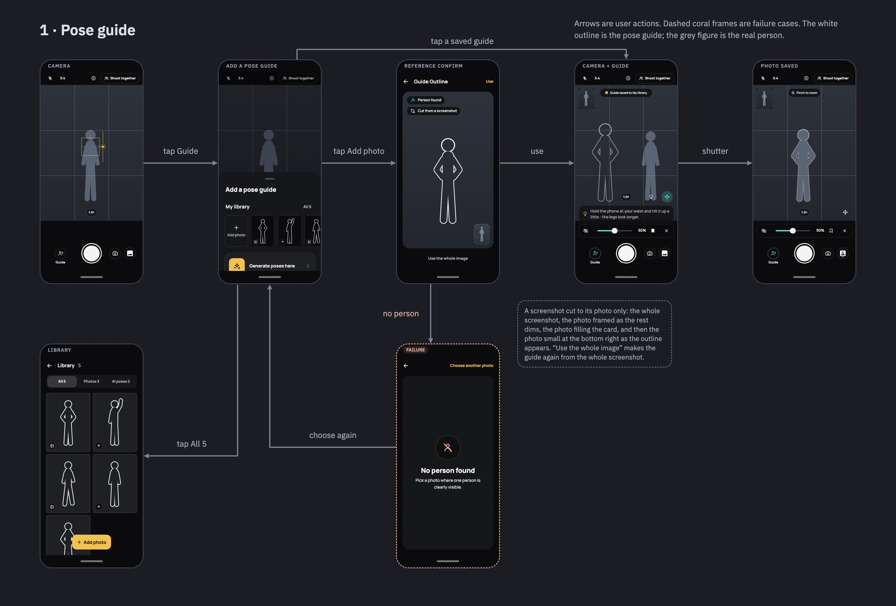

*Figure 1. Camera → Add a pose guide → Reference confirm → Camera + guide → Photo saved, with "No person found" and the Library. Drawn after a tap to focus, a screenshot cut (FR-2.10), and "Save guide".*

한국어

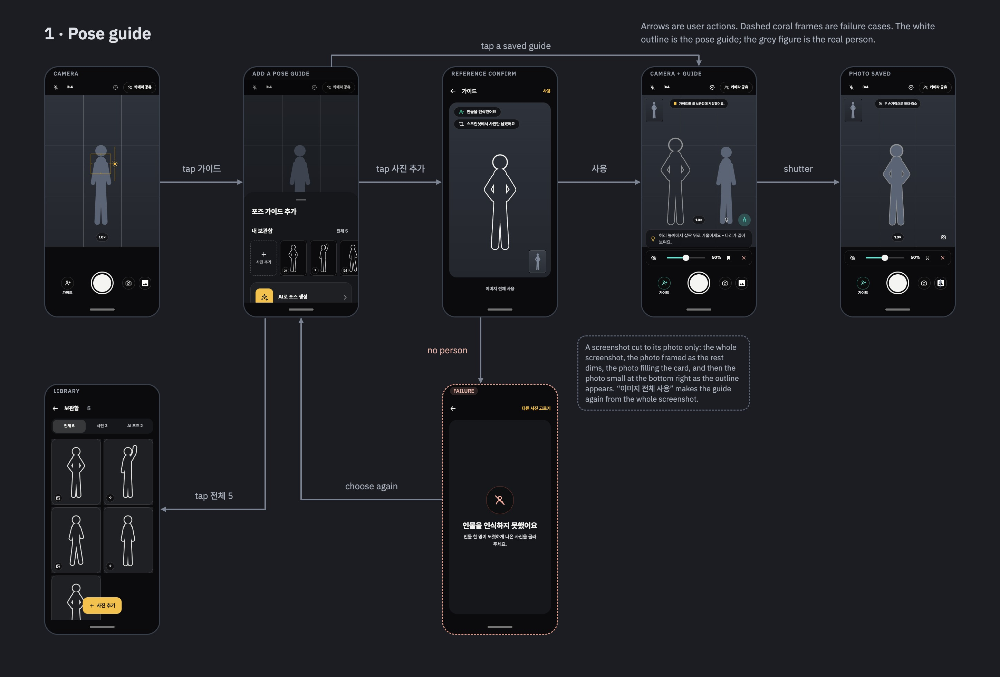

| Screen | Shows | Input → result | Not allowed / failure |
|---|---|---|---|
| **Camera** | Preview in the chosen ratio below the top bar, with grid and horizon bar (FR-1.9, FR-1.10, FR-1.13). Top bar: flash, ratio, gear, *Shoot together*. Zoom readout over the image. Bottom: *Guide*, shutter, camera switch, gallery thumbnail. | *Guide* → Add a pose guide · Shutter → Photo saved · *Shoot together* → Who takes the photo? (Flow 6) · Gear → Settings (Flow 7) · Thumbnail → the last photo · Pinch, or tap the readout → zoom (FR-1.3) · Tap → focus box and brightness bar; drag up or down → brightness (FR-1.4, FR-1.11, [#182]) · Ratio → the three ratios; the choice is kept (FR-1.13) · Flash → off, auto, on (FR-1.12) · Camera switch → the front camera at 1× and the base brightness; again → rear (FR-1.14). | Permission denied → "Pix needs camera access to show the viewfinder and take photos. Allow camera access in Settings." with *Open settings*, and *Allow camera* while Android can still ask. Camera busy → "Camera unavailable…" with *Try again*. The thumbnail is disabled until a photo is saved. No flash or front camera → no button for it; a front camera that fails → the rear one. |
| **Add a pose guide** | Sheet: "My library", with *All N* while guides are saved; *Add photo* and the ten newest saved guides (FR-3.11); *Generate poses here*; *Cancel*. With a guide on the camera: "Replace the pose guide?" and *Keep the current guide*. | *Add photo* → photo picker → Reference confirm · *All N* → Library · A saved guide → Camera + guide · *Generate poses here* → Scene photo, after the Consent notice the first time (Flow 2) · *Cancel* or swipe down → Camera. | Picker closed → Camera, guide unchanged. A guide that cannot be opened → "Couldn't open the saved guide." |
| **Library** | "Library" and the count; *All N · Photos N · AI poses N*; the guides in two columns, newest first; *Add photo*. | A guide → Camera + guide · Long press (TalkBack: *Delete saved guide*) → "Delete this saved guide?"; a guide on the camera stays · A filter → its guides · *Add photo* → picker → Reference confirm, whose Back returns here · Back → Camera. | None saved → "No saved guides yet" and "Save a guide on the camera, or add a photo.", without filters; an empty filter → "No guides of this kind yet". |
| **Reference confirm** | Back, "Guide Outline", and *Use* in the top bar; the person's white outline on a dark card; "Finding the person…", then "Person found". A screenshot cut to its photo plays the cut once, about 2 s, keeps the photo small in a corner, and adds "Cut from a screenshot" and *Use the whole image* (FR-2.10). | *Use* → Camera + guide · *Use the whole image* → the guide from the whole screenshot · Back → the screen before: Camera, the library, or Pick a pose ([#199]). | *Use* waits for the person. No person → No person found. An unreadable photo, or no model within 60 s → "Couldn't use this photo. Try another one." → Camera. |
| **Camera + guide** | The outline, starting where the person stands in the reference (FR-3.1). Above the shutter: *Hide* / *Show*, opacity, *Save guide* (filled once saved), *Remove*. The reference thumbnail, top left at first (FR-3.9). Beside the readout: the guide-edit mode toggle, and a light bulb for a generated pose's tip (FR-4.10). Hint "Pinch to zoom" with the mode off, "Guide hidden" while hidden. | Mode on: drag or pinch → the guide moves or resizes; off: pinch → zoom. On with a new guide; off at the shutter or *Hide* · Toggle → *Guide* or *Camera* over it (FR-1.3) · Slider → opacity (FR-3.4) · *Hide* / *Show* → "Guide hidden" / "Guide shown" (FR-3.6) · *Remove* → no guide · *Guide* → "Replace the pose guide?" · *Save guide* → "Guide saved to My library."; again → "Removed from My library." (FR-3.8) · Thumbnail → enlarge or move (FR-3.9) · Shutter → Photo saved. | Height 21–210% of the frame; 20% stays on screen (FR-3.2, FR-3.3). No editing while hidden. A failed save → "Couldn't save the guide. Check the phone's storage." |
| **Photo saved** | The new thumbnail, with no notice; the camera stays live (FR-1.6). | Thumbnail → the photo · Shutter → another photo. | A failed save → its reason until the next photo; guide and camera stay (FR-1.7). |
| **No person found** | Back and *Choose another photo* in the top bar; "Pick a photo where one person is clearly visible." | *Choose another photo* → picker · Back → the screen before Reference confirm, guide unchanged. | — |

### 6.3 Flow 2 · Generate poses for this scene

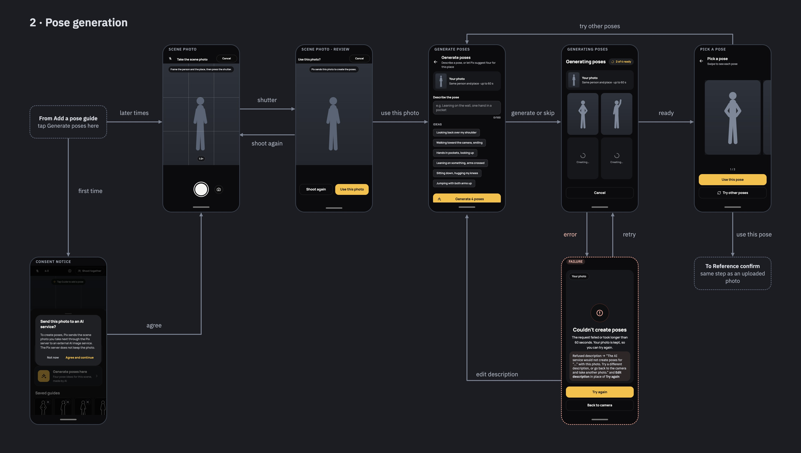

*Figure 2. Consent notice (first time) → Scene photo → Review → Generate poses → Generating poses → Pick a pose → Reference confirm, with "No one in this photo", "Couldn't create poses", and the questions Back asks on Generating poses and Pick a pose.*

한국어

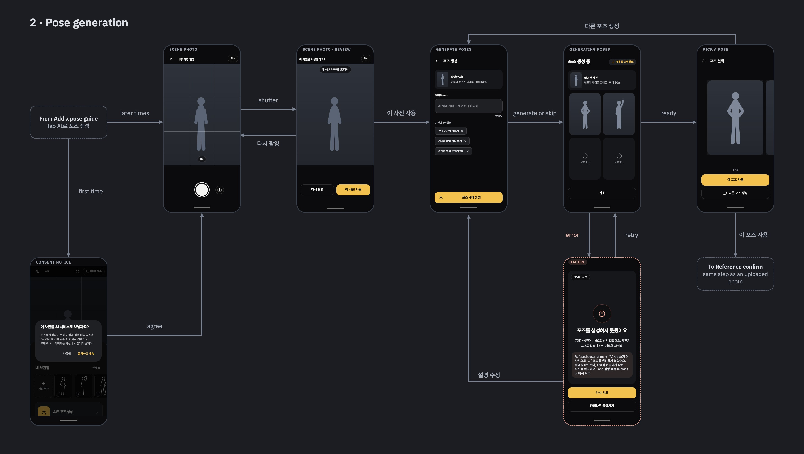

| Screen | Shows | Input → result | Not allowed / failure |
|---|---|---|---|
| **Consent notice** | A dialog over Add a pose guide, the first time only: "Send this photo to an AI service?"; *Not now*, *Agree and continue*. | *Agree and continue* → Scene photo · *Not now* → Add a pose guide. | Nothing is sent without consent (FR-4.2). |
| **Scene photo** | Camera with Back, the flash button as a light, and "Take the scene photo" in the top bar, in place of the ratio, the gear, and *Shoot together*. Hidden: *Guide*, the thumbnail, any guide and its controls, the ratio, and brightness. | Pinch → zoom · Flash → light on or off · Shutter → Review; nothing is saved · Back or system back → Camera. | The shutter waits for the camera. No tap to focus. A failed shot → "Couldn't take the photo. Try again." |
| **Scene photo · Review** | Back, "Use this photo?", and *Use* in the top bar; the photo in the middle of the space under it; "Pix sends this photo to create the poses." under the photo. No person: "No one in this photo" (FR-4.13). | *Use* → Generate poses · Back or system back → Scene photo. | No zoom. *Use* waits for the person check, and stays disabled without a person. |
| **Generate poses** | Back, the title, and one button in the top bar: *Suggest* while empty, *Generate* with text (FR-4.8). The scene photo; "Describe the pose" with "0/100" and a ✕; "Used before" chips, each with a ✕, and *All* / *With Joonhyung* in an invitation's session (FR-4.11). After a refusal: "The last set was refused. Try a different description, or another photo." In a session: "Joonhyung sees this too", and "Joonhyung is typing…" while Joonhyung types (FR-6.15). | A chip → its text in the field; its ✕ → removed from the history · *With Joonhyung* → those used with Joonhyung · The button → Generating poses · Back or system back → Scene photo · Review, the text kept, also closing Joonhyung's · Joonhyung's button first → Generating poses. | 100 characters; spaces only count as empty. Nothing is sent before the button. While Joonhyung types, this field and button wait. |
| **Generating poses** | Back, the title, and "n of 4 ready", or "Choosing poses…" / "Creating…" until the poses are known, in the top bar; four slots filling in, "Couldn't create" in a failed one. | Back or system back → "Go back?" with "Going back stops the poses being created. They can't be recovered.", *Cancel*, *Go back*; *Go back* → the set stops; Generate poses, photo and description kept · Done, or 60 s, with one ready → Pick a pose. | No candidate can be picked yet. None ready, or an error → Couldn't create poses. |
| **Pick a pose** | Back, the title, and *Select* in the top bar; one candidate at a time, neighbors at the sides; "2 / 4" (TalkBack: "Pose 2 of 4"), hidden for one; a ♥ on each, red once saved; *Regenerate* at the bottom. | Swipe → the next one, now selected · ♥ → "Pose saved to My library."; again → "Pose removed from My library." (FR-4.14) · *Select* → Reference confirm (Flow 1), whose Back returns here · *Regenerate* → Generating poses, the same request · Back or system back → "Go back?" with "Going back discards these poses. They can't be recovered.", *Cancel*, *Go back*; *Go back* → Generate poses, photo and description kept, the set gone ([#199]). | A pose without a person → "Couldn't find a person in this pose." A ♥ ignores taps while it saves, and finishes after the screen is left. A failed candidate is not shown. |
| **Couldn't create poses** | Back in the top bar, and *Try again* when offline, timed out, or after a server error; the scene photo; the title and why, in one line (FR-4.7, [#203]): "Pix couldn't reach the server.", "It took longer than 60 seconds.", "The hourly limit has been reached.", "Today's limit has been reached.", "Pix received a harmful prompt." (FR-4.12), "The AI service declined this request.", "No one was found in this photo." (FR-4.13), or "The server had a problem." | *Try again* → Generating poses · Back or system back → Generate poses, photo and text kept ([#199]). | — |

### 6.4 Flow 3 · Add a friend by Pix ID

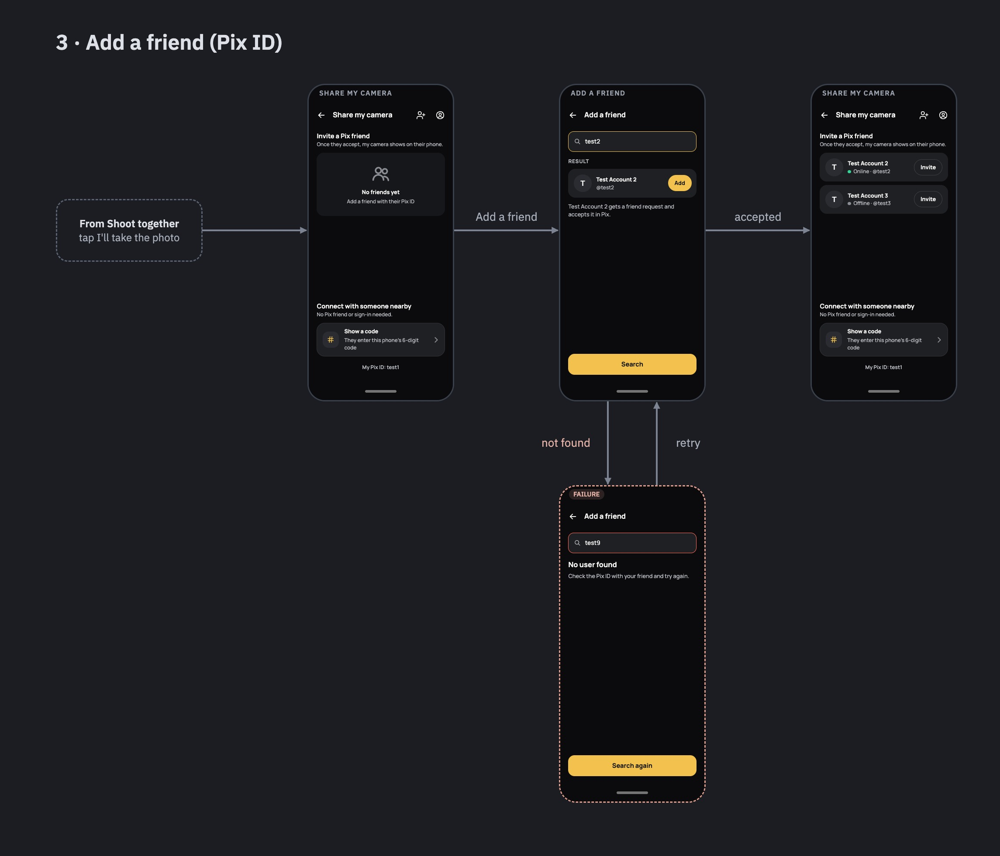

*Figure 3. Share my camera (empty) → Add a friend → Share my camera (list), with the "No user found" failure. Share my camera opens from "I'll take the photo" (Flow 6, [#188]).*

한국어

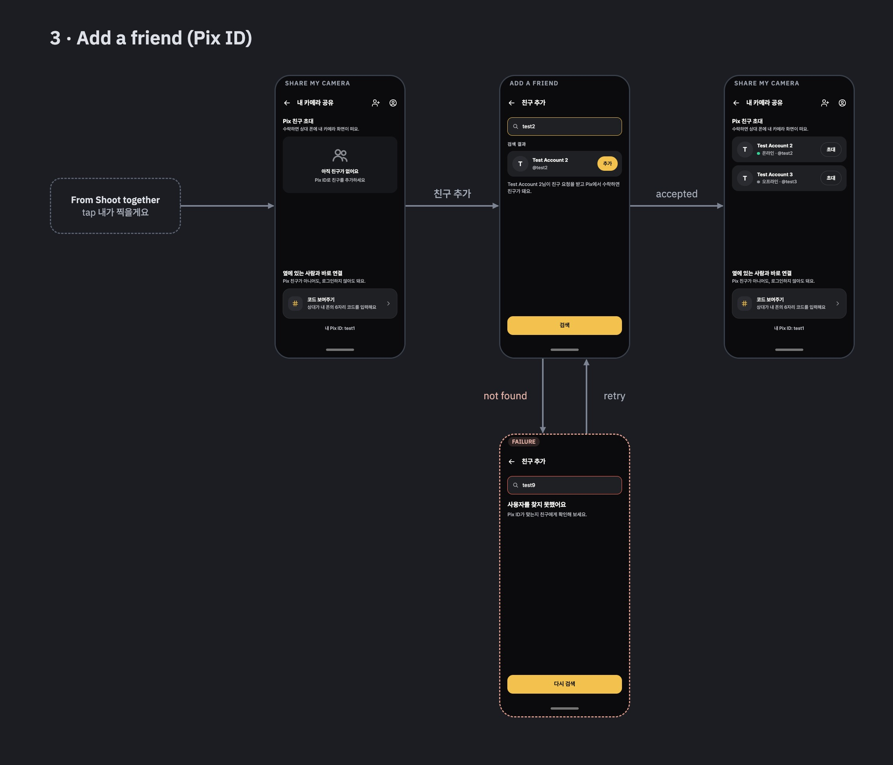

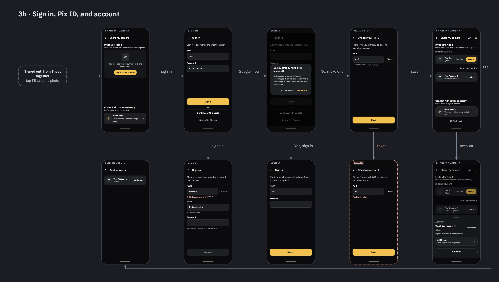

*Figure 3b. Share my camera (signed out) → Sign in → "Do you already have a Pix account?" → Pix ID setup → Share my camera with a request; below, Sent requests, Sign up, Sign in to add Google, "This Pix ID is taken", and Account.*

한국어

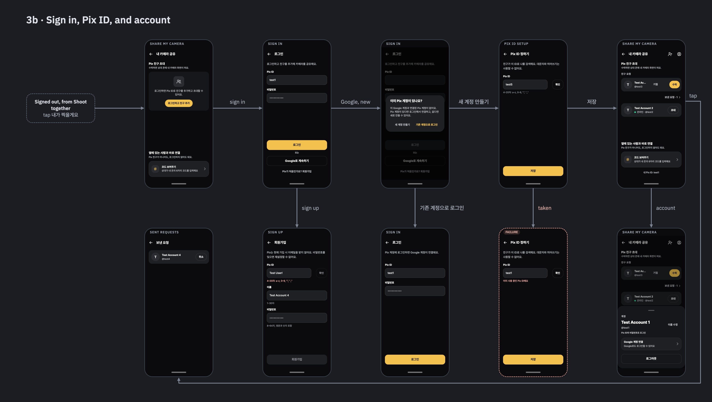

| Screen | Shows | Input → result | Not allowed / failure |
|---|---|---|---|
| **Share my camera** | Top bar: *Add a friend*, account button. Under *Invite a Pix friend*: received requests (FR-5.7), "Sent requests · 2" (FR-5.16), and friends with "Online", "Offline", or "In a session" and *Invite* (FR-5.9), or "No friends yet". Bottom: *Connect with someone nearby* with *Show a code*, and "My Pix ID: dongje.p". Lists refresh every 10 s. Signed in, it asks once per run to show notifications (Android 13 and later). | *Add a friend* → Add a friend · *Invite* → Invite sent (Flow 4), also to an offline friend · *Accept* / *Decline* a request (US-8) · *Sent requests · 2* → Sent requests · Long press a friend (TalkBack: *Remove friend*) → "Remove Joonhyung?" (FR-5.10) · *Show a code* → Room code (Flow 6) · Account button → Account · Own Pix ID → copied (FR-5.4) · Back → Camera. | Friend in another session → "Joonhyung is in another session" (FR-6.9). Withdrawn request → "This request is no longer there." Failed refresh → "Couldn't update your friends. Check your connection." Signed out by the server → "You were signed out. Sign in again to see your friends." |
| **Share my camera** (signed out) | "Sign in to add friends by their Pix ID and invite them." with *Sign in to add friends*; *Show a code*. An account without a Pix ID: "Choose your Pix ID" with *Choose a Pix ID*. | *Sign in to add friends* → Sign in · *Choose a Pix ID* → Pix ID setup · *Show a code* → Room code · Back → Camera. | — |
| **Add a friend** | "Their Pix ID"; *Search*; a result with name, @ID, and *Add*. | *Search* → the result, or No user found · *Add* → "Requested", with *Withdraw request* · Back → Share my camera. | Only a–z, 0–9, ".", "_"; *Search* waits for text. Own ID, a friend, or a pending request → "This is you", "Friends", "Requested", or *Accept* in place of *Add* (FR-5.8). A failed search → its reason. |
| **No user found** | The field in red, "No user found"; *Search again*. | *Search again* → the field, text kept · Back → Share my camera. | — |
| **Sign in** | "Sign in to add friends and shoot together."; Pix ID, password; *Sign in*; *Continue with Google*; "New to Pix? Sign up". | *Sign in* → the screen that opened it: Share my camera, Invitation (Flow 5), or Settings (Flow 7), after Pix ID setup for an account without one · *Continue with Google* → that screen, or "Do you already have a Pix account?" · *Sign up* → Sign up · Back → that screen. | *Sign in* waits for both fields. Wrong → "The Pix ID or the password is wrong." |
| **"Do you already have a Pix account?"** | A dialog after a Google account that no Pix account uses (FR-5.13). | *Yes, sign in* → Sign in, which then adds Google · *No, make one* → Pix ID setup. | Closing it forgets the Google account. |
| **Sign up** | Pix ID with *Check* (FR-5.15), name, and password, each with its rule under it (FR-5.2, FR-5.11); "There is no email, so a forgotten password can't be reset." | *Sign up* → the screen that opened Sign in, signed in · *Check* → "This Pix ID is available" or "This Pix ID is taken" · Back → Sign in. | A broken rule, or a password equal to the Pix ID, turns red and *Sign up* stays disabled (US-6). Taken → "This Pix ID is taken", input kept. No answer → "Couldn't reach Pix. Check your connection and try again." |
| **Pix ID setup** | "Choose your Pix ID"; the field with its rule and *Check*; *Save*. | *Save* or Back → the screen under it; after Back, Share my camera asks again. | As on Sign up (US-6). |
| **Sent requests** | Each unanswered request with *Withdraw*, or "No sent requests"; it refreshes like Share my camera (FR-5.16). | *Withdraw* → it leaves · Back → Share my camera. | Answered meanwhile → "This request is no longer there." Signed out → Share my camera. |
| **Account** (sheet) | From the account button or Settings: the name with *Edit name*, the @ID, how it signs in; *Add Google* or *Add a password* (FR-5.12, FR-5.14); *Sign out*. | *Edit name*, *Add a password* → a dialog with the rule · *Add Google* → Google's chooser · *Sign out* → "Signed out"; the sheet closes. | Google used by another account → "Another Pix account uses this Google account." |

### 6.5 Flow 4 · Shoot together, photographer's phone

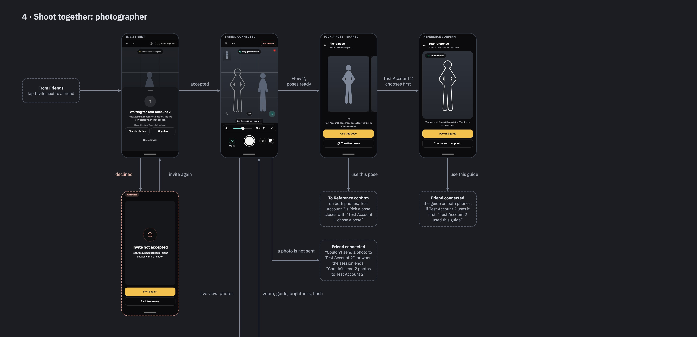

*Figure 4. Invite sent → Friend connected, with "Invite not accepted"; Pick a pose and Reference confirm, shared with the subject; a photo not sent. Vertical arrows lead to the subject's phone (Flow 5).*

한국어

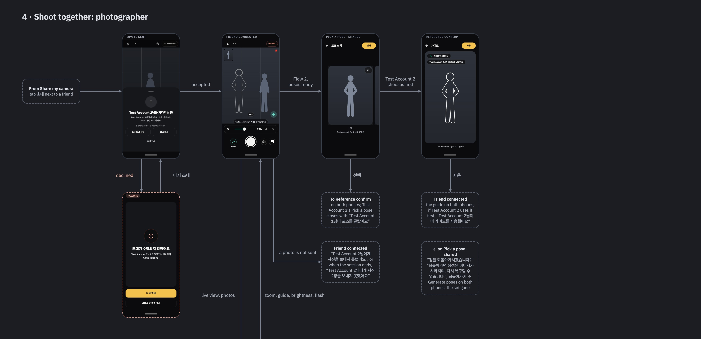

| Screen | Shows | Input → result | Not allowed / failure |
|---|---|---|---|
| **Invite sent** | A sheet over Camera: "Sending the invitation…", "Waiting for Joonhyung", then "Joonhyung accepted · connecting…"; *Share invite link*, *Copy link* (FR-6.1); *Cancel invite*. No remote-control toggle yet (FR-7.5, Could, Iteration 5). | Joonhyung accepts → Friend connected · *Cancel invite* → Share my camera; after an accept, it ends the session. | Declined, or 60 s → Invite not accepted (FR-6.3). Closing the sheet while waiting cancels the invitation. Other failures → "Couldn't connect…". |
| **Friend connected** | Camera + guide with a blinking red light (FR-6.8), and *End session* in place of *Shoot together*, with the gear beside it ([#204]). A notice per remote action, such as "Joonhyung set zoom to 2×" or "Joonhyung set a pose guide" (FR-7.4). "The live view uses mobile data." once (FR-6.13). While the link reconnects, the light is off (FR-6.12). | Flow 1's inputs · *End session* → Camera; the subject is told · The subject's changes → applied and echoed back. | "Joonhyung left", or "Joonhyung disconnected" after 10 s without the link (FR-6.11, FR-6.12); the camera keeps working. Unsent photos → "Couldn't send a photo to Joonhyung" or "Couldn't send 2 photos to Joonhyung" (FR-6.14). |
| **Pick a pose · shared** | Pick a pose (Flow 2) with "Joonhyung sees this too", without *Regenerate*. | Either phone's *Select* first → Reference confirm on both; its Back → Camera · Back → "Go back?" with "Going back discards these poses. They can't be recovered."; *Go back* → Generate poses on both, the set discarded. | Swipes and ♥s are not sent (FR-6.15). Leaving closes Joonhyung's screen too. |
| **Reference confirm** (Joonhyung's choice) | Reference confirm, titled *Guide Outline*, with "Joonhyung chose this pose" on the card and "Joonhyung sees this too". | Either phone's *Use* first → Friend connected, the guide on both; Joonhyung's first adds "Joonhyung used this guide" · Back → Camera; Joonhyung's closes. | A failure closes Joonhyung's too. A photo picked from Camera's *Guide* is not shared. |
| **Invite not accepted** | "Joonhyung declined or didn't answer within a minute." | *Invite again* → Invite sent · *Back to camera* → Camera. | — |

### 6.6 Flow 5 · Shoot together, subject's phone

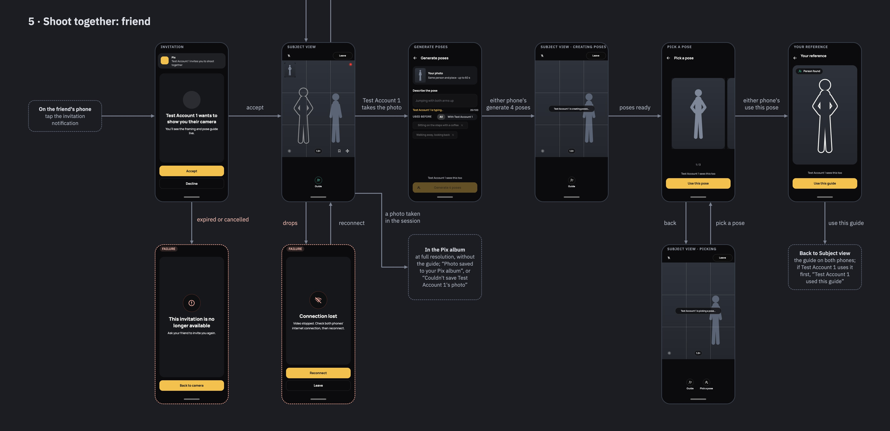

*Figure 5. Invitation → Subject view, with "no longer available" and "Connection lost"; the shared Generate poses, Generating poses, Pick a pose, and Your reference; Subject view · Picking after Back; a session photo reaching the Pix album.*

한국어

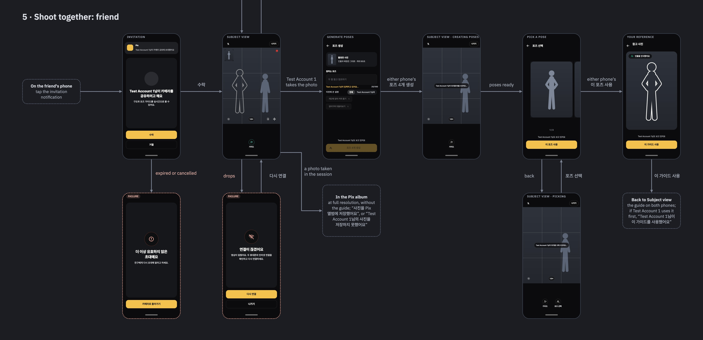

| Screen | Shows | Input → result | Not allowed / failure |
|---|---|---|---|
| **Invitation** | From the notification "Dongje invites you to shoot together" or the invite link's *Open in Pix*: "Dongje wants to show you their camera"; *Accept*, *Decline*. | *Accept* → Subject view · *Decline* → Camera; Dongje sees Invite not accepted. | Expired, cancelled, answered, or for another account → "This invitation is no longer available". Signed out → "Sign in to Pix with the account your friend invited, then accept." with *Sign in*, which returns here. Not loaded → "Couldn't open the invitation" with *Try again*. Another session here → "You're in another session. Leave it first, then accept." A room this phone waits in alone, as after its subject left (Design 2.4), is ended first ([#188]). |
| **Subject view** | Dongje's live camera in Dongje's ratio, as a mirror (FR-6.6), with the grid, the guide, and its reference thumbnail (FR-3.9); a blinking red light (FR-6.6). Top bar: flash, gear, *Leave* ([#204]). Over the video: brightness, zoom readout, and with a guide *Save guide* and the mode toggle. *Guide* at the bottom. No shutter. "Connecting…", "The photographer's camera is paused." after 2 s without video, or "Reconnecting…" (FR-6.12). "The live view uses mobile data." once (FR-6.13). | *Leave* → Camera · Gear → Settings, then back here · System back → "Leave the session?" · Dongje ends the session → "Dongje ended the session" → Camera. | Not reconnected in 10 s → Connection lost. |
| **Subject view** · remote control | Brightness opens a horizontal EV slider above *Guide* (FR-7.3, [#182]). | Pinch the video or tap the readout → Dongje's zoom (FR-7.1) · Mode on: drag or pinch the guide → on both phones (FR-7.2) · Slider or flash → Dongje's camera · *Guide* → Add a pose guide with this phone's library, without *Generate poses here*; a guide used → on both phones, and "Joonhyung set a pose guide" on Dongje's (FR-6.15) · *Save guide* → this phone's library (FR-6.16) · *Save guide*, the readout, and the toggle show the Camera screen's labels · Tap the video → Dongje's focus (FR-7.7, Could, Iteration 5). | Opacity and hiding stay Dongje's. A guide that did not reach Dongje → "Couldn't send the guide". Remote control blocked, if built → disabled with a message (FR-7.5). |
| **Subject view** · Dongje's steps | While Dongje describes, creates, picks, or checks a pose: "Dongje is describing a pose…", "…creating poses…", "…picking a pose…", or "…checking the guide…", and a button beside *Guide* for that step. | Dongje's step starts → its screen opens here once: Generate poses, Generating poses, Pick a pose, or Your reference · The button → it again · Dongje's photo saved here → "Photo saved to your Pix album" (FR-6.14). | Dongje decides or closes first → "Dongje chose a pose", "Dongje closed the poses", "Dongje used this guide", "Dongje closed the reference", or "Dongje closed Generate poses". A photo not saved → "Couldn't save Dongje's photo". |
| **Generate poses** (Dongje's) | As on Dongje's phone, with this phone's history and *All* / *With Dongje* (FR-4.11), "Dongje sees this too", and "Dongje is typing…". | Typing → shown on Dongje's phone · The button → Dongje's phone starts the set · Back → Subject view. | While Dongje types, this field waits. No answer in 5 s → "Couldn't send your request". |
| **Generating poses** (Dongje's set) | As on Dongje's phone. | Ready → Pick a pose · Back → Subject view, the set going on. | Dongje cancels → "Dongje stopped creating poses"; all failed → "Dongje's poses couldn't be created" and, under it, the line Dongje's *Couldn't create poses* shows ([#203]). |
| **Pick a pose** (Dongje's candidates) | As on Dongje's phone, without *Regenerate*. | Swipe → this phone only · ♥ → this phone's library (FR-4.14) · *Select* → Your reference on this phone, Reference confirm on Dongje's · Back → Subject view. | No answer in 5 s → "Couldn't send your pick". |
| **Your reference** (Dongje's outline) | Reference confirm as on Dongje's phone, titled *Guide Outline*. | *Use* → Subject view, the guide on both phones · Back → Subject view. | Waits for the outline. No answer in 5 s → "Couldn't send your choice". |
| **Connection lost** | "Video stopped. Check both phones' internet connection, then reconnect.", after 10 s of reconnecting (FR-6.12). | *Reconnect* → Subject view, or "The session has ended." → Camera · *Leave* → Camera. | *Reconnect* is disabled while it reconnects. |

On the four screens over Subject view, a closing notice returns to Subject view, and a 5 s notice lets the button be tapped again. While the link reconnects, they keep what they show and wait.

### 6.7 Flow 6 · Who takes the photo, and a room code

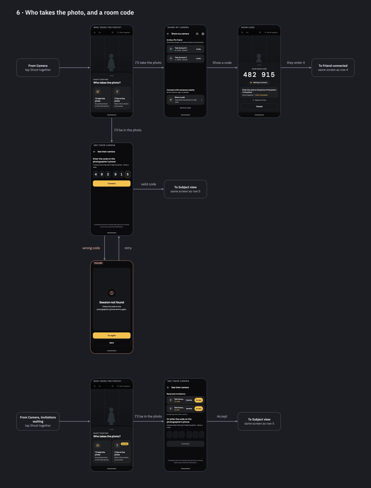

*Figure 6. Who takes the photo? → Share my camera → Room code, or → See their camera → Subject view, with "Session not found"; last row, waiting invitations (FR-6.17). Each phone sees only its own ways to connect ([#188]).*

한국어

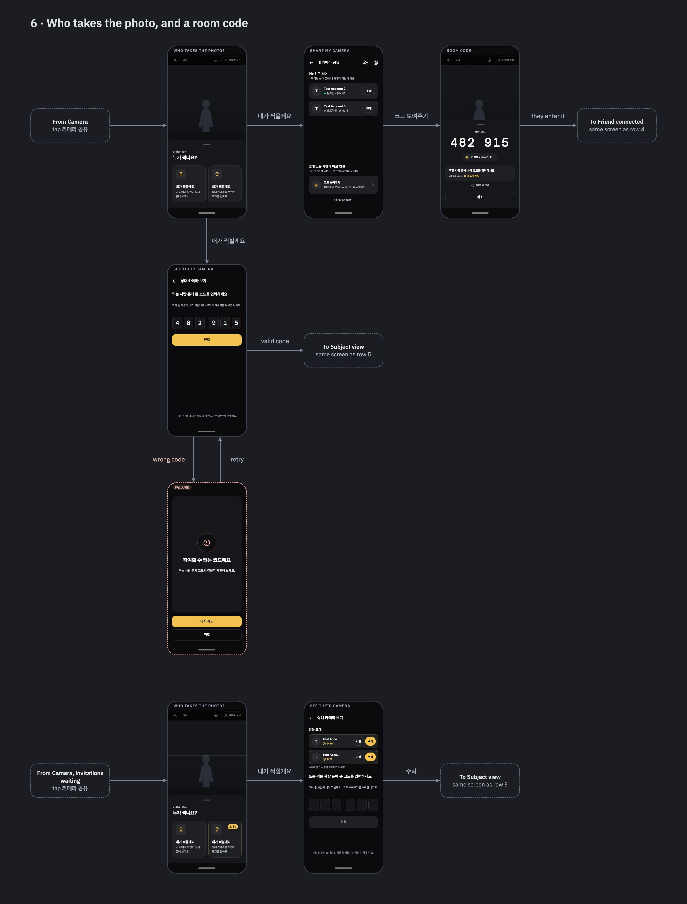

| Screen | Shows | Input → result | Not allowed / failure |
|---|---|---|---|
| **Who takes the photo?** | A sheet over Camera: *I'll take the photo* ("My camera shows on the other phone") and *I'll be in the photo* ("Watch their camera as you pose"), which counts waiting invitations ("2 invites") (FR-6.17). | *I'll take the photo* → Share my camera (6.4) · *I'll be in the photo* → See their camera, ending a room this phone waits in alone · Swipe down, Back, or a tap outside → Camera. Back from either screen is Camera. | — |
| **Room code** | A sheet: "Your room code"; the code; "Getting a code…", "Waiting to connect…", then "They joined · connecting…"; "Enter this code on the phone of the person in the photo" with *Shoot together › I'll be in the photo*; "Expires in 10 min"; *Cancel*. | *Cancel* → Camera; the code expires · The other phone joins → Friend connected (Flow 4). | 10 minutes → "The code expired. Tap Show a code again for a new one." No server → "Couldn't connect. Check your internet connection and try again." |
| **See their camera** | "Enter the code on the photographer's phone" and where it shows; six digit boxes, keyboard open; *Connect*; "Invitations from Pix friends wait here for a minute, even if you miss the notification." Open invitations come first, each with name, time left, *Decline*, and *Accept*, with the keyboard down (FR-6.17). *Scan a QR code* is planned (FR-9.2, #122). | 6 digits and *Connect* → Subject view (Flow 5) · *Accept* → Subject view, as from Invitation · *Decline* → Dongje sees Invite not accepted · Back → Camera. | Digits only; *Connect* waits for 6. Unreachable → "Couldn't connect…" (FR-8.5). Too many wrong codes → "Too many wrong codes from this network. Try again in a few minutes." (NFR-15). A gone invitation → "This invitation is no longer available"; rows go when their time runs out. *Accept* during another session → refused as on Invitation (FR-6.9). |
| **Session not found** | "Check the code on the photographer's phone and try again." | *Try again* → See their camera, the code kept and selected · *Back* → Camera. | — |

### 6.8 Screens still to be drawn

These screens follow from the requirements but are not in the wireframe yet. Each is drawn before the iteration that builds it.

| Screen | Purpose | Requirement |
|---|---|---|
| Camera permission denied | Why the camera is needed; *Open settings*. Built (6.2), not drawn. | FR-1.2 |
| Subject view, control blocked | Disabled remote controls with the reason. Could, Iteration 5. | FR-7.5 |
| Show QR, Scan QR, Connected | The QR code and hotspot status from *Show a QR code* on Share my camera; the scanner from *Scan a QR code* on See their camera; both phones confirm with *Resume*. Iteration 4 ([#214]). | FR-9.1–9.4 |

### 6.9 Rules for every screen

- **Portrait only.** Every screen is designed for one-handed portrait use. Held sideways, the icons of the controls turn with the phone; the layout does not (FR-1.15, It 4).
- **Theme.** Light and dark, following the phone's setting unless Settings chooses one (FR-10.1, It 4). Nothing over the camera image changes between the modes.
- **Top bar.** Back at the top left goes one step back, and that step shows what it had. The step's action sits at the top right: yellow text without a pill, faint while disabled, right-aligned so the text ends 20 dp from the edge, in a touch area at least 88 dp wide, in the middle of the 56 dp bar or the camera's 48 dp bar. The bottom keeps the secondary actions. Built on the guide and pose screens, on both phones; the session's own screens, such as *Invite not accepted*, *Connection lost*, and Flow 6, keep their buttons at the bottom (It 4, [#199], [#204]).
- **System back** does what Back at the top left does, or the screen's *Back* or *Cancel* where it has no top bar. On Subject view, it first asks "Leave the session?".
- **Shapes and spacing.** Chips and pills are fully round; radius 12 dp for small thumbnails, 16 dp for buttons, fields, info cards, and pose slots, 24 dp for large cards and images, and 28 dp for sheets and dialogs. Spacing is 8, 12, 16, or 24 dp, with 20 dp at the screen's sides and bottom; content starts 8 dp under the top bar ([#199]).
- **Waiting states** say what the app waits for and how long it may take, and offer *Cancel* or Back.
- **Failure screens** say what happened in plain words and offer a way back, and a retry where another try may pass ([#203]). No screen is a dead end.
- **The guide** is drawn only inside the camera image, as an outline without the reference's pixels or background, so it is not taken for a control or the scene: a line with no fill, white and about 2 dp wide unless Settings changes it (FR-3.10, Design 2.6.1).
- **Language.** English and Korean, following the phone's language unless Settings chooses one (FR-10.2).
- **The other person** may be a parent or someone just met. A screen says *friend* only for the Pix friend list (*Invite a Pix friend*, friend requests); elsewhere it says *the photographer*, *the person in the photo*, or *the other person* (상대) ([#188]).
- **Motion** (Design 2.1). Screens to or from Camera and Subject view, whose picture is the live camera, fade in place; others come in a little from the right as the last fades, and Back moves the other way, also from a screen a link opened. Sheets slide. Tutorial tips, a new guide (growing, on both phones), the outline, and each candidate fade in; *Hide* and *Remove* fade the guide; a saving ♥ grows once. Guide moves, resizes, and opacity are immediate. A change lasts at most 300 ms, never delays a tap, and is immediate with the phone's animations off.

### 6.10 Flow 7 · Settings

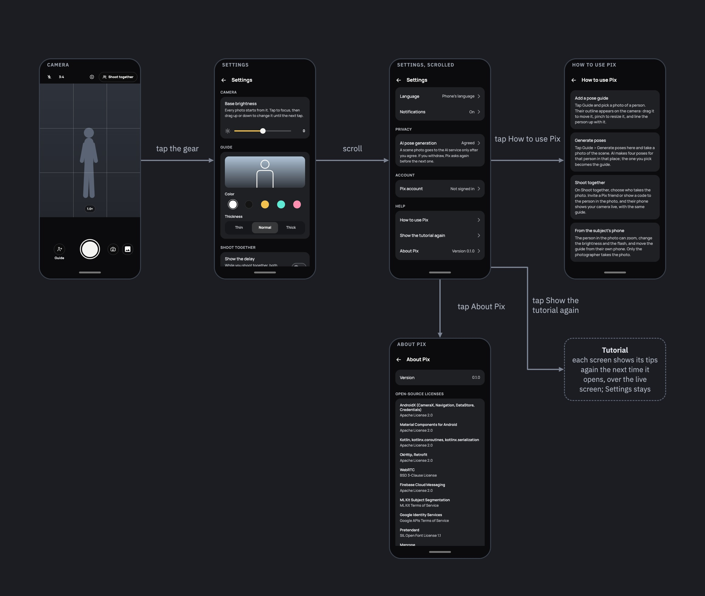

*Figure 7. Camera → Settings → How to use Pix, About Pix, and the tutorial again (Iter3-P23). Settings opens on its Camera section ([#182]).*

한국어

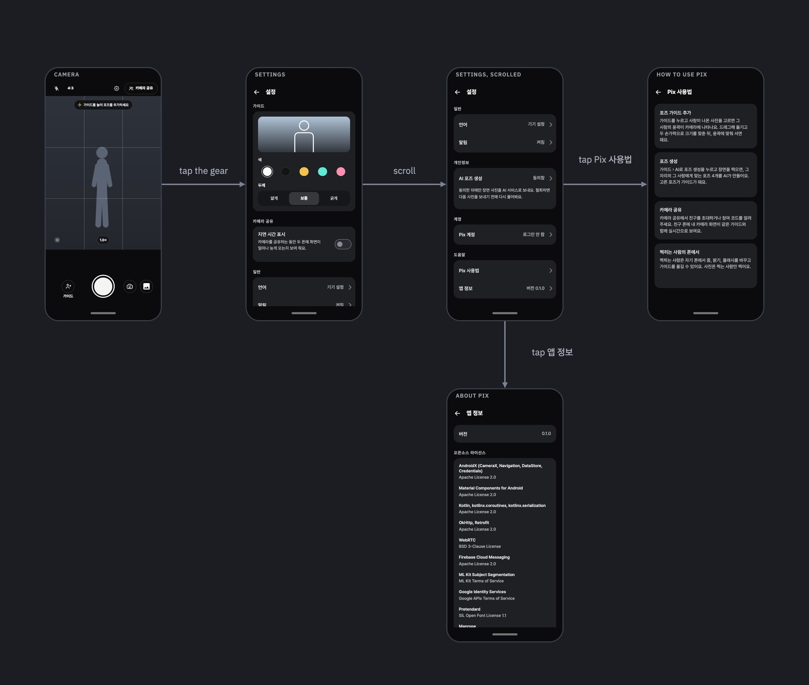

| Screen | Shows | Input → result | Not allowed / failure |
|---|---|---|---|
| **Settings** | *Camera*: *Base brightness*, a slider from −2 to +2 EV in thirds, 0 by default. *Guide*: a preview, five colors (white, black, yellow, mint, pink), and *Thin* · *Normal* · *Thick*. *Shoot together*: *Show the delay*, off by default. *General*: *Language*, *Notifications* ("On" / "Off"). *Privacy*: *AI pose generation*, "Agreed" or "Not agreed". *Account*: *Pix account*, with the @ID, the name, or "Not signed in". *Help*: *How to use Pix*, *Show the tutorial again*, *About Pix* ("Version 0.1.0"). | Brightness, color, thickness, delay → applied at once, the look to every guide on this phone (FR-1.11, FR-3.10, FR-10.3) · *Language* → "Phone's language", "English", or "한국어"; Pix redraws, Settings still open (FR-10.2) · *Notifications* → the phone's settings for Pix · *AI pose generation*, agreed → "Withdraw your agreement?" (FR-4.2) · *Pix account* → Account, or Sign in, which returns here · *Show the tutorial again* → "The tutorial shows again on each screen." (FR-10.4) · *How to use Pix*, *About Pix* → those screens · Back → Camera. | Not agreed → *AI pose generation* opens nothing. A choice that cannot be stored is not kept after Pix closes. |
| **How to use Pix** | Four cards: *Add a pose guide*, *Generate poses*, *Shoot together*, *From the subject's phone*. | Back → Settings. | — |
| **Tutorial** | Over the live screen, the first time: the screen dimmed, a dashed ring around each control, and a caption with an arrow. Camera: gear, *Shoot together*, *Guide*, camera switch, shutter. Add a pose guide: *Add photo*, *Generate poses here*, saved guides. The guide on Camera: the guide, the mode toggle, *Save guide*, *Hide* with opacity. Generate poses: the photo, the field, the button. Subject view ("When you're the subject"): *Guide*, zoom, brightness, the mode toggle. *Got it*. | *Got it* or Back → the screen; its tips do not return by themselves. | Tips whose screen changes under them close and return next time. |
| **About Pix** | The version and each library and font with its license. | Back → Settings. | — |
| **Camera and Subject view, with the delay** | In a session with *Show the delay* on: "Delay 120 ms" with a green, yellow, or red dot (FR-10.3), or "Delay –" before the first number and while reconnecting. The scene photo's title replaces it (not drawn). | — | — |

---

## 7. Assumptions, Constraints, and Out of Scope

**Assumptions**
- Both people have an Android phone with Pix installed.
- The photographer's phone has a rear camera. More lenses are optional.
- Pose generation, room codes, friends, and invitations need internet. Friends and invitations also need a Pix account, made with a Pix ID and a password or with Google.
- The camera and gallery guides work offline. Two phones can connect offline with a QR code (F9, It 4).

**Constraints**
- OpenRouter's Image API bills each generated image and has rate limits. Pose generation needs no account, so the server limits requests per network address per hour (by default 20 poses, 10 suggestion requests, and 20 tips; phones behind one address share them) and for all phones per day (by default 500 poses).
- The Pix server runs with Docker and nginx on the two course servers, one for the stable build and one for development. They are reachable only over HTTP on port 80, so there is no HTTPS or WSS (NFR-14). They cannot host a TURN relay, so sessions across networks use Cloudflare's managed relay.
- The course servers answer only on the campus network. So an AWS server with the same setup serves debug builds and sessions across networks. GitHub hosting serves only static pages and cannot run the server.
- Development follows the course schedule: about 10 hours of work per member per iteration.

**Out of scope**
- iOS, tablets, and landscape layouts. Landscape photos are in (FR-1.5, It 4); the screens stay portrait.
- Video recording, not planned before Iteration 5, once the remote session is stable.
- Sessions with more than two phones.
- Scoring how well the pose matches, and automatic capture.
- Taking the photo from the subject's phone; the photographer always takes it.
- Beauty filters and photo editing.
- Public profiles or a social feed.
- Running the generative model on the phone.
- Choosing the image model in the app, which would show our costs; the model stays a server setting.
- A guide that keeps the reference's background.
- Lines inside the outline for arms and legs in front of the body, such as folded arms (Design 2.6.1).

---

## 8. Glossary

| Term | Meaning in this document |
|---|---|
| **Photographer** | The person whose phone takes the photo (*I'll take the photo*). |
| **Subject** | The person in the photo (*I'll be in the photo*), who joins the session from their own phone. |
| **Reference** | The photo that shows the wanted pose: a gallery photo or a chosen pose candidate. |
| **Guide** | The person from the reference, drawn over the preview as an **outline** with no fill and none of the reference's pixels or background. By default a white line about 2 dp wide; *Settings › Guide* sets its color and thickness. |
| **Guide-edit mode** | A toggle on Camera and *Subject view*: while it is on, drags and pinches edit the guide instead of zooming. |
| **Reference thumbnail** | A small copy of the reference photo in a corner of Camera and *Subject view*, so the original pose stays in sight. |
| **Saved guide** | A guide kept on the phone in *My library* to reuse later. |
| **Scene photo** | The photo of the place and the person that the user takes to generate poses. |
| **Suggested pose** | One of four poses the Pix server chooses for a scene photo when the user wrote no description (*Suggest*); each becomes one pose candidate. |
| **Pose variation** | One of three rewordings of the user's description that the Pix server writes for the scene; with the description itself, they make the four candidates differ. |
| **Pose candidate** | One of four images generated from the scene photo: the same person and place in a different pose. |
| **Pose tip** | A short hint on how to take the chosen pose: how close to get, the phone's height, and its angle. |
| **Prompt history** | The descriptions used before ("Used before" on *Generate poses*), for all sessions or *With <name>*; kept on the phone only. |
| **Session** | A live connection between one photographer's phone and one subject's phone (*Shoot together*). |
| **Live view** | The photographer's camera image as shown on the subject's phone. |
| **Remote control** | The subject adjusting the shot from their phone: the zoom, the guide's position and size, the brightness, and the flash. Either person can move and resize the guide; only the photographer takes the photo. |
| **Pix ID** | A unique user name, such as "joonhyung.h", that friends use to find each other. |
| **Room code** | A 6-digit code (*Show a code*) that connects two phones without an account. |
| **Invite link** | A link to an invitation that the photographer shares when the push notification does not arrive; it opens the same *Invitation* screen. |
| **Relay** | Cloudflare's managed TURN service, which forwards the encrypted live view when the phones cannot connect directly, for example on cellular data. |
| **QR connection** | Connecting two phones without internet: the photographer's phone creates a local hotspot and shows its details as a QR code, which the subject scans (It 4). |

[#51]: https://github.com/snuhcs-course/swpp-2026-project-team-10/issues/51
[#52]: https://github.com/snuhcs-course/swpp-2026-project-team-10/issues/52
[#53]: https://github.com/snuhcs-course/swpp-2026-project-team-10/issues/53
[#54]: https://github.com/snuhcs-course/swpp-2026-project-team-10/issues/54
[#96]: https://github.com/snuhcs-course/swpp-2026-project-team-10/pull/96
[#108]: https://github.com/snuhcs-course/swpp-2026-project-team-10/pull/108
[#110]: https://github.com/snuhcs-course/swpp-2026-project-team-10/pull/110
[#111]: https://github.com/snuhcs-course/swpp-2026-project-team-10/issues/111
[#113]: https://github.com/snuhcs-course/swpp-2026-project-team-10/issues/113
[#114]: https://github.com/snuhcs-course/swpp-2026-project-team-10/issues/114
[#115]: https://github.com/snuhcs-course/swpp-2026-project-team-10/issues/115
[#116]: https://github.com/snuhcs-course/swpp-2026-project-team-10/issues/116
[#117]: https://github.com/snuhcs-course/swpp-2026-project-team-10/issues/117
[#118]: https://github.com/snuhcs-course/swpp-2026-project-team-10/issues/118
[#119]: https://github.com/snuhcs-course/swpp-2026-project-team-10/issues/119
[#120]: https://github.com/snuhcs-course/swpp-2026-project-team-10/issues/120
[#121]: https://github.com/snuhcs-course/swpp-2026-project-team-10/issues/121
[#123]: https://github.com/snuhcs-course/swpp-2026-project-team-10/issues/123
[#124]: https://github.com/snuhcs-course/swpp-2026-project-team-10/issues/124
[#132]: https://github.com/snuhcs-course/swpp-2026-project-team-10/issues/132
[#136]: https://github.com/snuhcs-course/swpp-2026-project-team-10/issues/136
[#139]: https://github.com/snuhcs-course/swpp-2026-project-team-10/pull/139
[#156]: https://github.com/snuhcs-course/swpp-2026-project-team-10/issues/156
[#158]: https://github.com/snuhcs-course/swpp-2026-project-team-10/issues/158
[#165]: https://github.com/snuhcs-course/swpp-2026-project-team-10/issues/165
[#170]: https://github.com/snuhcs-course/swpp-2026-project-team-10/issues/170
[#171]: https://github.com/snuhcs-course/swpp-2026-project-team-10/issues/171
[#174]: https://github.com/snuhcs-course/swpp-2026-project-team-10/issues/174
[#177]: https://github.com/snuhcs-course/swpp-2026-project-team-10/issues/177
[#179]: https://github.com/snuhcs-course/swpp-2026-project-team-10/issues/179
[#180]: https://github.com/snuhcs-course/swpp-2026-project-team-10/issues/180
[#181]: https://github.com/snuhcs-course/swpp-2026-project-team-10/issues/181
[#182]: https://github.com/snuhcs-course/swpp-2026-project-team-10/issues/182
[#188]: https://github.com/snuhcs-course/swpp-2026-project-team-10/issues/188
[#199]: https://github.com/snuhcs-course/swpp-2026-project-team-10/issues/199
[#200]: https://github.com/snuhcs-course/swpp-2026-project-team-10/issues/200
[#201]: https://github.com/snuhcs-course/swpp-2026-project-team-10/issues/201
[#203]: https://github.com/snuhcs-course/swpp-2026-project-team-10/issues/203
[#204]: https://github.com/snuhcs-course/swpp-2026-project-team-10/issues/204
[#206]: https://github.com/snuhcs-course/swpp-2026-project-team-10/issues/206
[#207]: https://github.com/snuhcs-course/swpp-2026-project-team-10/issues/207
[#209]: https://github.com/snuhcs-course/swpp-2026-project-team-10/issues/209
[#210]: https://github.com/snuhcs-course/swpp-2026-project-team-10/issues/210
[#211]: https://github.com/snuhcs-course/swpp-2026-project-team-10/issues/211
[#212]: https://github.com/snuhcs-course/swpp-2026-project-team-10/issues/212
[#213]: https://github.com/snuhcs-course/swpp-2026-project-team-10/issues/213
[#214]: https://github.com/snuhcs-course/swpp-2026-project-team-10/issues/214