## Document Revision History

| Version | Date | Key changes |
|---|---|---|
| 0.1 | 2026-09-30 | Initial draft: abstract, customers, competitive landscape, features, functional requirements, 14 user stories, non-functional requirements, wireframes and screen specifications, scope, and glossary. |
| 0.2 | 2026-09-30 | Saved guides (Iteration 2); room codes stay, so Pix works without an account; the QR offline connection (F9) and guides that keep the background (Iterations 3–4); the subject's remote controls per iteration; the same-Wi-Fi test setup; Android 10 minimum. |
| 0.3 | 2026-10-04 | OpenRouter's Image API chosen, with the model as a server setting (FR-4.3, section 7); NFR-13 covers sending the scene photo to it. |
| 0.4 | 2026-10-06 | Zoom sliders on Camera and Subject view replace pinch zoom (FR-1.3, FR-7.1, US-1, US-12). |
| 0.5 | 2026-10-06 | The scene photo is taken with the shutter and confirmed before it is sent; candidates show without pose names; the 30 s notice (FR-4.1, FR-4.5, FR-4.6, US-4, 6.3). |
| 0.6 | 2026-10-06 | The Flow 2 wireframe redrawn to match 0.5 (Figure 2, 6.3). |
| 0.7 | 2026-10-07 | Generating poses and save-notice texts as built (FR-4.5, 6.2, 6.3). |
| 0.8 | 2026-10-09 | Final version for Iteration 1, synced with the build: HTTPS and WSS from Iteration 2 (NFR-14), the notices and *Leave the session?* as built (6.5, 6.9), and the composition grid and horizon bar (FR-1.9, FR-1.10). |
| 1.0 | 2026-10-13 | First version for Iteration 2 (versions count 1.0, 1.1, …; task IDs are `Iter2-Pn`, the schedule's P21–P44 minus 20), from the 10/09 kickoff: the dates (4.1); brightness, flash, aspect ratios, and pinch zoom (FR-1.3, FR-1.11–1.13); outline-only guides, starting position, reference thumbnail, and saved guides (FR-2.2, FR-3.1, FR-3.8, FR-3.9); pose descriptions (FR-4.4, FR-4.8); Google sign-in (FR-5.2); push invitations and cross-network sessions (FR-6.1, FR-6.5); new NFRs (NFR-13, NFR-14, NFR-19) and the S21 (NFR-17); selfie mode, settings, and Korean for Iterations 3–4. |
| 1.1 | 2026-10-13 | Hosting decided (Iter2-P4): the course servers over HTTP and WS (NFR-14) and a managed TURN relay (FR-6.5, section 7). |
| 1.2 | 2026-10-14 | Lines for limbs in front of the body are out of scope; the outline is the silhouette only (section 7). |
| 1.3 | 2026-10-15 | Pix ID and password sign-up next to Google (Iter2-P8; FR-5.2 revised, FR-5.11–5.14, US-6), with no email or password reset; a wrong-code limit (NFR-15); password hashes and tokens (NFR-13, NFR-14). |
| 1.4 | 2026-10-15 | Camera controls as built (Iter2-P10, [#51]): how each ratio is cropped (FR-1.13) and where the controls sit (6.2). |
| 1.5 | 2026-10-16 | Guide controls as built (Iter2-P11, [#52]): size limits of 21–210 % (FR-3.3 revised), no *Replace* button (FR-3.6), the movable thumbnail (FR-3.9), and the outline on *Reference confirm* (6.2). |
| 1.6 | 2026-10-21 | Suggested poses (Iter2-P12, [#53]): without a description the server suggests four poses (FR-4.4 revised), and with one, three candidates follow variations of it (FR-4.8, US-5 revised); *Skip, suggest poses for me* and *Try other poses* (FR-4.6 revised, 6.3); a 60 s limit with the 20 s and 30 s targets kept (NFR-4 revised). |
| 1.7 | 2026-10-21 | Sign-in, Pix ID, and Friends screens as built (Iter2-P13, [#54]): *Shoot together* opens *Friends*, usable signed out (FR-5.2 revised); the account screens (6.4) and Figure 3b. |
| 1.8 | 2026-10-22 | *Check* for a free Pix ID (FR-5.15) and *Sent requests* with *Withdraw* (FR-5.16) (Iter2-P13, [#54]; US-6, US-7, 6.4). |
| 1.9 | 2026-10-23 | Synced with the app on `dev` after [#96], with original texts kept: FR-8.1, FR-8.5, and US-13 revised; section 6 follows the built screens, and Figures 1–6 and 3b are redrawn; invitations, reconnection, and the Could items move to Iteration 3 (4.1). |
| 2.0 | 2026-10-26 | Iteration 3 scope from the kickoff (4.1, F1–F10, US-14–US-16); current requirements only. |
| 2.1 | 2026-10-26 | *Pick a pose* one candidate at a time as built (Iter3-P10, [#114], [#108]): FR-4.6, the screen (6.3), Figure 2, and 6.8. |
| 2.2 | 2026-10-26 | Pose tips as built (Iter3-P11, [#115], [#110]): one tip for the pose the user takes, on the Camera screen (4.1, F4, FR-4.10, US-15, NFR-13, 6.2, Figure 1, 6.8, glossary). |
| 2.4 | 2026-10-27 | Every wireframe figure also in Korean, with the app's Korean text (Iter3-P7, [#111]; 6.1–6.7). |

Items marked **TBD** need a team decision.

**Contents**
1. [Project Abstract](#1-project-abstract)
2. [Customer](#2-customer)
3. [Competitive Landscape](#3-competitive-landscape)
4. [Functional Requirements](#4-functional-requirements)
5. [Non-functional Requirements](#5-non-functional-requirements)
6. [User Interface Requirements](#6-user-interface-requirements)
7. [Assumptions, Constraints, and Out of Scope](#7-assumptions-constraints-and-out-of-scope)
8. [Glossary](#8-glossary)

---

## 1. Project Abstract

Pix is an Android camera app that helps two people get the portrait one of them has in mind. When friends photograph each other, the person in the photo usually knows the pose and framing they want, but only the photographer sees the screen, which leads to repeated instructions and retakes. Pix gives both people the same view. The photographer adds a pose guide to the camera, either from a gallery photo or from one of four poses that Pix generates for the current scene with an image-editing AI. Pix separates the person from the background and shows them as an outline that can be moved, resized, and faded; the reference's own pixels and background are never drawn on the camera. The photographer then invites a friend added by Pix ID. Once the friend accepts, their phone shows the photographer's live camera view with the same guide, over Wi-Fi or cellular data. With the photographer's permission, the friend can also adjust the shot from their own phone: the zoom, the guide's position and size, the brightness, and the flash. The photographer takes the photo, and it is saved at full quality without the guide. Without an account, two phones on the same Wi-Fi can also connect with a 6-digit room code. Later, a QR code will connect two phones even without internet.

---

## 2. Customer

### 2.1 General audience

Android smartphone users who regularly take photos of each other, such as friends, couples, and family members, on trips, during everyday outings, and for social media. They care about how the photo looks, but most of them are not trained photographers.

### 2.2 Specific customer types

| Customer type | Situation | What they need from Pix | Features |
|---|---|---|---|
| **Couples and friends on trips** | At a landmark, the person being photographed knows the shot they want, but the photographer cannot see it in their head. They shout instructions back and forth and retake many times. | Show the intended pose on the photographer's screen, and let the subject see the framing themselves. | F2, F3, F6, F7 |
| **Reference recreators** | They saved a photo from Instagram or Pinterest and want the same pose and framing at their own location. | Turn that photo into a guide that both people can see. | F2, F3, F6 |
| **People without a pose idea** | They are at a good spot but do not know which pose would look good there. Generic pose libraries do not match their place or outfit. | Pose ideas made from a photo of this person in this place. | F4 |
| **Self-directing subjects** | People who run a personal social media account and are often photographed by a partner or parent who is less careful about framing. | Adjust the zoom, the brightness, and the guide from their own phone. | F7 |

### 2.3 Two roles in one shoot

Every "shoot together" session has two people with two phones. Roles are decided per session, and the same user can be either one on another day. Both need Pix installed.

| Role | What they do | What they need |
|---|---|---|
| **Photographer** | Holds the phone that takes the photo, sets the pose guide, and invites the subject. | Quick guide setup and adjustment; to see what the subject changed; to decide whether the subject may control the camera. |
| **Subject** (the friend being photographed) | Stands in the photo and holds their own phone, usually in one hand. | The live framing with the same guide; a few large controls to adjust the zoom, the guide, and the brightness. |

### 2.4 Example scenario

> Dongje and Junhyeong are at the Han River. Junhyeong wants a photo like one they saved on Instagram. Dongje opens Pix, which starts on the camera, taps *Guide*, and picks that photo. The person in it appears as an outline on the camera. Dongje drags it to the left third of the frame and taps *Invite* next to Junhyeong in the friend list. Junhyeong's phone shows a notification, and after *Accept*, Junhyeong sees Dongje's camera and the same outline. Junhyeong steps into the outline and pinches the live view to 2×, and Dongje's camera zooms in right away. When Junhyeong is in position, Dongje presses the shutter, and the saved photo does not include the outline.

---

## 3. Competitive Landscape

### 3.1 Market competitors

| Product | Platform | What it does | Gap for our situation |
|---|---|---|---|
| **Superpose** | iOS | AI pose camera that suggests poses and overlays a pose guide on the camera. | Only the photographer's screen shows the guide; not available on Android. |
| **Ulike** (ByteDance) | Android, iOS | Selfie and beauty camera with a library of pose samples shown as outlines. | Preset poses only; single screen. |
| **SayCheese** | Android | Turns a second phone into a remote viewfinder and shutter. | No pose guide, so the subject still has to guess the target pose. |
| **Galaxy Watch Camera Controller** | Galaxy Watch paired with a Galaxy phone | Shows the phone's camera preview on the watch, with shutter, zoom, and a 3-second timer. | Needs a watch paired to the camera phone; the screen is tiny; no pose guide. |

### 3.2 Feature comparison

| Feature | Superpose | Ulike | SayCheese | Watch Camera Controller | **Pix** |
|---|:---:|:---:|:---:|:---:|:---:|
| Pose suggestions made for the user's current scene | O | X | X | X | **O** |
| Pose guide overlaid on the camera preview | O | O | X | X | **O** |
| Guide made from the user's own reference photo | O | X | X | X | **O** |
| Subject sees the live framing on their own device | X | X | O | O | **O** |
| The same pose guide shown on the subject's device, in sync | X | X | X | X | **O** |
| Subject controls the camera remotely (for example, zoom) | X | X | O | O | **O** |
| Works with two ordinary phones (no extra hardware) | O | O | O | X | **O** |
| Available on Android | X | O | O | O | **O** |

Based on store listings and articles as of September 2026. Ulike's pose feature is described as a preset sample library, so "own reference photo" and "scene-based suggestions" are marked X.

### 3.3 How Pix differs

- **A shared view, not only a remote.** Remote-viewfinder products show the framing but not the goal. Pix shows the framing and the same pose guide on both phones, so the subject can match the pose without verbal instructions.
- **A guide from what the user actually wants.** The guide comes from the user's own reference photo or from poses generated for their current scene, not from a fixed library.
- **Friends anywhere, no extra device.** After adding each other once, two friends connect with one invitation over Wi-Fi or cellular data (Iteration 3 and later). Without an account, a room code works on the same Wi-Fi, and a QR code works even without internet (Iteration 3).
- **The photographer stays in control.** Remote control is allowed only with the photographer's permission, and only the photographer takes the photo.

---

## 4. Functional Requirements

### 4.1 Scope by iteration

| Iteration | What users can do by the end of it |
|---|---|
| **Iteration 1** 9/27 – 10/9 · prototype | Open the camera and take photos; add a guide from a gallery photo or from four generated poses (predefined pose templates); adjust the guide; connect a second phone **with a room code on the same Wi-Fi**; see the live view and guide on the second phone; change the zoom from the second phone. |
| **Iteration 2** 10/11 – 10/25 · midterm 10/21 | Sign up and sign in with a Pix ID and a password or with Google; add friends by Pix ID, with friend requests and online status. Camera: tap to focus, brightness, flash, aspect ratios 4:3, 16:9, and 1:1, pinch zoom with a guide-edit mode toggle on both phones, and zooming without stutter. Guide: smooth outlines with limbs that keep their shape, a guide that starts where the person stands in the reference, a reference thumbnail, hide and replace, and saved guides. From the subject's phone: move and resize the guide, adjust the brightness, and switch the flash. Pose generation from suggested poses, idea chips, or a typed description. Room codes stay for use without signing in. |
| **Iteration 3** 10/26 – 11/6 · user test 10/31–11/1, heuristic evaluation 11/4 | Invite a friend **over Wi-Fi or cellular data** by push notification, or by an invite link if the push does not arrive; accept or decline invitations; get friend requests as push notifications; reconnect automatically after a short drop. Connect two phones without internet by scanning a QR code. Pose generation: candidates in the scene photo's aspect ratio, shown one at a time with a swipe, with a tip on how to take the chosen one; four candidates from four prompt templates; a history of past descriptions. In a session, the subject's phone can also choose the guide and generate poses, both phones show the same step, and photos are saved on both phones. Selfie mode while no session runs. A settings screen with the language (English or Korean, the phone's by default), the guide's color and thickness, a latency indicator, and help; a tutorial on first use. If time allows (Could): the remote-control switch and remote focus. Key stories for the user acceptance test (UAT) are fixed by the end of Iteration 3. |
| **Iteration 4** tentative · UAT 11/16 and 11/18 | Fixes from the user test and the heuristic evaluation; the UAT and its fixes. |
| **Iteration 5** tentative · in-class testing 11/30, real user test 12/2 | Polish, stability, and performance against the non-functional requirements, based on UAT feedback; in-class testing and a test with real users. |

### 4.2 Feature list

Priority: **Must** = required for the product to make sense · **Should** = important, but the product works without it · **Could** = nice to have if time allows.

| ID | Feature | What it covers | Priority | Target |
|---|---|---|---|---|
| F1 | **Camera** | Opens straight to the live preview; shutter, pinch zoom with a guide-edit mode, tap to focus, brightness, flash, aspect ratio; selfie mode with the front camera; saves full-quality photos to the gallery. | Must / Should | It 1 – 3 |
| F2 | **Guide from a reference photo** | Pick a gallery photo; separate the person from the background on the device; preview as an outline that never shows the reference's pixels. Smooth edges with arms and legs that keep their shape. | Must | It 1 / It 2 |
| F3 | **Guide overlay** | Show the guide over the preview, starting where the person stands in the reference; move, resize, fade, hide, replace, remove; a reference thumbnail; never saved in photos. Save guides to reuse them. The guide's color and thickness in the settings. | Must / Should | It 1 – 3 |
| F4 | **AI pose generation** | Four pose candidates of the same person in the same place, in the scene photo's aspect ratio, generated through the Pix server; pick one as the guide. Poses suggested for the scene, or a pose chosen from idea chips or past descriptions or described in words. A tip on how to take the chosen one. | Must / Should | It 1 – 3 |
| F5 | **Pix account and friends** | An optional account, needed only for friends, with a Pix ID and a password or with Google (either kind can add the other way to sign in); Pix ID, search by exact Pix ID, friend requests, friend list with online status. | Must | It 2 |
| F6 | **Shoot-together session** | Invitation by push notification with an invite link as the fallback, live view on the subject's phone, guide sync, leaving and reconnecting, over Wi-Fi or cellular data through the public Pix server and a relay. The subject's phone can also choose the guide and generate poses, and photos are saved on both phones. | Must | It 1 – 3 |
| F7 | **Remote control** | From their own phone, the subject changes the zoom, the guide's position and size, the brightness, and the flash. The photographer sees each action and always takes the photo. The switch that blocks remote control and remote focus are Could items. | Must / Should / Could | It 1 – 3 |
| F8 | **Room-code session** | 6-digit code on the same Wi-Fi, with no sign-in, for people without an account. | Must | It 1 |
| F9 | **Offline connection (QR)** | The photographer's phone creates a local hotspot and shows a QR code; the subject scans it and connects without internet. One phone only, and both people confirm before the session starts. | Should | It 3 |
| F10 | **Settings and help** | A settings screen with the language (English or Korean), the guide's color and thickness, a latency indicator for sessions, and how-to-use help; a tutorial on first use. | Must / Should | It 3 |

### 4.3 Detailed requirements

Each requirement describes one behavior the app must show. User stories in 4.4 refer to these IDs.

#### F1 · Camera
*Pix is a camera first; everything else sits on top of it.*

| ID | Requirement | Priority | Target |
|---|---|---|---|
| FR-1.1 | Pix opens directly to the rear-camera preview. No sign-in, menu, or splash screen comes before it. | Must | It 1 |
| FR-1.2 | On first launch Pix asks for camera permission. If it is denied, Pix explains why the camera is needed and shows a button that opens the system settings. | Must | It 1 |
| FR-1.3 | The camera screen has a shutter button and a readout of the applied zoom. A pinch on the preview zooms the camera within the phone's supported range, including below 1× only when the hardware exposes it; zoom is relative to the primary rear camera across lens switches. A **guide-edit mode** toggle hands every drag and pinch to the guide while it is on, so zooming and editing the guide never clash. The readout's Zoom in / Zoom out accessibility actions are the non-gesture way to zoom. | Must | It 1 / It 2 |
| FR-1.4 | Tapping the preview focuses and sets exposure at that point. | Should | It 2 |
| FR-1.5 | Photos are saved at the camera's full resolution to a "Pix" album in the gallery. No guide or on-screen control is included. | Must | It 1 |
| FR-1.6 | After saving, "Saved without the guide" appears and the thumbnail updates. Tapping the thumbnail opens the photo in the gallery. | Must | It 1 |
| FR-1.7 | If saving fails (for example, storage is full), Pix shows why, and the camera and guide stay as they were. | Must | It 1 |
| FR-1.8 | The camera screen has entry points for *Guide* (add a pose guide) and *Shoot together*. | Must | It 1 |
| FR-1.9 | The photographer's preview shows a 3×3 composition grid. The actual image in the chosen aspect ratio (FR-1.13) is divided into three equal columns and three equal rows, excluding letterbox bars. | Must | It 1 |
| FR-1.10 | A horizon bar at the center of the middle grid cell follows device tilt and turns dark yellow when level. If the horizon cannot be determined, the bar is hidden. The grid and bar do not block gestures or appear in saved photos or streamed video. | Must | It 1 |
| FR-1.11 | The camera screen has a brightness slider that sets exposure compensation within the range the phone's camera supports. The applied value shows on the slider. | Should | It 2 |
| FR-1.12 | The camera screen has a flash button with off, auto, and on. On a phone without a flash the button is hidden. | Should | It 2 |
| FR-1.13 | The user chooses the aspect ratio 4:3, 16:9, or 1:1. The preview, the composition grid, the guide frame, the saved photo, and the live view all use the same frame, so 16:9 photos fit Instagram stories without cropping. Each ratio is cut from the middle of the camera's 4:3 image: 16:9 keeps its full height, and 1:1 its full width. | Should | It 2 |
| FR-1.14 | While no session runs, the Camera screen can switch to the front camera (selfie mode). Pose generation works with a selfie as the scene photo (Design Documentation 2.6.3). | Must | It 3 |

#### F2 · Guide from a reference photo
*Turn any photo of a person into a guide.*

| ID | Requirement | Priority | Target |
|---|---|---|---|
| FR-2.1 | *Upload a reference* opens the system photo picker, and the user picks one photo. Pix does not need access to the whole gallery. | Must | It 1 |
| FR-2.2 | Pix separates the person from the background on the phone and makes an outline guide. The guide never shows the reference's pixels or background: the person is drawn only as a white outline about 3 dp wide at the default size, with no fill (Design 2.6.1). | Must | It 1 / It 2 |
| FR-2.3 | *Reference confirm* shows the outline over a neutral background and two actions: *Use this guide* and *Choose another photo*. | Must | It 1 / It 2 |
| FR-2.4 | If no person can be separated, Pix shows *No person found* with *Choose another photo* and *Back to camera*. | Must | It 1 |
| FR-2.5 | If the photo shows several people, such as a couple, all of them are kept in the guide. | Should | It 1 |
| FR-2.6 | The reference photo is processed only on the phone and is never uploaded. | Must | It 1 |
| FR-2.7 | Closing the picker without choosing returns to the camera, and any existing guide stays unchanged. | Must | It 1 |
| FR-2.8 | Dropped: a guide that keeps the reference's background (section 7). | — | Dropped |
| FR-2.9 | The outline has smooth edges, and the arms and legs keep their real shape and length instead of coming out jagged, too thick, or too long. The same outline is built on the subject's phone from the received guide. | Must | It 2 |

#### F3 · Guide overlay
*Place the guide exactly where the person should stand.*

| ID | Requirement | Priority | Target |
|---|---|---|---|
| FR-3.1 | A confirmed guide appears over the live preview, starting at the position and size the person has in the reference photo, mapped to the camera frame; the user adjusts it from there. | Must | It 1 / It 2 |
| FR-3.2 | Dragging with one finger moves the guide. At least 20% of it always stays on screen. | Must | It 1 |
| FR-3.3 | Pinching resizes the guide between 21% and 210% of the frame height, and both phones apply the same limits. | Must | It 1 / It 2 |
| FR-3.4 | A slider changes the guide's opacity between 10% and 90%. | Must | It 1 |
| FR-3.5 | Dropped: the Cutout/Outline toggle; the guide is an outline only (FR-2.2). | — | Dropped |
| FR-3.6 | The user can hide the guide for a moment, remove it, or replace it with another one. There is no separate *Replace* button: while a guide is on the camera, *Guide* asks "Replace the pose guide?", and the new guide takes the old one's place (decided 2026-10-16). | Should | It 2 |
| FR-3.7 | The guide's position and size are kept relative to the camera image rather than the screen, so the guide lands on the same part of the scene on a phone with a different screen size. | Must | It 1 |
| FR-3.8 | *Save guide* stores the current guide on the phone. *Add a pose guide* lists saved guides so the user can reuse or delete them. Saved guides live in the app's private storage, not in the gallery and not on the server, and survive an app restart. At most 20 are kept; saving one more removes the oldest, and the notice says so. | Should | It 2 |
| FR-3.9 | While a guide is set, a small thumbnail of the reference photo sits in a corner of the Camera screen, so the photographer still sees the original pose. Tapping it enlarges it to about half the preview's width, and tapping it again makes it small. Dragging it moves it to the nearest of the preview's four corners, never elsewhere; the bottom corners stay above the guide's controls. The thumbnail is not streamed to the subject and does not appear in photos. | Should | It 2 |
| FR-3.10 | The settings screen sets the guide's color and line thickness (FR-10.1). By default the guide is the white line of FR-2.2. | Should | It 3 |

#### F4 · AI pose generation
*Pose ideas made for this person in this place.*

| ID | Requirement | Priority | Target |
|---|---|---|---|
| FR-4.1 | *Generate poses here* returns to the Camera screen to take the scene photo. The user frames the subject, with zoom as usual, and presses the shutter, then confirms the photo with *Use this photo* or takes another with *Shoot again*. Nothing is sent before the photo is confirmed, and the scene photo is not saved to the gallery. | Must | It 1 |
| FR-4.2 | Before the first request, Pix says that the scene photo will be sent to an external AI service and asks for consent. Without consent, nothing is sent. | Should | It 1 |
| FR-4.3 | Pix requests four candidates that keep the same person and background, through the Pix server. The server generates them with an image-editing model on OpenRouter; the model is a server setting (Design Documentation 2.6.3). Each candidate has the aspect ratio of the scene photo (FR-1.13). | Must | It 1 / It 3 |
| FR-4.4 | Without a description, the Pix server suggests four poses that suit the scene photo, and Pix requests one candidate for each; *Skip, suggest poses for me*, or *Generate 4 poses* with an empty field, requests them. When the server cannot suggest poses, it uses the predefined poses: hands on hips, wave, walking, and arms crossed. | Must | It 1 / It 2 |
| FR-4.5 | *Generating poses* shows the scene photo, each candidate as soon as it is ready, progress ("2 of 4 ready"), how long it may take ("up to 60 s"), and *Cancel*. | Must | It 1 |
| FR-4.6 | *Pick a pose* shows the candidate images one at a time, without pose names, and a swipe moves to the next ([#108]); the candidate on screen is the selected one. *Use this pose* sends it to *Reference confirm* (F2). *Try other poses* goes back to *Generate poses* with the scene photo and the description kept, so the user can keep the description, change it, or skip before a new set is requested. | Must | It 1 / It 3 |
| FR-4.7 | If no candidate arrives within 60 s or every request fails, Pix shows *Couldn't create poses* with *Try again* and *Back to camera*, and keeps the scene photo; when the service refused every pose of a description, *Edit description* takes the place of *Try again* (US-5). If only some candidates fail, the others are still shown. | Must | It 1 |
| FR-4.8 | After the scene photo is confirmed, *Generate poses* shows a thumbnail of the scene, idea chips, and a text field for a pose description in Korean or English (up to 100 characters, with a counter). Idea chips are the default: tapping a chip fills the field, and the user can edit or type their own text. *Generate 4 poses* requests four candidates that follow the description through four different prompt templates, so that the four differ; *Skip, suggest poses for me* requests poses suggested for the scene (FR-4.4). The server's prompt reads the description as the user's request, keeps the person, the face, the clothing, and the place whatever the description says, puts one pose in each candidate, and may frame the person closer than the scene photo, never wider (Design Documentation 2.6.3). | Should | It 2 / It 3 |
| FR-4.9 | The Pix server does not keep the scene photo or the generated images after returning them. | Must | It 1 |
| FR-4.10 | After *Use this pose*, the Camera screen tells in plain words, without numbers, how to take the pose: how close to get, at what height to hold the phone, at what angle, and why. A translucent banner shows it once, "Preparing a tip…" until it arrives; a touch anywhere closes it, and a button in the top bar opens it again. A guide from an uploaded reference or a saved guide has no tip. | Must | It 3 |
| FR-4.11 | *Generate poses* lists the descriptions used before. A toggle switches between the whole history and the history with the current partner: as the photographer, the whole history holds the descriptions of the photos the user took, and as the subject, those of the photos they were in. ✕ deletes an entry. | Should | It 3 |

#### F5 · Pix account and friends
*Add a friend once, then connect with one tap.*

| ID | Requirement | Priority | Target |
|---|---|---|---|
| FR-5.1 | Pix works without an account: single-phone features (F1–F4), room codes (F8), and QR connections (F9) need no sign-in. Only friends and invitations need one. | Must | It 2 |
| FR-5.2 | *Shoot together* opens *Friends*. Signed out, it offers *Sign in to add friends* and *Use a room code instead*, so a room code never needs an account (FR-5.1, FR-8.1). The user signs in with a Pix ID and a password or with Google, or signs up with a Pix ID, a display name, and a password; an account made with Google chooses its Pix ID right after signing up. Either way the server issues Pix's own session token, which the phone keeps, and it verifies a Google sign-in first. A Pix ID is 4–20 characters of lowercase letters, digits, "." and "_". | Must | It 2 |
| FR-5.3 | A Pix ID that is taken or breaks the rules is rejected with the reason, and nothing is saved. | Must | It 2 |
| FR-5.4 | The Friends screen shows the user's own Pix ID. Tapping it copies the ID. | Should | It 2 |
| FR-5.5 | *Add a friend* finds users only by their exact Pix ID. There is no public list or partial-match search. | Must | It 2 |
| FR-5.6 | *Add* sends a friend request. The two users become friends only after the other user accepts. | Must | It 2 |
| FR-5.7 | The receiver sees pending requests on *Friends* with *Accept* and *Decline*, and gets a push notification for each request once Pix has push ([#119]). | Must | It 2 / It 3 |
| FR-5.8 | Search results mark special cases instead of showing *Add*: the user's own ID ("This is you"), an existing friend ("Friends"), a request the user sent ("Requested", with *Withdraw request*), and a request the other person sent (*Accept*, which makes them friends at once). | Should | It 2 |
| FR-5.9 | The friend list shows each friend's name, Pix ID, online status (Pix is open on their phone), and an *Invite* button. | Must | It 2 |
| FR-5.10 | The user can remove a friend. A removed user can no longer send invitations to them. | Should | It 2 |
| FR-5.11 | A password has 8–64 characters, at least one letter and one digit, and is not the same as the Pix ID. One that breaks a rule is rejected with the rule, and nothing is saved. The server stores only a hash of the password. | Must | It 2 |
| FR-5.12 | A user who signed up with a Pix ID and a password can add their Google account, and then sign in with either. | Should | It 2 |
| FR-5.13 | When someone signs in with a Google account that no Pix account uses, Pix asks whether they already have a Pix account. If they do, they sign in with its Pix ID and password, and the Google account is added to it; if not, a new account is created and they choose a Pix ID. | Should | It 2 |
| FR-5.14 | A user who signed up with Google can add a password once they have a Pix ID, and then sign in with the Pix ID and the password too. The password rules of FR-5.11 apply. | Should | It 2 |
| FR-5.15 | *Sign up* and *Pix ID setup* have *Check* beside the Pix ID field. It tells whether the Pix ID is free before the form is sent, without signing in. A Pix ID that someone takes in the meantime is still rejected when the form is sent (FR-5.3). | Should | It 2 |
| FR-5.16 | *Friends* shows how many friend requests the user sent that are not answered yet. *Sent requests* lists them with each user's name and Pix ID, and *Withdraw* takes one back; a request that was answered in the meantime leaves the list. | Should | It 2 |

#### F6 · Shoot-together session
*The subject sees what the camera sees, with the same guide.*

| ID | Requirement | Priority | Target |
|---|---|---|---|
| FR-6.1 | *Invite* sends an invitation that reaches the friend as a push notification, even when Pix is closed on the friend's phone. If the push does not arrive, the photographer can share an invite link through the Android share sheet (for example KakaoTalk) or copy it; opening the link shows the same *Invitation* screen. | Must | It 3 |
| FR-6.2 | *Invite sent* shows "Waiting for &lt;name&gt;", *Share invite link*, *Copy link*, and *Cancel invite*. The remote-control toggle (FR-7.5) is added here if it is built. | Must | It 3 |
| FR-6.3 | An invitation expires after 30 s. If it is declined or expires, the photographer sees *Invite not accepted* with *Invite again* and *Back to camera*. | Must | It 3 |
| FR-6.4 | The friend's *Invitation* screen shows who is inviting, with *Accept* and *Decline*. Opening an expired or cancelled invitation shows "This invitation is no longer available". | Must | It 3 |
| FR-6.5 | After *Accept*, the phones connect whether they are on the same Wi-Fi, on different Wi-Fi networks, or on cellular data. Signaling goes through the public Pix server, and a TURN relay forwards the live view when a direct connection is not possible. Room-code sessions use the same server and relay. | Must | It 3 |
| FR-6.6 | The subject's *Subject view* shows the photographer's live camera in portrait, the photographer's name ("Dongje's camera"), and *Leave*. | Must | It 1 |
| FR-6.7 | The guide appears on the subject's phone at the same relative position, size, and opacity as on the photographer's phone, including its starting position (FR-3.1). It updates whenever either person moves or resizes it (FR-7.2), and whenever the photographer fades, hides, replaces, or removes it. | Must | It 1 / It 2 |
| FR-6.8 | While connected, the photographer's camera shows "Live · &lt;name&gt; connected". | Must | It 1 |
| FR-6.9 | A session has exactly one photographer and one subject. Inviting a friend who is already in a session shows "&lt;name&gt; is in another session". | Should | It 3 |
| FR-6.10 | Either person can end the session (*End session* or *Leave*). The other person is told, and the photographer's camera keeps working on its own. | Must | It 1 |
| FR-6.11 | When the connection is lost, the subject sees *Connection lost* with *Reconnect* and *Leave*, and the photographer sees "&lt;name&gt; disconnected". | Must | It 1 |
| FR-6.12 | Before showing *Connection lost*, both phones try to reconnect automatically for up to 10 s. | Should | It 3 |
| FR-6.13 | The first time a session runs on cellular data, Pix says that the live view uses mobile data. | Should | It 3 |
| FR-6.14 | Photos taken in a session are saved on both phones by default: the photographer's phone sends each photo to the subject in full quality. | Must | It 3 |
| FR-6.15 | During a session, the subject's phone can also open *Add a pose guide* and *Generate poses here*. Both phones then show the same step: the scene photo with the photographer's camera, *Generate poses*, and *Pick a pose*. What one person types or selects is not streamed to the other phone; the first phone to go on moves both to the next step. | Must | It 3 |
| FR-6.16 | *Save guide* is on both phones and saves on the phone where it is tapped. A guide saved on the subject's phone is used by opening *Add a pose guide* from the subject's phone. | Must | It 3 |

#### F7 · Remote control
*The subject fine-tunes the shot from their phone; the photographer takes the photo.*

| ID | Requirement | Priority | Target |
|---|---|---|---|
| FR-7.1 | A pinch on *Subject view*'s live video changes the photographer's zoom within the photographer's supported range. During a pinch the readout follows the requested ratio immediately; afterward it settles on the applied ratio echoed by the photographer. *Subject view* has the same guide-edit mode toggle as the Camera screen (FR-1.3), because the subject both moves the guide (FR-7.2) and zooms. The readout's Zoom in / Zoom out accessibility actions step the zoom without a gesture. | Must | It 1 / It 2 |
| FR-7.2 | On *Subject view*, the subject can drag the guide to move it and pinch it to resize it, within the same limits as the photographer (FR-3.2, FR-3.3), so the subject can fix a guide that the photographer placed badly. Both phones show the change. Opacity, hiding, and replacing stay with the photographer. | Must | It 2 |
| FR-7.3 | *Subject view* has a brightness slider and a flash button with the same range and states as the photographer's own controls (FR-1.11, FR-1.12). The flash button is hidden if the photographer's phone has no flash. | Should | It 2 |
| FR-7.4 | The photographer sees a short notice for each remote action, such as "Junhyeong set zoom to 2×" or "Junhyeong moved the guide". | Should | It 1 |
| FR-7.5 | The photographer can allow or block remote control on *Invite sent* and change it during the session. While it is blocked, the subject's remote controls are disabled with the message "Dongje turned off remote control". Until this is built, remote control is always allowed. | Could | It 3 |
| FR-7.6 | The photographer's own controls always keep working, and only the photographer takes photos. If both people change the zoom, the guide, or the brightness at the same moment, the later change wins and both phones show the same final value. | Must | It 1 |
| FR-7.7 | The subject can also set the focus point remotely, as the photographer does with FR-1.4. | Could | It 3 |

#### F8 · Room-code session
*Connect on the same Wi-Fi without an account.*

| ID | Requirement | Priority | Target |
|---|---|---|---|
| FR-8.1 | *Friends* has *Use a room code* (*Use a room code instead* when signed out), which works without signing in, starts a room, and shows a 6-digit code, "Waiting for your friend…", and *Cancel*. The code sheet's *Join with a code instead* cancels that code and opens *Join with code*. | Must | It 1 |
| FR-8.2 | *Join with code* accepts digits only. *Join* stays disabled until all 6 digits are entered. | Must | It 1 |
| FR-8.3 | A valid code opens *Subject view*. An unknown or expired code shows *Session not found* and keeps the entered code for editing. | Must | It 1 |
| FR-8.4 | A code expires when the photographer cancels, or after 10 minutes if nobody joins. | Should | It 1 |
| FR-8.5 | Both screens state that both phones must be on the same Wi-Fi. A join from another network still reaches the session and opens *Subject view* ("Connecting…"); if the phones cannot connect directly, it shows *Connection lost* after 15 s. When *Join with code* cannot reach the session at all, Pix shows "Couldn't connect. Make sure both phones are on the same Wi-Fi." | Must | It 1 |

#### F9 · Offline connection with a QR code
*Connect two phones anywhere, even without internet or a shared Wi-Fi.*

| ID | Requirement | Priority | Target |
|---|---|---|---|
| FR-9.1 | *Shoot together* offers *Show QR*. The photographer's phone creates a local hotspot, which has no internet, and shows a QR code with its connection details. | Should | It 3 |
| FR-9.2 | *Scan QR* on the subject's phone reads the code, joins the hotspot, and connects to the photographer's phone without the Pix server. No sign-in is needed. | Should | It 3 |
| FR-9.3 | For security, the photographer's phone accepts only one phone per QR code. Later attempts are refused. | Should | It 3 |
| FR-9.4 | When a phone connects, both phones show "Connected" with the other phone's name. The live view and remote control start only after both people tap *Resume*, so a stranger who connected first cannot join unnoticed. *Cancel* ends the connection and shows a new QR code. | Should | It 3 |
| FR-9.5 | The session works over the hotspot alone. Pose generation still needs the photographer's phone to have its own internet connection. | Should | It 3 |

#### F10 · Settings and help
*Make Pix fit the user, and show how it works.*

| ID | Requirement | Priority | Target |
|---|---|---|---|
| FR-10.1 | A settings screen holds the language, the guide's color and thickness (FR-3.10), a latency indicator for sessions, and how-to-use help. | Must | It 3 |
| FR-10.2 | The UI is available in English and Korean. It follows the phone's language by default, and the settings screen can switch it. | Must | It 3 |
| FR-10.3 | A setting shows a latency indicator on both phones during a session, with the live view's current delay. | Should | It 3 |
| FR-10.4 | A short tutorial runs the first time Pix opens. The settings screen can start it again and has a how-to-use help. | Should | It 3 |

### 4.4 User stories and acceptance criteria

Each story lists its scenarios in Given-When-Then form. **Normal** is the expected path, **Failure** is an error or a rejected input, and **Edge** is an unusual but valid situation. Stories marked "UAT candidate" are proposals; the final UAT set is fixed by the end of Iteration 3.

#### US-1 · Take a photo right after opening Pix
F1 · FR-1.1–1.13 · Iteration 1 → Iteration 2 (focus, brightness, flash, aspect ratio, pinch zoom)

> As a photographer, I want Pix to open straight to the camera, so that I do not miss the moment.

| Case | Given | When | Then |
|---|---|---|---|
| **Normal** | Camera permission is granted | I open Pix | The rear-camera preview appears within 2 s, with the shutter, the applied zoom readout, composition grid, horizon bar when available, *Guide*, and *Shoot together*. |
| **Normal** | Guide-edit mode is off | I pinch the preview | The camera zooms, and the guide keeps its size. With the mode on, a pinch anywhere in the camera image resizes the guide instead. The readout's Zoom in / Zoom out actions also zoom. |
| **Edge** | A pinch crosses 1× on a phone with a separate ultrawide | I keep pinching around 1× | The lens changes at most once, near 0.95× or 1.05×, and the last frame stays on screen during the switch, without a blank preview. |
| **Normal** | The preview is showing | I change the zoom, including below 1× | The preview stays continuous, with no stutter and no loading pause (NFR-19). |
| **Normal** | The preview is showing | I tap a point in the preview | The camera focuses and meters there. |
| **Normal** | The preview is showing | I move the brightness slider or tap the flash button | The preview gets brighter or darker within the camera's range, and the flash cycles off, auto, on. |
| **Normal** | The preview is showing | I choose 16:9 | The preview, grid, and guide frame change to 16:9, and the next photo is saved in 16:9. |
| **Edge** | My phone has no flash | I look at the controls | There is no flash button. |
| **Normal** | The preview is showing | I tap the shutter | The photo is saved to the "Pix" album within 2 s, a confirmation appears, and the thumbnail updates. |
| **Failure** | I denied camera permission | Pix opens | Pix explains why it needs the camera and shows *Open settings* instead of a blank preview. |
| **Failure** | The phone's storage is full | I tap the shutter | "Couldn't write the photo. Check available storage and try again." appears, and the camera stays ready. |

#### US-2 · Turn a gallery photo into a pose guide
F2 · FR-2.1–2.7, FR-2.9 · Iteration 1 → Iteration 2 (outline only, smooth edges) · UAT candidate

> As a photographer, I want to pick a reference photo from my gallery and see the person in it on my camera screen, so that I can frame the shot the way my friend wants.

| Case | Given | When | Then |
|---|---|---|---|
| **Normal** | I tapped *Guide › Upload a reference* | I choose a photo with a clearly visible person | *Reference confirm* shows the person as an outline within 2 s. None of the photo's pixels or background are shown. |
| **Normal** | The person in the photo has an arm stretched out and legs apart | Processing finishes | The outline is smooth, and the arm and legs have their real shape and length. |
| **Normal** | *Reference confirm* is showing | I tap *Use this guide* | The camera shows the guide over the live preview. |
| **Failure** | I chose a photo with no person, such as a landscape | Processing finishes | *No person found* appears. *Choose another photo* reopens the picker, and *Back to camera* returns without a guide. |
| **Edge** | The photo shows two people | Processing finishes | Both people are included in the guide. |
| **Edge** | The photo picker is open and a guide was already set | I close the picker without choosing | I return to the camera, and the existing guide is unchanged. |

#### US-3 · Adjust the guide to my composition
F3 · FR-3.1–3.10, FR-1.5 · Iteration 1 → Iteration 2 (starting position, hide, replace, thumbnail, saved guides)

> As a photographer, I want to move, resize, fade, hide, and replace the guide, and keep the ones I like, so that it matches the composition without hiding the scene.

| Case | Given | When | Then |
|---|---|---|---|
| **Normal** | A guide is on the preview | I drag it with one finger | It follows my finger, and the preview stays smooth. |
| **Normal** | A guide is on the preview | I pinch it | It grows or shrinks, and stops at 21% and 210% of the frame height. |
| **Normal** | A guide is on the preview | I move the opacity slider | The opacity changes between 10% and 90%. |
| **Normal** | A guide is visible | I take a photo | The saved photo does not contain the guide. |
| **Edge** | I am dragging the guide toward the edge | I keep dragging past the edge | It stops when only 20% of it is still on screen, so it cannot be lost. |
| **Normal** | I confirmed a reference where the person stands at the left edge | The guide appears | It appears at the left, at the person's size in the photo, not centered. |
| **Normal** | A guide is on the preview | I tap *Hide*, then *Show* | The guide disappears and comes back at the same position and size. |
| **Normal** | A guide is on the preview | I tap *Guide*, which asks "Replace the pose guide?", and confirm another reference | The new guide takes the old one's place, starting where the person stands in the new reference. |
| **Normal** | A guide is on the preview | I tap the reference thumbnail in the corner | The reference photo is shown large; tapping again makes it small. It is not in my photos. |
| **Normal** | The reference thumbnail is in the top-left corner | I drag it toward the bottom right and let go | It settles in the bottom-right corner, above the guide's controls. |
| **Normal** | A guide is on the preview | I tap *Save guide*, close Pix, open it, and open *Add a pose guide* | The saved guide is listed and can be used or deleted. It is not in my gallery. |
| **Normal** (Could, It 3) | The guide color is built and the scene is dark | I switch the guide color | The outline changes between black and white. |

#### US-4 · Get pose ideas that fit this place
F4 · FR-4.1–4.7, FR-4.9 · Iteration 1 · UAT candidate

> As a user without a reference photo, I want Pix to suggest poses from a photo of where we are, so that I get ideas that fit this place and this person.

| Case | Given | When | Then |
|---|---|---|---|
| **Normal** | My friend is in the camera frame, and the phone is online | I tap *Guide › Generate poses here* (and agree to the notice the first time), press the shutter, and tap *Use this photo* | *Generating poses* shows my scene photo and fills in each candidate as it arrives, with "n of 4 ready". |
| **Edge** | The scene photo I just took is shown | I tap *Shoot again* | The camera is shown again, and nothing is sent. |
| **Normal** | The candidates are shown | I select one and tap *Use this pose* | It opens in *Reference confirm*, the same as an uploaded photo. |
| **Normal** | The candidates are shown | I tap *Try other poses* | *Generate poses* appears with the same scene photo and my description, and nothing is sent until I tap *Generate 4 poses* or *Skip*. |
| **Failure** | The phone is offline, the server fails, or 60 s pass with no candidate | Generation stops | *Couldn't create poses* appears with my scene photo kept. *Try again* resends the same photo. |
| **Failure** | The consent notice is shown for the first time | I tap *Not now* | Nothing is sent, and I return to *Add a pose guide*. |
| **Edge** | Three candidates succeeded and one failed | Generation ends | The three candidates are shown and can be used. |
| **Edge** | Generation is in progress | I tap *Cancel* | The results are discarded, and I return to the camera. |

#### US-5 · Describe the pose I want
F4 · FR-4.8 · Iteration 2

> As a user, I want to describe the pose I want in my own words, so that the suggestions match my idea.

| Case | Given | When | Then |
|---|---|---|---|
| **Normal** | *Generate poses* shows the scene thumbnail and idea chips | I tap a chip | Its text fills the description field, and I can edit it. |
| **Normal** | I typed "벽에 기대서 한 손은 주머니에" (leaning on the wall, one hand in a pocket) | I tap *Generate 4 poses* | The four candidates show that pose in different ways, with the same person and place, still well framed. |
| **Edge** | The description field is empty | I tap *Generate 4 poses* or *Skip, suggest poses for me* | Pix suggests four poses for the scene and creates one candidate for each. |
| **Failure** | I am typing a description | I go past 100 characters | Further input is blocked, and the counter shows 100/100. |
| **Failure** | The AI service refuses every pose of my description; it does not say whether the photo or the text was the reason | The response arrives | Pix says it could not create poses for my description with this photo, and offers *Edit description* with my text kept, or *Back to camera* for another photo. |

#### US-6 · Get my Pix ID
F5 · FR-5.1–5.4, FR-5.11–5.15 · Iteration 2

> As a new user, I want to create a Pix ID the first time I use Shoot together, so that my friends can find me.

| Case | Given | When | Then |
|---|---|---|---|
| **Normal** | I have no account | I tap *Shoot together*, sign in with Google, and save the Pix ID "dongje.p" | *Friends* opens and shows "My Pix ID: dongje.p". The next time, Pix does not ask me to sign in again. |
| **Failure** | "dongje.p" is already used | I tap *Save* | "This Pix ID is taken" appears, and I stay on the screen with my input kept. |
| **Failure** | I typed "Dong Je!" | I look at the *Save* button | *Save* is disabled, and the rule (4–20 characters: a–z, 0–9, ".", "_") is shown. |
| **Edge** | I have no account | I use the camera, guides, or pose generation | Pix never asks me to sign in. |
| **Normal** | I have no account | I tap *Shoot together*, choose *Sign up*, and enter the Pix ID "dongje.p", my name, and a password | *Friends* opens and shows "My Pix ID: dongje.p". On another phone, "dongje.p" and the password sign me in. |
| **Normal** | I signed up as "dongje.p" with a password, and no Pix account uses my Google account | I tap *Continue with Google*, answer that I already have a Pix account, and sign in as "dongje.p" | My Google account is added, and from then on Google alone signs me in as "dongje.p". |
| **Normal** | I signed up with Google and chose the Pix ID "junhyeong.h" | I add a password in my account | On a phone without my Google account, "junhyeong.h" and the password sign me in. |
| **Failure** | I am signing up | I enter "abcdefgh" as the password | The rule (8–64 characters with a letter and a digit) is shown, and no account is created. |
| **Normal** | I am signing up and typed the Pix ID "test5" | I tap *Check* | "test5 is available" appears under the field, or "This Pix ID is taken" if someone uses it, before I fill in the rest. |

#### US-7 · Add a friend by Pix ID
F5 · FR-5.5–5.9, FR-5.16 · Iteration 2

> As a user, I want to find my friend by their Pix ID and send a friend request, so that I can invite them with one tap later.

| Case | Given | When | Then |
|---|---|---|---|
| **Normal** | I am on *Add a friend* | I search for "junhyeong.h" | The result shows Junhyeong (@junhyeong.h) with *Add*. |
| **Normal** | The result is shown | I tap *Add* | The button changes to "Requested", with *Withdraw request* beside it. After Junhyeong accepts, Junhyeong appears in my friend list. |
| **Failure** | No user has the ID "junhyeong.hh" | I search for it | *No user found* appears. *Search again* keeps my text so I can fix it. |
| **Edge** | I type only part of an ID, such as "junhyeong" | I search | *No user found* appears, because only exact IDs match. |
| **Edge** | I search for my own ID or for an existing friend | The result appears | It shows "This is you" or "Friends" instead of *Add*. |
| **Normal** | I sent a request to "test3", who has not answered | I tap *Sent requests · 1* on *Friends*, then *Withdraw* | The request leaves the list, and test3 no longer sees it. |

#### US-8 · Answer a friend request
F5 · FR-5.6–5.7 · Iteration 2

> As a user who received a friend request, I want to accept or decline it, so that only people I know can invite me.

| Case | Given | When | Then |
|---|---|---|---|
| **Normal** | Seongmin sent me a friend request | I open *Friends*, or from Iteration 3 the notification | I see the request with *Accept* and *Decline*. |
| **Normal** | The request is shown | I tap *Accept* | Seongmin and I appear in each other's friend lists. |
| **Edge** | The request is shown | I tap *Decline* | The request disappears. Seongmin is not notified and can send a request again later. |

#### US-9 · Invite a friend to shoot together
F6, F7 · FR-6.1–6.5, FR-6.9, FR-7.5 · Iteration 3 · UAT candidate

> As a photographer, I want to invite a friend from my list, so that they can see my camera from where they are standing without typing a code.

| Case | Given | When | Then |
|---|---|---|---|
| **Normal** | Junhyeong is in my friend list | I tap *Invite* | *Invite sent* shows "Waiting for Junhyeong", and Junhyeong gets a notification within 5 s. |
| **Normal** | I am on Wi-Fi and Junhyeong is on cellular data | Junhyeong accepts | My camera shows "Live · Junhyeong connected" within 10 s. |
| **Failure** | The invitation is waiting | Junhyeong declines, or 30 s pass | *Invite not accepted* appears with *Invite again* and *Back to camera*. |
| **Edge** | The invitation is waiting | I tap *Cancel invite* | I return to *Friends*. If Junhyeong opens the invitation now, it says it is no longer available. |
| **Edge** | Junhyeong is already in another session | I tap *Invite* | "Junhyeong is in another session" appears, and no invitation is sent. |
| **Edge** | Junhyeong is shown as offline because Pix is closed | I tap *Invite* | Junhyeong still receives the invitation as a notification. |
| **Edge** | The invitation is waiting and Junhyeong says no notification arrived | I tap *Share invite link* and send it in KakaoTalk | Junhyeong opens the link, sees the same *Invitation* screen, and *Accept* connects us. |

#### US-10 · See the photographer's framing live
F6 · FR-6.4, 6.6, 6.10–6.12 · Iteration 1 (room code) → Iteration 3 (invitation) · UAT candidate

> As a subject, I want to see the photographer's camera view on my own phone, so that I can fix my position and pose myself.

| Case | Given | When | Then |
|---|---|---|---|
| **Normal** | I received Dongje's invitation | I tap the notification and then *Accept* | *Subject view* shows "Dongje's camera" live within 10 s. |
| **Normal** | We are connected over Wi-Fi | Dongje moves the phone | My view follows with a delay of 0.5 s or less. |
| **Normal** | We are connected | I tap *Leave* | I return to my own camera, and Dongje sees "Junhyeong left". |
| **Failure** | We are connected | The connection drops and does not recover within 10 s | *Connection lost* appears. *Reconnect* rejoins without a new invitation if Dongje is still in the session; *Leave* returns to my camera. |
| **Edge** | The invitation expired or was cancelled | I tap the old notification | "This invitation is no longer available" appears. |

#### US-11 · See the same guide on both phones
F3, F6 · FR-3.7, FR-6.7 · Iteration 1 → Iteration 2 (moves from either phone) · UAT candidate

> As a subject, I want the guide on my phone to match the photographer's, so that we both aim at the same target.

| Case | Given | When | Then |
|---|---|---|---|
| **Normal** | Dongje set a guide before I joined | I join the session | The same guide appears on my phone at the same relative position, size, and opacity. |
| **Normal** | Both phones show the guide | Dongje drags, pinches, or fades it | My phone shows the same change within 0.3 s. |
| **Normal** | Both phones show the guide | Dongje hides, removes, or replaces it | My phone hides, removes, or replaces it too. |
| **Edge** | Dongje and I drag the guide at almost the same moment | Both changes arrive | The later change wins, and both phones show the guide in the same place. |
| **Edge** | My screen has a different aspect ratio from Dongje's | The guide is shown | It covers the same part of the camera image; the offset is at most 3% of the frame width. |
| **Failure** | I am on *Subject view* | I look for the guide's opacity, hide, or replace controls | There are none; only Dongje changes those. I can move and resize the guide (FR-7.2). |

#### US-12 · Adjust the shot from my phone
F7 · FR-7.1–7.6 · Iteration 1 (zoom) → Iteration 2 (guide, brightness, flash) → Iteration 3 (remote-control switch and remote focus, Could) · UAT candidate

> As a subject, I want to adjust the photographer's zoom, the guide, and the brightness from my phone, so that I get the framing I want without shouting instructions.

| Case | Given | When | Then |
|---|---|---|---|
| **Normal** | We are connected, remote control is allowed, and guide-edit mode is off | I pinch the live video to 2× and let go | My readout follows immediately, Dongje's camera zooms to 2× within 0.5 s, both readouts settle on the applied ratio, and Dongje sees "Junhyeong set zoom to 2×". |
| **Normal** | We are connected and remote control is allowed | I use the readout's Zoom in / Zoom out action | The photographer receives the final requested ratio, and both phones show the applied result. |
| **Edge** | I am pinching the live video | An applied zoom update arrives from Dongje's phone | My readout keeps following the gesture; after it ends, applied updates determine the displayed result. |
| **Edge** | I am pinching the live video while connected | The gesture is cancelled or I leave the screen | The last requested value is finalized and the gesture ends. |
| **Normal** | We are connected and remote control is allowed | I drag the guide to the right and pinch it larger | The guide moves and grows on both phones, and Dongje sees "Junhyeong moved the guide". |
| **Normal** | We are connected and remote control is allowed | I raise the brightness slider | Dongje's preview and my live view get brighter within 0.5 s. |
| **Normal** | We are connected and remote control is allowed | I tap the flash button | Dongje's flash cycles to the next state, and both phones show it. |
| **Failure** (Could, It 3) | The remote-control switch is built and Dongje turned it off | I look at my controls | My remote controls are disabled with "Dongje turned off remote control". The live view continues. |
| **Normal** (Could, It 3) | Remote focus is built | I tap a point in the live view | Dongje's camera focuses there. |
| **Edge** | Dongje's phone has no usable ultra-wide range | I pinch the live video to zoom out | The zoom stops at the actual supported minimum, typically 1×, and cannot request unsupported values. |
| **Edge** | Dongje's phone has no flash | *Subject view* opens | The flash button is not shown. |
| **Edge** | Dongje and I change the zoom at almost the same moment | Both changes arrive | The later change wins, and both phones show the same zoom level. |

#### US-13 · Join with a room code
F8 · FR-8.1–8.5 · Iteration 1

> As a subject without a Pix account, I want to join the photographer's session by entering a 6-digit code, so that we can shoot together on the same Wi-Fi without signing in.

| Case | Given | When | Then |
|---|---|---|---|
| **Normal** | Both phones are on the same Wi-Fi and the photographer's phone shows a code | I enter the code and tap *Join* | *Subject view* opens within 10 s. |
| **Failure** | I entered a code that does not exist or has expired | I tap *Join* | *Session not found* appears; *Try again* returns to *Join with code* with my code kept for editing. |
| **Failure** | I am on *Join with code* | I try to type letters, or I have entered fewer than 6 digits | Letters are not accepted, and *Join* stays disabled. |
| **Failure** | The phones are on different networks | I tap *Join* with a valid code | *Subject view* opens with "Connecting…", and *Connection lost* follows if the phones cannot connect within 15 s. "Couldn't connect. Make sure both phones are on the same Wi-Fi." appears only when the session cannot be reached. |

#### US-14 · Get the photos on my phone
F6 · FR-6.14 · Iteration 3

> As a subject, I want to receive the photos taken of me during the session, so that I do not have to ask for them afterward.

| Case | Given | When | Then |
|---|---|---|---|
| **Normal** | We are in a session | Dongje takes a photo | The photo is also saved to my "Pix" album at full resolution, without the guide. |
| **Failure** | A photo is being sent | The connection drops | Sending resumes after reconnecting. If the session has ended, Dongje sees "Couldn't send". |

#### US-15 · Know how to take the generated pose
F4 · FR-4.10 · Iteration 3

> As a photographer, I want a short tip for the pose I picked, so that I know how to move the camera to match it.

| Case | Given | When | Then |
|---|---|---|---|
| **Normal** | I took a generated pose | Its guide is on the Camera screen | A banner says, for example, "Zoom in or take a step closer, hold the phone at your waist and tilt it up a little - the legs look longer." |
| **Normal** | The tip banner is open | I touch anywhere | It closes, and the light bulb in the top bar opens it again. |
| **Edge** | My guide is from an uploaded reference or a saved guide | The guide is on the Camera screen | No tip is shown. |
| **Failure** | A tip cannot be made | The Camera screen opens | "Couldn't get a tip for this pose" shows briefly; the guide works without a tip. |

#### US-16 · Choose the pose from my phone as the subject
F6 · FR-6.15, FR-6.16 · Iteration 3

> As a subject, I want to choose or generate the pose from my own phone, so that I pick the pose I will make.

| Case | Given | When | Then |
|---|---|---|---|
| **Normal** | We are connected | I open *Generate poses here* on *Subject view* | Both phones show the scene photo step with Dongje's camera. |
| **Normal** | Both phones show *Generate poses* | I tap *Generate 4 poses* first | Both phones go on to *Generating poses* with my description. |
| **Normal** | Both phones show *Pick a pose* | Dongje uses a candidate first | Both phones go on with Dongje's choice, and the guide appears on both. |
| **Normal** | A guide is saved on my phone | I open *Add a pose guide* on *Subject view* and tap it | The guide appears on both phones. |
| **Normal** | A guide is on both phones | I tap *Save guide* on my phone | The guide is saved on my phone. |

---

## 5. Non-functional Requirements

Targets are measured on a Galaxy S22 unless stated otherwise. An iteration in parentheses, such as "(It 3)", means the requirement applies once that feature exists.

| ID | Category | Requirement | How we check it |
|---|---|---|---|
| NFR-1 | Performance | The camera preview appears within 2 s of tapping the app icon (cold start). | Screen recording; median of 10 launches. |
| NFR-2 | Performance | The preview stays at 30 fps or more while a guide is shown and being dragged or pinched. | Frame-rate profiling during 30 s of dragging. |
| NFR-3 | Response latency | A reference photo (up to 12 MP) is ready on *Reference confirm* within 2 s, including the outline smoothing of FR-2.9. | Timing logs; 90th percentile over 10 photos. |
| NFR-4 | Response latency | The first pose candidate appears within 20 s and all four within 30 s. Requests stop at 60 s, so a slow image service still delivers a late candidate instead of none. | Timing logs over 10 requests on Wi-Fi. |
| NFR-5 | Response latency | The live view on the subject's phone lags the real scene by at most 0.5 s on the same Wi-Fi and at most 0.8 s over cellular data or a relay (It 3). | Point the camera at a running stopwatch and photograph both screens together; 10 samples per network. |
| NFR-6 | Quality | The live view runs at 720p and 24 fps or more on Wi-Fi. On a weak network it lowers quality, but not below 480p and 15 fps, instead of freezing. | Connection statistics logged during sessions. |
| NFR-7 | Response latency | Guide changes appear on the other phone within 0.3 s. A remote zoom, guide, or brightness change is visible within 0.5 s. | Timestamps logged on both phones; 20 actions each. |
| NFR-8 | Accuracy | The guide's position differs between the two phones by at most 3% of the frame width, including phones with different aspect ratios. | Screenshots from both phones; compare the guide center. |
| NFR-9 | Response latency | 95% of invitations arrive within 5 s. The live view starts within 10 s after *Accept*. (It 3) | 20 invitations with logged times. |
| NFR-10 | Reliability | At least 90% of sessions connect in each network combination: same Wi-Fi, different Wi-Fi, Wi-Fi with cellular, and cellular with cellular. (It 3) | 10 trials per combination. |
| NFR-11 | Reliability | A drop shorter than 10 s recovers without a new invitation. Switching from Wi-Fi to cellular during a session does not crash the app. (It 3) | Turn on airplane mode for 5 s during a session; switch Wi-Fi off. |
| NFR-12 | Resource use | A 10-minute session uses at most 10% of the photographer's battery. The live view uses at most 2.5 Mbps, about 190 MB per 10 minutes. | Battery statistics; bitrate from connection statistics. |
| NFR-13 | Privacy | Reference photos and saved guides never leave the phone. A scene photo is sent only when the user asks for poses, only to the Pix server, which passes it to the image-editing service to generate the poses and, with the candidate the user takes, to a vision model for its tip (FR-4.2, FR-4.10), and keeps no copy once the response is returned. Nothing from the live view is recorded or stored on any server. The server stores only what accounts, friends, and invitations need: the Google account identifier, the Pix ID, the display name, a hash of the password for an account that has one, friendships and requests, the push-notification device token, and a hash of each signed-in phone's refresh token, plus the hashes of the refresh tokens it has already exchanged, for at most one sign-in lifetime (30 days), so a reused one can be detected; access tokens are not stored. Tokens and personal data are never written to logs. | Code review; server log review. |
| NFR-14 | Security | API keys exist only on the server. Traffic between the phone and the Pix server uses HTTP and WS, without transport encryption, because the course-provided servers are reachable only over HTTP on port 80; the app allows unencrypted traffic only to those servers, and the server's own calls to outside services use HTTPS. The server verifies Google sign-ins and issues its own session tokens; the Google token itself is never stored. A password crosses the same unencrypted HTTP at sign-up and sign-in, is stored only as an argon2id hash, and login attempts are not limited for now. A sign-in gives a 15-minute access token (a JWT the server signs) and a refresh token that lasts 30 days from its last use and is replaced on every refresh; a refresh token used twice ends the sign-in, and sign-out ends it at once, the access token within 15 minutes. The live view and control messages are encrypted end to end between the phones, and the relay server cannot read them. | Inspect the APK for keys; configuration review. |
| NFR-15 | Access control | Only accepted friends can invite each other (It 3). Pix IDs are found only by exact match. Remote control works only while the photographer allows it (Could, It 3). One network address may send at most 100 wrong room codes in 10 minutes; after that every join from it is refused for a while, so a code cannot be guessed. A QR connection accepts only one phone and starts only after both people tap *Resume* (It 3). | API tests with non-friend and blocked cases; a third phone tries to join a QR session. |
| NFR-16 | Usability | Controls on *Subject view* are at least 48 dp and reachable with one thumb. Every failure screen says what happened and offers both a retry and a way back. A first-time user can add a guide and take a photo without help. | Hallway test with 5 people: at least 4 finish "add a guide and shoot" within 1 minute. |
| NFR-17 | Compatibility | Pix runs on Android phones in portrait orientation. It is tested on a Galaxy S22, a Galaxy S23 Ultra, and a Galaxy S21. The minimum version is Android 10 (API 29). | Full test pass on every test device each iteration. |
| NFR-18 | Scalability | The server handles at least 50 sessions at the same time (100 users). This is sized for demos and the UAT, not for a public launch. | Load test script. |
| NFR-19 | Performance | Zooming does not stutter: the preview on the photographer's phone and the live view on the subject's phone stay continuous through every zoom change, and crossing below 1× shows no loading pause or blank preview (the last frame stays on screen if a lens must switch). Could (It 3): the short freeze when the shutter is pressed is gone as well. | `Timings` marks on the Galaxy S21 and S22, with before and after numbers in the PR; 20 zoom changes per phone. |

---

## 6. User Interface Requirements

### 6.1 Wireframe overview

The low-fidelity wireframe is drawn as a wireflow: each row is one task, arrows are user inputs or system events, and failure screens hang below the step where they occur. Its source is `wiki/design/wireframes/` in the repository, one file per flow, rendered to the figures below. Under each figure, *한국어* opens the same flow with the app's Korean text (FR-10.2).

- **Arrows**: user input or system event, labeled
- **Dashed coral frame**: failure case
- **Dashed mint figure**: the pose guide
- **Grey figure**: the real person

In the tables below, **Input → result** lists what the user can do on the screen and where it leads. **Not allowed / failure** lists blocked inputs and what the screen does when something goes wrong.

### 6.2 Flow 1 · Add a pose guide from a photo

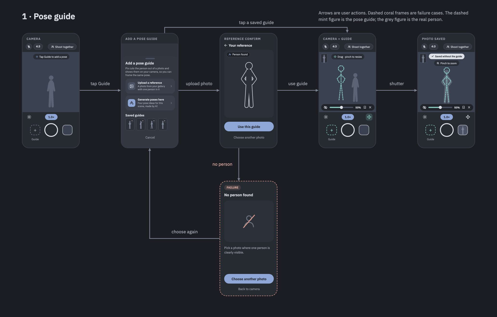

*Figure 1. Camera → Add a pose guide → Reference confirm → Camera + guide → Photo saved, with the "No person found" failure.*

한국어

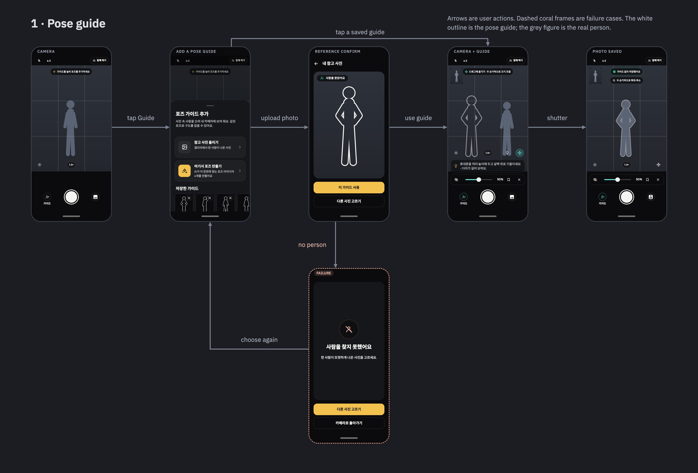

| Screen | Shows | Input → result | Not allowed / failure |
|---|---|---|---|
| **Camera** | Live preview with a 3×3 grid and centered horizon bar in the chosen aspect ratio; *Shoot together* (top); flash and aspect-ratio (4:3 / 16:9 / 1:1) buttons in the top bar; the applied zoom readout, with a brightness button beside it that opens a brightness slider in EV; *Guide*, shutter, gallery thumbnail (bottom); hint "Tap Guide to add a pose". | *Guide* → Add a pose guide · Shutter → Photo saved · *Shoot together* → Friends · Thumbnail → the last photo Pix saved, opened in the gallery app; disabled until Pix saves one · Pinch the preview → camera zoom while guide-edit mode is off · The readout's Zoom in / Zoom out accessibility actions → one zoom step · Tap the preview → focus and meter there · Aspect ratio, brightness, flash → applied to the preview and the next photo; each tap on the flash or ratio button moves to the next choice, and the last ratio is kept for the next time · Align phone → dark yellow horizon bar. | Permission denied → "Pix needs camera access to show the viewfinder and take photos. Allow camera access in Settings." with *Open settings*, and *Allow camera* while Android can still ask. Camera busy in another app → "Camera unavailable. Close other apps using the camera, check camera access, then try again." with *Try again*. Unknown horizon or no sensor → hide the bar, retain the grid. No flash hardware → no flash button. |
| **Add a pose guide** | Bottom sheet with "Pix cuts the person out of a photo and shows them on your camera, so you can frame the same pose.", *Upload a reference* ("A photo from your gallery with one person in it"), *Generate poses here* ("Four pose ideas for this scene, made by AI"), "Saved guides": a row of thumbnails, newest first, each with an ✕, hidden while there are none, and *Cancel*. With a guide on the camera, the sheet is titled "Replace the pose guide?", says "Choose a new reference, and its guide takes the place of the current one.", and *Cancel* reads *Keep the current guide*. | *Upload a reference* → system photo picker → Reference confirm · *Generate poses here* → Scene photo, after the Consent notice the first time (Flow 2) · Tap a saved guide → Camera + guide, the guide starting at its reference's place · ✕ on a saved guide → "Delete this saved guide?" ("It is removed from this phone. A guide on the camera stays there.") → *Delete* or *Cancel* · *Cancel* or swipe down → Camera. | Picker closed without a choice → Camera with the old guide kept. A saved guide that cannot be opened → "Couldn't open the saved guide." |
| **Reference confirm** | "Your reference" with a back arrow; the person as a white outline about 3 dp wide on a dark neutral card; "Finding the person…" while it works, then "Person found" at the card's corner. | *Use this guide* → Camera + guide · *Choose another photo* → picker · Back → Camera. | *Use this guide* is disabled until the person is found. No person → No person found. A photo that cannot be read, or a model that is not ready within 60 s → "Couldn't use this photo. Try another one." → Camera. |
| **Camera + guide** | Outline guide over the preview, starting where the person stands in the reference; hint "Drag · pinch to resize" while guide-edit mode is on, "Pinch to zoom" while it is off, and "Guide hidden" while hidden; a panel over the bottom of the preview with icon buttons *Hide* / *Show*, the guide opacity slider and its percentage, *Save guide* (filled once saved), and *Remove*; the reference thumbnail in a corner (top left at first); the row under the preview with the brightness button, the zoom readout, and the guide-edit mode toggle; if built, the guide color switch; for a generated pose, the tip banner above the panel and a light bulb in the top bar (FR-4.10); shutter. | With guide-edit mode on, drag or pinch anywhere in the camera image → move or resize the guide · Pinch with guide-edit mode off → camera zoom · Guide-edit mode turns on when a guide is added and off after the shutter · Opacity slider → fade guide · *Hide* → the guide disappears, with the hint "Guide hidden", until *Show* · *Guide* → Add a pose guide, which asks to replace the guide, and the new guide takes the old one's place · *Save guide* → stored on the phone, with a notice for 3 s: "Guide saved. Use it again from Guide.", "Guide saved. The oldest saved guide was removed to keep 20.", "This guide is already saved. Find it under Guide.", or "Couldn't save the guide. Check the phone's storage." · Thumbnail → enlarge, tap again to make it small · Drag the thumbnail → the nearest corner · Touch anywhere → the tip banner closes · Light bulb → it opens again · Shutter → Photo saved. | Size limited to 21–210% of the frame height. At least 20% of the guide stays on screen. A hidden guide cannot be edited. The thumbnail is never in photos or the live view. |
| **Photo saved** | "Saved without the guide" for 3 s; thumbnail updated; camera still live. | Thumbnail → gallery · Shutter → another photo. | Save failed → reason shown until the next photo; guide and camera unchanged. |
| **No person found** | Failure message: "Pick a photo where one person is clearly visible." | *Choose another photo* → picker · *Back to camera* → Camera, with any earlier guide unchanged. | — |

### 6.3 Flow 2 · Generate poses for this scene

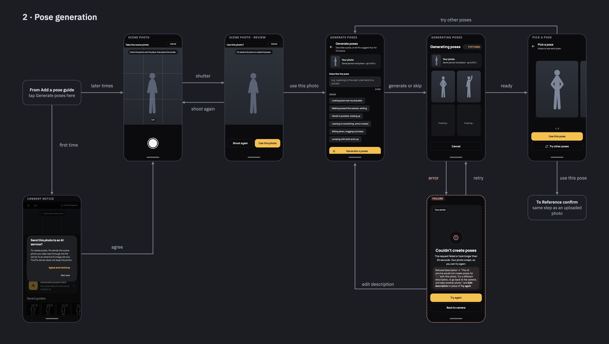

*Figure 2. Consent notice (the first time) → Scene photo → Scene photo · Review → Generate poses → Generating poses → Pick a pose → Reference confirm, with the "Couldn't create poses" failure. *Try other poses* goes back to Generate poses with the photo and the description kept, and so does *Edit description* when the service refused the description.*

한국어

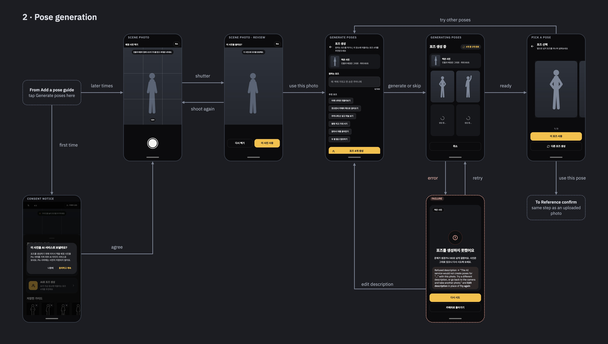

| Screen | Shows | Input → result | Not allowed / failure |
|---|---|---|---|
| **Consent notice** | A dialog over Add a pose guide, the first time only: "Send this photo to an AI service?"; that Pix sends the scene photo taken next through the Pix server to an external AI image service, and that the server does not keep it; *Not now* and *Agree and continue*. | *Agree and continue* → Scene photo, and the notice is not shown again · *Not now* → Add a pose guide. | Nothing is sent without consent (FR-4.2). |
| **Scene photo** | The Camera screen with "Take the scene photo" and *Cancel* in place of *Shoot together*; the preview, grid, zoom readout, and shutter as usual; "Frame the person and the place, then press the shutter." at the top of the preview; *Guide*, the thumbnail, any earlier guide and its panel, the reference thumbnail, the flash, aspect-ratio, and brightness controls, and the guide-edit mode toggle are hidden. | Pinch the preview → zoom, whatever guide-edit mode says · Shutter → Scene photo · Review, and nothing is saved · *Cancel* → Camera. | The shutter is disabled until the camera is ready. Tap to focus is off. Nothing is sent. A failed shot → "Couldn't take the photo. Try again." System back is *Cancel*. |
| **Scene photo · Review** | The same screen with "Use this photo?" and *Cancel*; the photo that was taken, in place of the preview; "Pix sends this photo to create the poses."; *Shoot again* and *Use this photo*. | *Use this photo* → Generate poses · *Shoot again* → Scene photo · *Cancel* → Camera. | No zoom while the photo is shown. Nothing is sent before *Use this photo*. System back is *Shoot again*. |
| **Generate poses** | *Cancel* as a back arrow; "Describe a pose, or let Pix suggest four for this place"; a thumbnail of the scene photo; idea chips; a description field for Korean or English with a "0/100" counter; after a refused description, "The last set was refused. Try a different description, or another photo." under the field; *Generate 4 poses*; *Skip, suggest poses for me*. | Tap a chip → its text replaces the field's · Type → the counter updates · *Generate 4 poses* → Generating poses with the description · *Skip, suggest poses for me* → Generating poses with poses suggested for the scene · *Cancel* → Camera. | Input stops at 100 characters. An empty field with *Generate 4 poses* asks for suggested poses. Nothing is sent before one of the two buttons. System back is *Cancel*. |
| **Generating poses** | The scene photo, labeled "Your photo" and "Same person and place · up to 60 s"; four slots that fill in as candidates arrive, "Couldn't create" in a slot that failed; "n of 4 ready" beside the title. "Choosing poses…" (suggested poses) or "Creating…" (a description) and no slots until the server has given the poses: the suggested poses, or the variations of a description. | *Cancel* → Camera · All four done (ready or failed) with at least one ready, or 60 s with at least one ready → Pick a pose. | Candidates cannot be selected until generation ends. No candidate, or an error → Couldn't create poses. |
| **Pick a pose** | "Pick a pose" with a back arrow and "Swipe to see each pose"; the candidates that were created, one at a time as large as the screen allows, without pose names, with the previous and the next showing at the sides; below, the position ("2 / 4", read by TalkBack as "Pose 2 of 4") unless only one was created. | Swipe → the next or the previous candidate, which becomes the selected one · Back (or system back) → Camera, and the candidates are discarded · *Use this pose* → Reference confirm (Flow 1) with the candidate on screen · *Try other poses* → Generate poses with the scene photo and the description kept. | The candidate on screen is always the selected one, so *Use this pose* works as soon as the screen opens; a candidate selected before the screen opens is the one shown. |
| **Couldn't create poses** | "The request failed or took longer than 60 seconds. Your photo is kept, so you can try again." and the scene photo. If the service refused every pose of a description: "The AI service would not create poses for “…” with this photo. Try a different description, or go back to the camera and take another photo.". | *Try again* → Generating poses with the same photo · after a refused description, *Edit description* in place of *Try again* → Generate poses with the text kept · *Back to camera* → Camera. | — |

### 6.4 Flow 3 · Add a friend by Pix ID

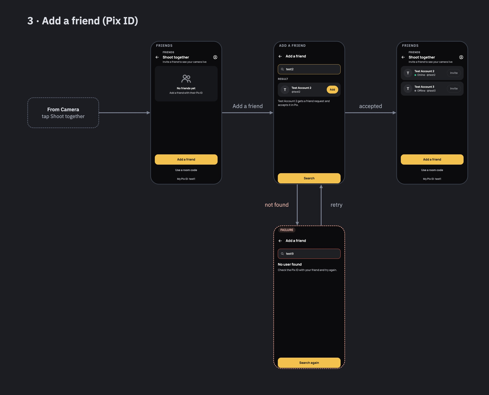

*Figure 3. Friends (empty) → Add a friend → Friends (list), with the "No user found" failure.*

한국어

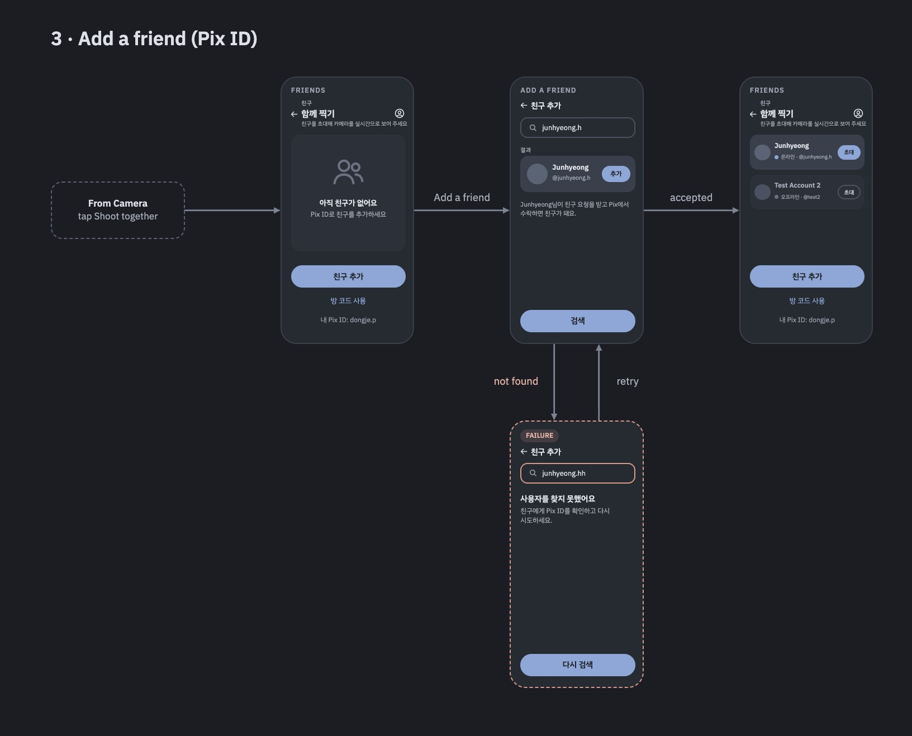

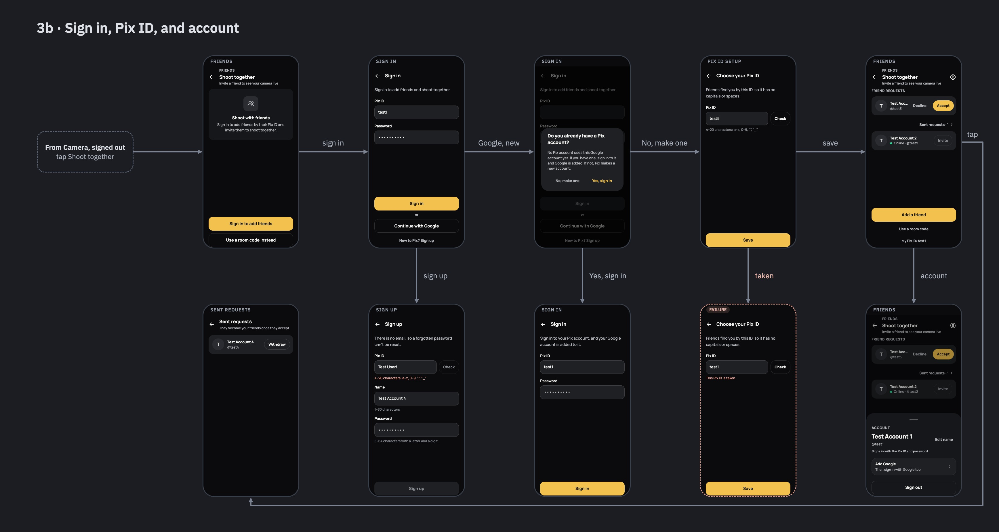

*Figure 3b. Friends (signed out) → Sign in → "Do you already have a Pix account?" → Pix ID setup → Friends with a request; below, Sent requests, Sign up with a broken rule, Sign in to add Google, "This Pix ID is taken", and the Account sheet.*

한국어

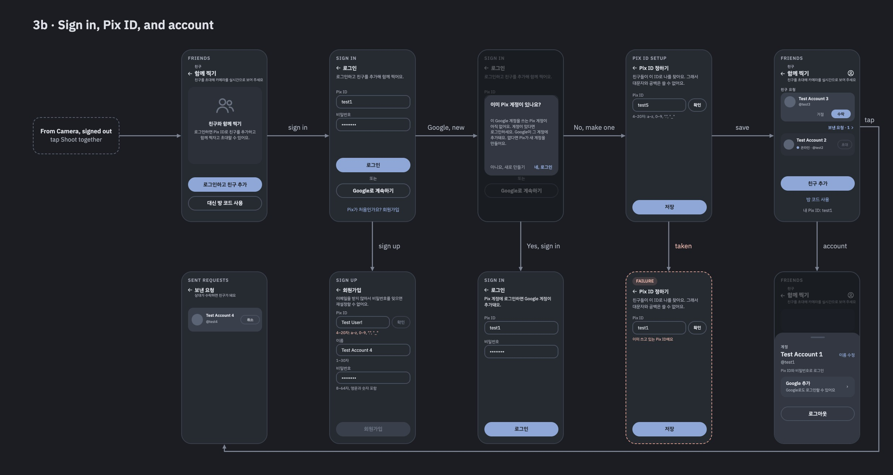

| Screen | Shows | Input → result | Not allowed / failure |
|---|---|---|---|
| **Friends (empty)** | A back arrow; "Friends" over "Shoot together · Invite a friend to see your camera live"; the account button; "No friends yet" and "Add a friend with their Pix ID"; *Add a friend*; *Use a room code*; "My Pix ID: dongje.p". | *Add a friend* → Add a friend · *Use a room code* → Room code (Flow 6) · The account button → Account · Tap own Pix ID → copied · Back arrow or system back → Camera. | No account yet → *Friends (signed out)*. |
| **Add a friend** | A back arrow; search field for a Pix ID ("Their Pix ID"); *Search* at the bottom ("Searching…" while it runs); result card with name, @ID, and *Add*; note "Junhyeong gets a friend request and accepts it in Pix." | Type an ID and *Search* → result or No user found · *Add* → "Requested" with *Withdraw request* · *Withdraw request* → *Add* again · *Accept* (a request they sent) → friends · Back → Friends. | Characters other than a–z, 0–9, ".", "_" are not accepted. Search is disabled while the field is empty. Own ID → "This is you", an existing friend → "Friends", a request the user sent → "Requested" with *Withdraw request*, a request the other person sent → *Accept*, instead of *Add*. A failed search → its reason under the field. |
| **Friends (list)** | Friend rows with name, "Online · @id" or "Offline · @id", and *Invite*; *Add a friend*; *Use a room code*; "My Pix ID: …"; once invitations are built ([#119]), "Works on Wi-Fi or cellular data". | *Invite* → Invite sent (Flow 4) · *Add a friend* → Add a friend · *Use a room code* → Room code (Flow 6) · Long-press a friend → *Remove friend* → "Remove Junhyeong?" ("You won't see each other in your friend lists. You can add each other again later.") → *Remove friend* or *Cancel*. | Friend already in a session → "&lt;name&gt; is in another session". |
| **No user found** | A state of *Add a friend*: the field in red, "No user found", and "Check the Pix ID with your friend and try again."; *Search* reads *Search again*. | *Search again* → the field, with the text kept · Back → Friends. | — |
| **Friends (signed out)** | "Shoot together · Invite a friend to see your camera live"; "Shoot with friends: Sign in to add friends by their Pix ID and invite them to shoot together." | *Sign in to add friends* → Sign in · *Use a room code instead* → Room code (Flow 6) · System back → Camera. | An account made with Google without a Pix ID sees "Choose your Pix ID" and *Choose a Pix ID* → Pix ID setup instead. |
| **Friends (requests)** | Received friend requests above the friend list, each with name, @ID, *Accept*, and *Decline*. Lists refresh every 10 s while the screen is shown; online friends show "Online"; "In a session" shows once a session's own connection is signed in ([#119]), and until then a friend in a session shows "Online". "Sent requests · 2" above the list while requests the user sent wait for an answer (FR-5.16). | *Accept* → the friend joins the list · *Decline* → the request disappears (US-8) · *Sent requests · 2* → Sent requests. | A request already withdrawn → "This request is no longer there." A failed refresh → "Couldn't update your friends. Check your connection." above the list. A sign-in the server ended → "You were signed out. Sign in again to see your friends." *Invite* stays disabled until invitations are built ([#119]). |
| **Sign in** | Pix ID and password fields; *Sign in*; *Continue with Google*; "New to Pix? Sign up". | *Sign in* → Friends (or Pix ID setup for an account without one) · *Continue with Google* → Google's account chooser → Friends, or "Do you already have a Pix account?" · *Sign up* → Sign up · *Back* → Friends. | *Sign in* is disabled until both fields are filled. A wrong Pix ID or password → "The Pix ID or the password is wrong." |
| **"Do you already have a Pix account?"** | A dialog after a Google account that no Pix account uses (FR-5.13). | *Yes, sign in* → Sign in, now saying the Google account is added once the person signs in, without Google and *Sign up* · *No, make one* → a new account → Pix ID setup. | Closing it forgets the Google account. |
| **Sign up** | Pix ID, name, and password fields, each with its rule under it: "4–20 characters: a–z, 0–9, ".", "_"", "1–30 characters", "8–64 characters with a letter and a digit"; "There is no email, so a forgotten password can't be reset." *Check* beside the Pix ID field (FR-5.15). | *Sign up* → Friends, signed in · *Back* → Sign in · *Check* → "Checking…", then "test5 is available" or "This Pix ID is taken" under the field, until the field changes. | A broken rule turns red and *Sign up* stays disabled (US-6); a password equal to the Pix ID says so; a taken Pix ID → "This Pix ID is taken" under the field, with the input kept. *Check* is disabled until the Pix ID follows the rule; no answer → "Couldn't reach Pix. Check your connection and try again." under the field. |
| **Pix ID setup** | "Choose your Pix ID"; one field with the rule under it, and *Check* beside it. | *Save* → Friends · *Back* → Friends, which asks again · *Check* → as on Sign up. | As on Sign up: the rule in red and *Save* disabled; "This Pix ID is taken" with the input kept (US-6). |
| **Sent requests** | "Sent requests · They become your friends once they accept"; each request the user sent and nobody answered yet, with name, @ID, and *Withdraw*; "No sent requests" and "Requests you send stay here until they're answered" when there are none. The list refreshes every 10 s while the screen is shown (FR-5.16). | *Withdraw* → the request leaves the list · *Back* → Friends. | A request answered in the meantime → "This request is no longer there.", and it leaves the list. A failed refresh → "Couldn't update your friends. Check your connection." Signed out → Friends. |
| **Account** (sheet) | The name with *Edit name*, the @ID, how the account signs in, *Add Google* (without Google) or *Add a password* (a Google account with a Pix ID), and *Sign out*. | *Edit name* → a dialog with the name rule · *Add Google* → Google's account chooser · *Add a password* → a dialog with the password rule · *Sign out* → Friends (signed out). | Google already used by another account → "Another Pix account uses this Google account." |

### 6.5 Flow 4 · Shoot together, photographer's phone

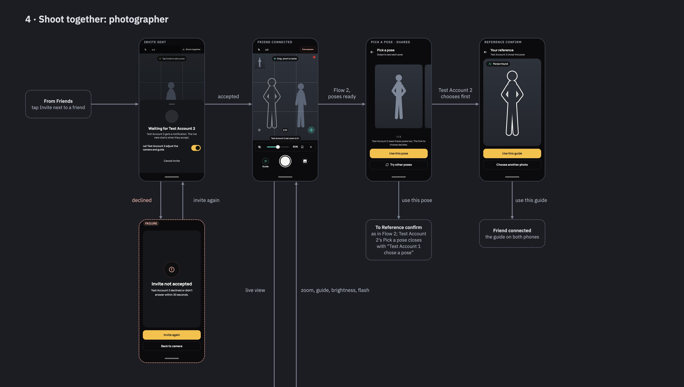

*Figure 4. Invite sent → Friend connected, with the "Invite not accepted" failure. The vertical arrows lead to the subject's phone (Flow 5). Invite sent and Invite not accepted are not built yet (Iteration 3).*

한국어

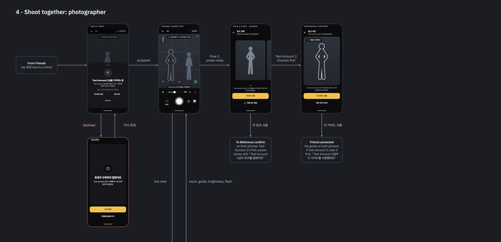

| Screen | Shows | Input → result | Not allowed / failure |
|---|---|---|---|
| **Invite sent** | "Waiting for Junhyeong"; "Junhyeong gets a notification. The live view starts when they accept."; *Share invite link* and *Copy link* under "No notification? Send a link instead."; if built (Could), the toggle "Let Junhyeong adjust the camera and guide" (on by default). | *Share invite link* → Android share sheet with the link · *Copy link* → copied · Toggle → allow or block remote control · *Cancel invite* → Friends · Friend accepts, from the notification or the link → Friend connected. | Declined or no answer in 30 s → Invite not accepted. |
| **Friend connected** | Camera + guide with the badge "Live · Junhyeong connected"; notices for remote actions ("Junhyeong set zoom to 2×", "Junhyeong moved the guide", "Junhyeong set brightness to +0.7", "Junhyeong turned the flash on" or "off", "Junhyeong set the flash to auto"); *End session* in place of *Shoot together* (top). | All camera and guide inputs from Flow 1 · *End session* → Camera alone, and the subject is told · Remote zoom, guide moves, brightness, and flash from the subject → applied here and echoed back. | Subject leaves or disconnects → notice "Junhyeong left" or "Junhyeong disconnected" for 3 s; the camera keeps working. |
| **Invite not accepted** | "Junhyeong declined or didn't answer within 30 seconds." | *Invite again* → Invite sent · *Back to camera* → Camera. | — |

### 6.6 Flow 5 · Shoot together, subject's phone

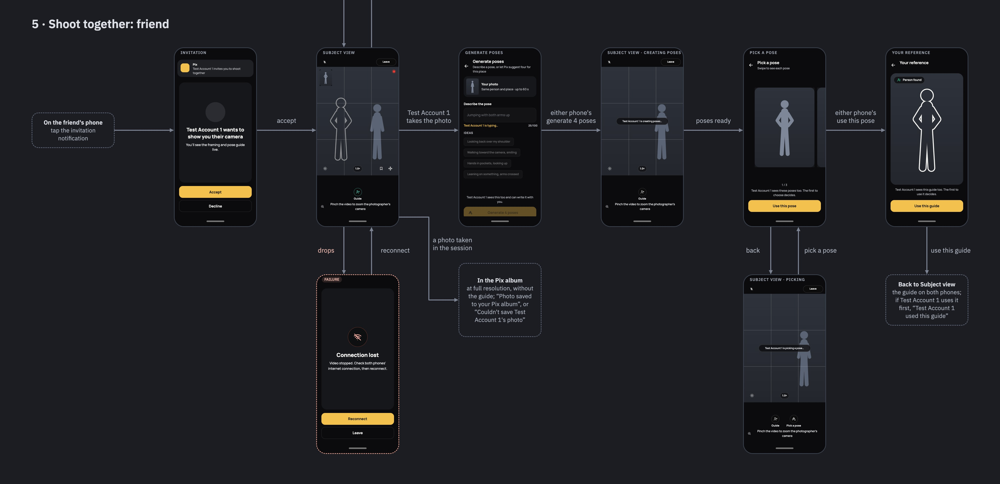

*Figure 5. Invitation → Subject view, with the "Connection lost" failure. Invitation is not built yet (Iteration 3).*

한국어

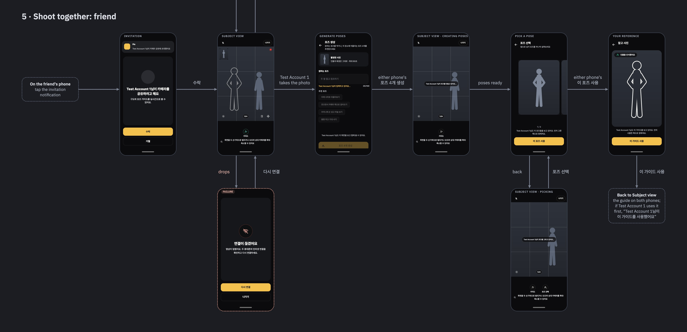

| Screen | Shows | Input → result | Not allowed / failure |
|---|---|---|---|
| **Invitation** | Opened from the notification "Dongje invites you to shoot together" or from an invite link; "You'll see the framing and pose guide live." | *Accept* → Subject view · *Decline* → closes, and the photographer sees Invite not accepted. | Expired or cancelled → "This invitation is no longer available" (screen to be drawn). |
| **Subject view** | Photographer's live camera in the photographer's aspect ratio, with the 3×3 grid and the synced guide; "Dongje's camera" (the name the photographer's phone sends); *Leave*; "Pinch the video to zoom the photographer's camera"; the flash button at the top left; a row under the video with the brightness button, which opens a brightness slider in EV, the ratio readout, and the guide-edit mode toggle; "Connecting…" until the session is connected, and "The photographer's camera is paused." after 2 s without video. No shutter. | Pinch the live video while guide-edit mode is off, or the readout's Zoom in / Zoom out action → photographer's zoom; during a pinch the local readout follows the request, then settles on the applied echo · With guide-edit mode on, drag or pinch the guide → it moves or resizes on both phones · Brightness slider or flash button → applied to the photographer's camera · (Could, It 3) tap the live video → photographer's focus · *Leave* (or system back, then confirm) → own Camera · The photographer ends the session → "Dongje ended the session" → own Camera. | The guide's opacity, hiding, and replacing cannot be changed here. Remote control blocked (if the switch is built) → controls disabled with a message. Connection lost → Connection lost. |
| **Connection lost** | "Connection lost"; "Video stopped. Check that both phones are on the same Wi-Fi, then reconnect."; "Connecting…" while it reconnects. | *Reconnect* → Subject view if the session is still open, otherwise "The session has ended." → Camera · *Leave* → Camera. | *Reconnect* is disabled while it reconnects; another failure keeps the screen, with *Reconnect* enabled again. |

### 6.7 Flow 6 · Room code

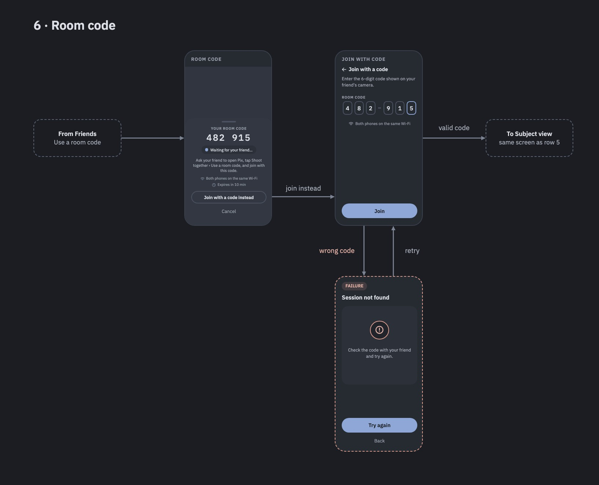

*Figure 6. Room code → Join with code → Subject view, with the "Session not found" failure. It opens from *Friends*: *Use a room code instead* when signed out, *Use a room code* under the friend list. Subject view is as in Flow 5.*

한국어

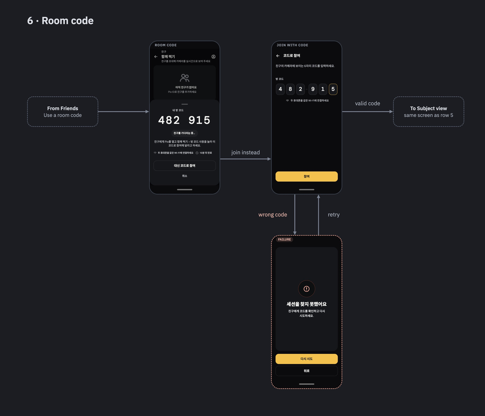

| Screen | Shows | Input → result | Not allowed / failure |
|---|---|---|---|
| **Room code** | A sheet over Camera: "Your room code"; "Ask your friend to open Pix, tap Shoot together › Use a room code, and join with this code."; 6-digit code ("482 915"); "Both phones on the same Wi-Fi" and "Expires in 10 min"; "Getting a code…", then "Waiting for your friend…", then "Your friend joined · connecting…". | *Cancel* → Camera, and the code expires · *Join with a code instead* → Join with code, and this phone's code is cancelled · Friend joins → Friend connected (Flow 4). | Nobody joins in 10 minutes → "The code expired. Tap Use a room code again for a new one." No server → "Couldn't connect. Make sure both phones are on the same Wi-Fi." |
| **Join with code** | A back arrow; "Join with a code"; "Enter the 6-digit code shown on your friend's camera."; "Room code" over six digit boxes, with the number keyboard open; "Both phones on the same Wi-Fi"; "Connecting…" while it joins. | Enter 6 digits and *Join* → Subject view (Flow 5) · Back → Camera. | Letters are not accepted. *Join* is disabled until 6 digits are entered. The session cannot be reached → "Couldn't connect…"; from another network the join opens Subject view (FR-8.5). |
| **Session not found** | "Session not found"; "Check the code with your friend and try again." | *Try again* → Join with code, with the code kept and selected for editing · *Back* → Camera. | — |

### 6.8 Screens still to be drawn

These screens follow from the requirements above but are not yet in the wireframe. Each is added before the iteration that builds it.

| Screen | Purpose | Requirement |
|---|---|---|
| Camera permission denied | Explain why the camera is needed; *Open settings*. Built in Iteration 1; the wireframe is still to be drawn. | FR-1.2 |
| Invitation no longer available | Shown when an expired or cancelled invitation is opened. Iteration 3, with invitations. | FR-6.4 |
| Invite sent (update) | *Share invite link* and *Copy link*; the remote-control toggle only if it is built. Iteration 3, with invitations. | FR-6.1, FR-6.2, FR-7.5 |
| Subject view, control blocked | Disabled remote controls with the reason. Could item, Iteration 3. | FR-7.5 |
| Selfie mode, Settings, and the tutorial | The front camera; the settings screen with the language, the guide's color and thickness, the latency indicator, and help; the first-use tutorial. Iteration 3. | FR-1.14, FR-10.1–10.4 |
| Show QR, Scan QR, Connected | The QR code and hotspot status; the scanner; both phones confirm with *Resume*. Iteration 3. | FR-9.1–9.4 |
| Prompt history | Past descriptions on *Generate poses*, the toggle between all and with this person, and ✕ to delete. Iteration 3. | FR-4.11 |
| Subject view, choosing the pose | *Guide* and *Generate poses here* on *Subject view*, and the same step on both phones. Iteration 3. | FR-6.15, FR-6.16 |

### 6.9 Rules for every screen

- **Portrait only.** Every screen is designed for one-handed portrait use.
- **System back** does the same as the screen's secondary action (*Back* or *Cancel*). On *Subject view*, it first asks "Leave the session?".
- **Waiting states** always say what the app is waiting for and how long it may take, and offer *Cancel*.
- **Failure screens** always state what happened in plain words, offer a primary retry, and offer a way back. No screen is a dead end.
- **The guide** is drawn only inside the camera image, as an outline of the person that never shows the reference's pixels or background, so it is not mistaken for a control or for the scene: a white line about 3 dp wide, with no fill (Design 2.6.1).
- **Language.** The UI is in English and Korean, following the phone's language unless the settings screen chooses one (FR-10.2).

---

## 7. Assumptions, Constraints, and Out of Scope

**Assumptions**
- Both people have an Android phone with Pix installed.
- The photographer's phone has a rear camera. Multiple lenses are optional.
- Pose generation, friends, and invitations need an internet connection. Friends and invitations also need a Pix account, made with a Pix ID and a password or with Google. The camera and gallery guides work offline, and from Iteration 3 two phones can connect offline with a QR code (F9).

**Constraints**
- The image-editing API has usage costs and rate limits. Pix uses OpenRouter's Image API, which bills each generated image, so the server limits how many poses one network address can request per hour (phones behind one Wi-Fi or carrier address share the limit), and, separately, how many pose suggestions it can ask for. It also limits how many poses all phones together can request in a day, because pose generation needs no account.
- The Pix server runs on the two course-provided servers with Docker and nginx, one for the stable build and one for development. They are reachable only over HTTP on port 80, so there is no HTTPS or WSS (NFR-14), and they cannot host a TURN relay, so sessions across networks use a managed relay service (Cloudflare). Until the course servers can be reached from outside the campus network, a temporary server on AWS with the same setup serves the user test and sessions across networks. GitHub hosting serves only static pages and cannot run the server.
- Development follows the course schedule: about 10 hours of work per member per iteration.

**Out of scope**
- iOS, tablets, and landscape layouts.
- Video recording and sessions with more than two phones.
- Scoring how well the pose matches, and automatic capture.
- Taking the photo from the subject's phone; the photographer always takes the photo.
- Beauty filters and photo editing.
- Public profiles or a social feed.
- Running the generative model on the phone.
- Choosing the image model in the app, because it would show our costs; the model stays a server setting.
- A guide that keeps the reference's background.
- Lines inside the outline for arms and legs in front of the body, such as folded arms (Design 2.6.1).
- Video, until the remote session is stable; it is not planned before Iteration 5.

---

## 8. Glossary

| Term | Meaning in this document |
|---|---|
| **Photographer** | The person holding the phone that takes the photo. |
| **Subject** | The friend in the photo, who joins the session from their own phone. |
| **Reference** | The photo that shows the desired pose: a gallery photo or a selected pose candidate. |
| **Guide** | The person from the reference drawn over the camera preview as an **outline**, without the reference's pixels or background: a white line about 3 dp wide, with no fill. |
| **Reference thumbnail** | A small copy of the reference photo in a corner of the Camera screen, so the photographer still sees the original pose. |
| **Idea chip** | A short preset pose description on *Generate poses* that fills the description field when tapped. |
| **Suggested pose** | One of four poses that the Pix server chooses for a scene photo when the user wrote no description; each becomes one pose candidate. |
| **Prompt template** | One of four ways the Pix server's prompt asks for the user's description, so that the four pose candidates differ. |
| **Pose tip** | A short hint on how to take the pose the user took: getting closer or back, the phone's height, and its angle. |
| **Prompt history** | The descriptions the user wrote before, shown on *Generate poses* for all sessions or for the current partner. |
| **Invite link** | A link to an invitation that the photographer shares when the push notification does not arrive; it opens the same *Invitation* screen (Iteration 3). |
| **Pose candidate** | One of four images generated from the scene photo, showing the same person and place in a different pose. |
| **Session** | A live connection between one photographer's phone and one subject's phone. |
| **Live view** | The photographer's camera image as shown on the subject's phone. |
| **Remote control** | The subject adjusting the shot from their own phone: the zoom, the guide's position and size, the brightness, and the flash. Either person can move and resize the guide. The photographer always takes the photo. |
| **Pix ID** | A unique user name, such as "junhyeong.h", that friends use to find each other. |
| **Room code** | A 6-digit code that connects two phones on the same Wi-Fi without an account. |
| **Relay** | A TURN service (Cloudflare's managed relay) that forwards the encrypted live view when the two phones cannot connect directly, for example on cellular data (Iteration 3). |
| **QR connection** | Connecting two phones without internet: the photographer's phone creates a local hotspot and shows its details as a QR code, which the subject scans (Iteration 3). |
| **Saved guide** | A guide stored on the phone to reuse later. |

[#51]: https://github.com/snuhcs-course/swpp-2026-project-team-10/issues/51
[#52]: https://github.com/snuhcs-course/swpp-2026-project-team-10/issues/52
[#53]: https://github.com/snuhcs-course/swpp-2026-project-team-10/issues/53
[#54]: https://github.com/snuhcs-course/swpp-2026-project-team-10/issues/54
[#96]: https://github.com/snuhcs-course/swpp-2026-project-team-10/pull/96
[#108]: https://github.com/snuhcs-course/swpp-2026-project-team-10/pull/108
[#110]: https://github.com/snuhcs-course/swpp-2026-project-team-10/pull/110
[#111]: https://github.com/snuhcs-course/swpp-2026-project-team-10/issues/111
[#114]: https://github.com/snuhcs-course/swpp-2026-project-team-10/issues/114
[#115]: https://github.com/snuhcs-course/swpp-2026-project-team-10/issues/115
[#119]: https://github.com/snuhcs-course/swpp-2026-project-team-10/issues/119
